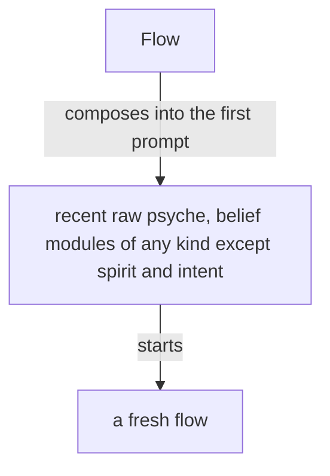
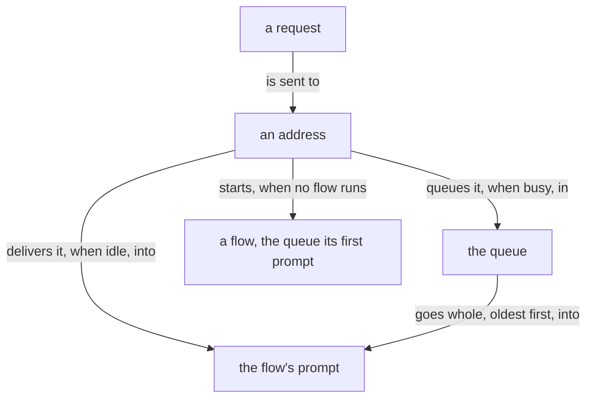
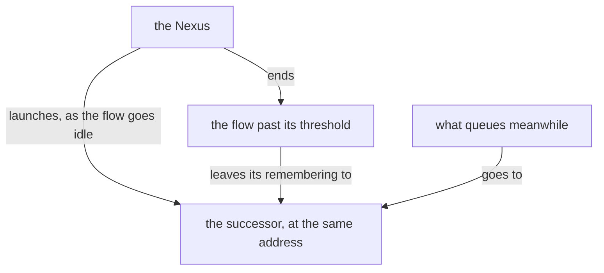

Presentation.{ «The Flow Nexus, version 1» }

# The Flow Nexus, version 1

### Proposal 1: What holds in every version · psyche-belief › vision/flow-nexus.md

**Comment** The module keeps what holds in every version. Its version-0 lines go to vision:short:flow-nexus, the sleeping, the waking and the further shapes of a flow to vision:long:flow-nexus. Gone: the one-model paragraph; the id taken from the harness session id and lengthened on collision; the real-world test, said under Versions in version 1; what a refresh carries, which is vision:remembering's.

- ---
- description: The Flow Nexus — the Nexus that launches, names, tracks and ends flows — or a metaflow, a side flow, a hook or the Capsule is being designed or judged against what the living wants.
- dependencies: [vision-nexus, vision-ethos]
- ---
+ ---
+ description: The Flow Nexus — the Nexus that starts, messages, refreshes and ends flows — is being designed or judged, in what holds for every version.
+ dependencies: [vision-nexus, vision-ethos, vision-aspects]
+ ---

  ## What it does

  The Flow Nexus sets up and starts a model flow: its working
  directory, system prompt, training files and instruction prompt.

- The Flow Nexus is the Nexus that manages flows. A flow is one run of a metaflow; the component is named for what it manages. A flow the living asks for is launched, properly and surely. The Flow Nexus holds the lock on flows.
+ The Flow Nexus is the Nexus that manages flows. A flow the living asks for is launched, properly and surely.

  The Flow Nexus is for starting flows cheaply: clean flows, specialized flows and refreshed flows, each with a clean on-point context, which yields higher-quality output. A flow is taken down as easily as it is started. Starting flows is the cornerstone of the system.

- A flow runs one model, linear and very limited, and the model is not always a language model: it may be a System 1 model, an audio model or a video model. An agent is a whole being, a lot more than that. Many flows, properly structured and orchestrated, together resemble a synthetic intelligence, synthesized from human knowledge and mathematical probability.

- The Capsule is the component that makes where a flow runs. Its first embodiment is the semi-sandbox: only the credential files are copied, everything else is recreated, with its own sockets and store, running light models. Later it encrypts the sensitive parts of the filesystem under a volatile key.

- Herdr is one backend of the Capsule, the component that gives a flow its place to run; the backend may be exchanged.

- The Flow Nexus manages metaflows. A metaflow is one address, { Aspect Topic Layer }, that continues through several flows one after another; the flow is its current run, and what is addressed is always the metaflow. The default topic is core: the permanent topic, the thing that keeps the machine going, the last topic to stand.

- A topic is an open enum: the constant topics, core among them, are fixed, and the users and the machine extend the set with camelCase identifiers.

- A topic lives on; when idle, its flows are turned off. When the living touches on it again, whether to wake a flow for it, and at which layer, is a judgment, made by a small model; a topic is bound to its belief modules, so the Flow Nexus knows what to start it with, together with the new input that warrants it.

- A metaflow sleeps so that a session not running keeps no harness: as soon as its turn ends and the harness is idle, with nothing waiting in its queue, the harness closes; the transcript stays and the address stays.

- A topic's name is a camelCase identifier, uncapitalized. A flow's id is the hash of the harness's session id, kept to six characters and lengthened when two collide, so a transcript is found from the flow id. Long term, the flow id is also written in three words, which convert back to the hash. Every call to the Flow Nexus is identified by the calling process. Anybody may call the Flow Nexus, a flow for its own refresh among them: because the CLI checks the calling process, a flow refreshes itself safely.

- In the chat a flow is named by its metaflow, and the flow id almost disappears from it; the id is for the ledger and for finding the transcript.

- A request reaching a metaflow is one of a closed set of types, each with its waking effect: an order, a question, the living's words, a result, a notice. Message asks the Flow Nexus to send a request to a metaflow; the Flow Nexus owns the lock and the delivery, answers sent or queued, and Message subscribes to the Flow Nexus's events, learning when a request has entered the flow's context. A metaflow asleep is woken by an order, a question or the living's words and receives its whole queue, oldest first, in the first prompt, a result or a notice waiting there until a waking; a metaflow under refresh or waking queues what arrives until its successor or woken seat has started, while the Flow Nexus keeps serving every other request. A metaflow a request needs is started whether or not it is running; with no working transcript to reawaken, it is fed the metaflow's belief modules and the prompt it is to get now.

- A flow woken for a metaflow is almost always a fresh flow, an old one only when the new input is literally the continuation of that topic.

- What has been queued for an idle metaflow, the vision touching its topic among it, is injected with the request that wakes it, so the flow knows it as soon as it wakes.
- A metaflow wakes when a request needs it; what touches its topic queues until then.

- The Flow Nexus exposes everything from the harness, the bare input: a flow is started, stopped and sent a message through the Flow Nexus, and Message makes use of it. Message is the send path: a flow asks Message to send, Message asks the Flow Nexus to deliver and subscribes to the Flow Nexus's events.

  The flow that finishes messages the flow that needs to know.

  A flow gives a presentation, a response that could fit into a book, whenever it is given significant new context to consider: its first turn ends in one, and so does every task, goal or question that originates in the living. A message from another flow that only updates it is answered with a short note. A presentation takes its form from the belief modules the flow was loaded with and from its prompt, the one string given to that flow alone, which is no belief module.

+ ## Address

+ A flow is addressed by { Aspect topic Layer }. A topic's name is a camelCase identifier, uncapitalized. A flow's title is one datom struct of its aspect, topic, layer and flow id: { Psyche core Secondary <id> }.

+ In the chat a flow is named by its address, and the flow id almost disappears from it; the id is for the ledger and for finding the transcript.

+ Every call to the Flow Nexus is identified by the calling process. Anybody may call the Flow Nexus, a flow for its own refresh among them: because the CLI checks the calling process, a flow refreshes itself safely.

  ## Starting flows

  A Nexus component decides the system prompt and everything about a
  launch, replacing the harness's subagents with specialized harnesses
  launched with specialized system prompts.

- A layer is Primary, Secondary, Tertiary or Quaternary, in every aspect; the layer decides the model. A launch names the metaflow, the belief modules composed into its prompts, and a brief of a small paragraph; the Nexus composes the prompt from its module registry.
+ A layer is Primary, Secondary, Tertiary or Quaternary, in every aspect; the layer decides the model.

- The Flow Nexus's configuration holds, for each metaflow, its purpose and the records of the living it rests on, beside its modules; the Flow Nexus composes them with the brief into the first prompt, and the instruction for the first response belongs to that composition.

  A fresh flow's first prompt carries the raw psyche relevant to it and recent, together with the belief modules relevant to it, of any kind except spirit and intent, which sit in the system prompt.



- A fresh flow starts with every belief module its metaflow is bound to, all loaded at its start: much of it in its system prompt, the rest in its first prompt, or in as many prompts as it takes, sent one right after another, so that its start is one model call.
+ A fresh flow starts with every belief module its address is bound to, all loaded at its start: much of it in its system prompt, the rest in its first prompt, or in as many prompts as it takes, sent one right after another, so that its start is one model call.

- A simplified flow is a kind of flow made for judgment alone: it starts with a system prompt of its own, it has no regular tool, and its response is its message.

- A flow is specified whole, in Datom, by a domain-specific language in Ethos: its system prompt, its default belief modules and its variations. The flow ethos holds the specification.

- Short term, the Secondary starts first, then its Primary.

- Long term, a Primary is a simplified flow, used only to render judgment: guiding a design or posing questions.

  The system prompt is composed of modules of several types, and what a harness calls a skill overlaps with them.
  Its anatomy is drawn up in ethos from a study of system prompts of every kind, each line placed by what it is and by the kind of guidance it belongs to.
  Where the harness allows it, a part of a main flow's system prompt is the main flow's alone and is not passed down to its subagents.

- Every flow has a topic; a flow with no special topic has the topic core, the heart of its aspect. A topic is a core:Name, a camelCaseExpression checked when created. A flow's title is one datom struct of its aspect, topic, layer and flow id: { Psyche core Secondary <id> }.
+ Every flow has a topic; a flow with no special topic has the topic core, the heart of its aspect.

+ A request reaching an address is one of a closed set of types: an order, a question, the living's words, a result, a notice.

  Who speaks to whom, within an aspect and across aspects at the same layer in a shared topic, is the vision-aspects skill's. The Flow Nexus refuses a request that leaves those routes.

  ## Repository and belief modules

  The flow repository holds the machinery of the Flow Nexus and is a runtime repository.
  Every belief module lives outside it, the basic modules included, so that a module changes live.
  The basic modules give our own take on how an agent behaves in a harness, replacing the prompt the harnesses build in.

- Every harness event reaches the Flow Nexus through the harness's hooks calling the Flow CLI, so the Flow Nexus knows each flow's state as it changes; a marked block landing in a transcript becomes an action, a book among them; a flow past its context threshold is refreshed as it goes idle. A poller that must exist is registered and reported.
+ Every harness event reaches the Flow Nexus through the harness's hooks calling the Flow CLI, so the Flow Nexus knows each flow's state as it changes. A poller that must exist is registered and reported.

- A flow is refreshed when its context passes its model's threshold: the Flow Nexus keeps the metaflow's next messages for its next flow, and the flow is replaced as it goes idle; while the refresh runs the metaflow is locked, and the predecessor is reaped in the same event. Each model's threshold is configured in the Flow Nexus.
+ A flow is refreshed when its context passes its model's threshold, as it goes idle. Each model's threshold is configured in the Flow Nexus.

  A flow refreshes before compaction; a compaction is a refresh that was missed.

  A flow that keeps working without being given more work may compact. Its compaction raises a warning, and a flow investigates why it worked so long, so that the trouble is brought to the living or Psyche reconsiders the approach and gives guidance.

- An ephemeral flow is a continuous job flow that does not wake back up: it takes jobs while it runs, up to a ceiling on its context, and past the ceiling it is given no new job and another ephemeral flow takes it.

  ## A superseded flow is closed

  An abandoned, duplicated or superseded flow is closed, archived and deregistered.

- ## Herdr holds the panes

- Herdr is the third-party terminal workspace every flow runs in, one pane per flow. Herdr is used as it is.

- ## A real-world test of the Flow Nexus

- A build of the Flow Nexus is tested in a testing capsule of its own: its own Herdr pane and session, the testing store, built in Nix. In it, several cheap, low-effort Codex and Claude flows message one another and start flows. The test shows whether the prompts, the system prompts and the tools are right, and which features are missing. Its findings return to the reimplementation, which is tested again.

- The stable Flow Nexus keeps running while variants are tested.

  ## A permission prompt is a launch failure

  A permission prompt reaching the living is a launch failure.

- ## The heartbeat

- The heartbeat reminds every flow it reaches to judge its own sanity, by these signs: an echo chamber, where the same question or claim goes round between flows and comes back; jargon and nonsense increasing; an acknowledgement answering an acknowledgement. The counts the heartbeat carries, awake metaflows, working panes, messages sent and queue growth per metaflow, are evidence under the reminder; the judgment is the flow's.

- The heartbeat reaches only a flow for which something changed that bears on it.

- The number of running flows is kept low: a topic flow no longer used is retired.

- ## Restarting without waking

- A flow can be restarted without being woken: its harness closes, its transcript stays, and its successor runs when a message wakes it. A flow can also restart itself. A restart meant to leave the flow asleep is done from outside; what arrives queues for its successor.

- ## What a refresh carries

- A refresh carries the flow's important presentations and illustrations, the raw psyche given to it, and the basic skills. The basic skills are everything a flow needs.

### Proposal 2: Version 0, as it runs today · psyche-belief › vision/short/flow-nexus.md, a new file

**Comment** Version 0's compromises, each line from vision:flow-nexus as it stands, the metaflow of the old sense now the address.

+ ---
+ description: Flow Nexus version 0, as it runs today, is being fixed or used: its short-term compromises.
+ dependencies: [vision-flow-nexus]
+ ---

+ ## Version 0 takes fixes

+ Version 0 keeps taking fixes while version 1 is built.

+ ## The send path

+ The Flow Nexus exposes everything from the harness, the bare input: a flow is started, stopped and sent a message through the Flow Nexus. Message is the send path: a flow asks Message to send, Message asks the Flow Nexus to deliver and subscribes to the Flow Nexus's events, learning when a request has entered the flow's context. The Flow Nexus holds the lock on flows.

+ ## Starting

+ Short term, the Secondary starts first, then its Primary.

+ The Flow Nexus's configuration holds, for each address, its purpose and the records of the living it rests on, beside its modules; the Flow Nexus composes them with the brief into the first prompt, and the instruction for the first response belongs to that composition.

+ A marked block landing in a transcript becomes an action, a book among them.

+ ## Where a flow runs

+ Herdr is the third-party terminal workspace every flow runs in, one pane per flow. Herdr is used as it is.

+ The Capsule is the component that makes where a flow runs. Its first embodiment is the semi-sandbox: only the credential files are copied, everything else is recreated, with its own sockets and store, running light models.

### Proposal 3: Version 1 · psyche-belief › vision/medium/flow-nexus.md, a new file

**Comment** The bare proposal with your comments of 2026-10-30 in: the permaflow is named on the user side and the Nexus works with flows and addresses; the Nexus gives a flow its id and keeps the harness session id beside it, nothing lengthened; the one-model paragraph is gone. Each operation reads as an actor. Under Versions it names vision:versioning and adds the refill of a fresh store by a cheap flow, which the meta signal makes possible by being complete over Memory. The harness datom is Claude Code 2.1.294 as installed today: its tool names and the opening words of their texts were read from the harness binary, and the command's flags are the harness's own.

+ ---
+ description: Flow Nexus version 1, the full rewrite, is being designed or built: how it starts, messages, refreshes and ends flows, and how it is tested and upgraded.
+ dependencies: [vision-flow-nexus, vision-nexus, vision-aspects, vision-signal, vision-memory, vision-versioning]
+ ---

+ ## Address

+ Inside the Nexus the unit is the flow: one harness session, one id, one address, { Aspect topic Layer }. The permaflow, the flows that have run at one address one after another, is named on the user-facing side; the Nexus works with flows and addresses.

+ The Nexus gives each flow its id, six characters, and records beside it the harness's session id, so the transcript is found from the flow id. The Nexus tells a flow its id and its address in its system prompt.

+ ## Start

+ A launch names an address, a remembering and a brief. The Nexus composes the flow's prompts from the belief modules declared for that address. A flow's tools and prompt are the harness's, less its blacklist. The Capsule gives the flow its place to run, one Herdr pane.

+ ## Message

+ A request is sent to an address and the Nexus delivers it into the flow's prompt. When the flow is busy, the request queues and is delivered when the flow is idle, the queue whole and oldest first; when no flow is running at the address, one is started with the queue as its first prompt. The living's words, a comment among them, reach a flow by this path.



+ A message lands in the flow's prompt as one datom: the sender's address, the kind and the words. Because the form is fixed, a transcript is searched for the living's words by it.

+ ## The harness

+ The harness's own system prompt is reproduced as a datom, sectioned and labeled by what each part is about, and the Nexus injects that reproduction in place of the stock one. A harness module is one section, named by the harness's own term, and says which tool it teaches; a tool and its teaching are one module. A declaration's blacklist names the harness modules a flow goes without, and each leaves with its tool and its section together. A separate tool extracts the stock prompt at each harness version and diffs it against the sections, so the modules a new version touches are known. What is universal is one abstraction; what differs per harness is its configuration.

```ethos
+ Library
+ [ flow:[ Address ModuleId ] ]
+ [ Harness.[ ClaudeCode Codex ]
+   HarnessVersion.String
+   HarnessModuleName.String
+   ToolName.String
+   HarnessModule.{ HarnessModuleName
+                   Option<ToolName>
+                   Text.String }
+   HarnessPrompt.{ Harness
+                   HarnessVersion
+                   Vector<HarnessModule> }
+   Installed.{ Harness HarnessVersion }
+   Blacklist.Vector<HarnessModuleName>
+   Declaration.{ Address
+                 Vector<ModuleId>
+                 Blacklist }
+   Composition.{ HarnessPrompt Blacklist } ]
+ [ Extractable.[ extract.[ HarnessPrompt ] ]
+   Composable.[ compose.[ Vector<String> ] ] ]
+ [ Installed.[ Extractable ]
+   Composition.[ Composable ] ]
```

```datom
+ ; Claude Code 2.1.294, as installed today;
+ ; each text is the harness's, verbatim, cut
+ { ClaudeCode
+   «2.1.294»
+   [ { Artifact
+       Some.Artifact
+       «The Artifact tool renders an HTML file …» }
+     { ArtifactComments
+       Some.ArtifactComments
+       «Read and answer the comment threads …» } ] }
```

```sh
+ claude --disallowedTools \
+   Artifact ArtifactComments ArtifactData \
+   --system-prompt-file prompt.md
```

+ ## Refresh

+ A flow past its model's context threshold is refreshed as it goes idle: a successor is launched at the same address with a remembering of its predecessor, the predecessor is ended, and what queues meanwhile goes to the successor.



+ ## End

+ A flow is ended by request or by refresh; its transcript stays.

+ ## Signal

```ethos
+ Signal
+ [ flow:[ Address
+          Remembering
+          FlowId
+          Request ] ]
+ [ Launch.{ Address
+            Remembering
+            Brief.String }
+   Send.{ Address Request }
+   Refresh.FlowId
+   End.FlowId ]
+ [ Launched.FlowId
+   Delivered
+   Queued
+   Started.FlowId
+   Refreshed.FlowId
+   Ended
+   Refused.[ NoCapsule
+             RouteClosed
+             AddressBusy ] ]
+ []
```

```datom
+ ; the living's comment, to the Psyche core Primary
+ Send.{ { Psyche core Primary }
+        Words.«This is not necessary.» }
+ Delivered
```

+ ## Operation

+ Each operation is an actor: an object that acts, holding what it acts on. Its outcome is what the actor answers.

```ethos
+ Operation
+ [ flow:[ Address
+          Remembering
+          FlowId
+          Request
+          Declaration ] ]
+ [ Start.{ Address                  ; actors
+           Remembering
+           Brief.String
+           Declaration }
+   Deliver.{ FlowId Request }
+   Enqueue.{ Address Request }
+   Replace.FlowId
+   Stop.FlowId ]
+ [ Started.FlowId                   ; their answers
+   Delivered
+   Enqueued
+   Replaced.FlowId
+   Stopped
+   Failed.[ CapsuleRefused
+            HarnessRefused
+            StoreRefused ] ]
+ [ Capsule.{ Home.String Pane.String } ]
```

+ ## Memory

```ethos
+ Memory
+ [ flow:[ Address FlowId Request ] ]
+ [ Flow.{ FlowId
+          Address
+          Session.Option<String>
+          State.[ Started Working Idle Ended ]
+          Predecessor.Option<FlowId> }
+   Queue.{ Address Vector<Request> }
+   Answer.[ Succeeded Failed ] ]
```

+ ## Meta signal

+ Configuration alone passes through the owner's socket, the declarations and the thresholds among it. The meta signal is complete over Memory: every record type is writable through it.

```ethos
+ Signal
+ [ flow:[ Address Declaration ]
+   memory:[ Flow Queue ] ]
+ [ Declare.Declaration
+   Threshold.{ Model.String Tokens.Integer }
+   Observe
+   FillFlow.Flow
+   FillQueue.Queue ]
+ [ Declared
+   Thresholded
+   Observed.Vector<Declaration>
+   Filled
+   Refused.[ NotOwner ] ]
+ []
```

```datom
+ ; the Psyche core Primary, with its blacklist
+ Declare.{ { Psyche core Primary }
+           [ spirit:core
+             spirit:psyche
+             spirit:ghost
+             intent:psyche
+             intent:living-interaction
+             vision:psyche-primary ]
+           [ Artifact
+             ArtifactComments
+             ArtifactData ] }
+ Declared
```

+ ## Versions

+ Version 1 is numbered, run as stable and next, and upgraded while the system runs, as vision:versioning says.

+ Version 1 is tested in a metaflow of its own, with cheap flows messaging one another and starting flows. The test shows whether the prompts, the system prompts and the tools are right, and which features are missing.

+ When an upgrade of the store looks or proves difficult, a cheap flow refills a fresh store: it reads the old store and sends the meta signals that repopulate the new one.

```datom
+ ; a cheap flow refilling a fresh store;
+ ; the session id is an example
+ FillFlow.{ b0d3ae
+   { Psyche core Primary }
+   Some.«0e2b6f4c-9d1a-4c7e-8f3b-5a2d6c1e9f70»
+   Ended
+   None }
+ Filled
```

### Proposal 4: Sleeping, waking and metaflows speaking · psyche-belief › vision/long/flow-nexus.md, a new file

**Comment** The sleeping and waking of permaflows and the further shapes of a flow, from vision:flow-nexus; the Flow Nexus's part in messaging between metaflows, whose interface is vision:versioning's.

+ ---
+ description: The Flow Nexus as it is to be ideally — permaflows sleeping and waking, metaflows messaging one another, and the further shapes of a flow — is being designed.
+ dependencies: [vision-flow-nexus, vision-medium-flow-nexus, vision-versioning]
+ ---

+ ## Sleeping and waking

+ A topic lives on; when idle, its flows are turned off and its address stays. When the living touches on it again, whether to wake a flow for it, and at which layer, is a judgment, made by a small model; a topic is bound to its belief modules, so the Flow Nexus knows what to start it with, together with the new input that warrants it.

+ A permaflow sleeps so that a session not running keeps no harness: as soon as its turn ends and the harness is idle, with nothing waiting in its queue, the harness closes; the transcript stays and the address stays.

+ A permaflow asleep is woken by an order, a question or the living's words and receives its whole queue, oldest first, in the first prompt; a result or a notice waits there until a waking. What has been queued, the vision touching its topic among it, is injected with the request that wakes it, so the flow knows it as soon as it wakes.

+ A flow woken for a permaflow is almost always a fresh flow, an old one only when the new input is literally the continuation of that topic.

+ A flow can be restarted without being woken: its harness closes, its transcript stays, and its successor runs when a message wakes it. A flow can also restart itself. A restart meant to leave the flow asleep is done from outside; what arrives queues for its successor.

+ ## Messaging between metaflows

+ The Flow Nexus of a new version speaks with the Flow Nexus of the metaflow being upgraded from, through the inter-metaflow interface of vision:versioning, so that an upgrade proceeds flow by flow.

+ ## Topics

+ A topic is an open enum: the constant topics, core among them, are fixed, and the users and the machine extend the set with camelCase identifiers.

+ ## Further shapes of a flow

+ A simplified flow is a kind of flow made for judgment alone: it starts with a system prompt of its own, it has no regular tool, and its response is its message. A Primary is a simplified flow, used only to render judgment: guiding a design or posing questions.

+ A flow is specified whole, in Datom, by a domain-specific language in Ethos: its system prompt, its default belief modules and its variations. The flow ethos holds the specification.

+ An ephemeral flow is a continuous job flow that does not wake back up: it takes jobs while it runs, up to a ceiling on its context, and past the ceiling it is given no new job and another ephemeral flow takes it.

+ The flow id is also written in three words, which convert back to it.

+ ## The heartbeat

+ The heartbeat reminds every flow it reaches to judge its own sanity, by these signs: an echo chamber, where the same question or claim goes round between flows and comes back; jargon and nonsense increasing; an acknowledgement answering an acknowledgement. The counts the heartbeat carries, awake permaflows, working panes, messages sent and queue growth per permaflow, are evidence under the reminder; the judgment is the flow's.

+ The heartbeat reaches only a flow for which something changed that bears on it.

+ The number of running flows is kept low: a topic flow no longer used is retired.

+ ## The Capsule

+ The Capsule encrypts the sensitive parts of the filesystem under a volatile key. Herdr is one backend of the Capsule; the backend may be exchanged.

### Proposal 5: The horizon modules hold a version in the making · psyche-belief › vision/versioning.md

**Comment** vision:versioning stays, holding for every Nexus; only its per-version module gives way to the horizon split.

  ## A full rewrite

  A full rewrite is the next version: built from the vision alone, reusing nothing of the implementation it replaces. It may live in the same repository, as a branch forked from the root commit and starting empty; this is one way of doing it, in Git or Jujutsu alike, and the rule is the empty start, not the tool. It runs beside the stable in a metaflow of its own and is switched to when it has proved itself.

- While two versions live, each has its own vision module: the running version keeps vision:<nexus> and goes on taking fixes, and the rewrite is designed in vision:<nexus>-<version>, as vision:flow-nexus-1; when the rewrite is the stable, the old module is archived and the new one takes the name.
+ While two versions live, the running version is described in vision:short:<nexus> and goes on taking fixes, and the rewrite is designed in vision:medium:<nexus>, as vision:medium:flow-nexus; when the rewrite is the stable, its vision becomes the short module.
