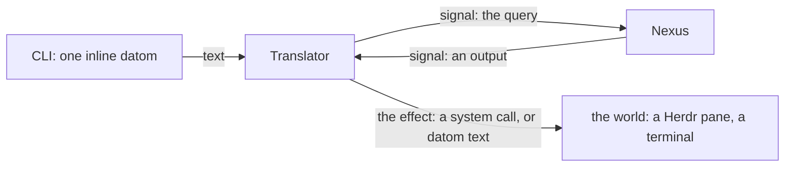

# The Translator

Created by Fable.

A proposal for a new module, vision:translator, and one line into vision:nexus. Drawn from the living's words of 2026-10-30 on the translator.

## Why

The running Flow Nexus writes its output as strings shaped like datom. That text is made by hand, in the Nexus, and it is fake datom: no type stands behind it, so it has already carried a deep design flaw and incorrectness. A Nexus thinks in typed values and speaks signal alone; every string it writes is a bug waiting.

The Translator takes the whole of text out of every Nexus. A Nexus emits a typed value; the Translator, the one place that holds a codec, turns it into datom text or into the system call it stands for. The same component turns datom text into signal on the way in, so the CLI becomes one of its users.

## vision:translator, proposed whole

### What the Translator is

The Translator is the component that carries datom to signal and signal to datom, given a target and a direction. It is shared: several Nexuses and the CLI use one Translator. It is not a Nexus: it keeps no domain and no Memory; it is compiled with the signal contracts it reads and writes, and it knows one more thing, how each output type leaves the system.



### Inbound: text becomes signal

A CLI takes one inline datom and hands it to the Translator with the contract it belongs to. The Translator actualizes it against that contract and sends the signal to the Nexus. Nothing of the text reaches the Nexus.

### Outbound: a Nexus emits an output, never a command

An output is a typed value a Nexus emits toward the world that returns nothing to it: a prompt into a Herdr pane, an interrupt, a line for a terminal. A Nexus declares its outputs in a fifth Ethos root, Output, beside Library, Signal, Operation and Memory: Signal is what a Nexus says to its peers, Output is what it sends into the world. The Nexus emits the output as signal; the Translator holds, for each output type, the one body that makes it real. So the Flow Nexus never writes `herdr` as a string; it emits a Prompt, and the Translator knows what a Prompt is in this world.

The Ethos, the Flow Nexus's Output:

```
Output
[ flow:[ FlowId Pane Message ] ]   ; imports: the library the Flow Nexus shares across its roots
[ Prompt.{ Pane Message }          ; outputs: a message delivered into a pane, as datom text
  Interrupt.Pane ]                 ;   a pane interrupted, no text
```

The Rust generated from it:

```rust
#[derive(Datomizable, Compositional)]
pub enum Output { Prompt(Prompt_Data), Interrupt(Pane) }
#[derive(Datomizable, Compositional)]
pub struct Prompt_Data { pub pane: Pane, pub message: Message }
```

The one Translator trait an output type bears, its body hand-written in the Translator and nowhere else:

```rust
pub trait Emittable { fn emit(&self) -> Result<Emitted, Refused>; }
impl Emittable for Prompt_Data {
    fn emit(&self) -> Result<Emitted, Refused> {
        let text = self.message.datomize(Path::root()).protosize().textualize();   // the only place the datom text is made
        self.pane.deliver(text)                                                    // the only place the pane is reached
    }
}
```

The datom, what the Flow Nexus emits, shown as text though it travels as signal:

```
Prompt.{ 3 { { Psyche core Primary } Soft.Question.«Is the fresh store ruled?» } }
```

### The Translator's own signal

```
Signal
[ translator:[ Contract Text ] ]                  ; imports
[ Actualize.{ Contract Text }                    ; queries: text to become signal under a contract
  Emit.{ Contract Output } ]                     ;   an output to become its effect
[ Actualized.Signal                              ; responses
  Emitted
  Refused.[ UnknownContract.Contract             ;   the Translator is not compiled with it
            Malformed.Error ] ]                  ;   the text did not match the contract
[ Contract.{ Name Version } ]                    ; types
```

### Many Translators run at once

A stable Nexus keeps the Translator it was built against while a next version runs with its own, because contracts change between versions. Each running Translator carries a unique suffix, a random hash; a Nexus is configured with the Translator it uses and discovers nothing. The suffix has no meaning at run time; it keeps the Translators apart.

## One line into vision:nexus

Under Signal only, after "A Nexus speaks only the signal contracts it is compiled with":

**Text enters and leaves through the Translator: a Nexus emits typed outputs and holds no codec.**

## Open

Whether Output is a root of its own or a section of Operation; the living asked for an output type, and a root keeps what leaves the system apart from what the Nexus does inside. A single-process or in-process Translator: the first embodiment may be a library the CLI and the Nexus link, with the socket form following when two Translators must run at once.
