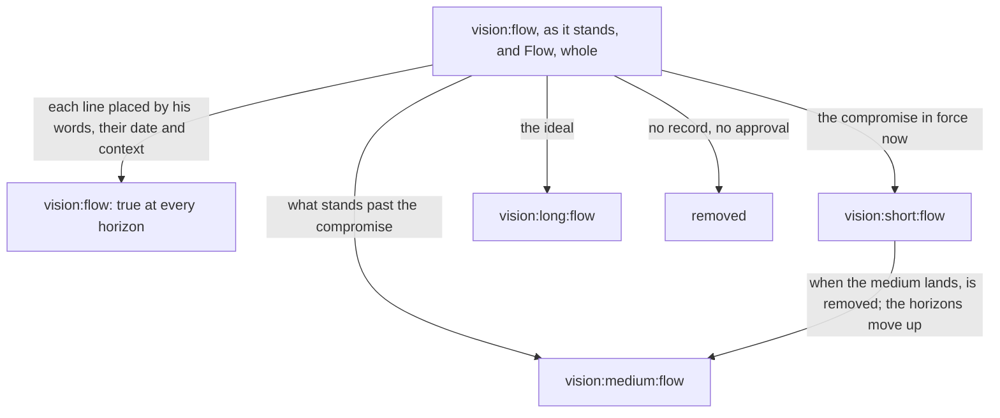
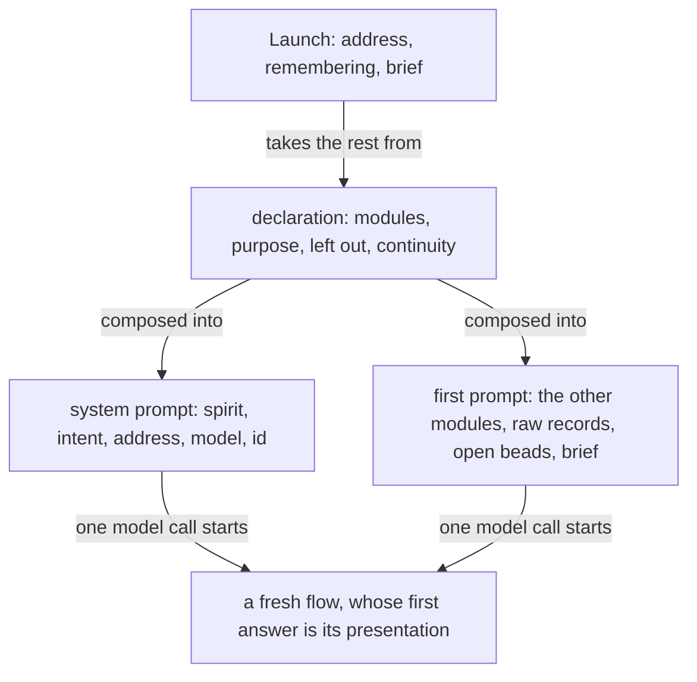
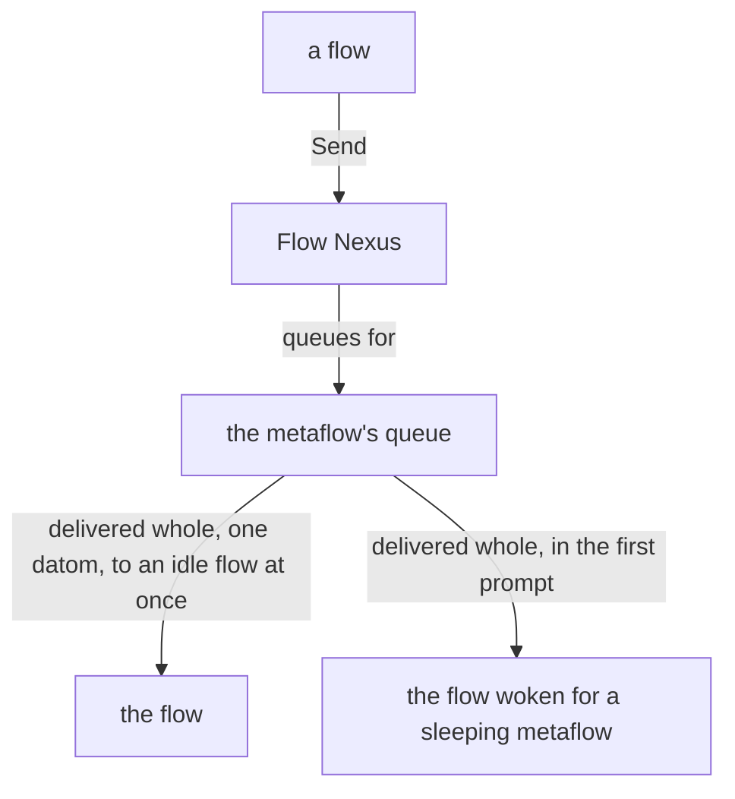
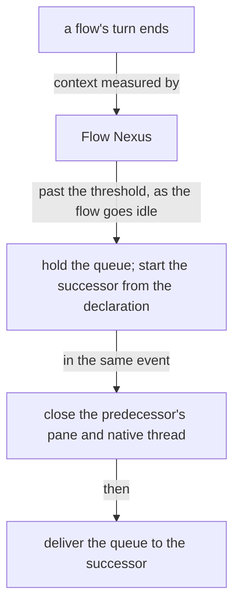
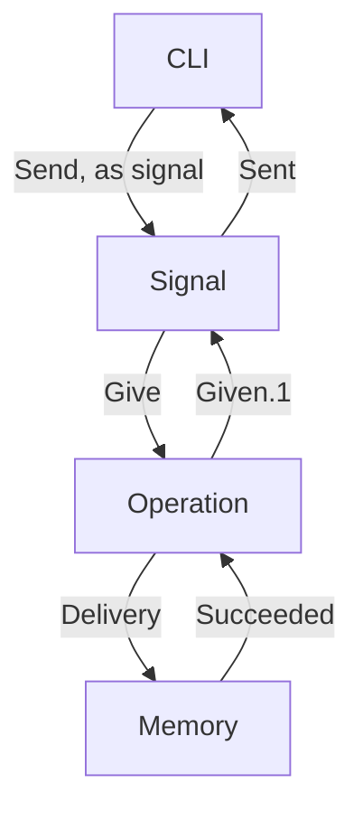
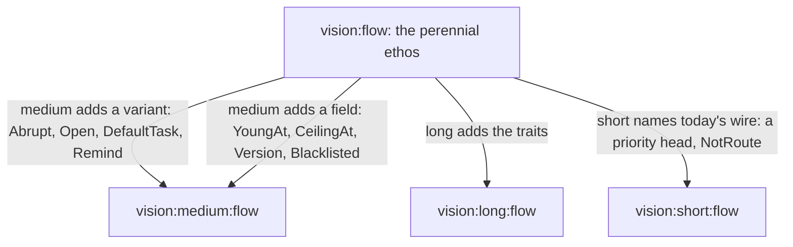

Presentation.{ «Flow by horizon» }

# Flow by horizon

Designed by Fable 5.1; the records gathered and the implementation read by Sonnet 5.5, served through Opus 5.5 (Psyche flow Secondary 5e5238).

Every line of vision:flow as it stands, and every line of Flow, whole, placed by horizon into four modules, as intent:psyche now rules: vision:flow, the unmarked module, holds what is true of the Flow Nexus at every horizon and the general aspects that drive behavior; vision:short:flow holds the compromises, short-term solutions and hacks in force now; vision:medium:flow describes the Flow Nexus past them; vision:long:flow describes it as it is ideally to be. There is no far vision of the Flow Nexus yet. The Nexus is named Flow Nexus in every line; a flow is a flow.

Each proposal is one idea, and shows where that idea's lines go: a line in red under vision/flow.md leaves it; a line in green under a module enters it; a line of vision:flow kept as it stands is shown plain. Each Comment says how the horizon was discerned, from your words, their date and their context, and what the implementation (CLI 0.40.0 at a0ca88, Nexus 0.40.4 at 230b3b) does with the line today: built, partly, or unbuilt. A short line unbuilt is the next thing built; a perennial line unbuilt is a gap the implementation closes.

Two readings I made, said plainly so you can correct them. Your 21:11 comment on Flow, whole reads "a single FML flow" in the transcript; your records of 10-16, 10-17 and 10-07 speak of the ephemeral flow, the fourth type, "when it doesn't wake back up", and of "other types of flows that are not parts of metaflows", so I read FML as ephemeral. And you asked today for proposals in Obsidian; the Psyche obsidian pair is designing that, so this one is presented as the system presents today.



### Proposal 1: Four modules · psyche-context › vision/flow.md, vision/short/flow.md, vision/medium/flow.md, vision/long/flow.md

**Comment** Your comment of 21:05: a whole-module proposal shows the module description. Here are the four, each with its description and dependencies; the three marked modules are new. Their registry ids are vision:flow, vision:short:flow, vision:medium:flow, vision:long:flow, so a declaration names the horizons a metaflow loads, as intent:psyche shows. The modules keep the topic's name, flow, which is the name of the metaflow topic and covers flows as well as the Flow Nexus; the intent:psyche example wrote vision:flow-nexus, and one word from you renames them. A module depends only on its own kind or a higher one, so each marked module depends on the unmarked one, and the long on the medium, whose lines it stands beyond.

#### psyche-context › vision/flow.md

- description: Flow — the Nexus that launches, names, tracks and ends flows — or a metaflow, a side flow, a hook or the Capsule is being designed or judged against what the living wants.
+ description: The Flow Nexus, which starts, names, tracks, refreshes and ends flows, or a flow, a metaflow, an ephemeral flow or the Capsule, is designed or judged against what the living wants of it at every horizon.
  dependencies: [vision-nexus, vision-ethos]

#### psyche-context › vision/short/flow.md

+ description: The Flow Nexus is implemented or repaired as it runs now: the compromises, short-term solutions and hacks in force, each standing in for a medium line.
+ dependencies: [vision-flow]

#### psyche-context › vision/medium/flow.md

+ description: The Flow Nexus is designed past its compromises: the lines that replace the short ones once they are built.
+ dependencies: [vision-flow]

#### psyche-context › vision/long/flow.md

+ description: The Flow Nexus as it is ideally to be is designed; what is built toward it is the medium.
+ dependencies: [vision-flow, vision-medium-flow]

```datom
; declarations naming the horizons a metaflow loads
{ { Field flow Secondary } [ vision:flow vision:short:flow ] }
{ { Mind flow Primary } [ vision:flow vision:short:flow vision:medium:flow ] }
{ { Psyche flow Primary } [ vision:flow vision:short:flow vision:medium:flow vision:long:flow ] }
```

### Proposal 2: What the Flow Nexus is · psyche-context › vision/flow.md, vision/medium/flow.md, vision/long/flow.md

**Comment** Your words of 10-02 (the lock), 09-25 and 10-13 ("the most important improvement we need to focus on right now" is starting lean, cheap, fresh flows), 10-19 (one short call), and of today: Flow Nexus, and a flow is one run of a metaflow or a single ephemeral flow, "at least in the long term". The definition of a flow is perennial: it is what the word means at every horizon, so the ephemeral flow is named here and designed in the medium (proposal 9). The sentence on flows and synthetic intelligence has records after all (08-19, landed 10-14 with the misnomer clause taken out on your word), and stays. "The model is not always a language model" is your 10-19 word, "It could be a system one also"; the Flow Nexus runs Claude and Codex harnesses alone today, so the capability is long. Built: the lock, Launch, Refresh, Stop, Send.

#### psyche-context › vision/flow.md

- ## What it does
+ ## What the Flow Nexus is

- The Flow Nexus sets up and starts a model flow: its working
- directory, system prompt, training files and instruction prompt.
-
- Flow is the Nexus that manages flows. A flow is one run of a metaflow; the component is named for what it manages. A flow the living asks for is launched, properly and surely. Flow holds the lock on flows.
+ The Flow Nexus starts, names, tracks, refreshes and ends flows, and carries every request between them. It holds the lock on flows: a flow is started, messaged, refreshed and ended through the Flow Nexus alone, and a flow the living asks for is launched, properly and surely.

- Flow is for starting flows cheaply: clean flows, specialized flows and refreshed flows, each with a clean on-point context, which yields higher-quality output. A flow is taken down as easily as it is started. Starting flows is the cornerstone of the system.
+ Starting a flow is the cornerstone of the system: a fresh flow with a clean, on-point context does better work than an old one carrying unrelated context, so flows are started often, specialized, and taken down as easily as they are started. Starting a standard flow is one short call.

- A flow runs one model, linear and very limited, and the model is not always a language model: it may be a System 1 model, an audio model or a video model. An agent is a whole being, a lot more than that. Many flows, properly structured and orchestrated, together resemble a synthetic intelligence, synthesized from human knowledge and mathematical probability.
+ A flow is one run of a harness: one model, one context, from its first prompt to its end, with every subflow it starts. A flow is one run of a metaflow, or a single ephemeral flow that belongs to no metaflow. A context restarted is a new flow. A flow not working is idle.
+
+ A flow runs one model, one flow of thought, linear and very limited. An agent is a whole being, a lot more than that. Many flows, properly structured and orchestrated, together resemble a synthetic intelligence, synthesized from human knowledge and mathematical probability.

#### psyche-context › vision/long/flow.md

+ ## Models of every kind
+
+ The Flow Nexus starts flows of models that are not language models: a System 1 model, an audio model, a video model, each a flow with its address or its job.

### Proposal 3: The metaflow and the topic · psyche-context › vision/flow.md, vision/medium/flow.md

**Comment** The metaflow is your central concept since 10-06; the topic that lives on and the core default are 10-07 to 10-11; "anything that touches a particular topic that we have a flow for should also go to that flow" is 10-25. "The flow is started if it's needed, which means it doesn't matter if it's running or not" was your long-term vision of 10-14 and is built in 0.40, so it is perennial now. The judgment by a small model on whether to wake and at which layer was "not intended for the first version but eventually" (10-07) and is unbuilt: medium. Built: the address, the metaflow record, Maintained and OnDemand continuity, the camelCase check; retirement of a topic no longer touched is a policy no code holds.

#### psyche-context › vision/flow.md

- Flow manages metaflows. A metaflow is one address, { Aspect Topic Layer }, that continues through several flows one after another; the flow is its current run, and what is addressed is always the metaflow. The default topic is core: the permanent topic, the thing that keeps the machine going, the last topic to stand.
-
- A topic is an open enum: the constant topics, core among them, are fixed, and the users and the machine extend the set with camelCase identifiers.
-
- Psyche, Mind and Field have similar payloads, and they go under one: the metaflow, whose aspect is Psyche, Mind or Field.
-
- A topic lives on; when idle, its flows are turned off. When the living touches on it again, whether to wake a flow for it, and at which layer, is a judgment, made by a small model; a topic is bound to its belief modules, so Flow knows what to start it with, together with the new input that warrants it.
+ ## The metaflow and the topic
+
+ A metaflow is one address, { Aspect Topic Layer }, that continues through flows one after another; the flow is its current run. What is addressed is the metaflow; the flow id is for the ledger and for finding a transcript. A metaflow holds its declaration, its queue, its past flows and its current flow, if any. Psyche, Mind and Field go under the one metaflow type, as its aspect.
+
+ A topic lives on: when idle, its flows are turned off, and its address, declaration and queue stay. The default topic is core, the permanent topic of its aspect, the last to stand. A topic is started from vision or raw psyche that touches it, and what touches a topic goes to that topic's flow; a topic no longer touched is retired.
+
+ A metaflow a request needs is started whether or not it is running: with no transcript to reawaken, its flow is fed the metaflow's belief modules and the prompt it is to get now.

```ethos
Library
[ flow:QueueEntry ]
[ FlowId.String
  Topic.String
  Aspect.[ Psyche Mind Field ]
  Layer.[ Primary Secondary Tertiary Quaternary ]
  Address.{ Aspect Topic Layer }
  Metaflow.{ Address
             State.[ Awake.FlowId Asleep ]
             Past.Vector<FlowId>
             Queue.Vector<QueueEntry> } ]
[]
[]
```

```datom
{ { Psyche flow Primary } Awake.098b1d
  [ 30fc30 ] [] }
```

#### psyche-context › vision/medium/flow.md

+ ## Waking is a judgment
+
+ When the living touches on an idle topic, whether to wake a flow for it, and at which layer, is a judgment made by a small model, given the topic's belief modules and the new input that warrants it.

### Proposal 4: Names · psyche-context › vision/flow.md, vision/short/flow.md, vision/medium/flow.md, vision/long/flow.md

**Comment** Six characters is your word of 08-26 and 08-31; "the Flow Nexus should give you your Flow ID" is 10-29; the title as one datom struct is 10-16. The word form of the id: "if we let go of the word ID for now and then do that in a later version, that's okay" (10-03), so the hash alone is the short line and the three words the long. The topic kept exactly as written: "Good. Mark short term" (10-20), and in the same breath "In the long term we want to support the open enum ... we first need to support that in Ethos": the open enum is the line the short one stands in for, and vision:ethos now carries open enums, so it is medium. Built: the six-character id, chosen before a Claude flow starts and bound from a Codex one, the title datom, the kernel-identified caller, the camelCase check; the word form and the open enum are unbuilt.

#### psyche-context › vision/flow.md

- A topic's name is a camelCase identifier, uncapitalized. Short term, it is kept exactly as written: Flow refuses a name that is not one and never lowers its capitals, so primaryCommitting stays primaryCommitting. A flow's id is the hash of the harness's session id, kept to six characters and lengthened when two collide, so a transcript is found from the flow id. The flow id stays the hash; its word form waits for a later version. Long term, the flow id is also written in three words, which convert back to the hash. Where the harness lets Flow choose the session id, Flow chooses it before the flow starts and the flow reads it in its prompt; where the harness assigns it, Flow learns it when the flow binds. Every call to Flow is identified by the calling process. Anybody may call Flow, a flow for its own refresh among them: because the CLI checks the calling process, a flow refreshes itself safely.
-
- In the chat a flow is named by its metaflow, and the flow id almost disappears from it; the id is for the ledger and for finding the transcript.
-
- Every flow has a topic; a flow with no special topic has the topic core, the heart of its aspect. A topic is a core:Name, a camelCaseExpression checked when created. A flow's title is one datom struct of its aspect, topic, layer and flow id: { Psyche core Secondary <id> }.
+ ## Names
+
+ A topic is an open enum: core is its fixed variant, and every other topic is a camel ID, an uncapitalized camelCase expression of words, checked when first used.
+
+ A flow id is six characters, the earliest random part of the harness's session id, lengthened when two collide, so the transcript is found from the id. The Flow Nexus gives a flow its id: where the harness lets it choose the session id, it chooses it before the flow starts; where the harness assigns it, it learns it as the flow comes up; either way the flow reads its id in its first prompt and its environment, and claims nothing itself.
+
+ Every pane, tab and title that represents a flow is one datom of its address and id, { Psyche core Secondary 9b514f }. Between flows and in speech a flow is named by its address; the id stays in the ledger.
+
+ Every call to the Flow Nexus is identified by the calling process: a caller is a flow, resolved to its address, or a process the Flow Nexus does not know. Anybody may call the Flow Nexus, a flow for its own refresh among them.

```ethos
Library
[ flow:Address ]
[ FlowId.String
  Topic.String
  Caller.[ Flow.{ Address FlowId }
           Process.Integer ] ]
[]
[]
```

#### psyche-context › vision/short/flow.md

+ ## Names, as kept now
+
+ A topic's name is kept exactly as written: the Flow Nexus refuses a name that is not an uncapitalized camelCase identifier and lowers no capital, so primaryCommitting stays primaryCommitting. Until Ethos's open enum reaches the Flow Nexus, core is written as every other topic is, a plain string checked the same way. The flow id is the six-character hash alone.

#### psyche-context › vision/medium/flow.md

+ ## The topic as an open enum
+
+ Topic is an open enum in the Flow ethos: Core is its capitalized fixed variant, and a custom topic is written bare as a camel ID; the Flow Nexus reads both from the one type.

```ethos
Library
[]
[ Topic.[ Core
          camelId ] ]   ; the uncapitalized word is the open variant
[]
[]
```

#### psyche-context › vision/long/flow.md

+ ## The flow id in words
+
+ A flow id is also written as three camelCase words that convert back to the hash, so a flow is named in speech by its address and, when its run matters, by its words.

### Proposal 5: Starting a flow · psyche-context › vision/flow.md, vision/short/flow.md, vision/medium/flow.md, vision/long/flow.md

**Comment** The declaration per metaflow is your word of 10-13 ("maybe we can even keep one configuration per aspect"), the brief of "a few small sentences describing the goal" 10-19, spirit and intent in the system prompt and the vision in the first prompt 10-07 and 10-23 ("not intent, not long term anyway, because intent should be in the system prompt itself"), one model call 10-19, the subflow tool 10-23 and 10-26 ("I don't want any of these fucking restrictions"). "Short term, the Secondary starts first" is your mark of 10-14 and 10-16: short. The default task when no brief is given, "by default maybe you set it somewhere else later on" (10-14): medium. The flow specified whole as a datom in Ethos, "a comprehensive reproduction of the full system prompt" (10-26), and the subagent definition as "a data object that defines which modules go where. Let's get that specified in Ethos" (10-16): medium, since it is what the per-metaflow leave-out list stands in for. The Primary as a simplified flow, "we eventually want primary to be a simplified flow" (10-19): long; the simplified flow itself has records (10-19) and stays as a kind in the perennial, with "no use for simplified flows yet because we don't have the hook infrastructure" (10-26) placing its use in the medium. The lines on a system-prompt anatomy study and on a part of the prompt withheld from subagents have no record and go. Built: the declaration with system and user modules, purpose, continuity, leave-outs; Launch with address, remembering and brief; the composed system prompt; the first prompt in numbered parts; the Secondary before the Primary. Partly: effort is hardwired against the configuration line; the open beads are not in the first prompt; the simplified flow lost its tool restriction in 0.40.

#### psyche-context › vision/flow.md

- ## Starting flows
-
- A Nexus component decides the system prompt and everything about a
- launch, replacing the harness's subagents with specialized harnesses
- launched with specialized system prompts.
-
- A layer is Primary, Secondary, Tertiary or Quaternary, in every aspect; the layer decides the model. A launch names the metaflow, the belief modules composed into its prompts, and a brief of a small paragraph; the Nexus composes the prompt from its module registry.
-
- Flow's configuration holds, for each metaflow, its purpose and the records of the living it rests on, beside its modules; Flow composes them with the brief into the first prompt, and the instruction for the first response belongs to that composition.
-
- A fresh flow's first prompt carries the raw psyche relevant to it and recent, together with the belief modules relevant to it, of any kind except spirit and intent, which sit in the system prompt.
-
- ```mermaid
- flowchart TB
-     a["Flow"] -- "composes into the first prompt" --> b["recent raw psyche, belief modules of any kind except spirit and intent"]
-     b -- "starts" --> c["a fresh flow"]
- ```
-
- A fresh flow starts with every belief module its metaflow is bound to, all loaded at its start: much of it in its system prompt, the rest in its first prompt, or in as many prompts as it takes, sent one right after another, so that its start is one model call.
-
- A simplified flow is a kind of flow made for judgment alone: it starts with a system prompt of its own, it has no regular tool, and its response is its message.
-
- A flow is specified whole, in Datom, by a domain-specific language in Ethos: its system prompt, its default belief modules and its variations. The flow ethos holds the specification.
-
- Short term, the Secondary starts first, then its Primary.
-
- Long term, a Primary is a simplified flow, used only to render judgment: guiding a design or posing questions.
-
- To the Nexus, a module's location is its registry entry.
-
- The system prompt is composed of modules of several types, and what a harness calls a skill overlaps with them.
- Its anatomy is drawn up in ethos from a study of system prompts of every kind, each line placed by what it is and by the kind of guidance it belongs to.
- Where the harness allows it, a part of a main flow's system prompt is the main flow's alone and is not passed down to its subagents.
+ ## Starting a flow
+
+ A metaflow is declared in the Flow Nexus's configuration, as datom: its address, the belief modules composed into its system prompt and into its first prompt, its purpose, the harness modules it leaves out, its continuity, and how far back its flows remember. A declaration carries the modules its topic needs and no other; what every flow of an aspect needs, the aspect's declaration carries once. The system prompt is composed of modules of several kinds, and what a harness calls a skill overlaps with them.
+
+ A launch names an address, a remembering and a brief of a few sentences; everything else is the declaration's. The Flow Nexus composes the system prompt whole, replacing the harness's own: spirit and intent, with the flow's address, model and id. The first prompt is one message, brimming with vision: the belief modules of every other kind, the raw vision and notion records the remembering names, the open beads of the address, then the brief. When one message does not hold it, the parts go in one right after another, so the start is one model call and the flow's first answer is its presentation.
+
+ A main flow is started with its subflow tool and every tool its declaration leaves in; the Flow Nexus limits nothing the configuration does not name. A permission prompt reaching the living is a launch failure.
+
+ A layer is Primary, Secondary, Tertiary or Quaternary, in every aspect; the layer and the aspect decide the model and its effort through the configuration.
+
+ A simplified flow is a kind of flow made for judgment alone: it starts with a system prompt of its own, it has no regular tool, and its response is its message.

```ethos
Library
[ flow:[ Address FlowId ] ]
[ ModuleIdentity.String
  HarnessModule.String
  RememberingDepth.Integer
  Remembering.[ Predecessors.RememberingDepth
                Custom.Vector<FlowId> ]
  Brief.String
  Continuity.[ OnDemand Maintained ]
  Declaration.{ Address
                System.Vector<ModuleIdentity>
                User.Vector<ModuleIdentity>
                Purpose.String
                LeftOut.Vector<HarnessModule>
                Continuity
                Remembering } ]
[]
[]
```

```datom
{ { Psyche flow Primary }
  [ spirit:core intent:main-flow intent:fable ]
  [ vision:flow vision:short:flow vision:medium:flow
    vision:long:flow vision:nexus vision:messaging ]
  «Designs the Flow Nexus from his vision»
  [ ClaudeArtifacts ClaudeMd BundledSkills ]
  OnDemand Predecessors.1 }
```

```sh
flow 'Launch.{ { Psyche flow Secondary }
               Predecessors.1
               «Audit the merged tree.» }'
```



#### psyche-context › vision/short/flow.md

+ ## Starting a flow, as done now
+
+ The Secondary starts first, then its Primary; a Primary launched without its Secondary awake is refused. Belief modules reach the Flow Nexus from the Curriculum Nexus over its socket, by identity; the Flow Nexus holds a module's identity and the composer's hash, and checks a module against that hash alone. What a flow leaves out of its harness is a list of named harness modules in its declaration, turned into harness flags at launch.

#### psyche-context › vision/medium/flow.md

+ ## The flow specified whole
+
+ A flow is specified whole, as a datom against the Flow ethos: its system prompt as a comprehensive reproduction of what the harness is given, its default belief modules, and its variations; a subflow definition is such a datom too, saying which modules go where. A flow launched without a brief has its declaration's default task: a proposal, or a question. A simplified flow is started wherever a judgment alone is wanted.

```ethos
Library
[ flow:Declaration ]
[ DefaultTask.[ Proposal Question ]
  Declared.{ Declaration DefaultTask } ]   ; the declaration gains its default task
[]
[]
```

#### psyche-context › vision/long/flow.md

+ ## The Primary is a simplified flow
+
+ A Primary is a simplified flow, used only to render judgment: guiding a design or posing questions. Every subflow is a flow the Flow Nexus starts, in place of the harness's subagent tool, as vision:subflows describes.

### Proposal 6: Requests and the queue · psyche-context › vision/flow.md, vision/short/flow.md, vision/medium/flow.md, and vision/messaging.md

**Comment** Your words of 10-28: the queue flushes as one message, "all of them, everything, including the one that comes in that gets the queue unstuck". Of 10-25 and 10-29: every machine message is one datom, the sender is known by its address. Of 10-14: a needed metaflow is started and the request arrives with its start prompt. These are perennial. Priority was "the wrong approach" (09-26: "the head is the kind"), and the delivery the sender asks is "ideally maybe not short term but longer term" (10-22): today's wire, a priority head and a Queue or Wake delivery, is the short line, and Delivery with Abrupt, the kind deciding the waking, is the medium. Flows send through the Flow Nexus directly "in the short term", and "in the long term it should do it with the message component" (10-20): the direct send is short, Message is medium, since it is the line the direct send stands in for. The per-harness Escape mechanics have no record and are what works today: short, leaving vision:messaging, which keeps the message as a datom. Built: the kinds, Up, the whole queue in a wake's first prompt and, in 0.40.4, as one payload on drain, the needed metaflow started, the pane lease. Unbuilt: kind-decided waking, Abrupt as a delivery, Message.

#### psyche-context › vision/flow.md

- A request reaching a metaflow is one of a closed set of types, each with its waking effect: an order, a question, the living's words, a result, a notice. Message asks Flow to send a request to a metaflow; Flow owns the lock and the delivery, answers sent or queued, and Message subscribes to Flow's events, learning when a request has entered the flow's context. A metaflow asleep is woken by an order, a question or the living's words and receives its whole queue, oldest first, in the first prompt, a result or a notice waiting there until a waking; a metaflow under refresh or waking queues what arrives until its successor or woken seat has started, while Flow keeps serving every other request. A metaflow a request needs is started whether or not it is running; with no working transcript to reawaken, it is fed the metaflow's belief modules and the prompt it is to get now.
-
- A flow woken for a metaflow is almost always a fresh flow, an old one only when the new input is literally the continuation of that topic.
-
- What has been queued for an idle metaflow, the vision touching its topic among it, is injected with the request that wakes it, so the flow knows it as soon as it wakes.
- A metaflow wakes when a request needs it; what touches its topic queues until then.
-
- Flow exposes everything from the harness, the bare input: a flow is started, stopped and sent a message through Flow, and Message makes use of it. Message is the send path: a flow asks Message to send, Message asks Flow to deliver and subscribes to Flow's events.
-
- The flow that finishes messages the flow that needs to know.
+ ## Requests and the queue
+
+ Everything the machine puts into a flow's prompt is one datom. A request is its sender, as an address, and its content, headed by its kind: Order, Question, Result, Notice, or Psyche, the living's words with their context. A kind is added by adding a variant. The Flow Nexus resolves the sender from the calling process; a request carries no flow id, no timestamp and no hash. The living's words are the only text in a transcript that is not datom, so his are told from the machine's by their shape.
+
+ A request names its recipient by address, or Up, the layer above in the sender's aspect and topic. Every request is queued for its metaflow, never for a flow, and the queue is delivered whole, oldest first, as one datom, a vector of requests, in one turn: to an idle flow at once, to a working flow as its turn ends, to a sleeping metaflow in the first prompt of the flow woken for it, the request that woke it among them. A metaflow a request needs is started whether or not it is running; the sender's call waits, and the start prompt and the request arrive together. A metaflow being refreshed receives nothing more; its queue waits for the successor.
+
+ The Flow Nexus exposes the harness's bare input: a flow is started, stopped and sent a request through it, and it is the one writer into a pane.

```ethos
Library
[ flow:[ Address FlowId ] ]
[ Recipient.[ Address Up ]
  Said.{ Context.String Verbatim.String }
  Body.String
  Content.[ Order.Body
            Question.Body
            Result.Body
            Notice.Body
            Psyche.Said
            Psyches.Vector<Said> ]
  Request.{ Address Content } ]
[]
[]
```

```datom
; the pane receives the whole queue, one datom
[ { { Psyche flow Primary }
    Order.«Fix the five defects.» }
  { { Psyche core Secondary }
    Psyche.{ «on the queue, 10-28»
             «all the messages should come in» } } ]
```



#### psyche-context › vision/short/flow.md

+ ## Delivery, as done now
+
+ A message carries a priority head, HardAbrupt, MiddleAbrupt or Soft, and the sender asks a delivery, Queue or Wake; the delivery decides whether a sleeping metaflow wakes, and the kind decides nothing. An abrupt message is typed into a live pane under its lease; a pane that refuses it has the message queued instead. A flow sends through the Flow Nexus directly, as `flow 'Send.…'`. When the Flow Nexus holds a delivery, the sender types into the recipient's pane through Herdr, its text opening with the sender's address; a message for a Primary goes to its Secondary's pane, by the Flow Nexus or by Herdr alike.
+
+ Abrupt on Codex is one Escape, and the prompt submits itself. Abrupt on Claude is two Escapes, the first taken by the input editor in vim mode, then the prompt, then an explicit Enter, because after an interrupt the prompt is placed in the composer without being submitted. A Wake or Queue delivery is typed into the pane, or sent as the Codex turn, as the recipient's turn ends, and at once when it is idle.

```sh
flow 'Send.{ Address.{ Mind flow Secondary } Wake
             Soft.Order.«Fix the five defects.» }'
```

#### psyche-context › vision/medium/flow.md

+ ## Delivery is what the sender asks of the queue
+
+ A message carries no priority: the kind in its head says what it is, and the Flow Nexus's records say how it was delivered. A sender asks one of three deliveries. Queue leaves the request for the next delivery. Wake delivers it, waking a sleeping metaflow; a Result or a Notice sent to a sleeping metaflow waits there for the next waking, so a flow satisfied with its topic is not woken to be told. Abrupt interrupts the recipient's turn and is answered Sent or Failed, never Queued.
+
+ Message, the Nexus of messaging, is the send path: a flow asks Message to send, Message asks the Flow Nexus to deliver and subscribes to its delivery events, learning when a request has entered a flow's context. Functionality leaves the Flow Nexus into other nexuses this way, once the Flow Nexus stands on its own.

```ethos
Library
[ flow:Request ]
[ Delivery.[ Queue Wake Abrupt ]
  QueueEntry.{ Delivery Request } ]
[]
[]
```

```sh
flow 'Send.{ Address.{ Mind flow Secondary } Wake
             Order.«Fix the five defects.» }'
```

#### psyche-context › vision/messaging.md

- ## Priority is a head on the datom
-
-     Priority.[HardAbrupt MiddleAbrupt Soft]
-
- ## Delivery is harness-specific, and the mechanism differs per tier
-
- Hard abrupt on Codex is one Escape, and the prompt submits itself. Hard
- abrupt on Claude is two Escapes — the first is taken by the input editor in
- vim mode and never reaches the harness — then the prompt, then an explicit
- Enter, because after an interrupt the prompt is placed in the composer
- without being submitted. Middle abrupt is the terminal prompt, which a
- Claude recipient receives at its next tool boundary. Soft waits for the
- recipient to finish.
-
- ## When Flow holds a delivery
-
- When Flow holds a delivery, the sender falls back to direct Herdr messaging: it finds the recipient's pane in the pane list, sends the text with the first words naming the sender, then Enter. The fallback changes the carrier and keeps the address: a message for a Primary goes to its Secondary's pane, by Flow or by Herdr alike.

### Proposal 7: Routes to a Primary · psyche-context › vision/flow.md, vision/short/flow.md

**Comment** "Flow refuses a request that leaves those routes" was landed 10-09 from the development-mode rule that every Fable call goes through you; on 10-28 you said "I don't think our system is ready to enforce that kind of stuff programmatically", and 0.40 refuses no route. Today, relayed to the Mind flow pair by Mind core Secondary fffb2f as your fresh words, a Send to a Primary is accepted only from that Primary's own Secondary or from the core Primary of its aspect, refused by name otherwise; I have the relay, not the record, and relay it as a claim. The two are one line at two horizons: the routes themselves are vision:aspects' and perennial; the refusal at the Flow Nexus is the compromise in force now, data-driven and off when unconfigured, as you asked of every restriction on 10-27. Your 10-14 word stands over it: "This concept is not strictly short-term."

#### psyche-context › vision/flow.md

- Who speaks to whom, within an aspect and across aspects at the same layer in a shared topic, is the vision-aspects skill's. Flow refuses a request that leaves those routes.
+ Who speaks to whom, within an aspect and across aspects at the same layer in a shared topic, is vision:aspects'. A restriction the Flow Nexus enforces on a route is configuration, off when unconfigured.

#### psyche-context › vision/short/flow.md

+ ## The route to a Primary is refused by name
+
+ A request to a Primary is accepted from that Primary's own Secondary, or from the core Primary of its aspect; another sender is refused by name, so a flow without a Secondary is still reached by its core Primary.

```ethos
Signal
[ flow:Address ]
[]
[ Refused.[ NotRoute.{ Address Address } ] ]   ; sender, recipient
[]
```

### Proposal 8: Sleeping, waking and refreshing · psyche-context › vision/flow.md, vision/short/flow.md, vision/medium/flow.md, vision/long/flow.md

**Comment** Sleep so that an idle session keeps no harness is 09-30 and 10-14; Maintained for the core Primary 10-23; a fresh flow on waking, "unless it's literally the continuation of that topic", 10-16; refresh by a per-model threshold from 09-14 on, with your numbers moving from 60% to 20–40% to a warning at 200,000; no summary and no handover "until I very explicitly say that I've changed my mind" 10-26; refresh from outside without waking, "I want the option", 10-25; the Codex threads put out when a flow closes, 10-28 and today. Perennial. Compaction: "I still use compaction right now because we just really can't afford to run these huge massive context windows" (10-13), so compaction as the emergency is the short line; the young and ceiling thresholds and the judgment on resuming an old context, with "we should do research on what the caches are with different providers" (10-16), are medium; the idle-flow procedure, "obviously not short term because it involves hooks" (10-27), is medium. "A refresh carries the flow's important presentations and illustrations" was "a long-term vision" with "some judgment for now" (10-17); it is long, and your 10-26 ruling, beliefs and raw records and those alone, governs until then. "Reaping belongs to the refresh event" and "a compaction is a refresh that was missed" have no record in those words; their substance is in the lines kept. Built: sleep, Maintained and OnDemand, the fresh wake, the single Refresh threshold per model, the successor started first and the predecessor reaped, refresh from outside, no handover, compaction refused under the threshold and warned. Unbuilt: young and ceiling, the resume judgment, the idle-flow procedure; closing the native thread in the same event is unverified.

#### psyche-context › vision/flow.md

- A metaflow sleeps so that a session not running keeps no harness: as soon as its turn ends and the harness is idle, with nothing waiting in its queue, the harness closes; the transcript stays and the address stays.
-
- ## A replaced session is reaped by the refresh itself
-
- Reaping belongs to the refresh event. A refreshed flow
- takes the replaced end out of receiving messages, so only live ends stay
- registered and addressable.
-
- Every harness event reaches Flow through the harness's hooks calling the Flow CLI, so Flow knows each flow's state as it changes; a marked block landing in a transcript becomes an action, a book among them; a flow past its context threshold is refreshed as it goes idle. A poller that must exist is registered and reported.
-
- A flow is refreshed when its context passes its model's threshold: Flow keeps the metaflow's next messages for its next flow, and the flow is replaced as it goes idle; while the refresh runs the metaflow is locked, and the predecessor is reaped in the same event. Each model's threshold is configured in Flow; an OpenAI model's is lower than a Claude model's.
-
- A flow refreshes before compaction; a compaction is a refresh that was missed.
-
- A flow that keeps working without being given more work may compact. Its compaction raises a warning, and a flow investigates why it worked so long, so that the trouble is brought to the living or Psyche reconsiders the approach and gives guidance.
-
- An ephemeral flow is a continuous job flow that does not wake back up: it takes jobs while it runs, up to a ceiling on its context, and past the ceiling it is given no new job and another ephemeral flow takes it. With Claude the ceiling is 300,000 tokens, and the flow is wound down at 250,000.
-
- ## A superseded flow is closed
-
- An abandoned, duplicated or superseded flow is closed, archived and deregistered.
-
- ## Restarting without waking
-
- A flow can be restarted without being woken: its harness closes, its transcript stays, and its successor runs when a message wakes it. A flow can also restart itself. A restart meant to leave the flow asleep is done from outside; what arrives queues for its successor.
-
- ## What a refresh carries
-
- A refresh carries the flow's important presentations and illustrations, the raw psyche given to it, and the basic skills. The basic skills are everything a flow needs.
+ ## Sleeping, waking and refreshing
+
+ A metaflow sleeps when its flow's harness closes: its transcript, address, declaration and queue stay, and no harness runs for it. A Maintained metaflow, core among them, is kept awake and refreshed at an age, so the living always has a flow to talk to; an OnDemand metaflow sleeps as soon as its turn ends with nothing queued. A metaflow woken for a request starts a fresh flow from its declaration; an old context is resumed only when the request is literally the continuation of that work.
+
+ The Flow Nexus measures a flow's context at every turn's end. Past its model's refresh threshold the flow is refreshed as it goes idle: the Flow Nexus holds the metaflow's queue, starts the successor from the declaration with the remembering the declaration names, closes the predecessor's pane and its native thread in the same event, and delivers the queue to the successor. The successor receives its belief modules and the raw records named, and no summary or handover from the predecessor, whose biases end with it. A flow is refreshed from outside without being woken, or refreshes itself through the Flow Nexus; a restart meant to leave the metaflow asleep is done from outside, and what arrives queues for its successor. Each model's thresholds are configuration; an OpenAI model's is lower than a Claude model's.
+
+ A refresh is the Flow Nexus's way to renew a context: targeted, intentful and structured. A flow that keeps working without being given more work is investigated for why it worked so long, so that the trouble is brought to the living or Psyche reconsiders the approach.
+
+ An abandoned, duplicated or superseded flow is closed, its pane and its native thread with it, archived and deregistered; the Flow Nexus puts out a flow's native thread when it closes the flow, so threads do not accumulate on the harness's server.

```ethos
Library
[ flow:[ Address Remembering ] ]
[ Tokens.Integer
  ModelName.String
  Thresholds.{ ModelName RefreshAt.Tokens }
  Refresh.{ Address Remembering } ]
[]
[]
```

```datom
{ claude-fable-5-1 280000 }
Refresh.{ { Psyche core Primary } Predecessors.2 }
```



#### psyche-context › vision/short/flow.md

+ ## Compaction stands as the emergency
+
+ One threshold per model, Refresh, is configured: today 280,000 tokens for Fable, 200,000 for the other Claude models, 150,000 for every OpenAI model. The harness's compaction stands as the emergency when a refresh is missed: it is ordered through the meta socket, refused under the threshold, and a compaction that happens raises a warning and is investigated.

#### psyche-context › vision/medium/flow.md

+ ## Young, refresh and ceiling
+
+ Each model has three thresholds in configuration: young, refresh and ceiling. Below the young threshold a flow is refreshed only on a dramatic change of direction, and a sleeping metaflow's last flow is resumed, rather than a fresh one started, when the request is literally the continuation of its work and its context is young; the judgment is a small model's, informed by what each provider's cache keeps and for how long.
+
+ The idle-flow procedure: the Flow Nexus tells a flow when it has been idle for a time, when its cache is about to expire, or when its context has passed a size; the flow winds down, puts every proposal it made in its chat into a proposal, and refreshes.

```ethos
Library
[ flow:[ Tokens ModelName ] ]
[ Thresholds.{ ModelName
               YoungAt.Tokens
               RefreshAt.Tokens
               CeilingAt.Tokens } ]
[]
[]
```

```datom
{ claude-fable-5-1 100000 280000 300000 }
```

#### psyche-context › vision/long/flow.md

+ ## What a refresh carries
+
+ A refresh carries the flow's important presentations and illustrations beside the raw records and belief modules its remembering names, chosen by the Flow Nexus's judgment of what mattered in the predecessor.

### Proposal 9: The ephemeral flow · psyche-context › vision/medium/flow.md

**Comment** Your definition of 10-17: "a continuous job flow that can take jobs as long as it's running ... With Claude it would be 300,000 tokens maximum but at 250,000 we should really wind it down. Some kind of smaller figure for Codex"; Flow, whole wrongly called the numbers unrecorded. Today: "a flow could be one run of a metaflow, or it could be a single [ephemeral] flow. At least in the long term, we have that concept also." The concept is in the perennial definition (proposal 2); its design is medium, since the Illustrator's jobs run in subflows today and nothing in the Flow Nexus holds a job flow; one word from you moves it to long. Unbuilt.

#### psyche-context › vision/medium/flow.md

+ ## The ephemeral flow
+
+ An ephemeral flow is a continuous job flow in no metaflow, started by the Flow Nexus for a kind of job and not woken again: it takes jobs while it runs, its cache warm, up to a ceiling on its context; past the ceiling it is given no new job and another ephemeral flow takes its place. The ceiling is the model's, in configuration: with Claude 300,000 tokens, wound down at 250,000; a smaller figure for Codex.

```ethos
Library
[ flow:[ FlowId Tokens ModuleIdentity ] ]
[ Job.String
  Ephemeral.{ FlowId
              Vector<ModuleIdentity>
              Context.Tokens
              Jobs.Vector<Job> } ]
[]
[]
```

```datom
{ 4ecab6 [ role:illustrator ] 212000
  [ «figure 3 of Flow by horizon» ] }
```

### Proposal 10: Harness events, reminders, the heartbeat · psyche-context › vision/flow.md, vision/short/flow.md, vision/medium/flow.md, vision/long/flow.md

**Comment** Your words of 09-30: hooks over polling, "if we do poll it would be a really long period and it'll be for something really important"; of 10-23: "Long term I would like a hook-based system ... Medium term I'd like hooks on all the harnesses that essentially notify Flow for everything that the hook can essentially hook into ... Flow could keep tabs, do the accounting, so to speak, of the usage quotas"; of 10-27: "we have a reset, so that would also be a good long-term feature: to be able to use those resets for you". The heartbeat as a sanity reminder, "I can let you be the judge of what is sane and what is insane", and the pulse of an hour or longer (10-28), are perennial behavior; the reminder through the Flow Nexus, "something that we could do afterwards" (10-27), is medium. The Flow Nexus as "a good freestanding small monolith" first, functionality moving out later (10-23), is short. The line "The heartbeat reaches only a flow for which something changed" and "a poller that must exist is registered and reported" have no record and go. Built: Claude hooks calling the Flow CLI, Codex app-server events, context recorded at the Stop hook. Unbuilt: reminders, the heartbeat, accounting. Your words of 10-29, in flows/b2b87a/vision/flow.md: "you need a function in flow that lets any metaflow (regardless of wether its refreshed) get a "reminder" so that it can check on stuff, using a per-situation timer ... it could even be a field in a certain kind of "task" message, which the receiver would see (a number of minutes) ... then the task-done reply would let the sender indicate which task so that the reminder is cancelled". The Psyche core Primary's rulings of 10-29 give it its shape: the task is the order itself, named by its message id, with no second identifier. I place it short because every piece it stands on exists in Flow today: Order, Result, the message id Flow already answers a send with, and Memory; moving it to medium is one word. One question is yours: a lapsed task reminds once, or every interval; both are shown below.

#### psyche-context › vision/flow.md

- ## The heartbeat
-
- The heartbeat reminds every flow it reaches to judge its own sanity, by these signs: an echo chamber, where the same question or claim goes round between flows and comes back; jargon and nonsense increasing; an acknowledgement answering an acknowledgement. The counts the heartbeat carries, awake metaflows, working panes, messages sent and queue growth per metaflow, are evidence under the reminder; the judgment is the flow's.
-
- The heartbeat reaches only a flow for which something changed that bears on it.
-
- The number of running flows is kept low: a topic flow no longer used is retired.
+ ## Harness events
+
+ The Flow Nexus learns a flow's state from the harness itself, as the harness's own events, and decides from its configuration where each event goes; a poll, where one must exist, is long-spaced and for something important.
+
+ ## The heartbeat
+
+ The heartbeat reminds every flow it reaches to judge its own sanity, by these signs: an echo chamber, where the same question or claim goes round between flows and comes back; jargon and nonsense increasing; an acknowledgement answering an acknowledgement. The counts it carries, awake metaflows, working panes, queued requests, are evidence under the reminder; the judgment is the flow's. The pulse is an hour or longer. The number of running flows is kept low.

#### psyche-context › vision/short/flow.md

+ ## One small monolith
+
+ The Flow Nexus is built as one freestanding small monolith until it stands reliably; a Claude flow's hooks call the Flow CLI at session start, prompt, tool use, turn end and session end, and a Codex flow's app-server sends its turn events. A flow that must look again after a time does so from its own context.
+
+ ## A task is an order with its minutes
+
+ Every Order carries Minutes, the sender's estimate of how long its doing takes; a sender that cannot estimate gives Flow's configured default. Flow answers the send with the order's message id, as it does today, and the receiver sees the id and the minutes in the order. The order is the task, named by its id. A Result names the order's id, and that closes the task; a Result naming no open task is refused. When the minutes lapse with no Result, Flow sends Reminder.<id> to the sender, waking it, and a Notice copy to the receiver, queued. The receiver may send Extend.{ <id> Minutes } before the lapse; Flow moves the deadline and tells the sender by a Notice. After a Reminder the task stays open until its Result; the sender may Extend it to set a new timer. A task is a Flow Memory record keyed by the order's id and the two addresses, so a refreshed sender or receiver finds it; a reminder goes to the address, whichever flow holds it.
+
+ Alternative A, proposed: a lapsed task reminds the sender once; a further timer is the sender's Extend.
+
+ Alternative B: a lapsed task reminds the sender every interval, its Minutes long, until its Result.

```ethos
Library
[ flow:[ Address MessageId ] ]
[ Minutes.Integer
  Instant.String
  Task.{ MessageId
         Sender.Address
         Receiver.Address
         Minutes
         Deadline.Instant
         State.[ Open Reminded Done ] } ]
[]
[]
```

```ethos
Signal
[ flow:[ MessageId Minutes ] ]
[ Send.{ Recipient Delivery Message } ]
[ SendAccepted.{ MessageId Cursor Queued }
  Refused.[ NoOpenTask.MessageId ] ]
[ Request.[ Order.{ Minutes String }
            Result.{ MessageId String }
            Extend.{ MessageId Minutes }
            Reminder.MessageId
            Notice.String ] ]
```

```ethos
Memory
[ flow:Task ]
[ Task ]
```

```datom
; the sender's order, forty minutes estimated
Send.{ Address.{ Field core Secondary } Wake Soft.Order.{ 40 «Deploy Flow 0.38 to the testing capsule.» } }
SendAccepted.{ 7f3a2c 12 Queued }
; the receiver asks for thirty more minutes before the lapse
Send.{ Up Queue Soft.Extend.{ 7f3a2c 30 } }
; at the lapse, Flow sends both
Reminder.7f3a2c
Notice.«Order 7f3a2c lapsed.»
; the receiver's result closes the task; Flow marks Task 7f3a2c Done
Send.{ Up Wake Soft.Result.{ 7f3a2c «Deployed; the capsule answers Current.» } }
```

#### psyche-context › vision/medium/flow.md

+ ## Hooks on every harness, and reminders
+
+ Hooks on every harness notify the Flow Nexus of everything a hook can hook into, so it holds a full account of what every flow is doing, and manages flows in part automatically and in part by a thinking machine's judgment. A flow that must look again at a time of its own choosing, apart from any task, asks the Flow Nexus for a reminder: a Notice to its own address, delivered at the time it names, waking it if it sleeps; no flow keeps a timer, a script or a harness schedule of its own. The heartbeat is such a reminder; the task timer of the short vision is the other. A turn's last response that is of a marked kind, a presentation for the living among them, is read by the Flow Nexus from the turn-end event and becomes its action.

```ethos
Signal
[ flow:[ FlowId Body ] ]
[ Report.{ FlowId Event }
  Remind.{ Instant Body } ]
[ Reported
  Reminded ]
[ Instant.String
  Event.[ Started Prompted Working Stopped Ended ] ]
```

```datom
Report.{ 098b1d Stopped }
Remind.{ 2026-10-30T09:00:00Z «Check the audit.» }
```

#### psyche-context › vision/long/flow.md

+ ## The account of usage
+
+ The Flow Nexus keeps the account of usage from the harness events: the machine spends its whole quota by the week's end, spends more where work is pressing and less where it waits, keeps a thinking machine answering the living at every hour of the week, and uses the providers' resets for its own work. The decision that more or less is spent now rests with the Flow Nexus; the judgment of what is spun up rests with a thinking machine.

### Proposal 11: Behavior is configuration · psyche-context › vision/flow.md, vision/short/flow.md, vision/medium/flow.md

**Comment** Your most repeated word on the Flow Nexus, in eleven records, "Make sure that there is no more hardwired behavior that we want to make configurable" (10-26), "it has to use data to drive that behavior, and so that we can essentially drive the system with it turned off if it's unconfigured" (10-27), "It's all datom" (10-28). Perennial. "We could just put it all on one socket right now" (10-26) and the Datom path expansion left aside "like a hack to get the Nexus started" (10-09) are short; the harness defined per version with its modules and a blacklist of what is not ours (10-26, 10-27) is medium, standing in for today's per-metaflow leave-out list, and the meta socket open locally to every flow is medium, standing in for today's gate to the Psyche aspect. Built: Configure over the meta socket with Models, Thresholds, LeaveOuts, Nexus, SendServers, Metaflows; Rebind, Release, Deliver, Compact, Retire, MetaBindExisting, Inspect, ReadEvents. Against the line: effort and power per layer and a 30 s timeout are hardwired, and the metaflow declarations still reach the Nexus from an EDN snapshot through a script, which your 10-28 word rules out.

#### psyche-context › vision/flow.md

+ ## Behavior is configuration
+
+ Every behavior a person might want otherwise is configuration: every model, effort, threshold, timing, limit, text, harness argument and route is typed datom, kept in the Flow Nexus's Memory, changed through the meta socket, and authored as datom files in the context repositories, sent in succession when the Flow Nexus is deployed. A value absent from configuration leaves its behavior off.
+
+ Every situation has its operation, so no bind needs a rebuild: rebinding a metaflow to a pane or a flow, releasing its lock, delivering its queue, compacting a flow, closing it, importing a running capsule session, reading any record.

```ethos
Signal
[ flow:[ Layer Aspect Tokens HarnessModule
         Declaration Metaflow ] ]
[ Configure.Configuration
  Declare.Declaration
  Observe.[ Configuration Metaflows ] ]
[ Configured
  Declared
  Observed.[ Configuration.Configuration
             Metaflows.Vector<Metaflow> ] ]
[ ModelName.String
  Effort.String
  Model.{ Layer Aspect ModelName Effort }
  Thresholds.{ ModelName RefreshAt.Tokens }
  HarnessKind.[ Claude Codex ]
  Executable.String
  Harness.{ HarnessKind
            Executable
            Modules.Vector<HarnessModule> }
  Timings.{ SendWait.Integer
            PaneRest.Integer
            StopWait.Integer }
  Limits.{ Cohort.Integer Frame.Integer }
  Configuration.{ Vector<Model>
                  Vector<Thresholds>
                  Vector<Harness>
                  Vector<Declaration>
                  Timings
                  Limits } ]
```

```datom
Configure.{
  [ { Primary Psyche claude-fable-5-1 medium }
    { Secondary Psyche claude-opus-5-5 medium }
    { Primary Mind gpt-6-astra medium } ]
  [ { claude-fable-5-1 280000 } ]
  [ { Claude claude
      [ ClaudeArtifacts ClaudeMd BundledSkills ] } ]
  [ { { Psyche flow Primary }
      [ spirit:core intent:main-flow ]
      [ vision:flow vision:short:flow ]
      «Designs the Flow Nexus from his vision»
      [ ClaudeArtifacts ]
      OnDemand Predecessors.1 } ]
  { 10000 15000 30000 }
  { 122880 1048576 } }
```

#### psyche-context › vision/short/flow.md

+ ## Configuration, as it reaches the Flow Nexus now
+
+ The configuration is sent to the running Flow Nexus through its meta CLI when the service activates, one Configure after another; the activation reads the datom file whole, since datom expands no path yet. The meta operations are open to callers of the Psyche aspect, and may all sit on one socket for now.

#### psyche-context › vision/medium/flow.md

+ ## The harness, defined per version
+
+ A harness is defined per version in configuration: its executable, its arguments, the modules of its stock prompt and tools by their own names, and which of them a flow leaves out. A harness-blacklisted module names the lines of a harness version that are not ours and voids them in every flow of that harness; the stock prompt per version is extracted and diffed against the modules by a tool outside the Flow Nexus. The meta socket is open locally to every flow.

```ethos
Library
[ flow:[ HarnessKind Executable HarnessModule ] ]
[ Version.String
  Blacklisted.String
  Harness.{ HarnessKind
            Version
            Executable
            Modules.Vector<HarnessModule>
            Vector<Blacklisted> } ]
[]
[]
```

```datom
{ Claude 2.1.294 claude
  [ ClaudeArtifacts ClaudeMd BundledSkills ]
  [ «Do your work through the Bash tool» ] }
```

### Proposal 12: The Capsule and Herdr · psyche-context › vision/flow.md, vision/short/flow.md, vision/medium/flow.md, vision/long/flow.md

**Comment** The Capsule is named on 10-02; the semi-sandbox was your route (a), approved 10-02, and the volatile key route (b), "This is a design for later on"; "create and use a different socket" is the same day. Herdr as the backend, "because we could change the [Herdr] for another backend", is 10-23: Herdr is the short line, and the Capsule with its own sockets and store, serving several capsules, is medium; the semi-sandbox and the key are long. A running Herdr session imported through the meta socket, "an import tool ... eventually" (09-24), is built as MetaBindExisting, so it is perennial. The Capsule paragraph of the module was assembled from these records and reads here as they were said. Built: Herdr, one pane per flow, the pane lease, the import. Unbuilt: the Capsule as a component; the capsule of today is a test script with its own runtime directory, store and Herdr session.

#### psyche-context › vision/flow.md

- The Capsule is the component that makes where a flow runs. Its first embodiment is the semi-sandbox: only the credential files are copied, everything else is recreated, with its own sockets and store, running light models. Later it encrypts the sensitive parts of the filesystem under a volatile key.
-
- Herdr is one backend of the Capsule, the component that gives a flow its place to run; the backend may be exchanged.
-
- ## Herdr holds the panes
-
- Herdr is the third-party terminal workspace every flow runs in, one pane per flow. Flow starts a flow in a pane of its own, names a sender by the pane it runs in, and delivers an abrupt message by typing it into the recipient's pane. Herdr is used as it is.
+ ## The Capsule
+
+ The Capsule is where flows run: a session holding one pane per flow. Its backend may be exchanged. The Flow Nexus is the one writer into the Capsule's panes and names a caller by its pane. A running session is imported into the Flow Nexus through the meta socket, the session first, then its flows in one vector.

```ethos
Signal
[ flow:[ Address FlowId ] ]
[ Import.{ Session Vector<Bound> }
  Release.Address ]
[ Imported.Integer
  Released ]
[ Session.String
  Pane.String
  Bound.{ Address FlowId Pane } ]
```

```datom
Import.{ default
         [ { { Psyche core Secondary }
             b2b118 wBJ:p1 }
           { { Mind flow Secondary }
             4db1d3 wBC:p1 } ] }
```

#### psyche-context › vision/short/flow.md

+ ## Herdr is the Capsule
+
+ Herdr, the third-party terminal workspace, is the Capsule's one backend, used as it is: one Herdr session, one pane per flow, the Flow Nexus starting each flow in a pane of its own and typing deliveries into panes. The Flow Nexus and its flows share the host's sockets and store.

#### psyche-context › vision/medium/flow.md

+ ## Several capsules
+
+ A capsule has its own sockets and store. The Flow Nexus serves several capsules: a query that names none takes the default, and a variant with one more field names one.

```ethos
Library
[ flow:[ Address Remembering Brief ] ]
[ Capsule.String
  Launch.[ Default.{ Address Remembering Brief }
           In.{ Capsule Address Remembering Brief } ] ]
[]
[]
```

#### psyche-context › vision/long/flow.md

+ ## The semi-sandbox
+
+ A capsule is a semi-sandbox: only the credential files are copied into it, everything else is recreated, with its own sockets and store, running light models; later it encrypts the sensitive parts of its filesystem under a volatile key.

### Proposal 13: Versions and testing · psyche-context › vision/flow.md, vision/short/flow.md, vision/medium/flow.md

**Comment** Your words of 10-23: "the reiteration, let's say for tonight, can work on in testing variants of the Flow Nexus. The stable version is what we keep using so that we don't end up with the broken situation we had this morning"; "two, maybe three, versions of the tools"; and of 10-25: test a new one "by just running the binary raw, wherever it's built ... in a hacky manner ... Once we've established that it's reliable and so on, then we can deploy it", to be "added somewhere, as a belief". The stable one running while variants are tested, and the testing capsule with cheap flows, are perennial practice; running the test binary raw is your own word hack, short; stable, last and next as named Nix outputs with their own sockets and stores is medium (its Nix is proposal 17). On 10-23 you also said of one ruling in that set "this ruling is the short-term one"; the record does not show which, so tell me if the testing capsule is it. Built: a transient 0.40.4 unit beside a 0.39 service, each on its own store; the testing capsule as a script. Unbuilt: the named versions in Nix.

#### psyche-context › vision/flow.md

- ## A real-world test of Flow
-
- A build of Flow is tested in a testing capsule of its own: its own Herdr pane and session, the testing store, built in Nix. In it, several cheap, low-effort Codex and Claude flows message one another and start flows. The test shows whether the prompts, the system prompts and the tools are right, and which features are missing. Its findings return to the reimplementation, which is tested again.
-
- The stable Flow keeps running while variants are tested.
-
- ## A permission prompt is a launch failure
-
- A permission prompt reaching the living is a launch failure.
+ ## Versions and testing
+
+ A new Flow Nexus is tried in a testing capsule of its own before it is deployed: cheap, low-effort Codex and Claude flows message one another and start flows, showing whether the prompts, the system prompts and the tools are right and which features are missing; the findings return to the implementation, which is tested again. The stable Flow Nexus keeps running meanwhile, and a testing binary never opens the stable store, so broken, stable and legacy systems run at once.

#### psyche-context › vision/short/flow.md

+ ## The test binary runs raw
+
+ A new Flow Nexus is run raw, wherever it is built, with its own environment, socket and store, beside the stable one; once it is reliable it is deployed. The testing capsule is a script that makes a runtime directory, a store, a Herdr session and a Curriculum of its own.

#### psyche-context › vision/medium/flow.md

+ ## Stable, last and next
+
+ The Flow Nexus runs as stable, last and next, each under its own name, socket and store, built as a Nix output each, so a host runs them side by side and the deployment names which is the service.

### Proposal 14: The Flow ethos · psyche-context › vision/flow.md, vision/short/flow.md, vision/long/flow.md

**Comment** Your order of 10-11 and 10-27 for the full vision of the Flow Nexus in ethos, and of 10-14: "Let's have the short-term version and then the long-term/universal version: the parts that are independent of whether or not it's short-term or long-term, like the overall intention of the design ... We focus on specifying the ethos and from the ethos we already talked about the fact that we're going to derive the short-term prototype code." So the ethos is perennial, and a horizon adds to it by adding a variant or a field, as the medium lines above do: Abrupt to Delivery, YoungAt and CeilingAt to Thresholds, DefaultTask to the declaration, Remind to the Signal, Version and Blacklisted to Harness, Open to Remembering (proposal 16). "Long term we want all the traits in ethos and short term we just do without" (10-16): the traits are long, doing without is short. Every file below passes ethos-zero's Check at 17.0.0 in the form Flow, whole gave; the datoms are written against the types above them. Built: generation from the Nexus's ethos files with a freshness check; Signal and meta Signal in their repositories. Partly: the Operation and Memory roots hold other types than these.

#### psyche-context › vision/flow.md

+ ## The Flow ethos
+
+ The Flow Nexus is specified whole in Ethos: the Library its parts share, the Signal of its ordinary socket, the Signal of its meta socket, its Operation and its Memory. Every type is declared here and the Rust is generated from it; the bodies are hand-written. A horizon adds to this ethos by adding a variant or a field, so the perennial ethos holds what every horizon shares. A datom below is written against the type above it.
+
+ ### Library
+
+ ```ethos
+ ; flow: the types every part of the Flow Nexus shares.
+ Library
+ []
+ [ FlowId.String
+   ; a camel ID; core is the fixed topic
+   Topic.String
+   Aspect.[ Psyche Mind Field ]
+   Layer.[ Primary Secondary Tertiary Quaternary ]
+   Address.{ Aspect Topic Layer }
+   ; Up is the layer above, in the sender's aspect
+   ; and topic
+   Recipient.[ Address Up ]
+   ; the living's words, with the context they were
+   ; said in
+   Said.{ Context.String Verbatim.String }
+   Body.String
+   ; the head is the kind
+   Content.[ Order.Body
+             Question.Body
+             Result.Body
+             Notice.Body
+             Psyche.Said
+             Psyches.Vector<Said> ]
+   ; what a flow receives: the sender as its address,
+   ; then the content
+   Request.{ Address Content }
+   ; what the sender asks of the queue
+   Delivery.[ Queue Wake ]
+   QueueEntry.{ Delivery Request }
+   Metaflow.{ Address
+              State.[ Awake.FlowId Asleep ]
+              Past.Vector<FlowId>
+              Queue.Vector<QueueEntry> }
+   ; a belief module by its registry name,
+   ; vision:flow
+   ModuleIdentity.String
+   ; a named part of a harness's stock prompt
+   HarnessModule.String
+   Tokens.Integer
+   RememberingDepth.Integer
+   Remembering.[ Predecessors.RememberingDepth
+                 Custom.Vector<FlowId> ]
+   Brief.String
+   Continuity.[ OnDemand Maintained ]
+   ; a metaflow as configured: what a launch does not
+   ; name
+   Declaration.{ Address
+                 System.Vector<ModuleIdentity>
+                 User.Vector<ModuleIdentity>
+                 Purpose.String
+                 LeftOut.Vector<HarnessModule>
+                 Continuity
+                 Remembering }
+   ; what a harness reports of a flow
+   Event.[ Started Prompted Working Stopped Ended ] ]
+ []
+ []
+ ```
+
+ ```datom
+ { { Psyche flow Primary }
+   [ spirit:core intent:main-flow intent:fable ]
+   [ vision:flow vision:short:flow ]
+   «Designs the Flow Nexus from his vision»
+   [ ClaudeArtifacts ]
+   OnDemand Predecessors.1 }
+ ```
+
+ ### Signal
+
+ ```ethos
+ ; signal-flow: what the Flow Nexus says on its
+ ; ordinary socket.
+ Signal
+ [ flow:[ Address Recipient Delivery Content FlowId
+          Remembering Brief Metaflow Event Topic ] ]
+ [ Send.{ Recipient Delivery Content }
+   Launch.{ Address Remembering Brief }
+   Refresh.{ Address Remembering }
+   ; everything queued, now, or nothing when nothing
+   ; is queued
+   Deliver.Address
+   Current.Address
+   Metaflows
+   Report.{ FlowId Event } ]
+ [ Sent
+   Queued
+   Launched.FlowId
+   Refreshed.FlowId
+   Delivered.Integer
+   Current.[ Awake.FlowId Asleep ]
+   Listed.Vector<Metaflow>
+   Reported
+   Refused.[ Unknown.Address
+             NoneAbove
+             TopicRefused.Topic
+             Undeclared.Address
+             NotConfigured
+             Unstarted.Address
+             NotSent.Address ] ]
+ []
+ ```
+
+ ```datom
+ Send.{ Address.{ Mind flow Secondary } Wake
+         Order.«Fix the five defects.» }
+ Launch.{ { Psyche flow Secondary } Predecessors.1
+           «Audit the merged tree.» }
+ Report.{ 098b1d Stopped }
+ ```
+
+ ### Meta-Signal
+
+ ```ethos
+ ; meta-signal-flow: what the Flow Nexus says on its
+ ; meta socket.
+ Signal
+ [ flow:[ Address FlowId Layer Aspect Tokens
+          HarnessModule Declaration Metaflow ] ]
+ [ Configure.Configuration
+   Declare.Declaration
+   Compact.FlowId
+   Rebind.{ Address FlowId }
+   Import.{ Session Vector<Bound> }
+   Release.Address
+   Close.FlowId
+   Observe.[ Configuration Metaflows Flow.FlowId ] ]
+ [ Configured
+   Declared
+   Compacted
+   Rebound
+   Imported.Integer
+   Released
+   Closed
+   Observed.[ Configuration.Configuration
+              Metaflows.Vector<Metaflow>
+              Flow.Flow ]
+   Refused.[ Unknown.FlowId
+             UnderThreshold.FlowId
+             NotConfigured ] ]
+ [ ModelName.String
+   Effort.String
+   Model.{ Layer Aspect ModelName Effort }
+   Thresholds.{ ModelName RefreshAt.Tokens }
+   HarnessKind.[ Claude Codex ]
+   Executable.String
+   Harness.{ HarnessKind
+             Executable
+             Modules.Vector<HarnessModule> }
+   Timings.{ SendWait.Integer
+             PaneRest.Integer
+             StopWait.Integer }
+   Limits.{ Cohort.Integer Frame.Integer }
+   Configuration.{ Vector<Model>
+                   Vector<Thresholds>
+                   Vector<Harness>
+                   Vector<Declaration>
+                   Timings
+                   Limits }
+   Session.String
+   Pane.String
+   Bound.{ Address FlowId Pane }
+   Flow.{ FlowId
+          Address
+          HarnessKind
+          Pane
+          Context.Tokens } ]
+ ```
+
+ ```datom
+ Compact.a2c6ce
+ Rebind.{ { Psyche core Primary } b2b87a }
+ Observe.Flow.098b1d
+ ```
+
+ ### Operation
+
+ ```ethos
+ ; the Flow Nexus's Operation: one operation for
+ ; every effect; a read of the world is none.
+ Operation
+ [ flow:[ Address FlowId Declaration Remembering
+          Brief Request Tokens Event ] ]
+ [ Compose.{ Declaration Remembering Brief }
+   Start.{ Address Composed }
+   Give.{ FlowId Vector<Request> }
+   Measure.{ FlowId Tokens }
+   Replace.{ Address Remembering }
+   Close.FlowId
+   Sleep.Address
+   Record.{ FlowId Event } ]
+ [ Composed.Composed
+   Started.FlowId
+   Given.Integer
+   Measured
+   Replaced.FlowId
+   Closed
+   Slept
+   Recorded
+   Failed.[ HarnessRefused
+            CapsuleRefused
+            StoreRefused
+            Unknown.FlowId ] ]
+ [ Prompt.String
+   Composed.{ System.Prompt First.Vector<Prompt> } ]
+ ```
+
+ ```datom
+ Give.{ a2c6ce
+        [ { { Psyche flow Primary }
+            Order.«Audit the merged tree.» } ] }
+ ```
+
+ ### Memory
+
+ ```ethos
+ ; the Flow Nexus's Memory: what it remembers,
+ ; reached through Operation alone.
+ Memory
+ [ flow:[ Address FlowId Metaflow Declaration Request
+          Tokens Event ] ]
+ [ Flow.{ FlowId
+          Address
+          Harness.[ Claude Codex ]
+          Session.String
+          Pane.String
+          Context.Tokens
+          Vector<Event> }
+   Delivery.{ Address
+              Vector<Request>
+              Receipt.[ Pending Received Failed ] }
+   Answer.[ Succeeded Failed ] ]
+ ```
+
+ ```datom
+ { a2c6ce { Psyche flow Secondary } Claude
+   a2c6ce72-cb70-5c69-a050-157733efa575 wBP:p1
+   61000 [ Started Prompted Stopped ] }
+ ```
+
+ ### One path
+
+ A query enters as signal, becomes an operation, changes Memory, and leaves as a response; reading the ethos alone shows every object on the path.
+
+ ```datom
+ ; 1 Query, typed at the CLI, sent as signal
+ Send.{ Address.{ Psyche flow Secondary } Wake
+         Order.«Audit the merged tree.» }
+ ; 2 Operation, the sender resolved from the caller
+ Give.{ a2c6ce
+        [ { { Psyche flow Primary }
+            Order.«Audit the merged tree.» } ] }
+ ; 3 the Change Operation hands Memory
+ { { Psyche flow Secondary }
+   [ { { Psyche flow Primary }
+       Order.«Audit the merged tree.» } ]
+   Received }
+ ; 4 Memory's answer to Operation
+ Succeeded
+ ; 5 Outcome
+ Given.1
+ ; 6 Response, to the CLI
+ Sent
+ ```





#### psyche-context › vision/short/flow.md

+ ## Without traits
+
+ The Flow Nexus's ethos declares its types; its traits are hand-written in Rust, and the Signal and meta Signal live in their own repositories, signal-flow and meta-signal-flow.

#### psyche-context › vision/long/flow.md

+ ## Every trait in ethos
+
+ Every trait the Flow Nexus uses is declared in its ethos, as vision:nexus says of every Nexus.

### Proposal 15: Repository and belief modules · psyche-context › vision/flow.md

**Comment** The flow repository as the machinery and the basic modules as "our own take" are 08-19; a module that changes live answers "Context modules deploy faster than I can blink" (10-22). "Runtime repository" has no record and goes; the rest stands, perennial, and built.

#### psyche-context › vision/flow.md

- ## Repository and belief modules
-
- The flow repository holds the machinery of the Flow Nexus and is a runtime repository.
- Every belief module lives outside it, the basic modules included, so that a module changes live.
- The basic modules give our own take on how an agent behaves in a harness, replacing the prompt the harnesses build in.
+ ## Repository and belief modules
+
+ The flow repository holds the machinery of the Flow Nexus. Every belief module lives outside it, the basic modules included, so that a module changes live. The basic modules give our own take on how a flow behaves in a harness, replacing the prompt the harnesses build in.

### Proposal 16: What a remembering carries · psyche-context › vision/remembering.md, vision/medium/flow.md

**Comment** Carried from Flow, whole: Open, the open records of the address under a cap, "a short-term remedy" against "too much to remember" (10-28); the beads named with the logs; InstructionPrompt renamed Brief, as the launch names it everywhere else. Predecessors and Custom are built; Open is not: vision:remembering keeps the perennial statement, and Open enters the medium of the Flow Nexus, whose launch field it is.

#### psyche-context › vision/remembering.md

- A launch names how far back the new flow remembers: the raw vision and notion logs of its predecessors to a depth, or of flows named one by one. The remembering is a field of the launch; the belief modules come from the declaration, from main; the brief comes last and carries the task alone. The logs are the record.
-
- A refreshed flow receives its beliefs and the raw vision and notion logs named at its launch, and those alone. The predecessor's biases end with it.
+ A launch names how far back the new flow remembers: the raw vision and notion logs of its predecessors to a depth, or of flows named one by one. The remembering is a field of the launch and of the declaration; the belief modules come from the declaration, from main; the brief comes last and carries the task alone. The logs are the record.
+
+ A refreshed flow receives its beliefs, the raw vision and notion logs its remembering names and the open beads of its address, and those alone: no summary and no handover. The predecessor's biases end with it.

- ```
- RememberingDepth.Integer
- Remembering.[ Predecessors.RememberingDepth Custom.Vector<FlowId> ]
- Launch.{ Address Remembering InstructionPrompt }
- ```
+ ```ethos
+ Library
+ [ flow:[ Address FlowId ] ]
+ [ RememberingDepth.Integer
+   Remembering.[ Predecessors.RememberingDepth
+                 Custom.Vector<FlowId> ]
+   Brief.String
+   Launch.{ Address Remembering Brief } ]
+ []
+ []
+ ```

#### psyche-context › vision/medium/flow.md

+ ## Open remembering
+
+ A launch may name Open: the open records of its address up to a cap on content, stopping one file short of it. Custom and depth remedy excessive remembering; Open remedies forgetting.

```ethos
Library
[ flow:[ FlowId RememberingDepth ] ]
[ ContentCap.Integer
  Remembering.[ Open.ContentCap
                Predecessors.RememberingDepth
                Custom.Vector<FlowId> ] ]
[]
[]
```

```sh
flow 'Launch.{ { Psyche core Primary }
               Open.40000 «brief» }'
```

### Proposal 17: Carried from Flow, whole, as they stood

**Comment** Four proposals of Flow, whole reach modules other than the Flow Nexus's and carry no horizon of their own; you did not address them, so they pass into this presentation as they stood, the Nexus named Flow Nexus. Proposal 12 of Flow, whole moves the presentation line to vision:collaboration, on your comment of 10-21 that it is how flows work together. Proposal 13 lands in intent:main-flow that a main flow is told its id and claims nothing, on your word of 10-21 and 10-29; intent enters only on your explicit word. Proposal 14 puts in vision:nix-builds how a Nexus is built in its versions, stable, last and next, each a Nix output with its own socket and store, which the medium line of proposal 13 here rests on. Proposal 15 puts in compensation:nix-workflow that a Nexus's configuration is datom files in a data repository, sent at activation through its meta CLI, and that a testing build runs raw against a testing store. Their text is unchanged from Flow, whole and is in the references file beside this proposal, so this page carries the ideas of the Flow Nexus alone.

#### psyche-context › vision/flow.md

- A flow gives a presentation, a response that could fit into a book, whenever it is given significant new context to consider: its first turn ends in one, and so does every task, goal or question that originates in the living. A message from another flow that only updates it is answered with a short note. A presentation takes its form from the belief modules the flow was loaded with and from its prompt, the one string given to that flow alone, which is no belief module.

#### psyche-context › vision/collaboration.md

+ A flow gives a presentation, a response that could fit into a book, whenever it is given significant new context to consider: its first turn ends in one, and so does every task, goal or question that originates in the living. A message from another flow that only updates it is answered with a short note. A presentation takes its form from the belief modules the flow was loaded with and from its prompt, the one string given to that flow alone, which is no belief module. The flow that finishes messages the flow that needs to know.

### What this closes

The Flow proposals since 10-02 are listed, with their landings, in the references file. Those landed are the module as it stands; those superseded are superseded by their later editions. The open ones that this presentation carries and closes: Flow, whole (30fc30); Flow by configuration (63aef7, proposal 11 here); Flow, from basic principles (87c40b) and Simplified flows first (38d4c1), whose lines are in proposals 2 and 5; The queue and What is open is remembered (9aaaba, 72b114), in proposals 6 and 16; Three nexuses (554e1a), whose Message line is in proposal 6. Flow, whole's proposals 34 to 40 of Everything open and the Five Flow proposals are closed with it.

The redesign order is bead primary-3zsl. Each line you land moves with its records into its module; each line you amend is redone in a proposal of its own.
