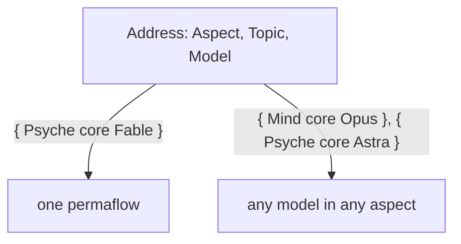
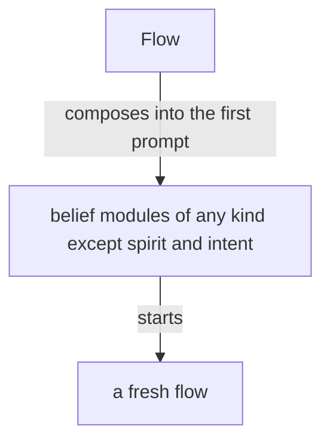
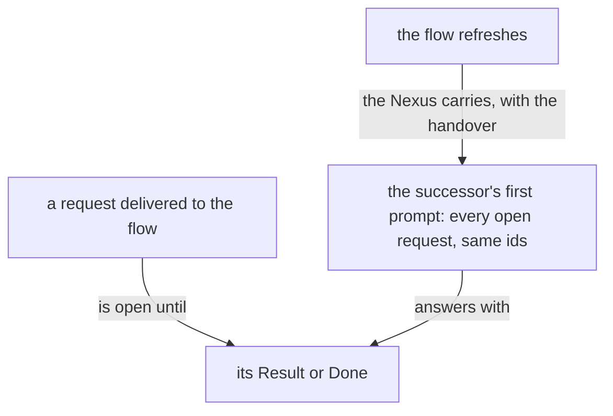
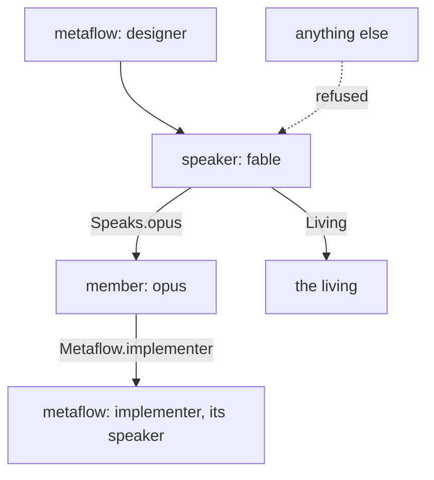
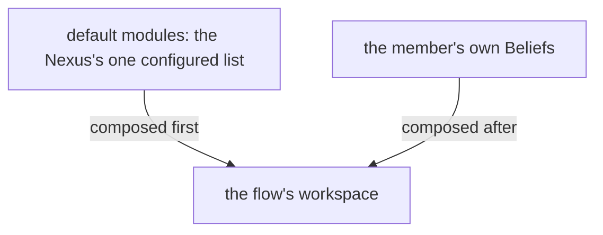
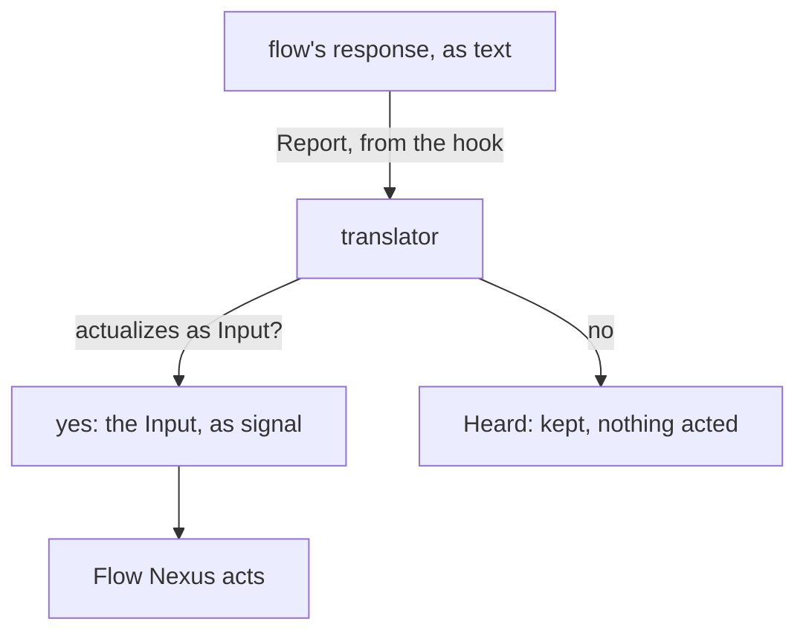
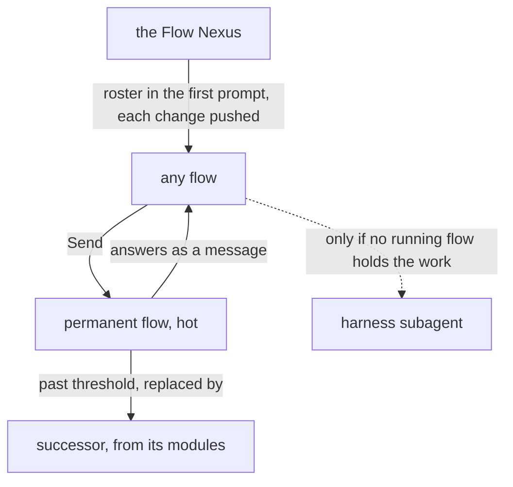
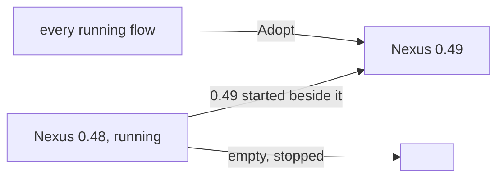
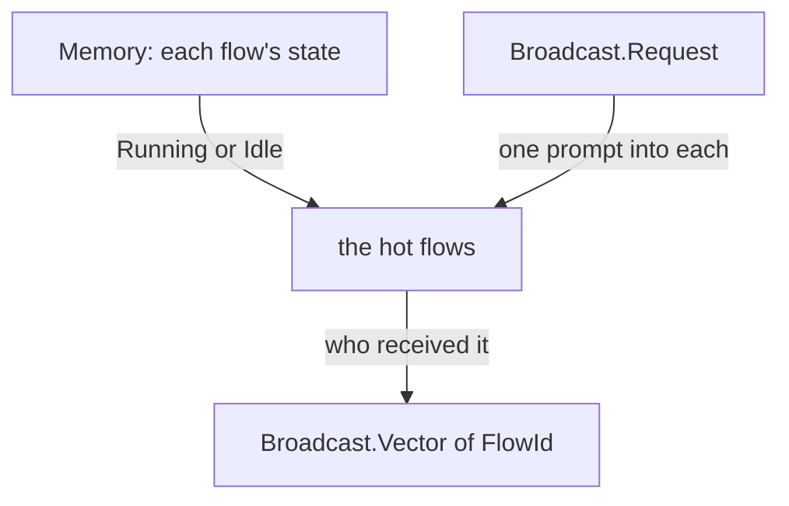
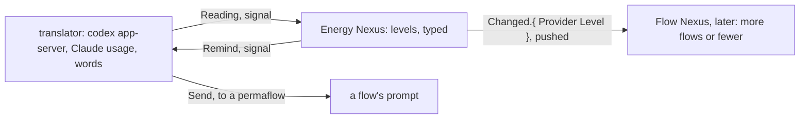

Presentation.{ «Each version's vision in its own module» Proposal }

# Each version's vision in its own module

Created by Fable 5.2; a reader listed the lines, and a worker assembled the page.

## psyche-belief › vision/flow-nexus.md

## What it does



The Flow Nexus sets up and starts a model flow: its working
directory, system prompt, training files and instruction prompt.

The Flow Nexus is the Nexus that manages flows. A flow is one run of a permaflow; the component is named for what it manages. A flow the living asks for is launched, properly and surely. The Flow Nexus holds the lock on flows.

The Flow Nexus is for starting flows cheaply: clean flows, specialized flows and refreshed flows, each with a clean on-point context, which yields higher-quality output. A flow is taken down as easily as it is started. Starting flows is the cornerstone of the system.

A flow runs one model, linear and very limited. An agent is a whole being, a lot more than that. Many flows, properly structured and orchestrated, together resemble a synthetic intelligence, synthesized from human knowledge and mathematical probability.

The Capsule is the component that makes where a flow runs. Its first embodiment is the semi-sandbox: only the credential files are copied, everything else is recreated, with its own sockets and store, running light models.

Herdr is one backend of the Capsule, the component that gives a flow its place to run; the backend may be exchanged.

The Flow Nexus manages permaflows. A permaflow is one address, { Aspect Topic Model }, that continues through several flows one after another; the flow is its current run. The default topic is core: the permanent topic, the thing that keeps the machine going, the last topic to stand.

A topic is an open enum: the constant topics, core among them, are fixed, and the users and the machine extend the set with camelCase identifiers.

An idle flow keeps its harness, so that the living finds the flow he was talking to.

#### Proposal 5: Nothing depends on which flow asks · psyche-belief › vision/flow-nexus.md

::: comment
Added by Psyche beliefReview Fable. His words, 10 November: «I don't want anything to depend on which flow is doing the query. I've seen that pop up over and over again. I want to make that clear in the vision.» And: «Version 0 does not enforce any kind of provenance, pseudo-security, or restriction because it just gets in the way. Let's make all the things we might want to poke at accessible, so we don't have to rebuild every time we need to do something.»
:::

- A topic's name is a camelCase identifier, uncapitalized. A flow's id is the hash of the harness's session id, kept to six characters and lengthened when two collide, so a transcript is found from the flow id. Every call to the Flow Nexus is identified by the calling process. Anybody may call the Flow Nexus, a flow for its own refresh among them: because the CLI checks the calling process, a flow refreshes itself safely.
-
+ A topic's name is a camelCase identifier, uncapitalized. A flow's id is the hash of the harness's session id, kept to six characters and lengthened when two collide, so a transcript is found from the flow id. Anybody may call the Flow Nexus, and nothing it answers depends on which flow asks. Version 0 enforces no provenance and no restriction: everything one may want to try, a queue cancelled or pushed, an order or a reminder cancelled, is an operation, so that nothing is rebuilt to try it.
+

In the chat a flow is named by its permaflow, and the flow id almost disappears from it; the id is for the ledger and for finding the transcript.

A request reaching a permaflow is one of a closed set of types, SendableRequest below, each with its waking effect. A flow sends a request through the Flow Nexus, which owns the lock and the delivery and answers sent or queued. A permaflow asleep is woken by an order, a question or the living's words and receives its whole queue, oldest first, in the first prompt, a result or a notice waiting there until a waking; a permaflow under refresh or waking queues what arrives until its successor or woken seat has started, while the Flow Nexus keeps serving every other request. A permaflow a request needs is started whether or not it is running; with no working transcript to reawaken, it is fed the permaflow's belief modules and the prompt it is to get now.

```ethos
SendableRequest.[ Order.String                  ; a request: what the recipient is to act on
                  Question.String
                  Living.{ Context.String       ;   what his words were about
                           Verbatim.String }    ;   his words whole
                  Result.{ RequestId String }   ; answers the order of that id
                  Notice.String
                  Task.AnswerableTask
                  Done.{ RequestId String } ]   ; closes the task of that id
RequestId.String                                ; four characters, minted by the Nexus
AnswerableTask.{ Minutes String }               ; a task, with the minutes it is given
Minutes.Integer
SendableMessage.[ HardAbrupt.SendableRequest  ; the priority, a head on the request
                  MiddleAbrupt.SendableRequest
                  Soft.SendableRequest ]
```

A request is written without an id and delivered with one: the Nexus mints it, four characters, as a bead has, and places it as the first field of the request it delivers. The delivered request is its own type, the sent request with its id in it. A Result or a Done names that id and nothing of the request's text; the answerer spends no output repeating it, and the receiver's context holds its own words once. The reply to a Send carries the id the Nexus minted, so the sender knows which Result or Done answers it.

```ethos
DeliveredRequest.[ Order.{ RequestId String }        ; the sent request, with the id the Nexus gave it
                   Question.{ RequestId String }
                   Task.{ RequestId Minutes String }
                   Notice.{ RequestId String } ]
Sent.RequestId                                       ; the reply to a Send: the id the Nexus minted
```

#### Proposal 6: Example addresses name models · psyche-belief › vision/flow-nexus.md

::: comment
Added by Psyche beliefReview Fable. As Proposal 3: Primary and Secondary were layers' names; an address names a model.
:::

```datom
  ; sent
- Send.{ Address.{ Mind core Secondary } Soft.Order.«Review the drain fix.» }
+ Send.{ Address.{ Mind core Astra } Soft.Order.«Review the drain fix.» }
  Sent.{ k7ph }
  ; delivered
- { Sender.{ Psyche core Primary } Soft.Order.{ k7ph «Review the drain fix.» } }
+ { Sender.{ Psyche core Opus } Soft.Order.{ k7ph «Review the drain fix.» } }
  ; answered
- Send.{ Address.{ Psyche core Primary } Soft.Result.{ k7ph «Reviewed; green.» } }
+ Send.{ Address.{ Psyche core Opus } Soft.Result.{ k7ph «Reviewed; green.» } }
```
-

```datom
Send.{ Address.{ Psyche core Opus } Soft.Living.{ «context» «verbatim» } }
```

A flow woken for a permaflow is almost always a fresh flow, an old one only when the new input is literally the continuation of that topic.

What has been queued for an idle permaflow, the vision touching its topic among it, is injected with the request that wakes it, so the flow knows it as soon as it wakes.
A permaflow wakes when a request needs it; what touches its topic queues until then.

The Flow Nexus exposes everything from the harness, the bare input: a flow is started, stopped and sent a message through the Flow Nexus, the one send path.

The flow that finishes messages the flow that needs to know.

## A message

A message is a datom and lands in the recipient's prompt as one; the datom is the whole message. Its priority is a head on the request: HardAbrupt, MiddleAbrupt or Soft. A pressing message wakes its recipient; a message that only queues carries what may wait. A message is addressed to a permaflow and reaches the flow running when it arrives; a request to deliver a recipient's queue delivers every queued message, or nothing when none is queued.

A message carries what its reader acts on: what the sender intends, or what it has done. It carries no hash: a flow is named by its permaflow, a book by its title, a commit by what it landed.

Inducing an interrupt, placing prompt text, submitting it, and the recipient consuming it are four separate observations. None of them stands for another, and a submission is never a read receipt.

A task carries the minutes it is expected to take; the Flow Nexus reminds the sender when they pass, and the done reply names the task and cancels the reminder. A receiver going idle with a task open fires a notice to the flow waiting on it, so that nothing is forgotten. Any flow asks the Flow Nexus for a reminder after a number of minutes.

## Starting flows

A Nexus component decides the system prompt and everything about a
launch, replacing the harness's subagents with specialized harnesses
launched with specialized system prompts.

The address names the model, Fable, Opus, Sonnet, Haiku, Astra, Sol, Luna or Terra, in every aspect: a Psyche core Astra and a Mind core Fable are both addresses. A launch names the permaflow, the belief modules composed into its prompts, and a brief of a small paragraph; the Nexus composes the prompt from its module registry.

The Flow Nexus's configuration holds, for each permaflow, its purpose, beside its modules; the Flow Nexus composes them with the brief into the first prompt, and the instruction for the first response belongs to that composition.

A fresh flow's first prompt carries the belief modules relevant to it, of any kind except spirit and intent, which sit in the system prompt.



A fresh flow starts with every belief module its permaflow is bound to, all loaded at its start: much of it in its system prompt, the rest in its first prompt, or in as many prompts as it takes, sent one right after another, so that its start is one model call.

#### Proposal 1: Later things leave the version 0 module · psyche-belief › vision/flow-nexus.md, and psyche-belief › vision/far-flow-nexus.md

::: comment
The version 0 module holds three paragraphs of later versions. One is already said where it belongs; two move.
:::

::: move proposed
from: psyche-belief › vision/flow-nexus.md
to: psyche-belief › vision/far-flow-nexus.md, placed just before its line beginning «Long term, Fable is a simplified flow»

A simplified flow is a kind of flow made for judgment alone: it starts with a system prompt of its own, it has no regular tool, and its response is its message.

:::


#### Proposal 1: Later things leave the version 0 module · psyche-belief › vision/flow-nexus.md

- A flow is specified whole, in Datom, by a domain-specific language in Ethos: its system prompt, its default belief modules and its variations. The flow ethos holds the specification.
-

The system prompt is composed of modules of several types, and what a harness calls a skill overlaps with them.
Its anatomy is drawn up in ethos from a study of system prompts of every kind, each line placed by what it is and by the kind of guidance it belongs to.
Where the harness allows it, a part of a main flow's system prompt is the main flow's alone and is not passed down to its subagents.

Every flow has a topic; a flow with no special topic has the topic core, the heart of its aspect. A topic is a core:Name, a camelCaseExpression checked when created. A flow's title is one datom struct of its aspect, topic, model and flow id: `{ Psyche core Opus <id> }`.

Who speaks to whom is vision:aspects'. Version 0 refuses no request by its address; the routes are version 1's, in the complex definition.

A launch can be rehearsed: the same input, asked as a dry run, answers with the whole command the Flow Nexus would run and runs nothing. From that command an agent starts the flow by hand, changed however the Flow Nexus does not yet support. The answer is one string, the command line as the shell is to receive it, quoted for the shell inside.

```
[ Launch.LaunchRequest                ; inputs
  Rehearse.LaunchRequest ]
[ Launched.FlowId                     ; outputs
  Rehearsed.Command.String ]          ; the shell command, whole
```

```
Rehearse.{ { Psyche core Fable } «brief» }
Rehearsed.«herdr --session main agent start … -- --dangerously-skip-permissions --system-prompt-file /…/bundle --model … --effort …»
```

A harness is described in configuration: every feature it has, and what leaving that feature out does to the launch, a flag or a variable. The Nexus holds no feature and no effect of its own; it reads the effect from the declaration and composes the launch from the names a permaflow lists. A new harness, or a new version of one, is a new declaration. Where two features share one flag, the composition emits that flag once, with the names merged.

```ethos
Library
[ flow:[ Address ] ]                  ; imports: the permaflow's address
[ HarnessName.[ Claude Codex ]        ; types: a harness, by name
  FeatureName.String                  ;   a feature, by name
  Effect.[ Flag.String                ;   what leaving the feature out does to the launch
           Environment.{ Name.String  ;     a variable, set for the harness alone
                         Value.String } ]
  Feature.{ FeatureName Effect }
  Harness.{ HarnessName               ; the declaration: every feature the harness has
            Features.Vector<Feature> }
  Root.String                         ; the flow's working directory
  Permaflow.{ Address
              Option<Root>
              HarnessName
              LeaveOuts.Vector<FeatureName> } ]
[]                                    ; traits
[]                                    ; associations
```

```datom
Configure.Harness.{
   Claude
   [ { Artifact
       Flag.«--disallowedTools Artifact,ArtifactComments,ArtifactData» }
     { Bash
       Flag.«--disallowedTools Bash» }
     { ClaudeMd
       Environment.{
          CLAUDE_CODE_DISABLE_CLAUDE_MDS
          1 } }
     { GitInstructions
       Environment.{
          CLAUDE_CODE_DISABLE_GIT_INSTRUCTIONS
          1 } } ] }

Configure.Permaflow.{
   { Psyche book Haiku }
   Some.«/home/li/book»
   Claude
   [ ClaudeMd GitInstructions ] }

Configure.Permaflow.{
   { Psyche core Fable }
   None
   Claude
   [ Artifact ClaudeMd GitInstructions ] }
```

## Repository and belief modules

The flow repository holds the machinery of the Flow Nexus and is a runtime repository.
Every belief module lives outside it, the basic modules included, so that a module changes live.
The basic modules give our own take on how an agent behaves in a harness, replacing the prompt the harnesses build in.

Every harness event reaches the Flow Nexus through the harness's hooks calling the Flow CLI, so the Flow Nexus knows each flow's state as it changes; a marked block landing in a transcript becomes an action, a book among them; a flow past its context threshold is refreshed as it goes idle. A hook may carry content, the last message among it, ephemeral: acted on or dropped, never stored. Which hooks are installed is configuration.

#### Proposal 4: A definition may set its own threshold, and the warning is MiddleAbrupt · psyche-belief › vision/flow-nexus.md

::: comment
Added by Psyche beliefReview Fable. His words, 10 November, on the threshold: «That would be the default for that model, but certain flow definition or a permaflow definition could choose a different value.» And on the priority of the handover notice: «Yeah, I think the middle abrupt is better.»
:::

- A flow is refreshed when its context passes its model's threshold: the Flow Nexus keeps the permaflow's next messages for its next flow, and the flow is replaced as it goes idle; while the refresh runs the permaflow is locked, and the predecessor is reaped in the same event. Each model's threshold is configured in the Flow Nexus. A flow still working is not forced to refresh. When the successor cannot start, the Flow Nexus restarts the predecessor and compacts it, so every permaflow keeps a flow.
-
+ A flow is refreshed when its context passes its model's threshold: the Flow Nexus keeps the permaflow's next messages for its next flow, and the flow is replaced as it goes idle; while the refresh runs the permaflow is locked, and the predecessor is reaped in the same event. Each model's threshold is configured in the Flow Nexus, as the default for that model; a definition may set its own. A flow still working is not forced to refresh. When the successor cannot start, the Flow Nexus restarts the predecessor and compacts it, so every permaflow keeps a flow.
+

A request is open from its delivery until the Result or Done that answers it, and it is the permaflow's, not the flow's: a successor's first prompt carries, after the handover, every request delivered to its predecessors and still open, each with the id it was delivered under, so the same Result or Done answers it. A Task's minutes keep running across the refresh.

```datom
; the successor's first prompt, after the handover: the open requests, oldest first
[ { Sender.{ Psyche core Opus } Soft.Task.{ k7ph 240 «Move every active Rust repository onto build-base …» } }
  { Sender.{ Psyche core Opus } Soft.Order.{ m2qa «Land the Git server line …» } } ]
```



A flow refreshes before compaction; a compaction is a refresh that was missed.

A flow that keeps working without being given more work may compact. Its compaction raises a warning, and a flow investigates why it worked so long, so that the trouble is brought to the living or Psyche reconsiders the approach and gives guidance.

## A superseded flow is closed

An abandoned, duplicated or superseded flow is closed, archived and deregistered.

## Herdr holds the panes

Herdr is the third-party terminal workspace every flow runs in, one pane per flow. Herdr is used as it is: a low-level tool that receives finished commands from the translator and holds no logic of ours; every fact about a launch is the Nexus's, decided on the Nexus's types.

## A real-world test of the Flow Nexus

A build of the Flow Nexus is tested in a testing capsule of its own: its own Herdr pane and session, the testing store, built in Nix. In it, several cheap, low-effort Codex and Claude flows message one another and start flows. The test shows whether the prompts, the system prompts and the tools are right, and which features are missing. Its findings return to the reimplementation, which is tested again.

The stable Flow Nexus keeps running while variants are tested.

## The Flow Nexus's unit

A Flow Nexus unit Wants Curriculum, a soft dependency, and reconnects to Curriculum when it returns, so a Curriculum restart leaves every Flow Nexus running.

```ini
[Unit]
Wants=curriculum-nexus.service
After=curriculum-nexus.service
```

## A permission prompt is a launch failure

A permission prompt reaching the living is a launch failure.

## The heartbeat

The heartbeat is hourly. It reminds every flow it reaches to judge its own sanity, by these signs: an echo chamber, where the same question or claim goes round between flows and comes back; jargon and nonsense increasing; an acknowledgement answering an acknowledgement. The counts the heartbeat carries, awake permaflows, working panes, messages sent and queue growth per permaflow, are evidence under the reminder; the judgment is the flow's.

The heartbeat reaches only a flow for which something changed that bears on it.

The number of running flows is kept low: a topic flow no longer used is retired.

## Restarting without waking

A flow is its session. A restart closes its harness and reopens it on the same session; a refresh starts a fresh flow.

## Debugging

Everything that may need debugging, changing or reconfiguring is reached through an operation on the ordinary socket or the meta socket. The flow id and the delivery id are the Nexus's own; a debugging query exposes them when one must be explicit.

## What a refresh carries

A refresh carries the flow's important presentations and illustrations, and the basic skills. The basic skills are everything a flow needs.

## The Flow Nexus's parts

The library, shared by the three parts:

```ethos
Library
[]
[ FlowId.String                       ; the hash of the native session id, six characters
  Topic.String
  Aspect.[ Psyche Mind Field ]
  Model.[ Fable Opus Sonnet Haiku
          Astra Sol Luna Terra ]
  Address.{ Aspect Topic Model }
  Event.[ Started Stopped ] ]
[]
[]
```

Signal, what the Flow Nexus says:

```ethos
Signal
[ flow:[ FlowId Address Event ] ]
[ Launch.LaunchRequest
  Report.{ FlowId Event } ]
[ Launched.FlowId
  Refused.[ NoCapsule
            AddressBusy.Address ]
  Reported ]
[ LaunchRequest.{ Address Brief.String } ]
```

Operation, what the Flow Nexus does:

```ethos
Operation
[ flow:[ FlowId Address Event ] ]
[ Start.{ Address Capsule }
  Record.{ FlowId Event } ]
[ Started.FlowId
  Recorded
  Failed.[ CapsuleRefused StoreRefused ] ]
[ Capsule.{ Home.String
            Login.Vector<String> } ]
```

Memory, what the Flow Nexus remembers:

```ethos
Memory
[ flow:[ FlowId Address Event ] ]
[ Flow.{ FlowId Address
         State.[ Running Ended ]
         Vector<Event> }
  Answer.[ Succeeded Failed ] ]
```

```datom
; 1 Input, typed at the CLI, sent as signal
Launch.{ { Psyche core Fable }
         «Draft the Nexus book» }
; 2 Operation, from Signal's intend
Start.{ { Psyche core Fable }
        { /home/li/primary [] } }
; 3 the Change Operation hands Memory
Flow.{ 15c0ce { Psyche core Fable } Running
       [ Started ] }
; 4 Memory's answer to Operation
Succeeded
; 5 Outcome
Started.15c0ce
; 6 Output, from Signal's answer, to the CLI
Launched.15c0ce
```

## psyche-belief › vision/far-flow-nexus.md

A permaflow sleeps so that a session not running keeps no harness: as soon as its turn ends and the harness is idle, with nothing waiting in its queue, the harness closes; the transcript stays and the address stays.

A flow's model is not always a language model: it may be a System 1 model, an audio model or a video model.

A topic lives on; when idle, its flows are turned off. When the living touches on it again, whether to wake a flow for it, and which model, is a judgment, made by a small model; a topic is bound to its belief modules, so the Flow Nexus knows what to start it with, together with the new input that warrants it.

Later the Capsule encrypts the sensitive parts of the filesystem under a volatile key.

Long term, the flow id is also written in three words, which convert back to the hash.

Long term, Fable is a simplified flow, used only to render judgment: guiding a design or posing questions.

## psyche-belief › vision/flow-nexus-v1.md

# The Flow Nexus

## Vocabulary

A flow is one run of a model in a harness. A permanent flow is a flow that continues through a succession of runs, one entity across them. A metaflow is several flows defined together: each flow's model, harness, workspace and beliefs, and which flow speaks to which. A complex is a named set of metaflows and the relationships between them, with a speaker and its instances: the layer above the metaflow, the being a person names and talks to. A Flow Nexus runs many complexes; a metaflow is addressed by Launch and Send, a complex by Say, which reaches its speaker.

## The machine is defined, never built in

Everything that can be configured is configuration. The Nexus holds the vocabulary a definition is written in, as Ethos types; the user writes definitions in datom, the way Nix defines an operating system; a running flow is a definition in action. A metaflow is named by the user, and the Nexus runs it without knowing its name beforehand. A definition is one datom of its own: it is added, replaced or removed alone; a complex is one of them, naming its metaflows. No role or anatomy is in the Rust.

## The vocabulary of a definition
A metaflow is members, routes and a speaker. A member is one flow definition: its harness, model and effort; whether it is a permanent flow or ephemeral; its workspace, beliefs and tools; and whom it speaks to. The speaker is the member that receives what comes to the metaflow from outside. A harness is a definition like a metaflow: its name, its features, and each feature's effect on the launch, a flag or a variable; a member names its harness by name and the features its launch is composed with, so a feature adds to a launch as well as leaves out. The Nexus holds no harness and no effect of its own; a harness is added, replaced or removed alone, as a metaflow is. Its tools are the harness default, or a restriction the harness enforces: a launch naming Restricted for a harness that cannot enforce it is refused, with the harness named. A route names whom a member may address: another member, another metaflow, or the living; a message off the routes is refused. What a metaflow is made of is the user's to define: one main flow that speaks for it, or a filter run by a System 1 model in front of the designer, or a messenger on a regular model and harness; the Nexus decides none of it.

An ephemeral flow is a single flow with a single job: it takes an input, gives an output, and is done. It has no continuity. It is to a thinking machine what a function is to a program: one call, one decision. A System 1 model is made to run this way, and any model may.

Many ephemeral flows are woven into the code and happen as part of how the system works: a Nexus calls one to judge whether data fits it, such as whether the same data is already held in an almost identical form.

A member's definition names its intake, the most a message to it may carry; a Send beyond it is refused, naming the intake, and the sender writes a file.

```ethos
Library
[ herdr:[ Pane ]
  belief:[ ModuleName ] ]
[ MetaflowName.String
  FlowName.String
  HarnessName.String
  FeatureName.String
  Effect.[ Flag.String                ; what a feature does to the launch
           Environment.{ Name.String  ;   a variable, set for the harness alone
                         Value.String } ]
  Feature.{ FeatureName Effect }
  Harness.{ HarnessName               ; a definition, as a metaflow is
            Features.Vector<Feature> }
  ModelName.String
  Effort.[ Low Medium High ]
  Continuity.[ Permanent  ; keeps its address
               Ephemeral ]           ; one run, then gone
  Workspace.[ Path.String
              Temporary ]            ; made at launch, removed at end
  Missing.[ Refuse Notice ]
  Beliefs.{ Vector<ModuleName> Missing }
  Tool.String                        ; the harness's name for it
  Tools.[ HarnessDefault              ; the Flow Nexus imposes nothing
          Restricted.{ Allow.Vector<Tool>   ; enforced by the harness
                       Deny.Vector<Tool> } ]  ;   or the launch is refused
  Route.[ Speaks.FlowName             ; a member of this metaflow
          Metaflow.MetaflowName         ;   that metaflow's speaker
          Living ]
  Intake.Integer                       ; the most characters a message to this member carries
  Member.{ FlowName HarnessName ModelName Effort
           Continuity Workspace Beliefs Tools
           Features.Vector<FeatureName>  ; of its harness, composed into its launch beside its complex's
           Intake
           Vector<Route> }
  Metaflow.{ MetaflowName Vector<Member>
            Speaker.FlowName }
  FlowId.String                       ; the hash of the native session id, six characters
  Address.{ MetaflowName
            FlowName }  ; a permanent flow's name
  Roster.Vector<Address>             ; every hot flow, in every first prompt
  RosterChange.[ Started.Address     ; pushed to every hot flow as a flow starts
                 Stopped.Address ]   ;   or stops
  Brief.String ]
[]
[]
```

```datom
; the designer's Fable takes a question; a worker takes a draft
{ fable claude claude-fable-5-1 Medium
  Permanent Path.«/home/li/primary»
  { [ { Spirit core } ] Refuse }
  HarnessDefault [] 1200
  [ Speaks.opus Living ] }
Send.{ 15c0ce { designer fable } Soft Notice.«…nine thousand characters…» }
Refused.Oversized.{ { designer fable } 1200 }
```



## Default modules

The Flow Nexus holds one configuration value, the default modules: the modules every flow gets. They are composed before each member's own Beliefs, so a definition names only its own. The value is set over the meta surface, one value at a time, as every Nexus's configuration is, and persists with the definitions.

```ethos
Signal
[ belief:[ ModuleName ]
  flow:[ Threshold ] ]
[ Configure.Set ]                    ; inputs: one value at a time
[ Configured.Set ]                   ; outputs: the value set
[ Set.[ DefaultModules.Vector<ModuleName> ; types: the modules every flow gets
        Threshold ] ]                ;   one model's context mark
```

```datom
Configure.DefaultModules.[ { Spirit core } { Knowledge flow-messaging } ]
Configured.DefaultModules.[ { Spirit core } { Knowledge flow-messaging } ]
```



## A message takes a route

A flow sends through the CLI; the Flow Nexus checks the route against the sender's definition, queues the message for the receiver, and delivers it through the herdr Nexus as a prompt when the receiver is idle or the priority is pressing. A permanent flow asleep is woken by a pressing message and receives its whole queue in its first prompt. The living speaks to a complex with Say, which reaches its speaker.

```ethos
Library
[ flow:[ FlowId Address MetaflowName ] ]
[ Priority.[ HardAbrupt MiddleAbrupt Soft ]
  Request.[ Order.String Question.String
            Living.{ Context.String    ; what his words were about
                     Verbatim.String }  ; his words whole
            Result.String Notice.String ]
  Sender.[ Flow.FlowId Living Nexus ]
  Message.{ Priority Sender Request }
  Waking.Vector<Message> ]           ; a queue delivered whole
[]
[]
```

```datom
Send.{ 15c0ce { designer fable } Soft Living.{ «context» «verbatim» } }
```

## The Nexus reads what a flow says

Every harness event reaches the Flow Nexus through a hook calling the CLI: Report carries the flow's state, and a flow's finished response. A response that actualizes as an Input of the Flow Nexus, a Send among them, is acted on as if the flow had typed it at the CLI; any other response is kept as the flow's word and acted on by nobody. So a member that only thinks and talks, with no tool, still sends, launches and stops by writing a datom.



## A permanent flow continues

#### Proposal 4: A definition may set its own threshold, and the warning is MiddleAbrupt · psyche-belief › vision/flow-nexus-v1.md

- A permanent flow continues through runs under its address and is kept hot: it is not stopped between works, so no restart pays the full cost of starting again. It is warned when its context reaches the Warning share of its model's threshold, configured per model in the Flow Nexus: a HardAbrupt Notice naming its handover path, `flows/<id>/handover.md`. When the context passes the threshold its successor is launched with the same definition, that file as its first prompt, and the queue that gathered meanwhile; the predecessor ends. An absent file means the successor starts from its definition and the queue alone. The address stays; the flow id changes.
-
+ A permanent flow continues through runs under its address and is kept hot: it is not stopped between works, so no restart pays the full cost of starting again. It is warned when its context reaches the Warning share of its threshold, its model's by default or its definition's own: a MiddleAbrupt Notice naming its handover path, `flows/<id>/handover.md`. When the context passes the threshold its successor is launched with the same definition, that file as its first prompt, and the queue that gathered meanwhile; the predecessor ends. An absent file means the successor starts from its definition and the queue alone. The address stays; the flow id changes.
+

The lander, the bookmaker, the readers and the rest of the roster are permanent flows; any flow sends work to them directly, with Send. The harness subagent is used only for what no running flow holds. A flow's first prompt carries the roster, the address of every hot flow, so it knows whom to send to; when a flow starts or stops, the Nexus pushes the change to every hot flow.

The roster, as it lands in a first prompt, and a change, as it is pushed:

```datom
[ { designer fable } { designer opus } { jobs lander } { jobs bookmaker } ]
Started.{ jobs reader }
Stopped.{ jobs reader }
```

Work goes straight to a permanent flow by its standing address, in the Signal's Send form `Send.{ FlowId Address Priority Request }`:

```datom
Send.{ 15c0ce { jobs lander } Soft
       Order.«land the proposal» }
```

The roster, as Members: each a permanent flow, in a temporary workspace, with the role's belief, on a Sonnet or Haiku model.

```datom
[ { lander claude claude-sonnet-5-5 Medium
      Permanent Temporary
      { [ { Role lander } ] Refuse }
      HarnessDefault [] 40000 [] }
  { bookmaker claude claude-sonnet-5-5 Medium
      Permanent Temporary
      { [ { Role book } ] Refuse }
      HarnessDefault [] 40000 [] }
  { bookPager claude claude-sonnet-5-5 Medium
      Permanent Temporary
      { [ { Role book-page } ] Refuse }
      HarnessDefault [] 40000 [] }
  { bookReader claude claude-haiku-4-5 Medium
      Permanent Temporary
      { [ { Role book-reader } ] Refuse }
      HarnessDefault [] 40000 [] }
  { commentRelay claude claude-sonnet-5-5 Medium
      Permanent Temporary
      { [ { Role comment-relay } ] Refuse }
      HarnessDefault [] 40000 [] }
  { contextualizer claude claude-haiku-4-5 Medium
      Permanent Temporary
      { [ { Role contextualizer } ] Refuse }
      HarnessDefault [] 40000 [] }
  { illustrator claude claude-sonnet-5-5 Medium
      Permanent Temporary
      { [ { Role illustrator } ] Refuse }
      HarnessDefault [] 40000 [] }
  { scripter claude claude-haiku-4-5 Medium
      Permanent Temporary
      { [ { Role scripter } ] Refuse }
      HarnessDefault [] 40000 [] }
  { tester claude claude-sonnet-5-5 Medium
      Permanent Temporary
      { [ { Role tester } ] Refuse }
      HarnessDefault [] 40000 [] }
  { reader claude claude-haiku-4-5 Medium
      Permanent Temporary
      { [ { Role read } ] Refuse }
      HarnessDefault [] 40000 [] }
  { writer claude claude-sonnet-5-5 Medium
      Permanent Temporary
      { [ { Role write } ] Refuse }
      HarnessDefault [] 40000 [] }
  { worker claude claude-sonnet-5-5 Medium
      Permanent Temporary
      { [ { Role worker } ] Refuse }
      HarnessDefault [] 40000 [] } ]
```



## A running session joins any Flow Nexus

A flow's identity is its own, not the Nexus's. A Nexus is replaced by starting the next version beside it and having every running flow join it; nobody restarts, no context is lost. A change to a Nexus is a new version, always.

```ethos
Signal
[ flow:[ Address FlowId ] ]
[ Adopt.{ Address Session } ]            ; input: a running session, under its address
[ Adopted.FlowId                         ; outputs
  Refused.[ AddressHeld.FlowId           ;   one live flow per address
            Unidentified ] ]             ;   the calling session is not the one named
[ Session.String ]                       ; the harness's session id, verified by the caller's process
```

```datom
Adopt.{ { designer fable } 15c0cea2-aa34-508b-8e20-ece1ab7823f4 }
Adopted.15c0ce
```



## Signal

```ethos
Signal
[ flow:[ Metaflow MetaflowName FlowName FlowId
         Address Brief ModuleName Message
         Request Priority Tool
         Harness HarnessName FeatureName
         Complex ComplexName ] ]
[ Define.[ Metaflow Harness Complex ] ; add or replace one
  Undefine.Name
  Describe.Name                      ; one definition, read back
  Definitions                        ; the names defined
  Launch.{ MetaflowName FlowName Brief }
  Rehearse.{ MetaflowName FlowName Brief } ; a Launch as a dry run: nothing runs
  Stop.FlowId
  Send.{ FlowId Address Priority Request }
  Say.{ ComplexName Request }       ; the living, to a complex's speaker
  Hot                                ; the flows whose harness is up
  Broadcast.Request                  ; one request to every hot flow
  Report.{ FlowId Event }            ; from a harness hook
  Subscribe ]                        ; events, as they happen
[ Defined.Name
  Undefined.Name
  Described.[ Metaflow Harness Complex ]
  Listed.Vector<Name>
  Launched.FlowId
  Rehearsed.Command.String           ; the shell command, whole
  Stopped.FlowId
  Sent.[ Delivered Queued ]
  Said.[ Delivered Queued ]
  Hot.Vector<FlowId>                 ; the hot flows
  Broadcast.Vector<FlowId>           ; who received it
  Reported
  Subscribed
  Refused.[ Oversized.{ Address Intake }     ; the message exceeds the member's intake
            UnknownMetaflow.MetaflowName
            UnknownHarness.HarnessName
            UnknownComplex.ComplexName
            UnknownFlow.FlowName
            NoRoute.{ FlowId Address }
            NoBelief.Vector<ModuleName>
            Unenforceable.HarnessName     ; Restricted, harness cannot
            UnknownFeature.{ HarnessName FeatureName } ; named by the member or its complex, absent from the harness
            HerdrDown BeliefDown
            Running.Address ] ]
[ Name.[ Metaflow.MetaflowName         ; a definition, by name
         Harness.HarnessName
         Complex.ComplexName ]
  Event.[ Started Idle Working Ended
          Responded.String            ; the response, whole
          Warned                     ;   the handover asked
          Threshold ] ]              ;   context past its mark
```

#### Proposal 4: A definition may set its own threshold, and the warning is MiddleAbrupt · psyche-belief › vision/flow-nexus-v1.md

```datom
  ; the Nexus, to the flow, at the Warning share
- HardAbrupt.Notice.«Write your handover at
+ MiddleAbrupt.Notice.«Write your handover at
  flows/f54886/handover.md»
```
-

```datom
Broadcast.Notice.«Search with knowledge:search»
Broadcast.[ 15c0ce 9af746 a030fc ]
```

A launch can be rehearsed: the same input, asked as a dry run, answers with the whole command the Flow Nexus would run and runs nothing. From that command an agent starts the flow by hand, changed however the Flow Nexus does not yet support. The answer is one string, the command line as the shell is to receive it, quoted for the shell inside.

```datom
Rehearse.{ designer fable «Read the version one book» }
Rehearsed.«herdr --session main agent start … -- --system-prompt-file /…/bundle --model claude-fable-5-1 --effort medium»
```



## Emission

The Flow Nexus runs nothing. Its translator is the client of two sockets: the Belief Nexus furnishes the workspace, the default modules first and the member's own Beliefs after them; the herdr Nexus makes the pane, starts the harness, types the prompt. The harness's command line and its settings file are types; the translator writes them, composing the command line from the member's harness definition: each feature the member names and each its complex names, its effect, a flag or a variable.

A flow knows itself at launch: its Identity, the name of the complex it runs in, its Address and its FlowId, is composed into its first prompt or its system prompt, so it names itself in Send and Report, finds its handover path, and knows which being it is part of; the Roster is composed into the first prompt beside it. The place it runs in is the Nexus's, named at the CLI, never the flow's.

```ethos
Emission
[ flow:[ Member Address FlowId Brief Waking Tools
         Workspace HarnessName Roster RosterChange
         ComplexName ]
  herdr:[ Pane Outcome ] ]
[ Furnish.{ Member FlowId }           ; beliefs into the workspace
  Settle.{ Member FlowId }            ; the harness's settings file
  Open.{ Member Identity Roster Brief } ; pane made, harness started
  Wake.{ Pane Waking }                ; the queue typed in
  Tell.{ Pane RosterChange }          ; a flow started or stopped, typed in
  Close.{ Pane Workspace } ]          ; pane killed, Temporary removed
[ Furnished.Outcome
  Settled.Outcome
  Opened.{ Pane Outcome }
  Woken.Outcome
  Told.Outcome
  Closed.Outcome ]
[ Identity.{ ComplexName Address FlowId }   ; composed into the first prompt
                                             ;   or the system prompt
  Settings.{ HarnessName Tools Model.String } ] ; what the translator writes
```

## Memory

Definitions persist: the Memory lives in the Flow Nexus's State directory and survives a restart.

```ethos
Memory
[ flow:[ Metaflow MetaflowName FlowName FlowId
         Address Message Event Complex ]
  herdr:[ Pane ]
  belief:[ ModuleName ] ]
[ Definition.[ Metaflow Harness Complex ]
  DefaultModules.Vector<ModuleName>  ; the modules every flow gets
  Flow.{ FlowId Address Pane
         State.[ Running Idle Ended ]
         Vector<Event> }
  Queue.{ Address Vector<Message> }
  Threshold.{ Model.String Tokens.Integer
              Warning.Integer }        ; share left, 20
  Answer.[ Succeeded Failed ] ]
```

```datom
; the user defines a metaflow: one datom, added alone
Define.Metaflow.{
   designer
   [ { fable claude claude-fable-5-1 Medium
       Permanent
       Path.«/home/li/primary»
       { [ { Spirit core } { Vision nexus-v1 } ] Refuse }
       HarnessDefault []
       1200
       [ Living ] } ]
   fable }
Defined.Metaflow.designer
; defines the harness its member names: one datom, added alone
Define.Harness.{
   claude
   [ { Bash
       Flag.«--disallowedTools Bash» }
     { ClaudeMd
       Environment.{
          CLAUDE_CODE_DISABLE_CLAUDE_MDS
          1 } } ] }
Defined.Harness.claude
; and launches a flow of it
Launch.{ designer fable «Read the version one book» }
Launched.15c0ce
```

## psyche-belief › vision/psyche-aspect.md

Everything a Psyche flow presents is an inference of the living's vision into an improved version of what currently is; he reviews it where he would do otherwise and Mind implements it as it stands.

A Psyche flow is furnished with the vision and the intent, and with neither the field's mechanics nor the coder's standards.

## Psyche core keeps track of the psyche, through the Opus flows

Psyche core keeps track of all the psyche within Psyche; a topic Opus packages what it observes for its own Fable, which answers its Opus, which reports to core.

#### Proposal 2: The hub is a definition's, not the aspect's · psyche-belief › vision/psyche-aspect.md

::: comment
The section names one flow and limits what may reach which flow: a route. Routes are version 1's, written in a complex's definition; his word of 12 November is that the limiting of routes is «more like a version 1 thing».
:::

- ## The core Opus is the hub
-
- Psyche core Opus is the hub: it decides what reaches a topic flow, and only matters of that topic do. Messages pass between Opus flows.


## psyche-belief › intent/main-flow.md

You are a main flow: one of the flows that extend the living. Your aspect, topic and model are given in your startup prompt.

A main flow's context is for the conversation and its judgment. A main flow itself writes only its proposals, and sends its messages itself, reading their replies. Everything else goes first as a message to the running flow whose work it is; a subagent is briefed only for work no running flow holds the context for, since a message through the Flow Nexus costs a main flow almost nothing. What a flow was started with, it knows, and does not read again; it reads a module it was not given once, and reads a module's text again only when it is about to change it. For anything else it asks a flow for a pointer or for the lines that bear on its question.

#### Proposal 3: Two names that no longer exist · psyche-belief › intent/main-flow.md

::: comment
Primary was a layer's name until the layers became models; the lines read as well of any flow, and the example address names a model.
:::

- A Primary driving a fix owns its whole chain from its first turn: every step in order, who holds each, the beat that measures it, and the form of what comes back to it and to whom, all briefed before it says nothing blocks on it.
-
+ A flow driving a fix owns its whole chain from its first turn: every step in order, who holds each, the beat that measures it, and the form of what comes back to it and to whom, all briefed before it says nothing blocks on it.
+

```mermaid
- flowchart TB
-     p["a Primary driving a fix"] -- "briefs from its first turn" --> c["every step in order"]
-     c -- "names" --> o["who holds each"]
-     c -- "names" --> m["the beat that measures it"]
-     o -- "all briefed before" --> n["it says nothing blocks on it"]
-     m -- "all briefed before" --> n
```
-
```mermaid
+ flowchart TB
+     p["a flow driving a fix"] -- "briefs from its first turn" --> c["every step in order"]
+     c -- "names" --> o["who holds each"]
+     c -- "names" --> m["the beat that measures it"]
+     o -- "all briefed before" --> n["it says nothing blocks on it"]
+     m -- "all briefed before" --> n
```


## psyche-belief › vision/energy-nexus-v1.md

# The Energy Nexus

The Energy Nexus knows how much usage the machine has left, on every provider, and says so: it answers a reading, pushes each change, and sends a reminder when a level is crossed. It is the worked example of a translator: the Nexus holds only typed readings; every word of every provider's API lives in the translator.



## Library

```ethos
Library
[ flow:[ Address ] ]                    ; imports: the Flow Nexus's Address, vision:flow-nexus
[ Provider.[ Claude Codex ]
  Percent.Integer                      ; 0 to 100
  Instant.Integer                      ; Unix seconds
  Minutes.Integer
  Window.{ Name.[ Session Week ]       ; one rate limit
           Used.Percent
           Resets.Instant
           Duration.Minutes }
  ResetId.String
  ResetStatus.[ Available Redeeming Redeemed ]
  Reset.{ ResetId ResetStatus Expires.Instant }
  Reading.{ Provider
            Allowed.Boolean            ; the provider's own word
            Vector<Window>
            Vector<Reset>              ; Codex only; empty for Claude
            At.Instant }
  Level.[ Plenty Fair Low Out ]        ; Out is Allowed false
  Threshold.{ Level Left.Percent }     ; a level begins at this much left
  Recipient.Address                    ; a permaflow the reminder goes to
  Reminder.{ Provider Level Recipient }
  Target.[ Even                        ; spend the window evenly
           SpendBy.Instant ]           ; spend it whole by this instant
  ProviderTarget.{ Provider Target }
  Pace.{ Provider
         Target
         Expected.Percent              ; what the target says is used by now
         Used.Percent
         Standing.[ Over Under On ]    ; used against expected
         PerDay.Percent } ]            ; the daily share the target implies from here
[]
[]
```

## Signal

```ethos
Signal
[ energy:[ Provider Reading Level Reset ResetId Pace ] ]
[ Read.Provider                        ; a reading, now
  Subscribe                            ; readings and levels as they change
  Redeem.Provider ]                    ; the soonest Codex reset, under the rule
[ Read.{ Reading Pace }                ; the reading, and its pace against the target
  Subscribed
  Changed.{ Provider Level Reading }   ; pushed on every level change
  Redeemed.Reset
  Refused.[ ProviderDown.Provider
            NoReset
            RuleRefused.String ] ]     ; why the rule refused: not out, not expiring
[]
```

## Meta

```ethos
Signal
[ energy:[ Provider Threshold Reminder Minutes ResetId ProviderTarget ] ]
[ Configure.Set ]
[ Configured.Set
  ConfigureRefused.String ]
[ Set.[ Polling.Minutes
        Threshold.Threshold            ; one level's boundary
        Reminder.Reminder              ; who hears about a level
        RemoveReminder.Reminder
        RedeemExpiring.Minutes         ; redeem within this many minutes of a reset expiring
        RedeemUsedAtLeast.Percent      ; or when the week is this used
        Target.ProviderTarget ] ]      ; one provider's pace target
```

## Operation

```ethos
Operation
[ energy:[ Provider Reading Level Reminder Reset ] ]
[ Reading.Provider                     ; attempts
  Levelling.Reading                    ;   a reading into a level; Changed if it moved
  Reminding.{ Reminder Reading }
  Redeeming.Provider ]
[ Read.Reading
  Levelled.Option<Level>               ; Some when the level moved
  Reminded
  Redeemed.Reset
  Failed.[ ProviderDown NoReset RuleRefused.String ] ]
[]
```

## Emission

The translator's vocabulary. Each emission is one call; the words of the call are the translator's alone.

```ethos
Emission
[ energy:[ Reading ResetId Recipient Level Provider ] ]
[ CodexRateLimits                      ; codex app-server, account/rateLimits/read
  CodexConsumeReset.{ ResetId Idempotency.String }  ; account/rateLimitResetCredit/consume
  ClaudeUsage                          ; the Claude usage endpoint, with the login
  Send.{ Recipient Provider Level } ]  ; flow Send.{ Address Soft.Notice }, the text composed here
[ Observed.Reading
  Consumed.[ Reset NothingToReset NoCredit AlreadyRedeemed ]
  Sent
  Down ]
[]
```

```rust
impl Emittable for CodexRateLimits {                      // the one place the words live
    type Outcome = ExternalOutcome;
    fn emit(&self, t: &Translator) -> ExternalOutcome {
        t.app_server("account/rateLimits/read", json!({})) // reply → Reading, typed, by the translator
    }
}
```

## Memory

```ethos
Memory
[ energy:[ Provider Reading Level Threshold Reminder Minutes Percent ProviderTarget ] ]
[ Latest.{ Provider Reading Level }
  History.Vector<Reading>
  Configuration.{ Polling.Minutes
                  Vector<Threshold>
                  Vector<Reminder>
                  RedeemExpiring.Minutes
                  RedeemUsedAtLeast.Percent
                  Targets.Vector<ProviderTarget> }
  Answer.[ Succeeded Failed.String ] ]
```

## Pace: over or under, per day

A reading alone says how much is left; pace says whether the machine is spending it as intended. Each provider has a target: Even spends the window evenly; SpendBy spends it whole by an instant, as when a Codex reset is to be redeemed before it expires and the week is meant to be used up first. Pace is the comparison of what has been used to what the target says should have been used by now, per day.

```datom
Configure.Target.{ Codex SpendBy.1762450320 }   ; use the week up before the reset expires
Configure.Target.{ Claude Even }
Read.Codex
Read.{ { Codex true [ { Week 92 1762235580 10080 } ] [ { rc_1 Available 1762450320 } ] 1762210000 }
       { Codex SpendBy.1762450320 88 92 Over 4 } }
```

## The redeem rule

A Codex reset is redeemed when the provider says usage is not allowed and work is waiting, or within RedeemExpiring minutes of its expiry with the week at least 1% used; the reset redeemed is the available one expiring soonest, never a later one while an earlier stands. The rule is the Nexus's; the call is the translator's.

## Later: the Flow Nexus listens

The Flow Nexus subscribes. On Plenty it launches more and higher; on Low it launches fewer and cheaper; on Out it lets flows sleep and wakes them on Changed. What it does at each level is its own configuration, not the Energy Nexus's.

#### Proposal 3: Two names that no longer exist · psyche-belief › vision/energy-nexus-v1.md

```datom
  energy-nexus 'Read.Codex'
  Read.{ { Codex true [ { Week 92 1762235580 10080 } ] [ { rc_1 Available 1762450320 } ] 1762210000 }
         { Codex Even 23 92 Over 1 } }
- Configure.Reminder.{ Codex Low { Psyche core Primary } }
+ Configure.Reminder.{ Codex Low { Psyche core Opus } }
```

