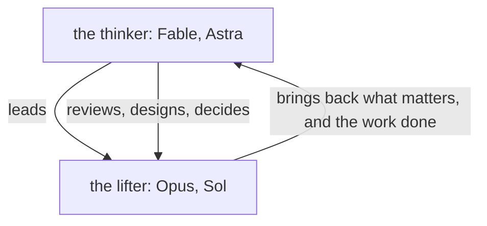
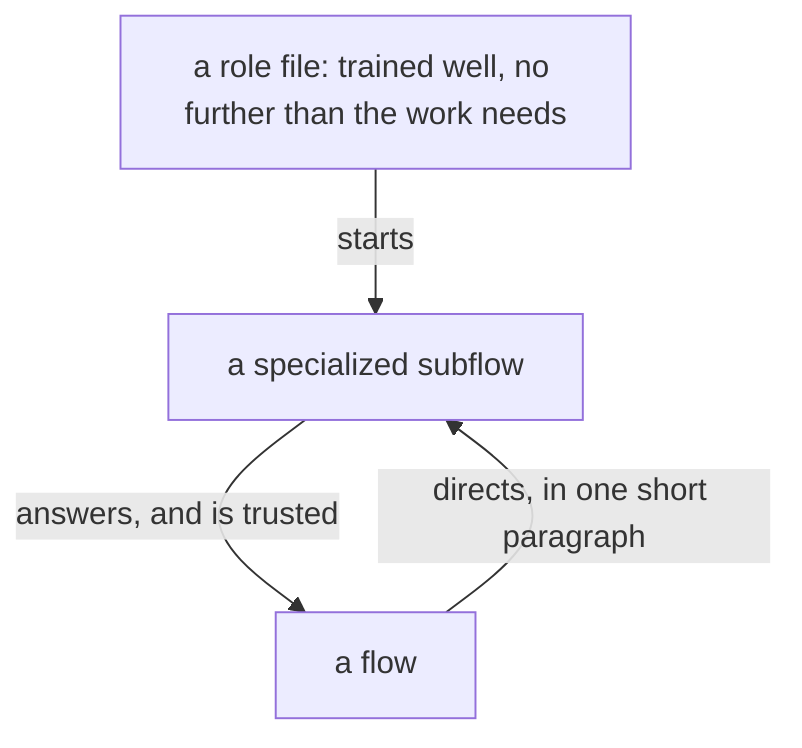

# Design: Who audits, who holds the code, who is asked

Author: Psyche core Fable (Fable 5.2). A worker assembles the presentation source from this file. Title: «Who audits, who holds the code, who is asked». Kind: Proposal. Signature line: Created by Fable 5.2; a Sonnet reader collected his words, and a worker assembled the page.

Redone on his words of 12 November: «The mind aspect proposal is a bit too specific about what to do. I want it more to inspire broad direction than give narrow direction … I'm not so keen on naming the flows so much» and, on the lines that limit the routes for messaging, «That's more like a version 1 thing, so let's make sure it's not in the wrong vision.»

The page is in the in-place form: each module view whole as it stands, each proposal at its landing place, added lines under the light green margin, removed lines under the light red margin, a moved line under the third colour headed by the module it leaves and the module it enters. Modules shown: psyche-belief › vision/model-roles.md (Proposals 1, 2, 6, 7), psyche-belief › vision/mind-aspect.md (Proposal 3), psyche-belief › vision/subflows.md (Proposal 4), psyche-belief › vision/aspects.md (Proposals 5, 6), psyche-belief › vision/flow-nexus.md (Proposal 6), psyche-belief › vision/flow-nexus-v1.md (Proposal 6; if the module is long, show the section «## A message takes a route» with what the form needs around it). Wording marked ADD, REMOVE, MOVE or COMMENT is final.

---

## Proposal 1: One thinks, one lifts · psyche-belief › vision/model-roles.md

COMMENT
His words, 11 November: «Let's do a kind of mirror of how Fable is to Opus, right? Fable does most of the heavy thinking, and then Opus does most of the lifting. We'll do that with Astra and Sol … Most of the code will be written by Sol and then reviewed by Astra.» The table above this place already pairs the models; this says what the pairing is for, in every aspect.

PLACE: section «## Models have personality», after the table and the line on Jev.

ADD
In each pair, one model thinks and one lifts. The thinker does the heavy thinking: it leads, reads what the lifter brings back, designs and decides. The lifter does most of the doing, and where the doing is code, writes most of it, for the thinker to review.

---

## Proposal 2: A dear flow's past is read, not asked · psyche-belief › vision/model-roles.md

COMMENT
His words, 24 October: «Imagine you have this really important employee in a business and you can ask him questions without bothering him. That's what the transcript is so why would you bother him? You might as well just get a haiku subagent to tell you what you want to know about him.»

PLACE: section «## A design decision goes up, to Fable», after its first paragraph.

ADD
What a dear flow did or said is read from its transcript, by a cheap flow. The dear flow itself is asked only for a judgment it has not yet given.

---

## Proposal 3: Finished work is audited against the vision · psyche-belief › vision/mind-aspect.md

COMMENT
His words, 22 October: «every time they finish an implementation their primaries will audit it and tell them what they need to modify.» 11 November: «Opus can do the design audit afterwards.» Who audits follows from the models; the line says only that it is done.

PLACE: after the paragraph «A Mind flow writes the code: it implements the design Psyche rules, as it stands, and asks where the design is silent.»

ADD
A finished implementation is audited against the vision before it is reported done.

---

## Proposal 4: A role is trained once and directed in a paragraph · psyche-belief › vision/subflows.md

COMMENT
His words, 30 October: «You just have to ask them a simple question and trust their good judgment … well-trained but not overtrained subagent role files for the machines to use so that they can just give them … one short paragraph at most.» 4 November: «I thought by now you'd have like 15 different kinds of specialized subagents.» This lands the principle alone; which roles there are is designed with him.

PLACE: a new section at the end of the module.

ADD
## A role is trained once and directed in a paragraph

A subflow's role is a role file that trains it well and no further than its work needs. The flow that briefs it writes one short paragraph, asks a simple question, and trusts the answer. Roles are many and specialized, one for each kind of work.

---

## Proposal 5: Each aspect has a core · psyche-belief › vision/aspects.md

COMMENT
His words, 11 November: «We should probably have three core flows on each aspect, so nine, as a backbone. That way, if anything needs to touch mind, we can talk to the core aspect if we don't know who to talk to … These are just sort of multitasker generalists in their aspect.»

PLACE: section «## What each aspect is for», after the paragraph «A flow's beliefs follow from its aspect: each starts with what its work needs and knows the other aspects by the line above.», before the figure.

ADD
Each aspect keeps three core flows, generalists of their aspect; the nine are the backbone. A flow that does not know whom to address in an aspect addresses its core.

---

## Proposal 6: Routes are version 1's · psyche-belief › vision/aspects.md, vision/model-roles.md, vision/flow-nexus.md, vision/flow-nexus-v1.md

COMMENT
His words, 12 November: «There are even things that are currently in the module that I'm not totally in accordance with, especially where it talks about limiting the routes for messaging, like having to specify which routes are allowed or which routes are denied. That's more like a version 1 thing, so let's make sure it's not in the wrong vision.» The Flow Nexus version 1 module already holds the routes, their types and the refusal; the lines below leave the modules that hold for every version.

REMOVE, from psyche-belief › vision/aspects.md: the whole section «## Routes are the definition's»: its heading, its paragraph except the one sentence moved below, and its datom fence. Shown beside the section «## A message takes a route» of vision/flow-nexus-v1.md, which makes it unnecessary.

MOVE, from psyche-belief › vision/aspects.md, section «## Routes are the definition's», to psyche-belief › vision/flow-nexus-v1.md, section «## A message takes a route», after its first paragraph:
Field reaches Psyche through Mind, unless Psyche has just spoken to Field.

REMOVE, from psyche-belief › vision/model-roles.md, section «## A design decision goes up, to Fable»:
Who reaches whom is the metaflow's routes, in its definition; Fable is reached through its Opus where the routes say so.

REPLACE, in psyche-belief › vision/flow-nexus.md, only the changed words marked:
was: Who speaks to whom is vision:aspects'. Version 0 refuses no request by its address; the routes are version 1's, in the complex definition.
becomes: Version 0 refuses no request by its address; the routes are version 1's, in the complex definition.

---

## Proposal 7: Codex implements · psyche-belief › vision/model-roles.md

COMMENT
Added by Psyche beliefReview Fable, from the belief review. His words, 11 November: «Sol is a very efficient coder, very, very good for the money. Most of the code will be written by Sol and then reviewed by Astra. Opus can do the design audit afterwards.» 12 November: «we're going to lean more on Codex now». The line that gives the Nexuses to Opus is older than both. Terra is a model of the Flow Nexus's address and is missing from the figure.

REPLACE, in the section «## Delegation ceiling», only the changed words marked:
was: A Nexus, and the infrastructure under the Nexuses, Ethos, Datom, Protos and Signal, is implemented by Opus or higher; Sonnet keeps the plain work around them.
becomes: A Nexus, and the infrastructure under the Nexuses, Ethos, Datom, Protos and Signal, is implemented by Sol and reviewed by Astra, and Opus audits its design afterwards; Sonnet keeps the plain work around them.

REPLACE, in the figure of the section «## Models have personality», only the changed words marked:
was: m["model: Fable, Opus, Sonnet, Haiku, Astra, Sol, Luna"]
becomes: m["model: Fable, Opus, Sonnet, Haiku, Astra, Sol, Luna, Terra"]
