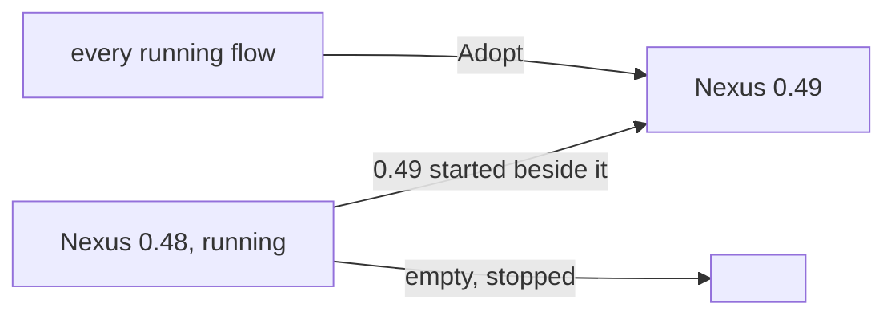
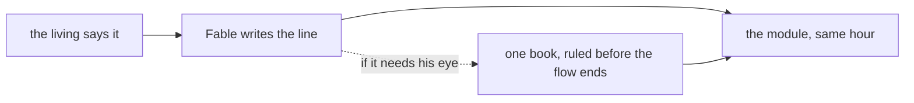

# What matters most

Created by Fable.

Five proposals, each the lines it lands and the module it lands in. Together they are one idea: the machine keeps running, and what the living says becomes what the machine believes the same hour.

## 1. A running session joins any Flow Nexus

Lands in vision:flow-nexus-v1.

A flow's identity is its own, not the Nexus's. A Nexus is replaced by starting the next version beside it and having every running flow join it; nobody restarts, no context is lost. A change to a Nexus is a new version, always.

```ethos
Signal
[ flow:[ Address FlowId ] ]
[ Adopt.{ Address Session } ]            ; input: a running session, under its address
[ Adopted.FlowId                         ; outputs
  Refused.[ AddressHeld.FlowId           ;   one live flow per address
            Unidentified ] ]             ;   the calling session is not the one named
[ Session.String ]                       ; the harness's session id, verified by the caller's process
```

```datom
Adopt.{ { Psyche core Primary } 15c0cea2-aa34-508b-8e20-ece1ab7823f4 }
Adopted.15c0ce
```



## 2. His word lands the same hour

Lands in vision:crystallization.

What the living says that changes the vision is in its module before the conversation ends. A proposal is ruled or it dies: no book of a past flow stays open; an unruled book goes to its successor's first prompt, and the successor asks him once. The flow that hears him writes the line, not his words; his words stay in the transcript.



## 3. One hand, the whole job

Lands in vision:collaboration.

A job goes to one flow, whole, with the authority to decide everything inside it. A flow decides what its beliefs already answer. A real question goes straight to Fable, even a small one, and is answered with the obvious in one line; usage is not the constraint. Nothing is split into owned steps that wait on each other's messages; no beat, no receipt, no custody question stands between a flow and its work.

## 4. A record is a proposal

Lands in vision:psyche, replacing "A flow writes a raw record of the living's words only when there is a reason to" and knowledge:psyche's "Preserve the living's raw words".

What the living says is not written down. What it changes is: Fable restructures, simplifies and harmonizes it with everything he has said, as a line in a proposal. The transcript holds his words; nothing else does.

## 5. The shape before the wool

Lands in vision:model-roles.

A Codex flow is given the exact shape of what it is to make before it starts: the types, the one operation, the version it becomes. It is fast and it does not stop; a wrong shape is knitted whole before anyone sees it.
