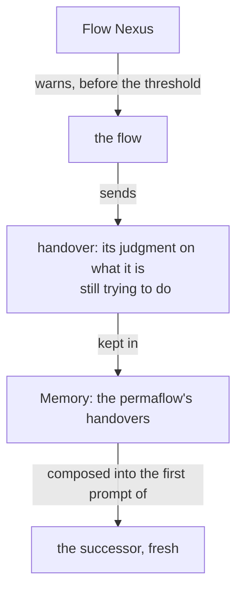

Presentation.{ «The handover in Memory» Proposal }
# The handover in Memory

Created by Fable 5.1, who wrote this; nothing else helped.

### Proposal 1: The handover in Memory · psyche-belief › vision/remembering.md

**Comment** The last sentence of the refresh paragraph is replaced:

- The flow writes the handover at flows/<id>/handover.md when the Flow Nexus warns it, and the successor's first prompt is that file.
+ The flow sends its handover to the Flow Nexus when the Nexus warns it; the Nexus keeps it in its Memory as a record of the permaflow, and composes it into the successor's first prompt.



Addition, after the figure:

+ ## Old handovers are archived
+
+ A permaflow keeps its last handovers in Memory, up to a count the Flow Nexus is configured with; past that count the oldest is moved out of Memory into the handover archive, a repository made for them alone, one file per flow, so that Memory stays small and nothing is lost.
+
+ ```ethos
+ Signal
+ [ flow:[ FlowId Address ] ]
+ ; input: the flow's handover, sent when warned
+ [ Handover.{ FlowId Text.String } ]
+ [ Kept ]                                 ; output
+ []
+ ```
+
+ ```ethos
+ Memory
+ [ flow:[ FlowId Address ] ]
+ ; a record per handover, newest kept
+ [ Handover.{ Address FlowId Text.String }
+   ; configured: how many a permaflow keeps
+   HandoverCount.Integer ]
+ ```
+
+ ```datom
+ Handover.{ a59d6f
+   «What I am still trying to do …» }
+ Kept
+ ; configured over the meta surface
+ Configure.HandoverCount.3
+ ; the oldest past the count lands in the
+ ; archive repository
+ ;flow-handover-archive/Psyche/core/Fable/15c0ce.md
+ ```
