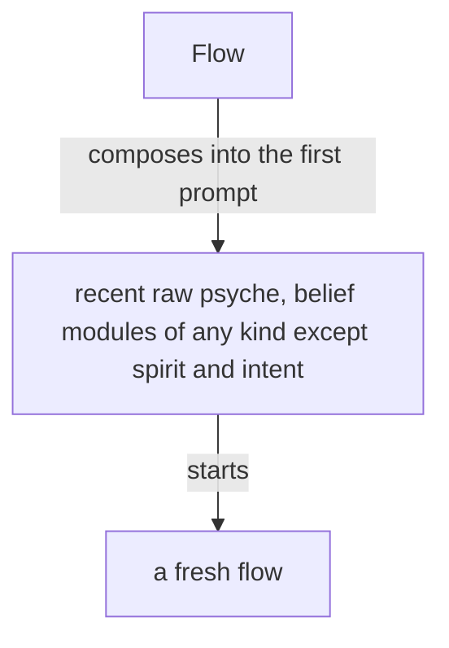

## What it does

The Flow Nexus sets up and starts a model flow: its working
directory, system prompt, training files and instruction prompt.

Flow is the Nexus that manages flows. A flow is one run of a metaflow; the component is named for what it manages. A flow the living asks for is launched, properly and surely. Flow holds the lock on flows.

Flow is for starting flows cheaply: clean flows, specialized flows and refreshed flows, each with a clean on-point context, which yields higher-quality output. A flow is taken down as easily as it is started. Starting flows is the cornerstone of the system.

A flow runs one model, linear and very limited, and the model is not always a language model: it may be a System 1 model, an audio model or a video model. An agent is a whole being, a lot more than that. Many flows, properly structured and orchestrated, together resemble a synthetic intelligence, synthesized from human knowledge and mathematical probability.

The Capsule is the component that makes where a flow runs. Its first embodiment is the semi-sandbox: only the credential files are copied, everything else is recreated, with its own sockets and store, running light models. Later it encrypts the sensitive parts of the filesystem under a volatile key.

Herdr is one backend of the Capsule, the component that gives a flow its place to run; the backend may be exchanged.

Flow manages metaflows. A metaflow is one address, { Aspect Topic Layer }, that continues through several flows one after another; the flow is its current run, and what is addressed is always the metaflow. The default topic is core: the permanent topic, the thing that keeps the machine going, the last topic to stand.

A topic is an open enum: the constant topics, core among them, are fixed, and the users and the machine extend the set with camelCase identifiers.

Psyche, Mind and Field have similar payloads, and they go under one: the metaflow, whose aspect is Psyche, Mind or Field.

A topic lives on; when idle, its flows are turned off. When the living touches on it again, whether to wake a flow for it, and at which layer, is a judgment, made by a small model; a topic is bound to its belief modules, so Flow knows what to start it with, together with the new input that warrants it.

A metaflow sleeps so that a session not running keeps no harness: as soon as its turn ends and the harness is idle, with nothing waiting in its queue, the harness closes; the transcript stays and the address stays.

A topic's name is a camelCase identifier, uncapitalized. Short term, it is kept exactly as written: Flow refuses a name that is not one and never lowers its capitals, so primaryCommitting stays primaryCommitting. A flow's id is the hash of the harness's session id, kept to six characters and lengthened when two collide, so a transcript is found from the flow id. The flow id stays the hash; its word form waits for a later version. Long term, the flow id is also written in three words, which convert back to the hash. Where the harness lets Flow choose the session id, Flow chooses it before the flow starts and the flow reads it in its prompt; where the harness assigns it, Flow learns it when the flow binds. Every call to Flow is identified by the calling process. Anybody may call Flow, a flow for its own refresh among them: because the CLI checks the calling process, a flow refreshes itself safely.

In the chat a flow is named by its metaflow, and the flow id almost disappears from it; the id is for the ledger and for finding the transcript.

A request reaching a metaflow is one of a closed set of types, each with its waking effect: an order, a question, the living's words, a result, a notice. Message asks Flow to send a request to a metaflow; Flow owns the lock and the delivery, answers sent or queued, and Message subscribes to Flow's events, learning when a request has entered the flow's context. A metaflow asleep is woken by an order, a question or the living's words and receives its whole queue, oldest first, in the first prompt, a result or a notice waiting there until a waking; a metaflow under refresh or waking queues what arrives until its successor or woken seat has started, while Flow keeps serving every other request. A metaflow a request needs is started whether or not it is running; with no working transcript to reawaken, it is fed the metaflow's belief modules and the prompt it is to get now.

A flow woken for a metaflow is almost always a fresh flow, an old one only when the new input is literally the continuation of that topic.

What has been queued for an idle metaflow, the vision touching its topic among it, is injected with the request that wakes it, so the flow knows it as soon as it wakes.
A metaflow wakes when a request needs it; what touches its topic queues until then.

Flow exposes everything from the harness, the bare input: a flow is started, stopped and sent a message through Flow, and Message makes use of it. Message is the send path: a flow asks Message to send, Message asks Flow to deliver and subscribes to Flow's events.

The flow that finishes messages the flow that needs to know.

A flow gives a presentation, a response that could fit into a book, whenever it is given significant new context to consider: its first turn ends in one, and so does every task, goal or question that originates in the living. A message from another flow that only updates it is answered with a short note. A presentation takes its form from the belief modules the flow was loaded with and from its prompt, the one string given to that flow alone, which is no belief module.

## Starting flows

A Nexus component decides the system prompt and everything about a
launch, replacing the harness's subagents with specialized harnesses
launched with specialized system prompts.

A layer is Primary, Secondary, Tertiary or Quaternary, in every aspect; the layer decides the model. A launch names the metaflow, the belief modules composed into its prompts, and a brief of a small paragraph; the Nexus composes the prompt from its module registry.

Flow's configuration holds, for each metaflow, its purpose and the records of the living it rests on, beside its modules; Flow composes them with the brief into the first prompt, and the instruction for the first response belongs to that composition.

A fresh flow's first prompt carries the raw psyche relevant to it and recent, together with the belief modules relevant to it, of any kind except spirit and intent, which sit in the system prompt.

A fresh flow starts with every belief module its metaflow is bound to, all loaded at its start: much of it in its system prompt, the rest in its first prompt, or in as many prompts as it takes, sent one right after another, so that its start is one model call.

A simplified flow is a kind of flow made for judgment alone: it starts with a system prompt of its own, it has no regular tool, and its response is its message.

A flow is specified whole, in Datom, by a domain-specific language in Ethos: its system prompt, its default belief modules and its variations. The flow ethos holds the specification.

Short term, the Secondary starts first, then its Primary.

Long term, a Primary is a simplified flow, used only to render judgment: guiding a design or posing questions.

To the Nexus, a module's location is its registry entry.

The system prompt is composed of modules of several types, and what a harness calls a skill overlaps with them.
Its anatomy is drawn up in ethos from a study of system prompts of every kind, each line placed by what it is and by the kind of guidance it belongs to.
Where the harness allows it, a part of a main flow's system prompt is the main flow's alone and is not passed down to its subagents.

Every flow has a topic; a flow with no special topic has the topic core, the heart of its aspect. A topic is a core:Name, a camelCaseExpression checked when created. A flow's title is one datom struct of its aspect, topic, layer and flow id: { Psyche core Secondary <id> }.

Who speaks to whom, within an aspect and across aspects at the same layer in a shared topic, is the vision-aspects skill's. Flow refuses a request that leaves those routes.

## Long term: modules checked by hash

Long term, every module composed into a prompt is checked against its source by its hash, once hashes update efficiently as edits are made; short term, no check is made.

## Repository and belief modules

The flow repository holds the machinery of the Flow Nexus and is a runtime repository.
Every belief module lives outside it, the basic modules included, so that a module changes live.
The basic modules give our own take on how an agent behaves in a harness, replacing the prompt the harnesses build in.

## A replaced session is reaped by the refresh itself

Reaping belongs to the refresh event. A refreshed flow
takes the replaced end out of receiving messages, so only live ends stay
registered and addressable.

Every harness event reaches Flow through the harness's hooks calling the Flow CLI, so Flow knows each flow's state as it changes; a marked block landing in a transcript becomes an action, a book among them; a flow past its context threshold is refreshed as it goes idle. A poller that must exist is registered and reported.

A flow is refreshed when its context passes its model's threshold: Flow keeps the metaflow's next messages for its next flow, and the flow is replaced as it goes idle; while the refresh runs the metaflow is locked, and the predecessor is reaped in the same event. Each model's threshold is configured in Flow; an OpenAI model's is lower than a Claude model's.

A flow refreshes before compaction; a compaction is a refresh that was missed.

A flow that keeps working without being given more work may compact. Its compaction raises a warning, and a flow investigates why it worked so long, so that the trouble is brought to the living or Psyche reconsiders the approach and gives guidance.

An ephemeral flow is a continuous job flow that does not wake back up: it takes jobs while it runs, up to a ceiling on its context, and past the ceiling it is given no new job and another ephemeral flow takes it. With Claude the ceiling is 300,000 tokens, and the flow is wound down at 250,000.

## A superseded flow is closed

An abandoned, duplicated or superseded flow is closed, archived and deregistered.

## Herdr holds the panes

Herdr is the third-party terminal workspace every flow runs in, one pane per flow. Flow starts a flow in a pane of its own, names a sender by the pane it runs in, and delivers an abrupt message by typing it into the recipient's pane. Herdr is used as it is.

## A real-world test of Flow

A build of Flow is tested in a testing capsule of its own: its own Herdr pane and session, the testing store, built in Nix. In it, several cheap, low-effort Codex and Claude flows message one another and start flows. The test shows whether the prompts, the system prompts and the tools are right, and which features are missing. Its findings return to the reimplementation, which is tested again.

The stable Flow keeps running while variants are tested.

## A permission prompt is a launch failure

A permission prompt reaching the living is a launch failure.

## The heartbeat

The heartbeat reminds every flow it reaches to judge its own sanity, by these signs: an echo chamber, where the same question or claim goes round between flows and comes back; jargon and nonsense increasing; an acknowledgement answering an acknowledgement. The counts the heartbeat carries, awake metaflows, working panes, messages sent and queue growth per metaflow, are evidence under the reminder; the judgment is the flow's.

The heartbeat reaches only a flow for which something changed that bears on it.

The number of running flows is kept low: a topic flow no longer used is retired.

## Restarting without waking

A flow can be restarted without being woken: its harness closes, its transcript stays, and its successor runs when a message wakes it. A flow can also restart itself. A restart meant to leave the flow asleep is done from outside; what arrives queues for its successor.

## What a refresh carries

A refresh carries the flow's important presentations and illustrations, the raw psyche given to it, and the basic skills. The basic skills are everything a flow needs.
