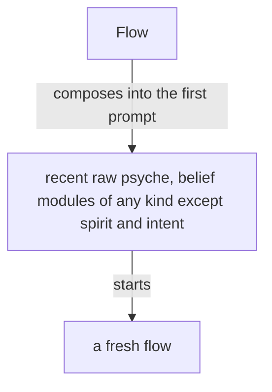

Presentation.{ «Flow, whole» }

# Flow, whole

Designed by Fable 5.1; the records gathered by Sonnet 5.5, the merged Flow tree mapped by Opus 5.5.

The whole vision of Flow and of the Flow ethos, redone as lines from every record of yours on Flow, messaging, remembering, Nexus, Signal, Ethos and Datom. Proposals 34 to 40 of Everything open, and the Five Flow proposals they superseded, are carried here and closed there. Every line marked In the long term is not achieved; every other line is for now.

## psyche-context › vision/flow.md

## What it does

The Flow Nexus sets up and starts a model flow: its working
directory, system prompt, training files and instruction prompt.

Flow is the Nexus that manages flows. A flow is one run of a metaflow; the component is named for what it manages. A flow the living asks for is launched, properly and surely. Flow holds the lock on flows.

Flow is for starting flows cheaply: clean flows, specialized flows and refreshed flows, each with a clean on-point context, which yields higher-quality output. A flow is taken down as easily as it is started. Starting flows is the cornerstone of the system.

A flow runs one model, linear and very limited, and the model is not always a language model: it may be a System 1 model, an audio model or a video model. An agent is a whole being, a lot more than that. Many flows, properly structured and orchestrated, together resemble a synthetic intelligence, synthesized from human knowledge and mathematical probability.

The Capsule is the component that makes where a flow runs. Its first embodiment is the semi-sandbox: only the credential files are copied, everything else is recreated, with its own sockets and store, running light models. Later it encrypts the sensitive parts of the filesystem under a volatile key.

Herdr is one backend of the Capsule, the component that gives a flow its place to run; the backend may be exchanged.

Flow manages metaflows. A metaflow is one address, { Aspect Topic Layer }, that continues through several flows one after another; the flow is its current run, and what is addressed is always the metaflow. The default topic is core: the permanent topic, the thing that keeps the machine going, the last topic to stand.

A topic is an open enum: the constant topics, core among them, are fixed, and the users and the machine extend the set with camelCase identifiers.

Psyche, Mind and Field have similar payloads, and they go under one: the metaflow, whose aspect is Psyche, Mind or Field.

A topic lives on; when idle, its flows are turned off. When the living touches on it again, whether to wake a flow for it, and at which layer, is a judgment, made by a small model; a topic is bound to its belief modules, so Flow knows what to start it with, together with the new input that warrants it.

A metaflow sleeps so that a session not running keeps no harness: as soon as its turn ends and the harness is idle, with nothing waiting in its queue, the harness closes; the transcript stays and the address stays.

A topic's name is a camelCase identifier, uncapitalized. Short term, it is kept exactly as written: Flow refuses a name that is not one and never lowers its capitals, so primaryCommitting stays primaryCommitting. A flow's id is the hash of the harness's session id, kept to six characters and lengthened when two collide, so a transcript is found from the flow id. The flow id stays the hash; its word form waits for a later version. Long term, the flow id is also written in three words, which convert back to the hash. Where the harness lets Flow choose the session id, Flow chooses it before the flow starts and the flow reads it in its prompt; where the harness assigns it, Flow learns it when the flow binds. Every call to Flow is identified by the calling process. Anybody may call Flow, a flow for its own refresh among them: because the CLI checks the calling process, a flow refreshes itself safely.

In the chat a flow is named by its metaflow, and the flow id almost disappears from it; the id is for the ledger and for finding the transcript.

A request reaching a metaflow is one of a closed set of types, each with its waking effect: an order, a question, the living's words, a result, a notice. Message asks Flow to send a request to a metaflow; Flow owns the lock and the delivery, answers sent or queued, and Message subscribes to Flow's events, learning when a request has entered the flow's context. A metaflow asleep is woken by an order, a question or the living's words and receives its whole queue, oldest first, in the first prompt, a result or a notice waiting there until a waking; a metaflow under refresh or waking queues what arrives until its successor or woken seat has started, while Flow keeps serving every other request. A metaflow a request needs is started whether or not it is running; with no working transcript to reawaken, it is fed the metaflow's belief modules and the prompt it is to get now.

A flow woken for a metaflow is almost always a fresh flow, an old one only when the new input is literally the continuation of that topic.

What has been queued for an idle metaflow, the vision touching its topic among it, is injected with the request that wakes it, so the flow knows it as soon as it wakes.
A metaflow wakes when a request needs it; what touches its topic queues until then.

Flow exposes everything from the harness, the bare input: a flow is started, stopped and sent a message through Flow, and Message makes use of it. Message is the send path: a flow asks Message to send, Message asks Flow to deliver and subscribes to Flow's events.

The flow that finishes messages the flow that needs to know.

A flow gives a presentation, a response that could fit into a book, whenever it is given significant new context to consider: its first turn ends in one, and so does every task, goal or question that originates in the living. A message from another flow that only updates it is answered with a short note. A presentation takes its form from the belief modules the flow was loaded with and from its prompt, the one string given to that flow alone, which is no belief module.

## Starting flows

A Nexus component decides the system prompt and everything about a
launch, replacing the harness's subagents with specialized harnesses
launched with specialized system prompts.

A layer is Primary, Secondary, Tertiary or Quaternary, in every aspect; the layer decides the model. A launch names the metaflow, the belief modules composed into its prompts, and a brief of a small paragraph; the Nexus composes the prompt from its module registry.

Flow's configuration holds, for each metaflow, its purpose and the records of the living it rests on, beside its modules; Flow composes them with the brief into the first prompt, and the instruction for the first response belongs to that composition.

A fresh flow's first prompt carries the raw psyche relevant to it and recent, together with the belief modules relevant to it, of any kind except spirit and intent, which sit in the system prompt.



A fresh flow starts with every belief module its metaflow is bound to, all loaded at its start: much of it in its system prompt, the rest in its first prompt, or in as many prompts as it takes, sent one right after another, so that its start is one model call.

A simplified flow is a kind of flow made for judgment alone: it starts with a system prompt of its own, it has no regular tool, and its response is its message.

A flow is specified whole, in Datom, by a domain-specific language in Ethos: its system prompt, its default belief modules and its variations. The flow ethos holds the specification.

Short term, the Secondary starts first, then its Primary.

Long term, a Primary is a simplified flow, used only to render judgment: guiding a design or posing questions.

To the Nexus, a module's location is its registry entry.

The system prompt is composed of modules of several types, and what a harness calls a skill overlaps with them.
Its anatomy is drawn up in ethos from a study of system prompts of every kind, each line placed by what it is and by the kind of guidance it belongs to.
Where the harness allows it, a part of a main flow's system prompt is the main flow's alone and is not passed down to its subagents.

Every flow has a topic; a flow with no special topic has the topic core, the heart of its aspect. A topic is a core:Name, a camelCaseExpression checked when created. A flow's title is one datom struct of its aspect, topic, layer and flow id: { Psyche core Secondary <id> }.

Who speaks to whom, within an aspect and across aspects at the same layer in a shared topic, is the vision-aspects skill's. Flow refuses a request that leaves those routes.

## Long term: modules checked by hash

Long term, every module composed into a prompt is checked against its source by its hash, once hashes update efficiently as edits are made; short term, no check is made.

## Repository and belief modules

The flow repository holds the machinery of the Flow Nexus and is a runtime repository.
Every belief module lives outside it, the basic modules included, so that a module changes live.
The basic modules give our own take on how an agent behaves in a harness, replacing the prompt the harnesses build in.

## A replaced session is reaped by the refresh itself

Reaping belongs to the refresh event. A refreshed flow
takes the replaced end out of receiving messages, so only live ends stay
registered and addressable.

Every harness event reaches Flow through the harness's hooks calling the Flow CLI, so Flow knows each flow's state as it changes; a marked block landing in a transcript becomes an action, a book among them; a flow past its context threshold is refreshed as it goes idle. A poller that must exist is registered and reported.

A flow is refreshed when its context passes its model's threshold: Flow keeps the metaflow's next messages for its next flow, and the flow is replaced as it goes idle; while the refresh runs the metaflow is locked, and the predecessor is reaped in the same event. Each model's threshold is configured in Flow; an OpenAI model's is lower than a Claude model's.

A flow refreshes before compaction; a compaction is a refresh that was missed.

A flow that keeps working without being given more work may compact. Its compaction raises a warning, and a flow investigates why it worked so long, so that the trouble is brought to the living or Psyche reconsiders the approach and gives guidance.

An ephemeral flow is a continuous job flow that does not wake back up: it takes jobs while it runs, up to a ceiling on its context, and past the ceiling it is given no new job and another ephemeral flow takes it. With Claude the ceiling is 300,000 tokens, and the flow is wound down at 250,000.

## A superseded flow is closed

An abandoned, duplicated or superseded flow is closed, archived and deregistered.

## Herdr holds the panes

Herdr is the third-party terminal workspace every flow runs in, one pane per flow. Flow starts a flow in a pane of its own, names a sender by the pane it runs in, and delivers an abrupt message by typing it into the recipient's pane. Herdr is used as it is.

## A real-world test of Flow

A build of Flow is tested in a testing capsule of its own: its own Herdr pane and session, the testing store, built in Nix. In it, several cheap, low-effort Codex and Claude flows message one another and start flows. The test shows whether the prompts, the system prompts and the tools are right, and which features are missing. Its findings return to the reimplementation, which is tested again.

The stable Flow keeps running while variants are tested.

## A permission prompt is a launch failure

A permission prompt reaching the living is a launch failure.

## The heartbeat

The heartbeat reminds every flow it reaches to judge its own sanity, by these signs: an echo chamber, where the same question or claim goes round between flows and comes back; jargon and nonsense increasing; an acknowledgement answering an acknowledgement. The counts the heartbeat carries, awake metaflows, working panes, messages sent and queue growth per metaflow, are evidence under the reminder; the judgment is the flow's.

The heartbeat reaches only a flow for which something changed that bears on it.

The number of running flows is kept low: a topic flow no longer used is retired.

## Restarting without waking

A flow can be restarted without being woken: its harness closes, its transcript stays, and its successor runs when a message wakes it. A flow can also restart itself. A restart meant to leave the flow asleep is done from outside; what arrives queues for its successor.

## What a refresh carries

A refresh carries the flow's important presentations and illustrations, the raw psyche given to it, and the basic skills. The basic skills are everything a flow needs.

### Proposal 1: What Flow is · psyche-context › vision/flow.md

**Comment** Three statements of Flow's purpose, two of the metaflow and two of the topic become one of each. "A flow is one run of a metaflow" goes: a subflow is a flow and is in no metaflow. The Capsule and Herdr move to their own section (proposal 8); the sentence on synthetic intelligence has no record and goes.

- ## What it does
+ ## What Flow is

- The Flow Nexus sets up and starts a model flow: its working
- directory, system prompt, training files and instruction prompt.
-
- Flow is the Nexus that manages flows. A flow is one run of a metaflow; the component is named for what it manages. A flow the living asks for is launched, properly and surely. Flow holds the lock on flows.
+ Flow is the Nexus that starts, names, tracks, refreshes and ends flows, and carries every request between them. Flow holds the lock on flows: a flow is started, messaged, refreshed and ended through Flow alone, and a flow the living asks for is launched, properly and surely.

- Flow is for starting flows cheaply: clean flows, specialized flows and refreshed flows, each with a clean on-point context, which yields higher-quality output. A flow is taken down as easily as it is started. Starting flows is the cornerstone of the system.
+ Starting a flow is the cornerstone of the system: a fresh flow with a clean, on-point context does better work than an old one carrying unrelated context, so flows are started often, specialized, and taken down as easily as they are started. Starting a standard flow is one short call.

- A flow runs one model, linear and very limited, and the model is not always a language model: it may be a System 1 model, an audio model or a video model. An agent is a whole being, a lot more than that. Many flows, properly structured and orchestrated, together resemble a synthetic intelligence, synthesized from human knowledge and mathematical probability.
+ A flow is one run of a harness: one model, one context, from its first prompt to its end, with every subflow it starts. A context restarted is a new flow. A flow not working is idle. A main flow has an address; a subflow has a flow id and no address.

- The Capsule is the component that makes where a flow runs. Its first embodiment is the semi-sandbox: only the credential files are copied, everything else is recreated, with its own sockets and store, running light models. Later it encrypts the sensitive parts of the filesystem under a volatile key.
-
- Herdr is one backend of the Capsule, the component that gives a flow its place to run; the backend may be exchanged.
-
- Flow manages metaflows. A metaflow is one address, { Aspect Topic Layer }, that continues through several flows one after another; the flow is its current run, and what is addressed is always the metaflow. The default topic is core: the permanent topic, the thing that keeps the machine going, the last topic to stand.
-
- A topic is an open enum: the constant topics, core among them, are fixed, and the users and the machine extend the set with camelCase identifiers.
-
- Psyche, Mind and Field have similar payloads, and they go under one: the metaflow, whose aspect is Psyche, Mind or Field.
-
- A topic lives on; when idle, its flows are turned off. When the living touches on it again, whether to wake a flow for it, and at which layer, is a judgment, made by a small model; a topic is bound to its belief modules, so Flow knows what to start it with, together with the new input that warrants it.
+ A metaflow is one address, { Aspect Topic Layer }, that continues through flows one after another; the flow is its current run. What is addressed is the metaflow; the flow id is for the ledger and for finding a transcript. A metaflow holds its declaration, its queue, its past flows and its current flow, if any.
+
+ A topic lives on: when idle, its flows are turned off, and its address, declaration and queue stay. The default topic is core, the permanent topic of its aspect, the last to stand; every other topic is started from vision or raw psyche that touches it, and a topic no longer touched is retired.

```ethos
Library
[ flow:QueueEntry ]
[ FlowId.String
  Topic.String
  Aspect.[ Psyche Mind Field ]
  Layer.[ Primary Secondary Tertiary Quaternary ]
  Address.{ Aspect Topic Layer }
  Metaflow.{ Address
             State.[ Awake.FlowId Asleep ]
             Past.Vector<FlowId>
             Queue.Vector<QueueEntry> } ]
[]
[]
```

```datom
{ { Psyche flow Primary } Awake.30fc30
  [ 63a06a 5330c1 ] [] }
```

```
+-------------+  is addressed by  +-----------+
| a request   |------------------>| metaflow  |
+-------------+                   | { Aspect  |
                                  |   Topic   |
+-------------+  continues        |   Layer } |
| flow, flow, |<------------------|           |
| flow ...    |      through      +-----------+
+-------------+                        | holds
                                       v
                             +------------------+
                             | declaration,     |
                             | queue, past      |
                             +------------------+
```

### Proposal 2: Names · psyche-context › vision/flow.md

**Comment** Topic, flow id and title were spread over four paragraphs with two statements of the id's form. One section, and your word of today: Flow gives a flow its id; no flow claims its own.

- A topic's name is a camelCase identifier, uncapitalized. Short term, it is kept exactly as written: Flow refuses a name that is not one and never lowers its capitals, so primaryCommitting stays primaryCommitting. A flow's id is the hash of the harness's session id, kept to six characters and lengthened when two collide, so a transcript is found from the flow id. The flow id stays the hash; its word form waits for a later version. Long term, the flow id is also written in three words, which convert back to the hash. Where the harness lets Flow choose the session id, Flow chooses it before the flow starts and the flow reads it in its prompt; where the harness assigns it, Flow learns it when the flow binds. Every call to Flow is identified by the calling process. Anybody may call Flow, a flow for its own refresh among them: because the CLI checks the calling process, a flow refreshes itself safely.
-
- In the chat a flow is named by its metaflow, and the flow id almost disappears from it; the id is for the ledger and for finding the transcript.
+ ## Names
+
+ A topic is an open enum: core is its fixed variant, and every other topic is a camel ID, an uncapitalized camelCase expression of words, checked when first used and kept exactly as written. Until Ethos carries open enums, core is written as every other topic is.
+
+ A flow id is six characters, the earliest random part of the harness's session id, lengthened when two collide, so the transcript is found from the id. Where the harness lets Flow choose the session id, Flow chooses it before the flow starts; where the harness assigns it, Flow learns it as the flow comes up. Either way the flow reads its id in its first prompt and its environment, given by Flow, and claims nothing itself. In the long term the id is also written as three camelCase words that convert back.
+
+ Every pane, tab and title that represents a flow is one datom of its address and id, { Psyche core Secondary 9b514f }. Between flows and in speech a flow is named by its address; the id stays in the ledger.
+
+ Every call to Flow is identified by the calling process: a caller is a flow, resolved to its address, or a process Flow does not know. Anybody may call Flow, a flow for its own refresh among them.

```ethos
Library
[ flow:Address ]
[ FlowId.String
  Topic.String
  Caller.[ Flow.{ Address FlowId }
           Process.Integer ] ]
[]
[]
```

### Proposal 3: Starting a flow · psyche-context › vision/flow.md

**Comment** The Starting flows section said the same thing of the first prompt three times and held six lines no record supports: the simplified flow, the Primary as a simplified flow, the system-prompt anatomy study, the subagent-private part, the registry entry, the refusal of routes. What stands is your words: a declaration per metaflow, modules its topic needs and no other, spirit and intent in the system prompt, the rest in one first prompt brimming with vision, a subflow tool always, a default task, a Secondary before a Primary.

- ## Starting flows
-
- A Nexus component decides the system prompt and everything about a
- launch, replacing the harness's subagents with specialized harnesses
- launched with specialized system prompts.
-
- A layer is Primary, Secondary, Tertiary or Quaternary, in every aspect; the layer decides the model. A launch names the metaflow, the belief modules composed into its prompts, and a brief of a small paragraph; the Nexus composes the prompt from its module registry.
-
- Flow's configuration holds, for each metaflow, its purpose and the records of the living it rests on, beside its modules; Flow composes them with the brief into the first prompt, and the instruction for the first response belongs to that composition.
-
- A fresh flow's first prompt carries the raw psyche relevant to it and recent, together with the belief modules relevant to it, of any kind except spirit and intent, which sit in the system prompt.
-
- ```mermaid
- flowchart TB
-     a["Flow"] -- "composes into the first prompt" --> b["recent raw psyche, belief modules of any kind except spirit and intent"]
-     b -- "starts" --> c["a fresh flow"]
- ```
-
- A fresh flow starts with every belief module its metaflow is bound to, all loaded at its start: much of it in its system prompt, the rest in its first prompt, or in as many prompts as it takes, sent one right after another, so that its start is one model call.
-
- A simplified flow is a kind of flow made for judgment alone: it starts with a system prompt of its own, it has no regular tool, and its response is its message.
-
- A flow is specified whole, in Datom, by a domain-specific language in Ethos: its system prompt, its default belief modules and its variations. The flow ethos holds the specification.
-
- Short term, the Secondary starts first, then its Primary.
-
- Long term, a Primary is a simplified flow, used only to render judgment: guiding a design or posing questions.
-
- To the Nexus, a module's location is its registry entry.
-
- The system prompt is composed of modules of several types, and what a harness calls a skill overlaps with them.
- Its anatomy is drawn up in ethos from a study of system prompts of every kind, each line placed by what it is and by the kind of guidance it belongs to.
- Where the harness allows it, a part of a main flow's system prompt is the main flow's alone and is not passed down to its subagents.
-
- Every flow has a topic; a flow with no special topic has the topic core, the heart of its aspect. A topic is a core:Name, a camelCaseExpression checked when created. A flow's title is one datom struct of its aspect, topic, layer and flow id: { Psyche core Secondary <id> }.
-
- Who speaks to whom, within an aspect and across aspects at the same layer in a shared topic, is the vision-aspects skill's. Flow refuses a request that leaves those routes.
+ ## Starting a flow
+
+ A metaflow is declared in Flow's configuration, as datom: its address, the belief modules composed into its system prompt and into its first prompt, its purpose, the harness modules it leaves out, its continuity, its default task and how far back its flows remember. A declaration carries the modules its topic needs and no other; what every flow of an aspect needs, the aspect's declaration carries once.
+
+ A launch names an address, a remembering and a brief of a few sentences; everything else is the declaration's. Flow composes the system prompt whole, replacing the harness's own: spirit and intent, with the flow's address, model and id. The first prompt is one message, brimming with vision: the belief modules of every other kind, the raw vision and notion records the remembering names, the open beads of the address, then the brief. When one message does not hold it, the parts go in one right after another, so the start is one model call and the flow's first answer is its presentation.
+
+ A flow launched without a brief has its declaration's default task: a proposal, or a question.
+
+ A main flow is started with its subflow tool and every tool its declaration leaves in; Flow limits nothing the configuration does not name. A permission prompt reaching the living is a launch failure.
+
+ A layer is Primary, Secondary, Tertiary or Quaternary, in every aspect; the layer and the aspect decide the model and its effort through Flow's configuration. A Primary is started after its Secondary.

```ethos
Library
[ flow:[ Address FlowId ] ]
[ ModuleIdentity.String
  HarnessModule.String
  ContentCap.Integer
  RememberingDepth.Integer
  Remembering.[ Open.ContentCap
                Predecessors.RememberingDepth
                Custom.Vector<FlowId> ]
  Brief.String
  Continuity.[ OnDemand Maintained ]
  DefaultTask.[ Proposal Question ]
  Declaration.{ Address
                System.Vector<ModuleIdentity>
                User.Vector<ModuleIdentity>
                Purpose.String
                LeftOut.Vector<HarnessModule>
                Continuity
                DefaultTask
                Remembering } ]
[]
[]
```

```datom
{ { Psyche flow Primary }
  [ spirit:core intent:main-flow intent:fable ]
  [ vision:flow vision:flow-ethos vision:nexus
    vision:messaging vision:remembering ]
  «Designs Flow and its ethos from his vision»
  [ ClaudeArtifacts ClaudeMd BundledSkills ]
  OnDemand Proposal Predecessors.1 }
```

```sh
flow 'Launch.{ { Psyche flow Secondary }
               Predecessors.1
               «Audit the merged tree.» }'
```

```
+----------+  names   +------------------------+
| Launch   |--------->| address, remembering,  |
+----------+          | brief                  |
                      +------------------------+
                                 | the rest from
                                 v
                      +------------------------+
                      | declaration: modules,  |
                      | purpose, left out,     |
                      | continuity, task       |
                      +------------------------+
                                 | composed into
              +------------------+----------------+
              v                                   v
+------------------------+   +--------------------+
| system prompt: spirit, |   | first prompt: the  |
| intent, address, id    |   | other modules, raw |
+------------------------+   | records, open      |
                             | beads, brief       |
                             +--------------------+
```

### Proposal 4: Requests and the queue · psyche-context › vision/flow.md

**Comment** Your words of this week: every machine message in a pane is one datom, so yours are told from them by shape; the sender is known by its address, without flow id; queues belong to metaflows; the whole queue arrives as one message, at once when the flow is idle; an abrupt message is sent or failed, never queued; a missing flow is started to receive; Flow enforces no Secondary-only route. The waking kinds and the Message Nexus keep their lines, said once.

- A request reaching a metaflow is one of a closed set of types, each with its waking effect: an order, a question, the living's words, a result, a notice. Message asks Flow to send a request to a metaflow; Flow owns the lock and the delivery, answers sent or queued, and Message subscribes to Flow's events, learning when a request has entered the flow's context. A metaflow asleep is woken by an order, a question or the living's words and receives its whole queue, oldest first, in the first prompt, a result or a notice waiting there until a waking; a metaflow under refresh or waking queues what arrives until its successor or woken seat has started, while Flow keeps serving every other request. A metaflow a request needs is started whether or not it is running; with no working transcript to reawaken, it is fed the metaflow's belief modules and the prompt it is to get now.
-
- A flow woken for a metaflow is almost always a fresh flow, an old one only when the new input is literally the continuation of that topic.
-
- What has been queued for an idle metaflow, the vision touching its topic among it, is injected with the request that wakes it, so the flow knows it as soon as it wakes.
- A metaflow wakes when a request needs it; what touches its topic queues until then.
-
- Flow exposes everything from the harness, the bare input: a flow is started, stopped and sent a message through Flow, and Message makes use of it. Message is the send path: a flow asks Message to send, Message asks Flow to deliver and subscribes to Flow's events.
-
- The flow that finishes messages the flow that needs to know.
+ ## Requests and the queue
+
+ Everything the machine puts into a flow's prompt is one datom. A request is its sender, as an address, and its content, headed by its kind: Order, Question, Result, Notice, or Psyche, the living's words with their context. A kind is added by adding a variant. A request carries no flow id, no timestamp and no hash; Flow resolves the sender from the calling process. The living's words are the only text in a transcript that is not datom, so his are told from the machine's by their shape, and a tool finds them in any transcript by that mark.
+
+ A request names its recipient by address, or Up, the layer above in the sender's aspect and topic, and asks one of three deliveries. Queue leaves it for the next delivery. Wake delivers it, waking a sleeping metaflow. Abrupt interrupts the recipient's turn and is answered Sent or Failed, never Queued.
+
+ Every request is queued for its metaflow, never for a flow, and the queue is delivered whole, oldest first, as one datom, a vector of requests, in one turn: to an idle flow at once, to a working flow as its turn ends, to a sleeping metaflow in the first prompt of the flow woken for it. A metaflow a request needs is started whether or not it is running; the sender's call waits, and the start prompt and the request arrive together. A metaflow being refreshed receives nothing more; its queue waits for the successor.
+
+ An Order, a Question and Psyche wake a sleeping metaflow; a Result and a Notice wait for the next waking, so a flow satisfied with its topic is not woken to be told. A Primary is reached through its Secondary as practice; Flow refuses no route, since a flow without a Secondary must stay reachable.
+
+ Flow is the one writer into a pane. Message, the Nexus of messaging, sends through Flow and subscribes to Flow's delivery events; until Message stands, and whenever it breaks, a flow sends through Flow directly. When Flow holds a delivery, a flow falls back to typing into the recipient's pane through Herdr, its text opening with the sender's address.

```ethos
Library
[ flow:[ Address FlowId ] ]
[ Recipient.[ Address Up ]
  Said.{ Context.String Verbatim.String }
  Body.String
  Content.[ Order.Body
            Question.Body
            Result.Body
            Notice.Body
            Psyche.Said
            Psyches.Vector<Said> ]
  Request.{ Address Content }
  Delivery.[ Queue Wake Abrupt ]
  QueueEntry.{ Delivery Request } ]
[]
[]
```

```sh
flow 'Send.{ Address.{ Mind flow Secondary } Wake
             Order.«Fix the five defects.» }'
```

```datom
; the pane receives the whole queue, one datom
[ { { Psyche flow Primary }
    Order.«Fix the five defects.» }
  { { Psyche core Secondary }
    Psyche.{ «on the queue, 10-28»
             «all the messages should come in» } } ]
```

```
+--------+  Send   +------+  queues for  +----------+
| a flow |-------->| Flow |------------->| metaflow |
+--------+         +------+              | queue    |
                                         +----------+
                                   delivers   |
                                   whole, as  |
                                   one datom  |
                     +------------------------+
                     v                        v
            +---------------+   +------------------+
            | idle flow:    |   | sleeping: first  |
            | at once       |   | prompt of the    |
            +---------------+   | woken flow       |
                                +------------------+
```

### Proposal 5: Sleeping, waking and refreshing · psyche-context › vision/flow.md

**Comment** Seven places spoke of refresh, wake and reaping, with numbers no record gives (300,000 and 250,000) and a handover you have since forbidden. One section: thresholds are configuration per model; a successor gets beliefs and raw records, no summary; a refresh is done from outside without waking; the predecessor and its native thread close in the same event; compaction is the emergency the meta socket can order.

- A metaflow sleeps so that a session not running keeps no harness: as soon as its turn ends and the harness is idle, with nothing waiting in its queue, the harness closes; the transcript stays and the address stays.
+ ## Sleeping, waking and refreshing
+
+ A metaflow sleeps when its flow's harness closes: its transcript, address, declaration and queue stay, and no harness runs for it. A Maintained metaflow, core among them, is kept awake and refreshed at an age, so the living always has a flow to talk to; an OnDemand metaflow sleeps as soon as its turn ends with nothing queued.
+
+ A metaflow woken for a request starts a fresh flow from its declaration. Its last flow is resumed only when the request is the literal continuation of that work and the transcript is young, under the model's young threshold; the judgment is a small model's.

- ## A replaced session is reaped by the refresh itself
-
- Reaping belongs to the refresh event. A refreshed flow
- takes the replaced end out of receiving messages, so only live ends stay
- registered and addressable.
-
- Every harness event reaches Flow through the harness's hooks calling the Flow CLI, so Flow knows each flow's state as it changes; a marked block landing in a transcript becomes an action, a book among them; a flow past its context threshold is refreshed as it goes idle. A poller that must exist is registered and reported.
-
- A flow is refreshed when its context passes its model's threshold: Flow keeps the metaflow's next messages for its next flow, and the flow is replaced as it goes idle; while the refresh runs the metaflow is locked, and the predecessor is reaped in the same event. Each model's threshold is configured in Flow; an OpenAI model's is lower than a Claude model's.
-
- A flow refreshes before compaction; a compaction is a refresh that was missed.
-
- A flow that keeps working without being given more work may compact. Its compaction raises a warning, and a flow investigates why it worked so long, so that the trouble is brought to the living or Psyche reconsiders the approach and gives guidance.
-
- An ephemeral flow is a continuous job flow that does not wake back up: it takes jobs while it runs, up to a ceiling on its context, and past the ceiling it is given no new job and another ephemeral flow takes it. With Claude the ceiling is 300,000 tokens, and the flow is wound down at 250,000.
-
- ## A superseded flow is closed
-
- An abandoned, duplicated or superseded flow is closed, archived and deregistered.
+ Flow measures a flow's context at every turn's end. Past its model's refresh threshold the flow is refreshed as it goes idle: Flow holds the metaflow's queue, starts the successor from the declaration with the remembering the declaration names, closes the predecessor's pane and its native thread in the same event, and delivers the queue to the successor. The successor receives its belief modules and the raw records named, and no summary or handover from the predecessor, whose biases end with it. A flow is refreshed from outside without being woken, or refreshes itself through Flow; below the young threshold a flow is refreshed only on a dramatic change of direction.
+
+ Each model's thresholds, young, refresh and ceiling, are configuration. A refresh comes before the harness's compaction; a compaction is an emergency, ordered through the meta socket and refused under the threshold, and a flow that compacted is investigated for working too long.
+
+ An abandoned, duplicated or superseded flow is closed, its pane and native thread with it, archived and deregistered. An ephemeral flow is a job flow that is not woken again: past its model's ceiling it is given no new job and another takes its place.

- ## Restarting without waking
-
- A flow can be restarted without being woken: its harness closes, its transcript stays, and its successor runs when a message wakes it. A flow can also restart itself. A restart meant to leave the flow asleep is done from outside; what arrives queues for its successor.
-
- ## What a refresh carries
-
- A refresh carries the flow's important presentations and illustrations, the raw psyche given to it, and the basic skills. The basic skills are everything a flow needs.

```ethos
Library
[ flow:[ Address FlowId Remembering ] ]
[ Tokens.Integer
  ModelName.String
  Thresholds.{ ModelName
               YoungAt.Tokens
               RefreshAt.Tokens
               CeilingAt.Tokens }
  Refresh.{ Address Remembering }
  Compact.FlowId ]
[]
[]
```

```datom
{ claude-fable-5-1 100000 200000 300000 }
Refresh.{ { Psyche core Primary } Predecessors.2 }
```

```
+--------------+ turn ends  +----------+
| flow         |----------->| Flow     |
+--------------+            | measures |
                            +----------+
                                 | past the threshold,
                                 | as it goes idle
                                 v
        +------------------------------------------+
        | hold the queue; start the successor from |
        | the declaration; close the predecessor   |
        | and its thread; deliver the queue        |
        +------------------------------------------+
```

### Proposal 6: Harness events, reminders, the heartbeat · psyche-context › vision/flow.md

**Comment** Hooks, polling, reminders and the pulse in one section; the harness-events line removed in proposal 5 returns here, said once. Your words: Flow is fed by the harness's own events and decides where they go; nothing polls; a reminder is Flow's, not a script's; the pulse is never shorter than an hour; the counts are evidence, the judgment the flow's. The line that reached only a flow for which something changed has no record and goes.

- ## The heartbeat
-
- The heartbeat reminds every flow it reaches to judge its own sanity, by these signs: an echo chamber, where the same question or claim goes round between flows and comes back; jargon and nonsense increasing; an acknowledgement answering an acknowledgement. The counts the heartbeat carries, awake metaflows, working panes, messages sent and queue growth per metaflow, are evidence under the reminder; the judgment is the flow's.
-
- The heartbeat reaches only a flow for which something changed that bears on it.
-
- The number of running flows is kept low: a topic flow no longer used is retired.
+ ## Harness events
+
+ Flow learns a flow's state from the harness itself: a Claude flow's hooks call the Flow CLI at session start, prompt, tool use, turn end and session end; a Codex flow's app-server sends its turn events. Flow decides from its configuration where each event goes; nothing polls, and a poller that must exist is registered and reported. In the long term Flow keeps the account of usage from these events, so the machine spends what it has and never more.
+
+ A flow that must look again after a time asks Flow for a reminder: a Notice to its own address, delivered at the time it names, waking it if it sleeps; no flow keeps a timer, a script or a harness schedule of its own. The heartbeat is such a reminder, never shorter than an hour, reminding the flow it reaches to judge its own sanity by these signs: an echo chamber, where the same question or claim goes round between flows and comes back; jargon and nonsense increasing; an acknowledgement answering an acknowledgement. The counts it carries, awake metaflows, working panes, queued requests, are evidence under the reminder; the judgment is the flow's. The number of running flows is kept low.

```ethos
Signal
[ flow:[ FlowId Body ] ]
[ Report.{ FlowId Event }
  Remind.{ Instant Body } ]
[ Reported
  Reminded ]
[ Instant.String
  Event.[ Started Prompted Working Stopped Ended ] ]
```

```datom
Report.{ 30fc30 Stopped }
Remind.{ 2026-10-29T18:40:00Z «Check the audit.» }
```

### Proposal 7: Behavior is configuration · psyche-context › vision/flow.md

**Comment** Your most repeated word on Flow, said in eleven records and in none of the module's lines: nothing hardwired that a person might want otherwise; configuration as datom, in Memory, over the meta socket, loaded from files; a value absent turns its behavior off; an operation for every bind; harnesses defined per version with their modules and a blacklist of what is not ours.

+ ## Behavior is configuration
+
+ Flow hardwires no behavior a person might want otherwise. Every model, effort, threshold, timing, limit, text, harness argument and route is configuration: typed datom, kept in Flow's Memory, changed through the meta socket, and authored as datom files in the context repositories, sent in succession when Flow is deployed. A value absent from configuration leaves its behavior off.
+
+ Every situation has its operation, so no bind needs a rebuild: rebinding a metaflow to a pane or a flow, releasing its lock, delivering its queue, compacting a flow, closing it, importing a running Herdr session, reading any record. The meta socket is open locally to every flow.
+
+ A harness is defined per version in configuration: its executable, its arguments, the modules of its stock prompt and tools by their own names, and which of them a flow leaves out. A harness-blacklisted module names the lines of a harness version that are not ours and voids them in every flow of that harness; the stock prompt per version is extracted and diffed against the modules by a tool outside Flow.

```ethos
Signal
[ flow:[ Layer Aspect Tokens HarnessModule
         Declaration Metaflow ] ]
[ Configure.Configuration
  Declare.Declaration
  Observe.[ Configuration Metaflows ] ]
[ Configured
  Declared
  Observed.[ Configuration.Configuration
             Metaflows.Vector<Metaflow> ] ]
[ ModelName.String
  Effort.String
  Model.{ Layer Aspect ModelName Effort }
  Thresholds.{ ModelName
               YoungAt.Tokens
               RefreshAt.Tokens
               CeilingAt.Tokens }
  HarnessKind.[ Claude Codex ]
  Version.String
  Executable.String
  Blacklisted.String
  Harness.{ HarnessKind
            Version
            Executable
            Modules.Vector<HarnessModule>
            Vector<Blacklisted> }
  Timings.{ SendWait.Integer
            PaneRest.Integer
            StopWait.Integer }
  Limits.{ Cohort.Integer Frame.Integer }
  Configuration.{ Vector<Model>
                  Vector<Thresholds>
                  Vector<Harness>
                  Vector<Declaration>
                  Timings
                  Limits } ]
```

```datom
Configure.{
  [ { Primary Psyche claude-fable-5-1 medium }
    { Secondary Psyche claude-opus-5-5 medium }
    { Primary Mind gpt-6-astra medium } ]
  [ { claude-fable-5-1 100000 200000 300000 } ]
  [ { Claude 2.1.294 claude
      [ ClaudeArtifacts ClaudeMd BundledSkills ]
      [ «Do your work through the Bash tool» ] } ]
  [ { { Psyche flow Primary }
      [ spirit:core intent:main-flow ]
      [ vision:flow vision:flow-ethos ]
      «Designs Flow from his vision»
      [ ClaudeArtifacts ]
      OnDemand Proposal Predecessors.1 } ]
  { 10000 15000 30000 }
  { 122880 1048576 } }
```

### Proposal 8: The capsule, Herdr and the versions of Flow · psyche-context › vision/flow.md

**Comment** The Capsule's semi-sandbox and volatile key have no record; your words are that Herdr is the capsule's first backend, one Herdr session, Flow the one writer in it, several capsules, a running session imported, and Flow run as stable, last and next with a testing binary never on the stable store.

- ## Herdr holds the panes
-
- Herdr is the third-party terminal workspace every flow runs in, one pane per flow. Flow starts a flow in a pane of its own, names a sender by the pane it runs in, and delivers an abrupt message by typing it into the recipient's pane. Herdr is used as it is.
-
- ## A real-world test of Flow
-
- A build of Flow is tested in a testing capsule of its own: its own Herdr pane and session, the testing store, built in Nix. In it, several cheap, low-effort Codex and Claude flows message one another and start flows. The test shows whether the prompts, the system prompts and the tools are right, and which features are missing. Its findings return to the reimplementation, which is tested again.
-
- The stable Flow keeps running while variants are tested.
-
- ## A permission prompt is a launch failure
-
- A permission prompt reaching the living is a launch failure.
+ ## The capsule
+
+ The Capsule is where flows run: a Herdr session holding one pane per flow, with its own sockets and store. Herdr is its first backend and is used as it is; the backend may be exchanged. Flow is the one writer into the capsule's panes and names a caller by its pane. Flow serves several capsules: a query that names none takes the default, and a variant with one more field names one. A running Herdr session is imported into Flow through the meta socket, the session first, then its flows in one vector.
+
+ Flow runs as stable, last and next, each under its own name, socket and store; a testing binary never opens the stable store. A new Flow is tried raw in a testing capsule before it is deployed: cheap, low-effort Codex and Claude flows message one another and start flows, showing whether the prompts, the system prompts and the tools are right and which features are missing; the findings return to the implementation. The stable Flow keeps running meanwhile, so broken, stable and legacy systems run at once.

```ethos
Signal
[ flow:[ Address FlowId ] ]
[ Import.{ HerdrSession Vector<Bound> }
  Release.Address ]
[ Imported.Integer
  Released ]
[ HerdrSession.String
  Pane.String
  Bound.{ Address FlowId Pane } ]
```

```datom
Import.{ default
         [ { { Psyche core Secondary }
             9b514f wBJ:p1 }
           { { Mind flow Secondary }
             4db1d3 wBC:p1 } ] }
```

### Proposal 9: The Flow ethos · psyche-context › vision/flow-ethos.md, a new file

**Comment** Your order of 10-11 and 10-27: the full vision of Flow in ethos, signal, memory and operation, all the types, with example datom. One file for each part, each passing ethos-zero's Check at 17.0.0; traits come in the long term, as vision:nexus says. The Thresholds positions read YoungAt, RefreshAt, CeilingAt because an inline position names a type in the file, and Refresh is a query.

+ ## The Flow ethos
+
+ Flow is specified whole in Ethos: the Library its parts share, the Signal of its ordinary socket, the Signal of its meta socket, its Operation and its Memory. Every type is declared here and the Rust is generated from it; the bodies are hand-written. In the long term every trait Flow uses is declared here too. A datom below is written against the type above it.
+
+ ### Library
+
+ ```ethos
+ ; flow: the types every part of Flow shares.
+ Library
+ []
+ [ FlowId.String
+   ; a camel ID; core is the fixed topic until Ethos
+   ; carries open enums
+   Topic.String
+   Aspect.[ Psyche Mind Field ]
+   Layer.[ Primary Secondary Tertiary Quaternary ]
+   Address.{ Aspect Topic Layer }
+   ; Up is the layer above, in the sender's aspect
+   ; and topic
+   Recipient.[ Address Up ]
+   ; the living's words, with the context they were
+   ; said in
+   Said.{ Context.String Verbatim.String }
+   Body.String
+   ; the head is the kind; the kind decides the
+   ; waking effect
+   Content.[ Order.Body
+             Question.Body
+             Result.Body
+             Notice.Body
+             Psyche.Said
+             Psyches.Vector<Said> ]
+   ; what a flow receives: the sender as its address,
+   ; then the content
+   Request.{ Address Content }
+   ; what the sender asks of the queue
+   Delivery.[ Queue Wake Abrupt ]
+   QueueEntry.{ Delivery Request }
+   Metaflow.{ Address
+              State.[ Awake.FlowId Asleep ]
+              Past.Vector<FlowId>
+              Queue.Vector<QueueEntry> }
+   ; a belief module by its registry name,
+   ; vision:flow
+   ModuleIdentity.String
+   ; a named part of a harness version's stock prompt
+   HarnessModule.String
+   Tokens.Integer
+   ContentCap.Integer
+   RememberingDepth.Integer
+   Remembering.[ Open.ContentCap
+                 Predecessors.RememberingDepth
+                 Custom.Vector<FlowId> ]
+   Brief.String
+   Continuity.[ OnDemand Maintained ]
+   DefaultTask.[ Proposal Question ]
+   ; a metaflow as configured: what a launch does not
+   ; name
+   Declaration.{ Address
+                 System.Vector<ModuleIdentity>
+                 User.Vector<ModuleIdentity>
+                 Purpose.String
+                 LeftOut.Vector<HarnessModule>
+                 Continuity
+                 DefaultTask
+                 Remembering }
+   ; what a harness reports of a flow
+   Event.[ Started Prompted Working Stopped Ended ] ]
+ []
+ []
+ ```
+
+ ```datom
+ { { Psyche flow Primary }
+   [ spirit:core intent:main-flow intent:fable ]
+   [ vision:flow vision:flow-ethos ]
+   «Designs Flow and its ethos from his vision»
+   [ ClaudeArtifacts ]
+   OnDemand Proposal Predecessors.1 }
+ ```
+
+ ### Signal
+
+ ```ethos
+ ; signal-flow: what Flow says on its ordinary
+ ; socket.
+ Signal
+ [ flow:[ Address Recipient Delivery Content FlowId
+          Remembering Brief Metaflow Event Topic
+          Body ] ]
+ [ Send.{ Recipient Delivery Content }
+   Launch.{ Address Remembering Brief }
+   Refresh.{ Address Remembering }
+   ; everything queued, now, or nothing when nothing
+   ; is queued
+   Deliver.Address
+   ; a Notice to the caller's own address, at a time
+   Remind.{ Instant Body }
+   Current.Address
+   Metaflows
+   Report.{ FlowId Event } ]
+ [ Sent
+   Queued
+   Launched.FlowId
+   Refreshed.FlowId
+   Delivered.Integer
+   Reminded
+   Current.[ Awake.FlowId Asleep ]
+   Listed.Vector<Metaflow>
+   Reported
+   Refused.[ Unknown.Address
+             NoneAbove
+             TopicRefused.Topic
+             Undeclared.Address
+             NotConfigured
+             Unstarted.Address
+             NotSent.Address ] ]
+ [ Instant.String ]
+ ```
+
+ ```datom
+ Send.{ Address.{ Mind flow Secondary } Wake
+         Order.«Fix the five defects.» }
+ Launch.{ { Psyche flow Secondary } Predecessors.1
+           «Audit the merged tree.» }
+ Report.{ 30fc30 Stopped }
+ Remind.{ 2026-10-29T18:40:00Z «Check the audit.» }
+ ```
+
+ ### Meta-Signal
+
+ ```ethos
+ ; meta-signal-flow: what Flow says on its meta
+ ; socket,
+ ; open locally to every flow.
+ Signal
+ [ flow:[ Address FlowId Layer Aspect Tokens
+          HarnessModule Declaration Metaflow ] ]
+ [ Configure.Configuration
+   Declare.Declaration
+   Compact.FlowId
+   Rebind.{ Address FlowId }
+   Import.{ HerdrSession Vector<Bound> }
+   Release.Address
+   Close.FlowId
+   Observe.[ Configuration Metaflows Flow.FlowId ] ]
+ [ Configured
+   Declared
+   Compacted
+   Rebound
+   Imported.Integer
+   Released
+   Closed
+   Observed.[ Configuration.Configuration
+              Metaflows.Vector<Metaflow>
+              Flow.Flow ]
+   Refused.[ Unknown.FlowId
+             UnderThreshold.FlowId
+             NotConfigured ] ]
+ [ ModelName.String
+   Effort.String
+   Model.{ Layer Aspect ModelName Effort }
+   Thresholds.{ ModelName
+                YoungAt.Tokens
+                RefreshAt.Tokens
+                CeilingAt.Tokens }
+   HarnessKind.[ Claude Codex ]
+   Version.String
+   Executable.String
+   ; a line of a harness version's stock prompt that
+   ; is not ours, voided
+   Blacklisted.String
+   Harness.{ HarnessKind
+             Version
+             Executable
+             Modules.Vector<HarnessModule>
+             Vector<Blacklisted> }
+   Timings.{ SendWait.Integer
+             PaneRest.Integer
+             StopWait.Integer }
+   Limits.{ Cohort.Integer Frame.Integer }
+   Configuration.{ Vector<Model>
+                   Vector<Thresholds>
+                   Vector<Harness>
+                   Vector<Declaration>
+                   Timings
+                   Limits }
+   HerdrSession.String
+   Pane.String
+   Bound.{ Address FlowId Pane }
+   Flow.{ FlowId
+          Address
+          HarnessKind
+          Pane
+          Context.Tokens } ]
+ ```
+
+ ```datom
+ Compact.a2c6ce
+ Rebind.{ { Psyche core Primary } 554e1a }
+ Observe.Flow.30fc30
+ ```
+
+ ### Operation
+
+ ```ethos
+ ; Flow's Operation: one operation for every effect;
+ ; a read of the world is none.
+ Operation
+ [ flow:[ Address FlowId Declaration Remembering
+          Brief Request Tokens Event ] ]
+ [ Compose.{ Declaration Remembering Brief }
+   Start.{ Address Composed }
+   Give.{ FlowId Vector<Request> }
+   Measure.{ FlowId Tokens }
+   Replace.{ Address Remembering }
+   Close.FlowId
+   Sleep.Address
+   Record.{ FlowId Event } ]
+ [ Composed.Composed
+   Started.FlowId
+   Given.Integer
+   Measured
+   Replaced.FlowId
+   Closed
+   Slept
+   Recorded
+   Failed.[ HarnessRefused
+            CapsuleRefused
+            StoreRefused
+            Unknown.FlowId ] ]
+ [ Prompt.String
+   Composed.{ System.Prompt First.Vector<Prompt> } ]
+ ```
+
+ ```datom
+ Give.{ a2c6ce
+        [ { { Psyche flow Primary }
+            Order.«Audit the merged tree.» } ] }
+ ```
+
+ ### Memory
+
+ ```ethos
+ ; Flow's Memory: what it remembers, reached through
+ ; Operation alone.
+ Memory
+ [ flow:[ Address FlowId Metaflow Declaration Request
+          Tokens Event ] ]
+ [ Flow.{ FlowId
+          Address
+          Harness.[ Claude Codex ]
+          Session.String
+          Pane.String
+          Context.Tokens
+          Vector<Event> }
+   Delivery.{ Address
+              Vector<Request>
+              Receipt.[ Pending Received Failed ] }
+   Answer.[ Succeeded Failed ] ]
+ ```
+
+ ```datom
+ { a2c6ce { Psyche flow Secondary } Claude
+   a2c6ce72-cb70-5c69-a050-157733efa575 wBP:p1
+   61000 [ Started Prompted Stopped ] }
+ ```
+
+ ### One path
+
+ A query enters as signal, becomes an operation, changes Memory, and leaves as a response; reading the ethos alone shows every object on the path.
+
+ ```datom
+ ; 1 Query, typed at the CLI, sent as signal
+ Send.{ Address.{ Psyche flow Secondary } Wake
+         Order.«Audit the merged tree.» }
+ ; 2 Operation, the sender resolved from the caller
+ Give.{ a2c6ce
+        [ { { Psyche flow Primary }
+            Order.«Audit the merged tree.» } ] }
+ ; 3 the Change Operation hands Memory
+ { { Psyche flow Secondary }
+   [ { { Psyche flow Primary }
+       Order.«Audit the merged tree.» } ]
+   Received }
+ ; 4 Memory's answer to Operation
+ Succeeded
+ ; 5 Outcome
+ Given.1
+ ; 6 Response, to the CLI
+ Sent
+ ```
+
+ ```
+ +-----+  Send   +--------+  Give   +-----------+
+ | CLI |-------->| Signal |-------->| Operation |
+ +-----+         +--------+         +-----------+
+    ^                ^                   | Delivery
+    | Sent           | Given.1           v
+    |            +--------+ Succeeded +--------+
+    +------------| Signal |<----------| Memory |
+                 +--------+           +--------+
+ ```

### Proposal 10: Delivery replaces priority · psyche-context › vision/messaging.md

**Comment** Your comment of 09-26: soft and hard was the wrong approach; the head is the kind. Your words of 10-22 and 10-28: an abrupt message is sent or failed; the queue arrives whole and while the flow is idle. Priority leaves the message; what the sender asks of the queue is the delivery.

- ## Priority is a head on the datom
-
-     Priority.[HardAbrupt MiddleAbrupt Soft]
-
- ## Delivery is harness-specific, and the mechanism differs per tier
-
- Hard abrupt on Codex is one Escape, and the prompt submits itself. Hard
- abrupt on Claude is two Escapes — the first is taken by the input editor in
- vim mode and never reaches the harness — then the prompt, then an explicit
- Enter, because after an interrupt the prompt is placed in the composer
- without being submitted. Middle abrupt is the terminal prompt, which a
- Claude recipient receives at its next tool boundary. Soft waits for the
- recipient to finish.
+ ## Delivery is what the sender asks of the queue
+
+ A sender asks one of three deliveries. Queue leaves the message for the next delivery. Wake delivers it, waking a sleeping metaflow. Abrupt interrupts the recipient's turn and is answered Sent or Failed, never Queued. The message itself carries no priority: the kind in its head says what it is, and Flow's records say how it was delivered.
+
+ ```ethos
+ Library
+ []
+ [ Delivery.[ Queue Wake Abrupt ] ]
+ []
+ []
+ ```
+
+ ## Delivery is harness-specific
+
+ Abrupt on Codex is one Escape, and the prompt submits itself. Abrupt on Claude is two Escapes — the first is taken by the input editor in vim mode and never reaches the harness — then the prompt, then an explicit Enter, because after an interrupt the prompt is placed in the composer without being submitted. A Wake or Queue delivery is typed into the pane, or sent as the Codex turn, as the recipient's turn ends, and at once when it is idle; it carries everything queued, as one datom.

### Proposal 11: What a remembering carries · psyche-context › vision/remembering.md

**Comment** Proposal 40 of Everything open, carried here: Open, the open records of the address under a cap; Custom and depth as remedies; the beads named with the logs; InstructionPrompt renamed Brief, as the launch names it everywhere else.

- A launch names how far back the new flow remembers: the raw vision and notion logs of its predecessors to a depth, or of flows named one by one. The remembering is a field of the launch; the belief modules come from the declaration, from main; the brief comes last and carries the task alone. The logs are the record.
-
- A refreshed flow receives its beliefs and the raw vision and notion logs named at its launch, and those alone. The predecessor's biases end with it.
+ A launch names how far back the new flow remembers: Open, the open records of its address up to a cap on content, stopping one file short of it; Predecessors, the raw vision and notion logs of its predecessors to a depth; or Custom, flows named one by one. Custom and depth both remedy excessive remembering. The remembering is a field of the launch and of the declaration; the belief modules come from the declaration, from main; the brief comes last and carries the task alone. The logs are the record.
+
+ A refreshed flow receives its beliefs, the raw vision and notion logs its remembering names and the open beads of its address, and those alone: no summary and no handover. The predecessor's biases end with it.

- ```
- RememberingDepth.Integer
- Remembering.[ Predecessors.RememberingDepth Custom.Vector<FlowId> ]
- Launch.{ Address Remembering InstructionPrompt }
- ```
-
- ```
- flow 'Launch.{ { Psyche core Primary } Predecessors.2 «brief» }'
- flow 'Launch.{ { Psyche core Primary } Custom.[ 36b71b e3c8c1 ] «brief» }'
- ```
+ ```ethos
+ Library
+ [ flow:[ Address FlowId ] ]
+ [ ContentCap.Integer
+   RememberingDepth.Integer
+   Remembering.[ Open.ContentCap
+                 Predecessors.RememberingDepth
+                 Custom.Vector<FlowId> ]
+   Brief.String
+   Launch.{ Address Remembering Brief } ]
+ []
+ []
+ ```
+
+ ```sh
+ flow 'Launch.{ { Psyche core Primary }
+                Predecessors.2 «brief» }'
+ flow 'Launch.{ { Psyche core Primary }
+                Custom.[ 36b71b e3c8c1 ] «brief» }'
+ flow 'Launch.{ { Psyche core Primary }
+                Open.40000 «brief» }'
+ ```

### Proposal 12: The presentation line is collaboration · psyche-context › vision/flow.md, and psyche-context › vision/collaboration.md

**Comment** Your comment of 10-21 on this very paragraph: this is how flows work together, not Flow.

#### psyche-context › vision/flow.md

- A flow gives a presentation, a response that could fit into a book, whenever it is given significant new context to consider: its first turn ends in one, and so does every task, goal or question that originates in the living. A message from another flow that only updates it is answered with a short note. A presentation takes its form from the belief modules the flow was loaded with and from its prompt, the one string given to that flow alone, which is no belief module.

#### psyche-context › vision/collaboration.md

+ A flow gives a presentation, a response that could fit into a book, whenever it is given significant new context to consider: its first turn ends in one, and so does every task, goal or question that originates in the living. A message from another flow that only updates it is answered with a short note. A presentation takes its form from the belief modules the flow was loaded with and from its prompt, the one string given to that flow alone, which is no belief module.

### Proposal 13: No flow claims its id · psyche-context › intent/main-flow.md

**Comment** Your words of 10-21 and today: a main flow is told its id, it spends nothing on claiming one. Intent enters only on your explicit word.

- You run a shell command for two things only: claiming your Flow ID, and the writes you own: your psyche records. Everything else goes to the flow whose topic it is or to a subflow with a brief. The main flow gets the work done: through the flow whose topic it is while that flow answers, otherwise through its own subflow. A lock whose holder is dead is released by whoever meets it. Primary edits go to the standing committer while it is live; otherwise the flow that holds the order commits them itself, its explicit paths only. In other repositories, commit and push your own changes.
+ You run a shell command for one thing only: the writes you own, your psyche records; your Flow ID is given to you at launch. Everything else goes to the flow whose topic it is or to a subflow with a brief. The main flow gets the work done: through the flow whose topic it is while that flow answers, otherwise through its own subflow. A lock whose holder is dead is released by whoever meets it. Primary edits go to the standing committer while it is live; otherwise the flow that holds the order commits them itself, its explicit paths only. In other repositories, commit and push your own changes.

### Proposal 14: Versions side by side · psyche-context › vision/nix-builds.md

**Comment** Flow depends on this: stable, last and next built and run at once, a testing binary raw from its build until proven. The Nix shows how: one output per version, one user service per version with its own socket and store.

  Tracking Nix builds is long term.
+
+ ## Versions side by side
+
+ A Nexus is built in its versions, stable, last and next, each a Nix output under its own name, so that one host runs them side by side, each on its own socket and store. The deployment names which version is the service; a testing binary runs raw from its build, against its own store, until it is proven.
+
+ ```nix
+ packages = {
+   flow-nexus-stable =
+     flow-stable.packages.${system}.flow-nexus;
+   flow-nexus-last =
+     flow-last.packages.${system}.flow-nexus;
+   flow-nexus-next =
+     flow-next.packages.${system}.flow-nexus;
+ };
+ ```
+
+ ```nix
+ systemd.user.services.flow-nexus-next = {
+   serviceConfig.ExecStart = ''
+     ${flow-next}/bin/flow-nexus 'Start.{
+       %t/flow-next/flow.sock
+       %t/flow-next/flow-meta.sock
+       %S/flow-next/memory.redb }'
+   '';
+ };
+ ```

### Proposal 15: Configuration is data, sent at activation · field-context › compensation/nix-workflow.md

**Comment** Flow depends on this too: its configuration lives as datom files in a data repository and reaches the running Nexus through its meta CLI when the service activates; no EDN, no reader of another notation in the deployment. Until datom expands a path, activation reads the file.

  A Rust runtime has its own Rust-only repository, holding only what compiling its executable or library needs; mutable data and content live in separate data inputs or repositories, so Rust compilation stays cached across data changes. A Rust executable repository holds Rust alone; everything else changes in its own repository.
+ A Nexus's configuration is datom files in a data repository; activation sends them to the running Nexus through its meta CLI, in succession, so the deployment holds no configured value and reads no other notation; the configuration input is the context repository that holds the file.
+ A testing build runs raw against a testing store and never the stable one; the declarative deployment carries the proven revision.
+
+ ```nix
+ serviceConfig.ExecStartPost =
+   pkgs.writeShellScript "flow-configure" ''
+     ${flow}/bin/flow-meta \
+       "$(cat ${configuration}/flow.datom)"
+   '';
+ ```
