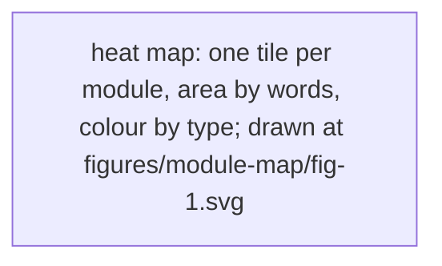
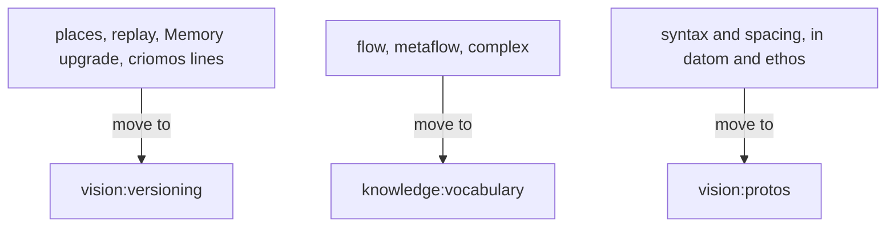

Presentation.{ «The module map» }

# The module map

Created by Fable, from a count of the modules and a Sonnet's reading of all of them, 2026-11-05.

91 modules, 38,300 words. Each tile is a module, its area its words; green is vision, orange knowledge, blue intent, purple spirit, grey role. Five modules hold a third of all words; half the modules are under 150.

Repeats, strongest first, each with the one module that should hold it:

- Places and replay: said in complex-v1, nexus-v1 and versioning. Home: versioning.
- The Memory upgrade: memory and versioning give two different fallbacks. Home: versioning.
- Flow, metaflow, complex: defined in four modules, and "flow" drifted between them. Home: vocabulary.
- Datom's syntax and spacing: datom, protos and ethos each state them. Home: protos.
- Nexus versioning lines inside criomos. Home: versioning.
- The Codex reset rule: energy-nexus-v1 and knowledge:codex-reset, drifting on the window. Home: energy-nexus-v1.

Three more fall by themselves: the Fable gate (your word today), the redo and change-mark rules (One presentation module, landing), and the message types said three ways (version 0's parts leaving the perennial Flow Nexus module, in the version 1 book).

Say the word and the six move to their homes, each as a proposal.
