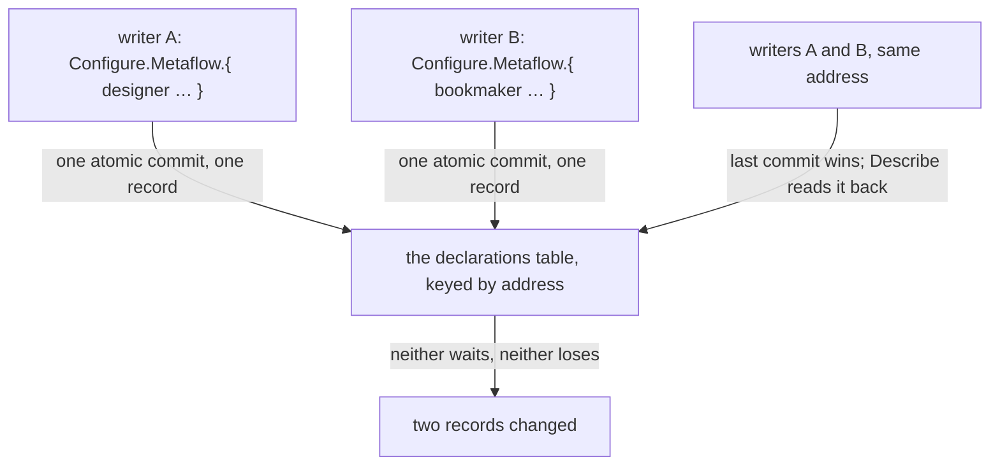

Presentation.{ «One declaration at a time» }

# One declaration at a time

Created by Fable, from his word of 2026-11-05 on the whole-set replace: "That's a really stupid design." On 0.51 a metaflow declaration is changed by sending the entire set, `Configure.Metaflows.[ … ]`, which the store applies by replacing the whole table (`replace_configuration_family`, crates/flow-nexus/src/store.rs 8610); two writers overwrite each other, so flows take turns by agreement. The store already has the right primitive: one atomic commit on one record, used for every flow record (`begin_atomic_commit().mutate(self.flows, flow)`, store.rs 7179). The change is to use it for declarations. Two halves: 0.52, on 0.51's types; version 1, on its own, where the book Flow Nexus version 1 already says Define adds or replaces one.



### Proposal 1: 0.52 changes one declaration · psyche-belief › vision/flow-nexus.md

**Comment** The perennial line, under "Starting flows", beside the Configure.Permaflow datom it already shows; the Rust is 0.52's, shown so the mechanism is read.

  ## Starting flows

+ A declaration is changed alone: one metaflow added or replaced, or one removed, in one atomic commit on its own record, keyed by its address; a change to one touches no other, and two writers never wait for each other. The whole set is read, never written.

```ethos
+ Signal                                ; the meta surface, 0.52
+ [ flow:[ Address ConfigureMetaflow ] ]
+ [ Configure.Set ]
+ [ Configured.Set
+   Refused.[ TopicRefused.Topic ] ]
+ [ Set.[ Metaflow.ConfigureMetaflow    ; one, added or replaced by its address
+         RemoveMetaflow.Address ] ]    ; one, removed
```

```datom
+ Configure.Metaflow.{ { Psyche book Quaternary } None
+                      [ spirit:core knowledge:flow-messaging ] [ knowledge:book ]
+                      Regular Default Maintained «publishes» [] }
+ Configured.Metaflow.{ Psyche book Quaternary }
+ Configure.RemoveMetaflow.{ Psyche flowAudit Secondary }
+ Configured.RemoveMetaflow.{ Psyche flowAudit Secondary }
```

```rust
+ // crates/flow-nexus/src/store.rs, 0.52: one record, one commit; the family is never replaced
+ ConfigurationChange::Metaflow(entry) => {
+     let record = StoredMetaMetaflowConfiguration::from(entry);
+     engine.begin_atomic_commit()
+         .mutate(tables.metaflows, record)   // keyed by address: insert or replace this one
+         .commit()?;
+     Ok(ConfigureOutcome::Applied)
+ }
+ ConfigurationChange::RemoveMetaflow(address) => {
+     engine.begin_atomic_commit()
+         .remove(tables.metaflows, &address)
+         .commit()?;
+     Ok(ConfigureOutcome::Applied)
+ }
- ConfigurationChange::Metaflows(entries) => FlowStore::replace_configuration_family(
-     engine, tables.metaflows, entries.into_iter().map(Into::into).collect(),
- ),
```

### Proposal 2: Version 1 defines one · psyche-belief › vision/flow-nexus-v1.md

**Comment** The Signal already says Define and Undefine take one; what the book adds is the Memory side: one record per definition, one commit per Define, and the figure. Under "The machine is defined, never built in".

  Everything that can be configured is configuration. The Nexus holds the vocabulary a definition is written in, as Ethos types; the user writes definitions in datom, the way Nix defines an operating system; a running flow is a definition in action. A metaflow is named by the user, and the Nexus runs it without knowing its name beforehand. A definition is one datom of its own: it is added, replaced or removed alone; a complex is one of them, naming its metaflows. No role or anatomy is in the Rust.

+ A Define is one atomic change of one Memory record, keyed by the definition's name; an Undefine removes that record; nothing else is read or written, so two definitions change at once without a lock, and the same definition changed twice keeps the later one. The set is read whole by Definitions and never written whole.

```ethos
+ Operation
+ [ flow:[ Definition Name ] ]
+ [ Defining.Definition                 ; attempts: one record written
+   Undefining.Name ]                   ;   one record removed
+ [ Defined.Name                        ; outcomes
+   Undefined.Name
+   Failed.StoreRefused ]
+ [ StoreRefused.String ]
```

```ethos
+ Memory
+ [ flow:[ Metaflow Harness Complex Name ] ]
+ [ Definition.{ Name                   ; one record per definition, keyed by name
+                Body.[ Metaflow Harness Complex ] }
+   Answer.[ Succeeded Failed ] ]
```

```mermaid
+ flowchart TB
+     d["Define.Metaflow.{ designer … }"] -- "Defining" --> o["Operation: one attempt"]
+     o -- "one record, one commit" --> m["Memory: Definition keyed by name"]
+     m -- "Succeeded" --> o
+     o -- "Defined.designer" --> d
```
