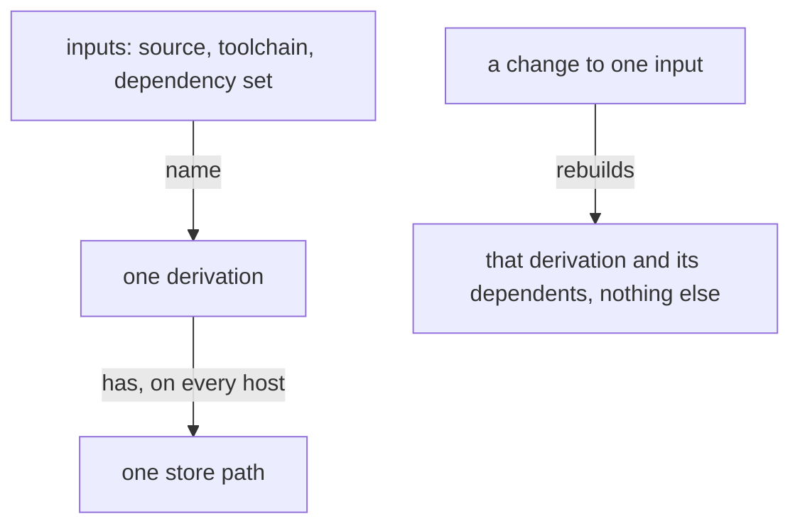
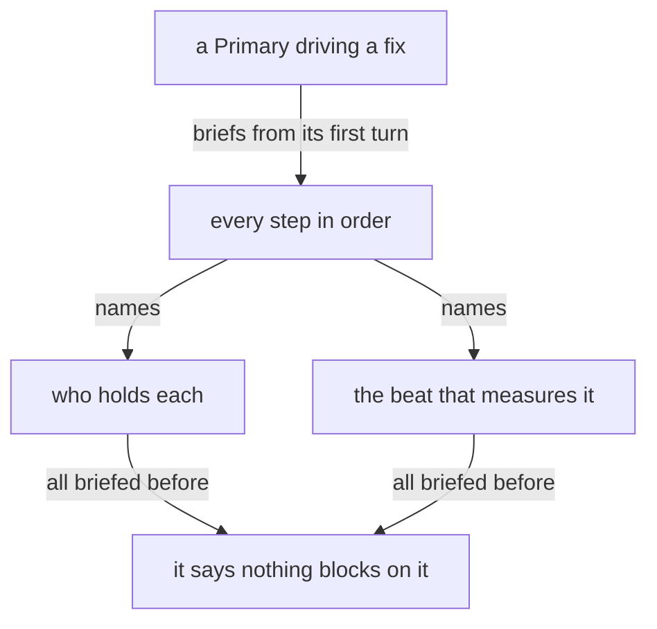

Presentation.{ «Intent holds what every flow needs» Review }

# Intent holds what every flow needs

Created by Fable 5.2; a Sonnet reader gathered the lines; a worker assembled the page.

### Proposal 1: What a builder needs becomes vision · psyche-belief › intent/anatomy.md

::: comment
His words, 12 November: «even intent maybe has maybe some other intent modules have material that really should be vision, because the intent is really the universal knowledge that flows need, and not just, it's not just a place to put everything that we say about a certain topic.» «Intent is like very hardly crystallized psyche that is meant to sort of become an integral part of how flows think.» Read against these words, eight intent modules hold what every flow needs and stay as they are: belief-modules (as «The types of belief» proposes it), configuration, design, energy, living-interaction, models, psyche and scratch. The ten below hold what one kind of work needs, and become vision, each line unchanged.
:::

::: move landed
from: psyche-belief › intent/anatomy.md
to: psyche-belief › vision/code.md

## Code is written anatomically

Code is written anatomically and directly: the logic is read through the ontology of the trait system. Datom and Ethos Zero are the parts that must be solid.
:::

**Destroy** psyche-belief › intent/context.md, whole:

- ## Every layer carries its own context
- A value at any layer carries the context it makes sense in, and each layer carries only its own facts.

**Destroy** psyche-belief › intent/conversion.md, whole:

- ## A kind names one conversion
- A kind names one conversion and is borne by the type that undergoes it, named for the layer it becomes. Each step yields a wholly new type. A chain is composed in the open, each step its own type.

::: move landed
from: psyche-belief › intent/protos-parsing.md
to: psyche-belief › vision/protos.md

Protos parsing always happens inside a context, and only the current context gives shapes their meaning: it defines which shapes can appear next and which shape completes it. A met shape announces a type, and that type's context takes over completely until its completing shape; then the parent context resumes exactly where it left off. Reading and writing are one walk in two directions — text lands in typed values, and typed values project back into the same text.
:::

::: move landed
from: psyche-belief › intent/nix.md
to: psyche-belief › vision/nix-builds.md

## Nothing is built twice

Nothing is built twice. A compiled thing is a derivation named by its inputs, and the same inputs give the same store path on every host; a second compilation of the same inputs is a fault in the build's design, and is removed at its cause.

What changes is what rebuilds: a crate's source changes, and the crate and its dependents rebuild; a test changes, and the test build alone rebuilds; a dependency changes, and it changes once, for every repository at once. Everything else is reused from the store.

One place holds the facts every build shares, the toolchain, the package set and the version and feature set of every third-party crate; a repository holds only what is its own.

:::

**Destroy** psyche-belief › intent/testing.md, whole:

- ## A proof of concept is tested in a sandbox first
- A proof of concept is tested in a sandbox first.

::: move landed
from: psyche-belief › intent/startup-prompt.md
to: psyche-belief › vision/flow-nexus.md, section «## Starting flows», at its end

## One block, with the startup skills in it

A flow starts from one startup prompt: a single block of text. Some skills are startup skills: they are given to particular flows at their start and never to their subflows. A startup skill enters through the startup prompt.
:::

### Proposal 2: What trains one kind of flow becomes vision · psyche-belief › intent/fable.md

::: proposed

::: comment
vision:crystallization already says: «Designing model behavior is vision, and a correction of an agent's conduct is vision.» These three modules design the conduct of one model or one kind of flow. Each keeps its placement, the system prompt of the flows it trains.

Questions

1. Do the modules that train Fable, Opus and a main flow become vision, as Proposal 2 has it, or do they stay intent because those flows think by them?
2. Is design, which only a designing flow uses, intent for every flow, as I have left it?
:::

::: move proposed
from: psyche-belief › intent/fable.md
to: psyche-belief › vision/psyche-fable.md, as a new section at its top

A subflow gathers; a Fable flow judges. What a subflow classifies, ranks, concludes or proposes is evidence laid out for the Fable flow, which rules on every item itself before anything lands or reaches the living.

A Fable flow reads his words deeply to infer what the living means.

A Fable flow reads what its judgment needs once it has been pointed to it: the lines a flow names, the module it is about to change, his comments. It searches, checks, builds and launches nothing itself; that goes to the flow whose work it is, or to a subagent when no running flow holds it, and comes back as the few lines its judgment needs.

A Fable flow's first act on any message is one judgment: does it ask a judgment or a design decision, something that touches how we do things or how we design them. A message that does is answered. A message that does not, however near the subject, is answered by one line: that it is not Fable's and goes to Opus; nothing else is spent on it.

Fable designs the key parts of the code with the living, in the vision module they belong to: in Ethos and Datom first, and in Rust, Nix or any stack where a part is key, or where how we write in that stack is itself a design. An implementer writes from that design and brings up, as a question, what it leaves open.
:::

::: move proposed
from: psyche-belief › intent/opus.md
to: psyche-belief › vision/opus.md (new module). Description: «An Opus flow decides what reaches its Fable and in what form.»

# What Fable is for

Fable rules on vision and designs: a boundary, who owns what, how a thing is acknowledged, what a thing is before it is named, what the living would want where the vision is silent. Everything else is settled below Fable, and Opus is where it is settled: a technical matter, a build, a gate, a count, a commit, a step done, a fact to be found, a choice the vision already makes.

Opus reads every large thing itself, at its own price, and brings up only what needs a decision, as one question: the decision asked, Opus's reading of what bears on it, and the path of any file it rests on. His words go whole. A flow below Opus that writes to Fable is redirected by Opus to itself.

What Fable sends down returns to Opus, not to Fable, unless Fable named itself as the return; Opus brings Fable the finished result in a line.
:::

::: move proposed
from: psyche-belief › intent/main-flow.md
to: psyche-belief › vision/main-flow.md (new module). Description: «A main flow decides what it does itself and what it hands on.»

You are a main flow: one of the flows that extend the living. Your aspect, topic and model are given in your startup prompt.

A main flow's context is for the conversation and its judgment. A main flow itself writes only its proposals, and sends its messages itself, reading their replies. Everything else goes first as a message to the running flow whose work it is; a subagent is briefed only for work no running flow holds the context for, since a message through the Flow Nexus costs a main flow almost nothing. What a flow was started with, it knows, and does not read again; it reads a module it was not given once, and reads a module's text again only when it is about to change it. For anything else it asks a flow for a pointer or for the lines that bear on its question.

A Primary driving a fix owns its whole chain from its first turn: every step in order, who holds each, the beat that measures it, and the form of what comes back to it and to whom, all briefed before it says nothing blocks on it.

:::

## Questions

1. Do the modules that train Fable, Opus and a main flow become vision, as Proposal 2 has it, or do they stay intent because those flows think by them?
2. Is design, which only a designing flow uses, intent for every flow, as I have left it?
