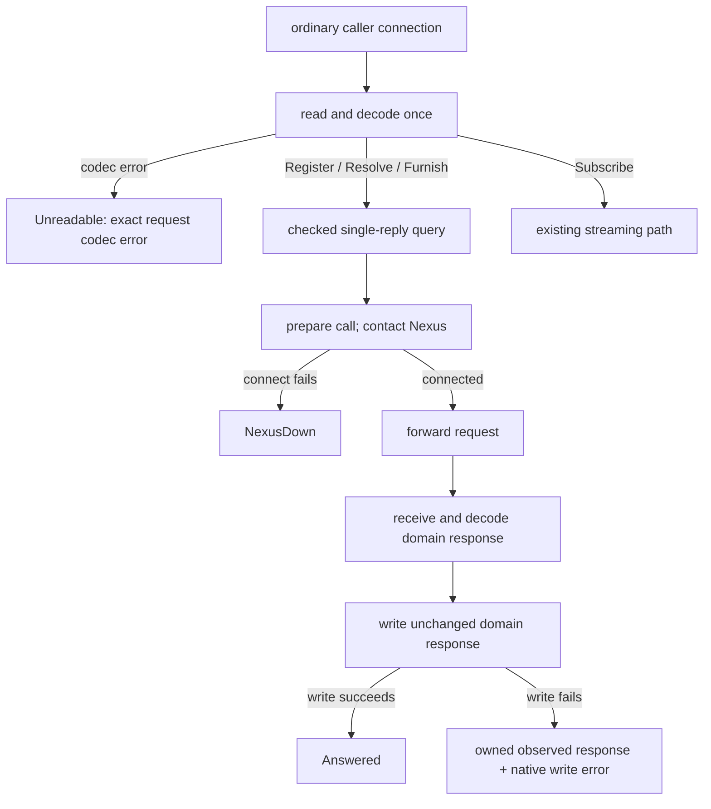
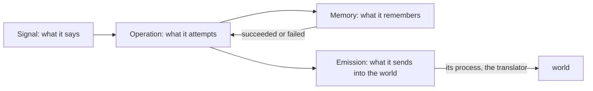
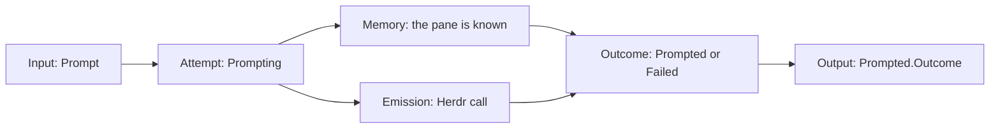
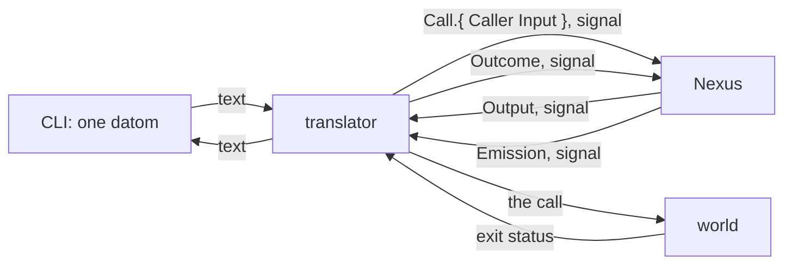
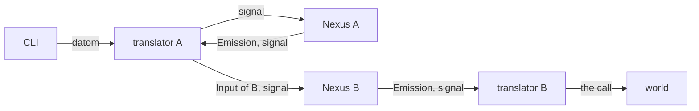

Presentation.{ «The Belief Nexus vision keeps the concept» Proposal }

# The Belief Nexus vision keeps the concept

Created by Fable 5.2; Sonnet readers found the lines, and a worker assembled the page.

## psyche-belief › vision/belief-nexus-v1.md

# The Belief Nexus

The Belief Nexus holds the belief modules and furnishes workspaces with them. Belief is the word: what a model believes when it starts. It replaces Curriculum. Its memory is its own; a definition in the Flow Nexus refers to a module by name only, and a name may resolve to nothing: the Belief Nexus answers which names are missing, and what is done about it is the definition's policy, never the Nexus's.

## Signal
The owner registers a belief repository at the Belief Nexus's own CLI, by his login, as he defines a complex at the Flow Nexus. A peer the meta peer list names furnishes over any registered repository.

A registered repository is watched: when its main moves, every workspace furnished with a module it changed is furnished again, and the Flow Nexus is told which flows now run on old belief, so a perma flow can be refreshed on it. A module is named by kind and subject; its front matter names its placement, system prompt or skill. The skills directory is the harness's.

```ethos
Signal
[ belief:[ ModuleSource ModuleName    ; imports
           Workspace Location ]
  flow:[ Harness ] ]
[ Register.ModuleSource              ; inputs: a module source
  Resolve.Vector<ModuleName>
  Furnish.{ Workspace Harness        ; the harness's
            Vector<ModuleName> }     ;   skills directory
  Subscribe ]
[ Registered.ModuleSource            ; outputs
  Resolved.{ Vector<ModuleName>      ; found
             Vector<ModuleName> }    ; missing
  Furnished.{ Location
              Vector<ModuleName> }   ; missing, left out
  Subscribed
  Changed.{ ModuleSource              ; pushed: main moved
            Vector<ModuleName>        ;   modules changed
            Vector<Workspace> }       ;   workspaces refurnished
  Refused.[ UnknownSource.ModuleSource
            Unwritable.Workspace ] ]
[]
```

```datom
Register.Repository.
  /git/github.com/LiGoldragon/psyche-belief
Registered.Repository.
  /git/github.com/LiGoldragon/psyche-belief
Register.Directory./home/li/psyche-belief-edits
```

```sh
belief-nexus '
  Register.
    /git/github.com/LiGoldragon/psyche-belief'
```

## Meta

A module's front matter names its placement; the default per Kind is a meta setting, set one value at a time, never in the Rust. The meta peer list names the peers admitted to Furnish, each bound by kernel credentials as a Nexus's peers are.

```ethos
Signal
[ belief:[ Kind Placement ] ]        ; imports
[ Configure.Set ]                    ; inputs: one value at a time
[ Configured.Set ]                   ; outputs: the value set
[ Set.[ Placement.{ Kind             ; types: the default
                    Placement }      ;   placement per Kind
        Peer.PeerBinding             ;   a peer admitted to Furnish
        RemovePeer.PeerId ]          ;   a peer removed
  UserId.Integer                     ; a login
  ProcessId.Integer
  PeerId.String                      ; a peer's name
  PeerIdentity.{ UserId ProcessId }  ; checked by kernel credentials
  PeerBinding.{ PeerId PeerIdentity } ]
```

## Library

```ethos
Library
[ sema:[ Document Block Edit Place Outline ] ]
[ Path.String                        ; a directory holding
                                     ;   <type>/<subject>.md
  ModuleSource.[ Repository.Path     ; a git repository, watched:
                                     ;   main moving refurnishes
                 Directory.Path ]    ; a directory read as it
                                     ;   stands, watched by nobody
  Kind.[ Spirit Intent Vision
         Knowledge Role ]
  ModuleName.{ Kind Subject.String }
  Workspace.String                   ; the flow's directory
  Placement.[ SystemPrompt Skill ]   ; named in front matter;
                                     ;   default per Kind: meta
  Location.{ SystemPrompt.String     ; the bundle file written
             Skills.String } ]       ; the skills directory
[]
[]
```

## Emission

Furnishing is writing: each module into the workspace's system-prompt bundle or the harness's skills directory, as its placement says.

```ethos
Emission
[ belief:[ Workspace ModuleName Location ]
  flow:[ Harness ] ]                   ; imports: the harness names the skills directory
[ Write.{ Workspace Harness Vector<ModuleName> } ] ; emissions: the bundle and the skills, written
[ Written.Location ]                   ; outcomes
[]
```

## Memory

```ethos
Memory
[ belief:[ ModuleSource ModuleName ] ]
[ Source.{ ModuleSource Vector<ModuleName> } ; records: each registered source and the modules it holds
  Answer.[ Succeeded Failed ] ]
```

```datom
Furnish.{ /home/li/primary Claude
          [ { Spirit core } { Vision nexus-v1 }
            { Vision none } ] }
Furnished.{ { /home/li/primary/.bundle
              /home/li/primary/.claude/skills }
            [ { Vision none } ] }
```

#### Proposal 1: The single-reply service goes down to knowledge · psyche-belief › vision/belief-nexus-v1.md, and mind-belief › knowledge/belief-nexus.md

::: comment
Three quarters of the Belief Nexus vision is the built service: authored Rust for its in-process types, its preparation and routing, the dependencies' error shapes, and the domain contract as it exists, which declares the Signal a second time with other types than the vision's own. That is the machine's working notes, not what he wants the Belief Nexus to be. The intent on belief modules: «When a vision module is found holding mechanics, the mechanics go down to a knowledge module and the concept stays.» His words, 12 November: «I would like it to not be a convoluted piece of slop code. If we could bring some clarity into the implementation and bring it more in line with what the vision is now.» The vision that remains is the one the open proposal «Belief is composed, for a flow or a subagent» changes.
:::

::: move proposed
from: psyche-belief › vision/belief-nexus-v1.md, from the heading «## The ordinary single-reply boundary» to the end of the module
to: mind-belief › knowledge/belief-nexus.md, a new module

## The ordinary single-reply boundary

The ordinary translator prepares a request once. Register, Resolve and Furnish enter a checked single-reply capability. Subscribe keeps its existing streaming path. The meta service keeps its existing path, including configuration application and recovery.

Preparation retains the direct request codec's structured error. A valid single-reply request enters execution with its caller connection. Execution returns Answered after the domain reply frame has been written successfully, or NexusDown when connecting to the Nexus fails before forwarding. These are in-process observations. The caller's successful domain datom keeps its existing form.

The composed service's Unreadable observation belongs to request preparation. Checked execution has no unreadable-request branch.



### Conceptual observations and the executable capability

The Belief ordinary single-reply service realizes the conceptual connection-level observations through one preparation boundary followed by checked execution. Its executable capability takes a checked request and connection, rather than the conceptual example's bare Connection; it returns a fallible SingleReplyOutcome rather than the composed Outcome. Preparation contributes Unreadable; checked execution contributes Answered or NexusDown.

`Unreadable.Error` corresponds exactly to the direct `datom_codec::Error`. The decoder preserves that value rather than converting it to a diagnostic string. This executable contract belongs to the Belief Nexus; the general example in vision:nexus-v1 remains conceptual.

### Authored Rust — in-process types

This is author-written Rust, not generated Rust. Ethos lowering for these generic/native-error shapes is unverified; no new Ethos spelling is asserted.

The native leaves retain their dependency-owned types: `datom_codec::Error`, `signal::FrameError`, `rkyv::rancor::Error`, `std::io::Error`, `std::string::FromUtf8Error`, and the existing local `TranslatorError`. These values remain in process; this contract adds no serialization requirement to them.

```rust
use std::io;
use std::os::unix::net::UnixStream;
use std::string::FromUtf8Error;
use signal::FrameError;
use signal_belief_nexus as public;

// Existing local diagnostic type, retained rather than redesigned.
#[derive(Debug)]
pub enum TranslatorError {
    Text(String),
    Signal(String),
    Peer(String),
    Configuration(String),
    Io(io::Error),
}

// Observations of preparation composed with single-reply execution.
pub enum Outcome {
    Answered,
    Unreadable(datom_codec::Error),
    NexusDown,
}

// A decoded, checked request can produce only these successful observations.
pub enum SingleReplyOutcome {
    Answered,
    NexusDown,
}

impl From<SingleReplyOutcome> for Outcome {
    fn from(value: SingleReplyOutcome) -> Self {
        match value {
            SingleReplyOutcome::Answered => Self::Answered,
            SingleReplyOutcome::NexusDown => Self::NexusDown,
        }
    }
}

pub enum PreparationFailure {
    RequestFrame(FrameError),
    RequestText(FromUtf8Error),
    Precondition(TranslatorError),
}

pub enum BeforeForwardFailure {
    Precondition(TranslatorError),
    Archive(rkyv::rancor::Error),
    NexusSetup(io::Error),
}

pub enum ReplyFailure {
    Frame(FrameError),
    Decode(rkyv::rancor::Error),
}

pub struct ResponseWriteFailure<Response> {
    pub response: Response,
    pub error: FrameError,
}

pub enum SingleReplyFailure<Response> {
    BeforeForward(BeforeForwardFailure),
    Forwarding(FrameError),
    Awaiting(ReplyFailure),
    ResponseWriteFailure(ResponseWriteFailure<Response>),
}
```

PreparationFailure records a failure before a checked query exists. Its Precondition retains existing preparation configuration errors. BeforeForward records that this checked call's request has not been forwarded to the Nexus. It makes no claim that the process performed no local work: preparation, peer/configuration checks, archiving and socket setup remain their own acts. NexusSetup is configuration of an already-connected socket; a failed Nexus connection produces NexusDown instead.

Forwarding records a failed request write, which may have been partial. Awaiting records a failed response read or typed restoration after forwarding, when the requested effect may already have occurred. ResponseWriteFailure moves the observed typed domain response into the failure together with the native caller-write error. That response records the Nexus's answer; it does not assert caller delivery or retry safety.

A frame error or invalid UTF-8 is transport evidence, distinct from a malformed Datom. The request-codec error is carried intact. Native archive/restoration errors remain native errors.

### Authored Rust — preparation and routing

`SingleReplyQuery` owns the original domain query. Its private field is constructed only by the exhaustive route match below; Subscribe has its own route. The four existing ordinary query variants are Register, Resolve, Furnish and Subscribe.

```rust
pub struct SingleReplyQuery {
    query: public::Query,
}

pub enum PreparedOrdinary {
    SingleReply(SingleReplyQuery),
    Subscribe,
    Unreadable(datom_codec::Error),
}

impl From<public::Query> for PreparedOrdinary {
    fn from(query: public::Query) -> Self {
        match query {
            query @ public::Query::Register(_)
            | query @ public::Query::Resolve(_)
            | query @ public::Query::Furnish(_) =>
                Self::SingleReply(SingleReplyQuery { query }),
            public::Query::Subscribe => Self::Subscribe,
        }
    }
}


pub trait OrdinaryPreparing {
    fn prepare(
        &self,
        connection: &mut UnixStream,
    ) -> Result<PreparedOrdinary, PreparationFailure>;
}

pub trait SingleReplyServing {
    type Response;

    fn serve(
        &self,
        request: SingleReplyQuery,
        connection: &mut UnixStream,
    ) -> Result<SingleReplyOutcome, SingleReplyFailure<Self::Response>>;
}
```

The ordinary decoder/router site becomes the typed preparation boundary. Its decoder preserves the direct codec error instead of converting it into the existing Text diagnostic; the request is still decoded once. The unreadable branch supplies `Outcome::Unreadable(error)` by moving the exact error. Its unary branch invokes SingleReplyServing and maps the returned SingleReplyOutcome into Outcome. A preparation failure remains PreparationFailure evidence. RequestFrame and RequestText are preparation-only cases; checked unary execution has neither variant. Its Subscribe branch invokes the existing stream path with its existing return semantics. These are separate branches, not a common session-completion wrapper.

The unary capability owns peer/precondition checks, call archiving, Nexus contact and setup, request forwarding, response restoration and caller response writing. The response type stays associated with the capability; ResponseWriteFailure stores that same type. Domain refusals are domain responses, so successfully writing one produces Answered.

The existing meta path is outside this capability. Its post-response apply/restore sequence and nested Nexus call retain their own design boundary.

### Existing native evidence shapes

The direct request codec's error structure is retained whole. These are dependency declarations shown for correspondence, not newly authored replacements.

```rust
// datom_codec
pub type Integer = i64;
pub type Path = Vec<Integer>;
pub enum ErrorLayer { Protos, Datom, Composition }
pub struct Error {
    pub layer: ErrorLayer,
    pub path: Path,
    pub kind: ErrorKind,
}
pub enum ErrorKind {
    Budget,
    Structural(protos::Error),
    Form { expected: String, found: String },
    Arity { expected: Integer, found: Integer },
    Value { expected: String, value: String },
    Variant { expected: String, found: String },
}
```

```rust
// protos
pub struct Extent { pub start: usize, pub end: usize }
pub struct Error { pub extent: Extent, pub problem: Problem }
pub enum Problem {
    Empty, Multiple, Unclosed(char), Unexpected(char),
    MissingHead, MissingBody, Budget, Depth,
}
```

```rust
// signal
pub enum FrameError {
    Io(std::io::Error),
    BodyTooLarge { found: usize, capacity: usize },
}
```

The standard-library I/O and UTF-8 errors and the rkyv native error remain opaque dependency-owned evidence. This module specifies their placement and ownership, not their private representation.

### Existing ordinary domain contract

The domain vocabulary is retained. This is its existing Ethos, including the declarations needed by Query and Response. The service types above use the compiled ordinary contract as `public`.

```ethos
Library
[]                                      ; imports
[ UserId.Integer                        ; types: authenticated identity
  GroupId.Integer
  ProcessId.Integer
  Caller.{ ProcessId UserId }            ; caller credentials
  PeerIdentity.{ UserId ProcessId }      ; peer binding identity
  PeerId.String
  PeerBinding.{ PeerId PeerIdentity }    ; named peer
  Principal.[ Login.UserId               ; authenticated owner
              Peer.PeerId ] ]
[]                                      ; traits
[]                                      ; associations
```
:::

-
```ethos
- Signal
- [ :translator:[ Caller PeerBinding UserId PeerId ] ] ; imports
- [ Register.Repository                   ; inputs
-   Resolve.Vector<ModuleName>
-   Furnish.FurnishRequest
-   Subscribe ]
- [ Registered.RepositoryState            ; outputs
-   Resolved.Resolution
-   Furnished.FurnishedWorkspace
-   Subscribed.Vector<FurnishedWorkspace>
-   Changed.FurnishedWorkspace
-   RefurnishFailed.RefurnishFailure
-   CleanupFailed.CleanupFailure
-   SubscriptionClosed.CloseReason
-   MemoryAfterPublication.MemoryAfterPublication
-   Refused.Refusal ]
- [ Kind.[ Spirit Intent Vision Knowledge Role ] ; types
-   Subject.String
-   ModuleName.{ Kind Subject }            ; module identity
-   RepositoryPath.String
-   Repository.RepositoryPath
-   WorkspacePath.String
-   Workspace.WorkspacePath
-   RelativePath.String
-   SourceRevision.String
-   PublicationRevision.Integer
-   GenerationId.String
-   Harness.[ Claude Codex ]               ; harness choice
-   Owner.[ Login.UserId Peer.PeerId ]      ; workspace owner
-   RepositoryState.{ Repository SourceRevision } ; observed source
-   Found.ModuleName
-   Resolution.{ Vector<Found> Vector<ModuleName> } ; found and missing
-   FurnishRequest.{ Workspace Harness Vector<ModuleName> } ; request
-   Placement.[ SystemPrompt Skills ]      ; destination kind
-   SystemPromptPath.String
-   SkillsPath.String
-   FurnishedPaths.{ SystemPromptPath SkillsPath } ; published paths
-   FurnishedWorkspace.{                   ; publication receipt
-      Workspace GenerationId PublicationRevision FurnishedPaths
-      Vector<Found> Vector<ModuleName> }
-   ExecutablePath.String
-   ContractDigest.String
-   PeerList.Vector<PeerBinding>
-   Call.{ Caller Query }                  ; authenticated input
-   SourceOperation.[ Registering Snapshotting Resolving Watching ] ; source act
-   FileOperation.[ Reading Staging Linking Replacing Inspecting Cleaning ] ; file act
-   MemoryOperation.[ Loading Recording BeginningPublication ; Memory act
-                     CompletingPublication AfterPublication Recovering ]
-   ExitStatus.Integer
-   Diagnostic.{ ExecutablePath Option<ExitStatus> String } ; external diagnostic
-   InvalidPlacement.[ Unknown.String NonScalar Duplicate ] ; placement error
-   InvalidModule.{ ModuleName RelativePath InvalidPlacement } ; source error
-   SourceEvidence.[ NotRepository MainUnavailable RevisionUnavailable ; evidence
-                    InvalidModule
-                    Ambiguous.{ ModuleName Vector<Repository> }
-                    Translator.Diagnostic ]
-   SourceFailure.{ Repository SourceOperation SourceEvidence } ; source failure
-   FileEvidence.[ OutsideBoundary.{ RelativePath RelativePath } ; evidence
-                  PermissionDenied
-                  MissingRequired.RelativePath
-                  Conflict.{ Option<PublicationRevision>
-                             Option<PublicationRevision> }
-                  Translator.Diagnostic ]
-   FileFailure.{ Workspace FileOperation FileEvidence } ; file failure
-   MemoryEvidence.[ Unavailable Corrupt Conflict ] ; Memory evidence
-   MemoryFailure.{ MemoryOperation MemoryEvidence } ; Memory failure
-   RefusalKind.[ Source File Memory NotAuthorized ; refusal class
-                 SubscriberCapacityReached NotReady ]
-   RefurnishFailure.{ Workspace RefusalKind } ; refurnish failure
-   CleanupFailure.{ Workspace GenerationId PublicationRevision FileFailure } ; cleanup
-   CloseReason.[ QueueOverflow WriteTimeout ] ; existing stream terminal reason
-   MemoryAfterPublication.{                ; Memory failure after publication
-      Workspace GenerationId PublicationRevision MemoryFailure }
-   Refusal.[ Source.SourceFailure         ; domain refusals
-             File.FileFailure
-             Memory.MemoryFailure
-             NotAuthorized.Caller
-             SubscriberCapacityReached.Integer
-             NotReady ] ]
```

### Proposal 1: The single-reply service goes down to knowledge · mind-belief › knowledge/belief-nexus.md

+ description: The Belief Nexus's ordinary single-reply service as built: its in-process types, preparation, routing and domain contract.
+ dependencies: [vision-belief-nexus-v1]

```ethos
+ Signal
+ [ :translator:[ Caller PeerBinding UserId PeerId ] ] ; imports
+ [ Register.Repository                   ; inputs
+   Resolve.Vector<ModuleName>
+   Furnish.FurnishRequest
+   Subscribe ]
+ [ Registered.RepositoryState            ; outputs
+   Resolved.Resolution
+   Furnished.FurnishedWorkspace
+   Subscribed.Vector<FurnishedWorkspace>
+   Changed.FurnishedWorkspace
+   RefurnishFailed.RefurnishFailure
+   CleanupFailed.CleanupFailure
+   SubscriptionClosed.CloseReason
+   MemoryAfterPublication.MemoryAfterPublication
+   Refused.Refusal ]
+ [ Kind.[ Spirit Intent Vision Knowledge Role ] ; types
+   Subject.String
+   ModuleName.{ Kind Subject }            ; module identity
+   RepositoryPath.String
+   Repository.RepositoryPath
+   WorkspacePath.String
+   Workspace.WorkspacePath
+   RelativePath.String
+   SourceRevision.String
+   PublicationRevision.Integer
+   GenerationId.String
+   Harness.[ Claude Codex ]               ; harness choice
+   Owner.[ Login.UserId Peer.PeerId ]      ; workspace owner
+   RepositoryState.{ Repository SourceRevision } ; observed source
+   Resolution.{ Vector<ModuleName> Vector<ModuleName> } ; found and missing
+   FurnishRequest.{ Workspace Harness Vector<ModuleName> } ; request
+   Placement.[ SystemPrompt Skills ]      ; destination kind
+   SystemPromptPath.String
+   SkillsPath.String
+   FurnishedPaths.{ SystemPromptPath SkillsPath } ; published paths
+   FurnishedWorkspace.{                   ; publication receipt
+      Workspace GenerationId PublicationRevision FurnishedPaths
+      Vector<ModuleName> Vector<ModuleName> }
+   ExecutablePath.String
+   ContractDigest.String
+   PeerList.Vector<PeerBinding>
+   Call.{ Caller Query }                  ; authenticated input
+   SourceOperation.[ Registering Snapshotting Resolving Watching ] ; source act
+   FileOperation.[ Reading Staging Linking Replacing Inspecting Cleaning ] ; file act
+   MemoryOperation.[ Loading Recording BeginningPublication ; Memory act
+                     CompletingPublication AfterPublication Recovering ]
+   ExitStatus.Integer
+   Diagnostic.{ ExecutablePath Option<ExitStatus> String } ; external diagnostic
+   InvalidPlacement.[ Unknown.String NonScalar Duplicate ] ; placement error
+   InvalidModule.{ ModuleName RelativePath InvalidPlacement } ; source error
+   SourceEvidence.[ NotRepository MainUnavailable RevisionUnavailable ; evidence
+                    InvalidModule
+                    Ambiguous.{ ModuleName Vector<Repository> }
+                    Translator.Diagnostic ]
+   SourceFailure.{ Repository SourceOperation SourceEvidence } ; source failure
+   FileEvidence.[ OutsideBoundary.{ RelativePath RelativePath } ; evidence
+                  PermissionDenied
+                  MissingRequired.RelativePath
+                  Conflict.{ Option<PublicationRevision>
+                             Option<PublicationRevision> }
+                  Translator.Diagnostic ]
+   FileFailure.{ Workspace FileOperation FileEvidence } ; file failure
+   MemoryEvidence.[ Unavailable Corrupt Conflict ] ; Memory evidence
+   MemoryFailure.{ MemoryOperation MemoryEvidence } ; Memory failure
+   RefusalKind.[ Source File Memory NotAuthorized ; refusal class
+                 SubscriberCapacityReached NotReady ]
+   RefurnishFailure.{ Workspace RefusalKind } ; refurnish failure
+   CleanupFailure.{ Workspace GenerationId PublicationRevision FileFailure } ; cleanup
+   CloseReason.[ QueueOverflow WriteTimeout ] ; existing stream terminal reason
+   MemoryAfterPublication.{                ; Memory failure after publication
+      Workspace GenerationId PublicationRevision MemoryFailure }
+   Refusal.[ Source.SourceFailure         ; domain refusals
+             File.FileFailure
+             Memory.MemoryFailure
+             NotAuthorized.Caller
+             SubscriberCapacityReached.Integer
+             NotReady ] ]
```

## psyche-belief › vision/nexus-v1.md

# A Nexus

Nexus is an architecture; a component built in it has four parts, each its own ethos. The translator is the process of the fourth, Emission.



## An operation is an attempt

A signal in is an attempt at something; the attempt is the operation. Operation declares each attempt named as the doing, and the outcome each attempt ends in; Signal's output is made from that outcome. One attempt per input; an attempt may compose several typed emissions, each emission one external call.



## The translator

The Nexus decodes signal and nothing else. The translator is the process in front of it that speaks text: a datom typed at the CLI comes in through it, and every emission goes out through it. Every translator carries the Caller, from the connection's peer credentials, in `Call.{ Caller Input }`.



#### Proposal 2: The same contract, said once · psyche-belief › vision/nexus-v1.md

::: comment
The Nexus vision names the Belief Nexus's contract in one sentence; with the contract in knowledge, the sentence has nothing in vision to point to.
:::

- The following conceptual Ethos names composed single-reply observations at the connection boundary. Each translator declares its executable capability and how request preparation and fallible execution produce those observations. The Belief ordinary single-reply contract separates preparation from checked execution and retains native failure evidence in process.
+ The following conceptual Ethos names composed single-reply observations at the connection boundary. Each translator declares its executable capability and how request preparation and fallible execution produce those observations.
-

```ethos
Library
[ signal:[ Input Output Error ]
  std:[ Connection ] ]
[ Translator.{ NexusSocket.String }   ; the socket of the Nexus it speaks for
  Caller.{ ProcessId.Integer          ; the connection's
           UserId.Integer }           ;   peer credentials
  Call.{ Caller Input }               ; what the translator sends in
  Outcome.[ Answered                  ; one reply written back
            Unreadable.Error          ; the text was not an Input
            NexusDown ] ]
[ Serving.[ serve.{ [ Connection ] [ Outcome ] } ] ]
[ Translator.[ Serving ] ]
```

## A command line is a type

What a Nexus sends into the world is a typed value: a variant per subcommand, a field per argument, a String only where a user writes freely. The translator turns the value into the call; it is the one place that holds the words.

```ethos
Emission
[]
[ Command.{ Verb Vector<Argument> } ]  ; emissions
[ Outcome.[ Done Refused.Integer ] ]   ; outcomes
[ Verb.[ List Show ]                   ; types
  Argument.[ Name.String Quiet ] ]
[ Arguable.[ argv.[ Vector<String> ] ] ]
[ Verb.[ Arguable ]
  Argument.[ Arguable ]
  Command.[ Arguable ] ]
```

```rust
impl Arguable for Verb {
    fn argv(&self) -> Vec<String> {
        match self {
            Verb::List => vec!["list".into()],
            Verb::Show => vec!["show".into()],
        }
    }
}
impl Arguable for Argument {
    fn argv(&self) -> Vec<String> {
        match self {
            Argument::Name(s) => vec![s.clone()],
            Argument::Quiet => vec!["--quiet".into()],
        }
    }
}
impl Arguable for Command {
    fn argv(&self) -> Vec<String> {
        let mut v = self.verb.argv();
        for a in &self.argument_vector { v.extend(a.argv()) }
        v
    }
}
impl Emittable for Command {           // trait: generated
    type Outcome = Outcome;
    fn emit(&self, t: &Translator) -> Outcome {
        t.call(&self.argv())
    }
}
```

## A Nexus starts in its place

A Nexus reads nothing from the environment: it is started with one datom, its place. Runtime holds its sockets and defaults to `$XDG_RUNTIME_DIR/nexus/<place-name>/`; State holds its memory and defaults to `$XDG_STATE_HOME/nexus/<place-name>/`, `~/.local/state/nexus/<place-name>/` when the variable is unset. Both roots are the CLI's fixed defaults, taken from the standard XDG variables and from nothing else, never an argument. The CLI is `<nexus-name> '<datom>'`: named after the Nexus, and taking the datom and nothing else. Whatever else it knows is its configuration, one datom at `$XDG_CONFIG_HOME/nexus/<nexus-name>.datom`, the place first among its values and more as the CLI gains options. The place name is resolved under the runtime root to the sockets. Two places are two names, and the stable one keeps running while the next is tried; a place is reached by the configuration that names it, so the testing capsule has its own configuration as it has its own sockets and store, and no place is ever typed.

```ethos
Library
[]
[ PlaceName.String                   ; main, next
  Place.{ PlaceName                  ; what every Nexus starts with
          Runtime.String             ; the sockets
          State.String }             ; the memory
  CliConfiguration.{ PlaceName } ]   ; what the CLI knows besides its datom; grows as the CLI gains options
[]
[]
```

```sh
# ~/.config/nexus/flow-nexus.datom
{ main }
flow-nexus 'Launch.{ designer fable «Read the book» }'
```

```datom
; a Nexus, started by the shell
{ main /run/user/1001/nexus/main
  /home/li/.local/state/nexus/main }
; the sockets it makes there
; <nexus>.sock  <nexus>-meta.sock  <nexus>-translator.sock  <nexus>-meta-translator.sock
; the meta CLI's text arrives at <nexus>-meta-translator.sock and becomes signal for <nexus>-meta.sock; the ordinary translator refuses meta text
; flow.sock  flow-meta.sock  flow-translator.sock  flow-meta-translator.sock
```

## A meta surface sets one value at a time

A Nexus's meta surface sets one value at a time, and a subscription sees the configuration as it changes.

## Two Nexuses



Signal between Nexuses, never text. A Nexus admits signal from the peers its meta configuration names: a typed peer list, each peer bound by kernel credentials as its own translator is; ownership stays per caller.
