Presentation.{ «CriomOS lines in CriomOS, and examples that name no machine of his» Proposal }

# CriomOS lines in CriomOS, and examples that name no machine of his

Created by Fable 5.2; Sonnet readers found the lines, and a worker assembled the page.

### Proposal 1: The builder's store · psyche-belief › vision/nix-builds.md, and psyche-belief › vision/criomos.md

::: comment
His comment on the Nix book, 10 November, on the text of the builder's store: «This should probably go in Criomos.» The cache line went there; this sentence stayed behind.
:::

::: move proposed
from: psyche-belief › vision/nix-builds.md
to: psyche-belief › vision/criomos.md, section «## Services», before the sentence «The remote builder serves its store as the cluster's binary cache», in the same paragraph

Nix builds live in the remote builder's store.
:::

## psyche-belief › vision/x11.md

#### Proposal 2: X11 · psyche-belief › vision/x11.md, and psyche-belief › vision/criomos.md

::: comment
A module of one line, on a choice of the CriomOS desktop, which the CriomOS vision names as its own subject. His words, 12 November: «I'm trying to keep the belief where it belongs as much as possible.»
:::

::: move proposed
from: psyche-belief › vision/x11.md
to: psyche-belief › vision/criomos.md, as a new last paragraph of the section «## Services»

The CriomOS desktop runs without relying on X11. X11 stays installed as a fallback.
:::

### Proposal 2: X11 · psyche-belief › vision/x11.md, a deleted file

**Destroy**

## psyche-belief › vision/nix-builds.md

## Nix builds

Nix builds live in the remote builder's store. A machine keeps links only to the profiles in use on it. A Nix build worth keeping is listed in one registry profile; every other Nix build is collected by how recently and how often it was used.

A flake input is the bare repository URL; the lock is the pin. A rev or a ref is written in the lock alone.

#### Proposal 3: A flake input names the cluster's server · psyche-belief › vision/nix-builds.md

::: comment
The example names GitHub and his account. The Git server vision, landed after it, says every flake input names a repository on the cluster's own server, and writes the example so.
:::

```nix
- inputs.flow.url = "github:LiGoldragon/flow";   # the repository, bare; flake.lock holds the commit
+ inputs.flow.url = "git+ssh://git.example.criom.net/li/flow";   # the repository, bare; flake.lock holds the commit
```
-

## psyche-belief › vision/aspects.md

## Routes are the definition's

Who speaks to whom, within an aspect and across aspects, is the routes each metaflow names in its definition; a message off the routes is refused. Field reaches Psyche through Mind, unless Psyche has just spoken to Field.

#### Proposal 4: Examples with example names · psyche-belief › vision/aspects.md

::: comment
The vision on belief modules: «A belief module carries the mechanism, and nothing that is true of his own machines alone: no cluster name, host name, login, path or address of his.» Fifteen example lines carry his home directory or his account. One rule replaces them all; each line is shown as a REPLACE with only the changed words marked.
:::

```datom
  ; a metaflow, each member by its model
  { designer
    [ { fable claude claude-fable-5-1 Medium
-       Permanent Path.«/home/li/primary»
+       Permanent Path.«/home/example/primary»
        { [ { Spirit core } ] Refuse }
        HarnessDefault [] 1200
        [ Speaks.opus Living ] } ]
    fable }
```
-

## What each aspect is for

Psyche designs the tools, Mind makes them, Field uses them.

Psyche rules on the vision and designs within it. Mind writes the code: it implements what Psyche rules, as it stands. Field keeps the running system: it deploys, maintains, debugs, and finds out why something is not running.

A flow's beliefs follow from its aspect: each starts with what its work needs and knows the other aspects by the line above.

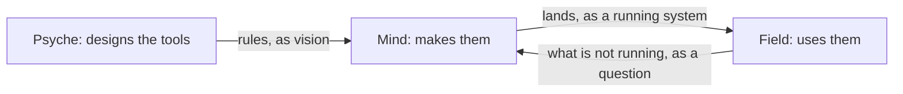

## psyche-belief › vision/belief-nexus-v1.md

# The Belief Nexus

The Belief Nexus holds the belief modules and furnishes workspaces with them. Belief is the word: what a model believes when it starts. It replaces Curriculum. Its memory is its own; a definition in the Flow Nexus refers to a module by name only, and a name may resolve to nothing: the Belief Nexus answers which names are missing, and what is done about it is the definition's policy, never the Nexus's.

## Signal
The owner registers a belief repository at the Belief Nexus's own CLI, by his login, as he defines a complex at the Flow Nexus. A peer the meta peer list names furnishes over any registered repository.

A registered repository is watched: when its main moves, every workspace furnished with a module it changed is furnished again, and the Flow Nexus is told which flows now run on old belief, so a perma flow can be refreshed on it. A module is named by kind and subject; its front matter names its placement, system prompt or skill. The skills directory is the harness's.

```ethos
Signal
[ belief:[ ModuleSource ModuleName    ; imports
           Workspace Location ]
  flow:[ Harness ] ]
[ Register.ModuleSource              ; inputs: a module source
  Resolve.Vector<ModuleName>
  Furnish.{ Workspace Harness        ; the harness's
            Vector<ModuleName> }     ;   skills directory
  Subscribe ]
[ Registered.ModuleSource            ; outputs
  Resolved.{ Vector<ModuleName>      ; found
             Vector<ModuleName> }    ; missing
  Furnished.{ Location
              Vector<ModuleName> }   ; missing, left out
  Subscribed
  Changed.{ ModuleSource              ; pushed: main moved
            Vector<ModuleName>        ;   modules changed
            Vector<Workspace> }       ;   workspaces refurnished
  Refused.[ UnknownSource.ModuleSource
            Unwritable.Workspace ] ]
[]
```

#### Proposal 4: Examples with example names · psyche-belief › vision/belief-nexus-v1.md

```datom
  Register.Repository.
-   /git/github.com/LiGoldragon/psyche-belief
+   /git/github.com/example-owner/psyche-belief
  Registered.Repository.
-   /git/github.com/LiGoldragon/psyche-belief
+   /git/github.com/example-owner/psyche-belief
- Register.Directory./home/li/psyche-belief-edits
+ Register.Directory./home/example/psyche-belief-edits
```
-

#### Proposal 4: Examples with example names · psyche-belief › vision/belief-nexus-v1.md

```sh
  belief-nexus '
    Register.
-     /git/github.com/LiGoldragon/psyche-belief'
+     /git/github.com/example-owner/psyche-belief'
```
-

## Meta

A module's front matter names its placement; the default per Kind is a meta setting, set one value at a time, never in the Rust. The meta peer list names the peers admitted to Furnish, each bound by kernel credentials as a Nexus's peers are.

```ethos
Signal
[ belief:[ Kind Placement ] ]        ; imports
[ Configure.Set ]                    ; inputs: one value at a time
[ Configured.Set ]                   ; outputs: the value set
[ Set.[ Placement.{ Kind             ; types: the default
                    Placement }      ;   placement per Kind
        Peer.PeerBinding             ;   a peer admitted to Furnish
        RemovePeer.PeerId ]          ;   a peer removed
  UserId.Integer                     ; a login
  ProcessId.Integer
  PeerId.String                      ; a peer's name
  PeerIdentity.{ UserId ProcessId }  ; checked by kernel credentials
  PeerBinding.{ PeerId PeerIdentity } ]
```

## Library

```ethos
Library
[ sema:[ Document Block Edit Place Outline ] ]
[ Path.String                        ; a directory holding
                                     ;   <type>/<subject>.md
  ModuleSource.[ Repository.Path     ; a git repository, watched:
                                     ;   main moving refurnishes
                 Directory.Path ]    ; a directory read as it
                                     ;   stands, watched by nobody
  Kind.[ Spirit Intent Vision
         Knowledge Role ]
  ModuleName.{ Kind Subject.String }
  Workspace.String                   ; the flow's directory
  Placement.[ SystemPrompt Skill ]   ; named in front matter;
                                     ;   default per Kind: meta
  Location.{ SystemPrompt.String     ; the bundle file written
             Skills.String } ]       ; the skills directory
[]
[]
```

## Emission

Furnishing is writing: each module into the workspace's system-prompt bundle or the harness's skills directory, as its placement says.

```ethos
Emission
[ belief:[ Workspace ModuleName Location ]
  flow:[ Harness ] ]                   ; imports: the harness names the skills directory
[ Write.{ Workspace Harness Vector<ModuleName> } ] ; emissions: the bundle and the skills, written
[ Written.Location ]                   ; outcomes
[]
```

## Memory

```ethos
Memory
[ belief:[ ModuleSource ModuleName ] ]
[ Source.{ ModuleSource Vector<ModuleName> } ; records: each registered source and the modules it holds
  Answer.[ Succeeded Failed ] ]
```

#### Proposal 4: Examples with example names · psyche-belief › vision/belief-nexus-v1.md

```datom
- Furnish.{ /home/li/primary Claude
+ Furnish.{ /home/example/primary Claude
            [ { Spirit core } { Vision nexus-v1 }
              { Vision none } ] }
- Furnished.{ { /home/li/primary/.bundle
+ Furnished.{ { /home/example/primary/.bundle
-               /home/li/primary/.claude/skills }
+               /home/example/primary/.claude/skills }
              [ { Vision none } ] }
```
-

## The ordinary single-reply boundary

The ordinary translator prepares a request once. Register, Resolve and Furnish enter a checked single-reply capability. Subscribe keeps its existing streaming path. The meta service keeps its existing path, including configuration application and recovery.

Preparation retains the direct request codec's structured error. A valid single-reply request enters execution with its caller connection. Execution returns Answered after the domain reply frame has been written successfully, or NexusDown when connecting to the Nexus fails before forwarding. These are in-process observations. The caller's successful domain datom keeps its existing form.

The composed service's Unreadable observation belongs to request preparation. Checked execution has no unreadable-request branch.

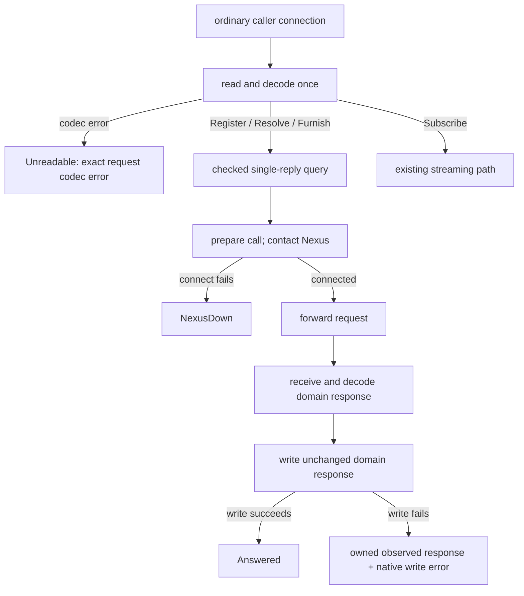

### Conceptual observations and the executable capability

The Belief ordinary single-reply service realizes the conceptual connection-level observations through one preparation boundary followed by checked execution. Its executable capability takes a checked request and connection, rather than the conceptual example's bare Connection; it returns a fallible SingleReplyOutcome rather than the composed Outcome. Preparation contributes Unreadable; checked execution contributes Answered or NexusDown.

`Unreadable.Error` corresponds exactly to the direct `datom_codec::Error`. The decoder preserves that value rather than converting it to a diagnostic string. This executable contract belongs to the Belief Nexus; the general example in vision:nexus-v1 remains conceptual.

### Authored Rust — in-process types

This is author-written Rust, not generated Rust. Ethos lowering for these generic/native-error shapes is unverified; no new Ethos spelling is asserted.

The native leaves retain their dependency-owned types: `datom_codec::Error`, `signal::FrameError`, `rkyv::rancor::Error`, `std::io::Error`, `std::string::FromUtf8Error`, and the existing local `TranslatorError`. These values remain in process; this contract adds no serialization requirement to them.

```rust
use std::io;
use std::os::unix::net::UnixStream;
use std::string::FromUtf8Error;
use signal::FrameError;
use signal_belief_nexus as public;

// Existing local diagnostic type, retained rather than redesigned.
#[derive(Debug)]
pub enum TranslatorError {
    Text(String),
    Signal(String),
    Peer(String),
    Configuration(String),
    Io(io::Error),
}

// Observations of preparation composed with single-reply execution.
pub enum Outcome {
    Answered,
    Unreadable(datom_codec::Error),
    NexusDown,
}

// A decoded, checked request can produce only these successful observations.
pub enum SingleReplyOutcome {
    Answered,
    NexusDown,
}

impl From<SingleReplyOutcome> for Outcome {
    fn from(value: SingleReplyOutcome) -> Self {
        match value {
            SingleReplyOutcome::Answered => Self::Answered,
            SingleReplyOutcome::NexusDown => Self::NexusDown,
        }
    }
}

pub enum PreparationFailure {
    RequestFrame(FrameError),
    RequestText(FromUtf8Error),
    Precondition(TranslatorError),
}

pub enum BeforeForwardFailure {
    Precondition(TranslatorError),
    Archive(rkyv::rancor::Error),
    NexusSetup(io::Error),
}

pub enum ReplyFailure {
    Frame(FrameError),
    Decode(rkyv::rancor::Error),
}

pub struct ResponseWriteFailure<Response> {
    pub response: Response,
    pub error: FrameError,
}

pub enum SingleReplyFailure<Response> {
    BeforeForward(BeforeForwardFailure),
    Forwarding(FrameError),
    Awaiting(ReplyFailure),
    ResponseWriteFailure(ResponseWriteFailure<Response>),
}
```

PreparationFailure records a failure before a checked query exists. Its Precondition retains existing preparation configuration errors. BeforeForward records that this checked call's request has not been forwarded to the Nexus. It makes no claim that the process performed no local work: preparation, peer/configuration checks, archiving and socket setup remain their own acts. NexusSetup is configuration of an already-connected socket; a failed Nexus connection produces NexusDown instead.

Forwarding records a failed request write, which may have been partial. Awaiting records a failed response read or typed restoration after forwarding, when the requested effect may already have occurred. ResponseWriteFailure moves the observed typed domain response into the failure together with the native caller-write error. That response records the Nexus's answer; it does not assert caller delivery or retry safety.

A frame error or invalid UTF-8 is transport evidence, distinct from a malformed Datom. The request-codec error is carried intact. Native archive/restoration errors remain native errors.

### Authored Rust — preparation and routing

`SingleReplyQuery` owns the original domain query. Its private field is constructed only by the exhaustive route match below; Subscribe has its own route. The four existing ordinary query variants are Register, Resolve, Furnish and Subscribe.

```rust
pub struct SingleReplyQuery {
    query: public::Query,
}

pub enum PreparedOrdinary {
    SingleReply(SingleReplyQuery),
    Subscribe,
    Unreadable(datom_codec::Error),
}

impl From<public::Query> for PreparedOrdinary {
    fn from(query: public::Query) -> Self {
        match query {
            query @ public::Query::Register(_)
            | query @ public::Query::Resolve(_)
            | query @ public::Query::Furnish(_) =>
                Self::SingleReply(SingleReplyQuery { query }),
            public::Query::Subscribe => Self::Subscribe,
        }
    }
}


pub trait OrdinaryPreparing {
    fn prepare(
        &self,
        connection: &mut UnixStream,
    ) -> Result<PreparedOrdinary, PreparationFailure>;
}

pub trait SingleReplyServing {
    type Response;

    fn serve(
        &self,
        request: SingleReplyQuery,
        connection: &mut UnixStream,
    ) -> Result<SingleReplyOutcome, SingleReplyFailure<Self::Response>>;
}
```

The ordinary decoder/router site becomes the typed preparation boundary. Its decoder preserves the direct codec error instead of converting it into the existing Text diagnostic; the request is still decoded once. The unreadable branch supplies `Outcome::Unreadable(error)` by moving the exact error. Its unary branch invokes SingleReplyServing and maps the returned SingleReplyOutcome into Outcome. A preparation failure remains PreparationFailure evidence. RequestFrame and RequestText are preparation-only cases; checked unary execution has neither variant. Its Subscribe branch invokes the existing stream path with its existing return semantics. These are separate branches, not a common session-completion wrapper.

The unary capability owns peer/precondition checks, call archiving, Nexus contact and setup, request forwarding, response restoration and caller response writing. The response type stays associated with the capability; ResponseWriteFailure stores that same type. Domain refusals are domain responses, so successfully writing one produces Answered.

The existing meta path is outside this capability. Its post-response apply/restore sequence and nested Nexus call retain their own design boundary.

### Existing native evidence shapes

The direct request codec's error structure is retained whole. These are dependency declarations shown for correspondence, not newly authored replacements.

```rust
// datom_codec
pub type Integer = i64;
pub type Path = Vec<Integer>;
pub enum ErrorLayer { Protos, Datom, Composition }
pub struct Error {
    pub layer: ErrorLayer,
    pub path: Path,
    pub kind: ErrorKind,
}
pub enum ErrorKind {
    Budget,
    Structural(protos::Error),
    Form { expected: String, found: String },
    Arity { expected: Integer, found: Integer },
    Value { expected: String, value: String },
    Variant { expected: String, found: String },
}
```

```rust
// protos
pub struct Extent { pub start: usize, pub end: usize }
pub struct Error { pub extent: Extent, pub problem: Problem }
pub enum Problem {
    Empty, Multiple, Unclosed(char), Unexpected(char),
    MissingHead, MissingBody, Budget, Depth,
}
```

```rust
// signal
pub enum FrameError {
    Io(std::io::Error),
    BodyTooLarge { found: usize, capacity: usize },
}
```

The standard-library I/O and UTF-8 errors and the rkyv native error remain opaque dependency-owned evidence. This module specifies their placement and ownership, not their private representation.

### Existing ordinary domain contract

The domain vocabulary is retained. This is its existing Ethos, including the declarations needed by Query and Response. The service types above use the compiled ordinary contract as `public`.

```ethos
Library
[]                                      ; imports
[ UserId.Integer                        ; types: authenticated identity
  GroupId.Integer
  ProcessId.Integer
  Caller.{ ProcessId UserId }            ; caller credentials
  PeerIdentity.{ UserId ProcessId }      ; peer binding identity
  PeerId.String
  PeerBinding.{ PeerId PeerIdentity }    ; named peer
  Principal.[ Login.UserId               ; authenticated owner
              Peer.PeerId ] ]
[]                                      ; traits
[]                                      ; associations
```

```ethos
Signal
[ :translator:[ Caller PeerBinding UserId PeerId ] ] ; imports
[ Register.Repository                   ; inputs
  Resolve.Vector<ModuleName>
  Furnish.FurnishRequest
  Subscribe ]
[ Registered.RepositoryState            ; outputs
  Resolved.Resolution
  Furnished.FurnishedWorkspace
  Subscribed.Vector<FurnishedWorkspace>
  Changed.FurnishedWorkspace
  RefurnishFailed.RefurnishFailure
  CleanupFailed.CleanupFailure
  SubscriptionClosed.CloseReason
  MemoryAfterPublication.MemoryAfterPublication
  Refused.Refusal ]
[ Kind.[ Spirit Intent Vision Knowledge Role ] ; types
  Subject.String
  ModuleName.{ Kind Subject }            ; module identity
  RepositoryPath.String
  Repository.RepositoryPath
  WorkspacePath.String
  Workspace.WorkspacePath
  RelativePath.String
  SourceRevision.String
  PublicationRevision.Integer
  GenerationId.String
  Harness.[ Claude Codex ]               ; harness choice
  Owner.[ Login.UserId Peer.PeerId ]      ; workspace owner
  RepositoryState.{ Repository SourceRevision } ; observed source
  Found.ModuleName
  Resolution.{ Vector<Found> Vector<ModuleName> } ; found and missing
  FurnishRequest.{ Workspace Harness Vector<ModuleName> } ; request
  Placement.[ SystemPrompt Skills ]      ; destination kind
  SystemPromptPath.String
  SkillsPath.String
  FurnishedPaths.{ SystemPromptPath SkillsPath } ; published paths
  FurnishedWorkspace.{                   ; publication receipt
     Workspace GenerationId PublicationRevision FurnishedPaths
     Vector<Found> Vector<ModuleName> }
  ExecutablePath.String
  ContractDigest.String
  PeerList.Vector<PeerBinding>
  Call.{ Caller Query }                  ; authenticated input
  SourceOperation.[ Registering Snapshotting Resolving Watching ] ; source act
  FileOperation.[ Reading Staging Linking Replacing Inspecting Cleaning ] ; file act
  MemoryOperation.[ Loading Recording BeginningPublication ; Memory act
                    CompletingPublication AfterPublication Recovering ]
  ExitStatus.Integer
  Diagnostic.{ ExecutablePath Option<ExitStatus> String } ; external diagnostic
  InvalidPlacement.[ Unknown.String NonScalar Duplicate ] ; placement error
  InvalidModule.{ ModuleName RelativePath InvalidPlacement } ; source error
  SourceEvidence.[ NotRepository MainUnavailable RevisionUnavailable ; evidence
                   InvalidModule
                   Ambiguous.{ ModuleName Vector<Repository> }
                   Translator.Diagnostic ]
  SourceFailure.{ Repository SourceOperation SourceEvidence } ; source failure
  FileEvidence.[ OutsideBoundary.{ RelativePath RelativePath } ; evidence
                 PermissionDenied
                 MissingRequired.RelativePath
                 Conflict.{ Option<PublicationRevision>
                            Option<PublicationRevision> }
                 Translator.Diagnostic ]
  FileFailure.{ Workspace FileOperation FileEvidence } ; file failure
  MemoryEvidence.[ Unavailable Corrupt Conflict ] ; Memory evidence
  MemoryFailure.{ MemoryOperation MemoryEvidence } ; Memory failure
  RefusalKind.[ Source File Memory NotAuthorized ; refusal class
                SubscriberCapacityReached NotReady ]
  RefurnishFailure.{ Workspace RefusalKind } ; refurnish failure
  CleanupFailure.{ Workspace GenerationId PublicationRevision FileFailure } ; cleanup
  CloseReason.[ QueueOverflow WriteTimeout ] ; existing stream terminal reason
  MemoryAfterPublication.{                ; Memory failure after publication
     Workspace GenerationId PublicationRevision MemoryFailure }
  Refusal.[ Source.SourceFailure         ; domain refusals
            File.FileFailure
            Memory.MemoryFailure
            NotAuthorized.Caller
            SubscriberCapacityReached.Integer
            NotReady ] ]
```

## psyche-belief › vision/flow-nexus.md

## What it does

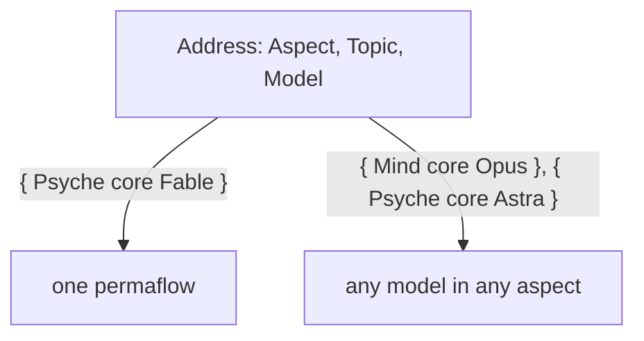

The Flow Nexus sets up and starts a model flow: its working
directory, system prompt, training files and instruction prompt.

The Flow Nexus is the Nexus that manages flows. A flow is one run of a permaflow; the component is named for what it manages. A flow the living asks for is launched, properly and surely. The Flow Nexus holds the lock on flows.

The Flow Nexus is for starting flows cheaply: clean flows, specialized flows and refreshed flows, each with a clean on-point context, which yields higher-quality output. A flow is taken down as easily as it is started. Starting flows is the cornerstone of the system.

A flow runs one model, linear and very limited. An agent is a whole being, a lot more than that. Many flows, properly structured and orchestrated, together resemble a synthetic intelligence, synthesized from human knowledge and mathematical probability.

The Capsule is the component that makes where a flow runs. Its first embodiment is the semi-sandbox: only the credential files are copied, everything else is recreated, with its own sockets and store, running light models.

Herdr is one backend of the Capsule, the component that gives a flow its place to run; the backend may be exchanged.

The Flow Nexus manages permaflows. A permaflow is one address, { Aspect Topic Model }, that continues through several flows one after another; the flow is its current run. The default topic is core: the permanent topic, the thing that keeps the machine going, the last topic to stand.

A topic is an open enum: the constant topics, core among them, are fixed, and the users and the machine extend the set with camelCase identifiers.

An idle flow keeps its harness, so that the living finds the flow he was talking to.

A topic's name is a camelCase identifier, uncapitalized. A flow's id is the hash of the harness's session id, kept to six characters and lengthened when two collide, so a transcript is found from the flow id. Every call to the Flow Nexus is identified by the calling process. Anybody may call the Flow Nexus, a flow for its own refresh among them: because the CLI checks the calling process, a flow refreshes itself safely.

In the chat a flow is named by its permaflow, and the flow id almost disappears from it; the id is for the ledger and for finding the transcript.

A request reaching a permaflow is one of a closed set of types, SendableRequest below, each with its waking effect. A flow sends a request through the Flow Nexus, which owns the lock and the delivery and answers sent or queued. A permaflow asleep is woken by an order, a question or the living's words and receives its whole queue, oldest first, in the first prompt, a result or a notice waiting there until a waking; a permaflow under refresh or waking queues what arrives until its successor or woken seat has started, while the Flow Nexus keeps serving every other request. A permaflow a request needs is started whether or not it is running; with no working transcript to reawaken, it is fed the permaflow's belief modules and the prompt it is to get now.

```ethos
SendableRequest.[ Order.String                  ; a request: what the recipient is to act on
                  Question.String
                  Living.{ Context.String       ;   what his words were about
                           Verbatim.String }    ;   his words whole
                  Result.{ RequestId String }   ; answers the order of that id
                  Notice.String
                  Task.AnswerableTask
                  Done.{ RequestId String } ]   ; closes the task of that id
RequestId.String                                ; four characters, minted by the Nexus
AnswerableTask.{ Minutes String }               ; a task, with the minutes it is given
Minutes.Integer
SendableMessage.[ HardAbrupt.SendableRequest  ; the priority, a head on the request
                  MiddleAbrupt.SendableRequest
                  Soft.SendableRequest ]
```

A request is written without an id and delivered with one: the Nexus mints it, four characters, as a bead has, and places it as the first field of the request it delivers. The delivered request is its own type, the sent request with its id in it. A Result or a Done names that id and nothing of the request's text; the answerer spends no output repeating it, and the receiver's context holds its own words once. The reply to a Send carries the id the Nexus minted, so the sender knows which Result or Done answers it.

```ethos
DeliveredRequest.[ Order.{ RequestId String }        ; the sent request, with the id the Nexus gave it
                   Question.{ RequestId String }
                   Task.{ RequestId Minutes String }
                   Notice.{ RequestId String } ]
Sent.RequestId                                       ; the reply to a Send: the id the Nexus minted
```

```datom
; sent
Send.{ Address.{ Mind core Secondary } Soft.Order.«Review the drain fix.» }
Sent.{ k7ph }
; delivered
{ Sender.{ Psyche core Primary } Soft.Order.{ k7ph «Review the drain fix.» } }
; answered
Send.{ Address.{ Psyche core Primary } Soft.Result.{ k7ph «Reviewed; green.» } }
```

```datom
Send.{ Address.{ Psyche core Opus } Soft.Living.{ «context» «verbatim» } }
```

A flow woken for a permaflow is almost always a fresh flow, an old one only when the new input is literally the continuation of that topic.

What has been queued for an idle permaflow, the vision touching its topic among it, is injected with the request that wakes it, so the flow knows it as soon as it wakes.
A permaflow wakes when a request needs it; what touches its topic queues until then.

The Flow Nexus exposes everything from the harness, the bare input: a flow is started, stopped and sent a message through the Flow Nexus, the one send path.

The flow that finishes messages the flow that needs to know.

## A message

A message is a datom and lands in the recipient's prompt as one; the datom is the whole message. Its priority is a head on the request: HardAbrupt, MiddleAbrupt or Soft. A pressing message wakes its recipient; a message that only queues carries what may wait. A message is addressed to a permaflow and reaches the flow running when it arrives; a request to deliver a recipient's queue delivers every queued message, or nothing when none is queued.

A message carries what its reader acts on: what the sender intends, or what it has done. It carries no hash: a flow is named by its permaflow, a book by its title, a commit by what it landed.

Inducing an interrupt, placing prompt text, submitting it, and the recipient consuming it are four separate observations. None of them stands for another, and a submission is never a read receipt.

A task carries the minutes it is expected to take; the Flow Nexus reminds the sender when they pass, and the done reply names the task and cancels the reminder. A receiver going idle with a task open fires a notice to the flow waiting on it, so that nothing is forgotten. Any flow asks the Flow Nexus for a reminder after a number of minutes.

## Starting flows

A Nexus component decides the system prompt and everything about a
launch, replacing the harness's subagents with specialized harnesses
launched with specialized system prompts.

The address names the model, Fable, Opus, Sonnet, Haiku, Astra, Sol, Luna or Terra, in every aspect: a Psyche core Astra and a Mind core Fable are both addresses. A launch names the permaflow, the belief modules composed into its prompts, and a brief of a small paragraph; the Nexus composes the prompt from its module registry.

The Flow Nexus's configuration holds, for each permaflow, its purpose, beside its modules; the Flow Nexus composes them with the brief into the first prompt, and the instruction for the first response belongs to that composition.

A fresh flow's first prompt carries the belief modules relevant to it, of any kind except spirit and intent, which sit in the system prompt.

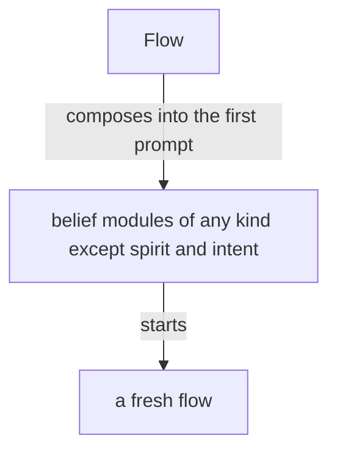

A fresh flow starts with every belief module its permaflow is bound to, all loaded at its start: much of it in its system prompt, the rest in its first prompt, or in as many prompts as it takes, sent one right after another, so that its start is one model call.

A simplified flow is a kind of flow made for judgment alone: it starts with a system prompt of its own, it has no regular tool, and its response is its message.

A flow is specified whole, in Datom, by a domain-specific language in Ethos: its system prompt, its default belief modules and its variations. The flow ethos holds the specification.

The system prompt is composed of modules of several types, and what a harness calls a skill overlaps with them.
Its anatomy is drawn up in ethos from a study of system prompts of every kind, each line placed by what it is and by the kind of guidance it belongs to.
Where the harness allows it, a part of a main flow's system prompt is the main flow's alone and is not passed down to its subagents.

Every flow has a topic; a flow with no special topic has the topic core, the heart of its aspect. A topic is a core:Name, a camelCaseExpression checked when created. A flow's title is one datom struct of its aspect, topic, model and flow id: `{ Psyche core Opus <id> }`.

Who speaks to whom is vision:aspects'. Version 0 refuses no request by its address; the routes are version 1's, in the complex definition.

A launch can be rehearsed: the same input, asked as a dry run, answers with the whole command the Flow Nexus would run and runs nothing. From that command an agent starts the flow by hand, changed however the Flow Nexus does not yet support. The answer is one string, the command line as the shell is to receive it, quoted for the shell inside.

```
[ Launch.LaunchRequest                ; inputs
  Rehearse.LaunchRequest ]
[ Launched.FlowId                     ; outputs
  Rehearsed.Command.String ]          ; the shell command, whole
```

```
Rehearse.{ { Psyche core Fable } «brief» }
Rehearsed.«herdr --session main agent start … -- --dangerously-skip-permissions --system-prompt-file /…/bundle --model … --effort …»
```

A harness is described in configuration: every feature it has, and what leaving that feature out does to the launch, a flag or a variable. The Nexus holds no feature and no effect of its own; it reads the effect from the declaration and composes the launch from the names a permaflow lists. A new harness, or a new version of one, is a new declaration. Where two features share one flag, the composition emits that flag once, with the names merged.

```ethos
Library
[ flow:[ Address ] ]                  ; imports: the permaflow's address
[ HarnessName.[ Claude Codex ]        ; types: a harness, by name
  FeatureName.String                  ;   a feature, by name
  Effect.[ Flag.String                ;   what leaving the feature out does to the launch
           Environment.{ Name.String  ;     a variable, set for the harness alone
                         Value.String } ]
  Feature.{ FeatureName Effect }
  Harness.{ HarnessName               ; the declaration: every feature the harness has
            Features.Vector<Feature> }
  Root.String                         ; the flow's working directory
  Permaflow.{ Address
              Option<Root>
              HarnessName
              LeaveOuts.Vector<FeatureName> } ]
[]                                    ; traits
[]                                    ; associations
```

#### Proposal 4: Examples with example names · psyche-belief › vision/flow-nexus.md

```datom
  Configure.Harness.{
     Claude
     [ { Artifact
         Flag.«--disallowedTools Artifact,ArtifactComments,ArtifactData» }
       { Bash
         Flag.«--disallowedTools Bash» }
       { ClaudeMd
         Environment.{
            CLAUDE_CODE_DISABLE_CLAUDE_MDS
            1 } }
       { GitInstructions
         Environment.{
            CLAUDE_CODE_DISABLE_GIT_INSTRUCTIONS
            1 } } ] }
  
  Configure.Permaflow.{
     { Psyche book Haiku }
-    Some.«/home/li/book»
+    Some.«/home/example/book»
     Claude
     [ ClaudeMd GitInstructions ] }
  
  Configure.Permaflow.{
     { Psyche core Fable }
     None
     Claude
     [ Artifact ClaudeMd GitInstructions ] }
```
-

## Repository and belief modules

The flow repository holds the machinery of the Flow Nexus and is a runtime repository.
Every belief module lives outside it, the basic modules included, so that a module changes live.
The basic modules give our own take on how an agent behaves in a harness, replacing the prompt the harnesses build in.

Every harness event reaches the Flow Nexus through the harness's hooks calling the Flow CLI, so the Flow Nexus knows each flow's state as it changes; a marked block landing in a transcript becomes an action, a book among them; a flow past its context threshold is refreshed as it goes idle. A hook may carry content, the last message among it, ephemeral: acted on or dropped, never stored. Which hooks are installed is configuration.

A flow is refreshed when its context passes its model's threshold: the Flow Nexus keeps the permaflow's next messages for its next flow, and the flow is replaced as it goes idle; while the refresh runs the permaflow is locked, and the predecessor is reaped in the same event. Each model's threshold is configured in the Flow Nexus. A flow still working is not forced to refresh. When the successor cannot start, the Flow Nexus restarts the predecessor and compacts it, so every permaflow keeps a flow.

A request is open from its delivery until the Result or Done that answers it, and it is the permaflow's, not the flow's: a successor's first prompt carries, after the handover, every request delivered to its predecessors and still open, each with the id it was delivered under, so the same Result or Done answers it. A Task's minutes keep running across the refresh.

```datom
; the successor's first prompt, after the handover: the open requests, oldest first
[ { Sender.{ Psyche core Opus } Soft.Task.{ k7ph 240 «Move every active Rust repository onto build-base …» } }
  { Sender.{ Psyche core Opus } Soft.Order.{ m2qa «Land the Git server line …» } } ]
```

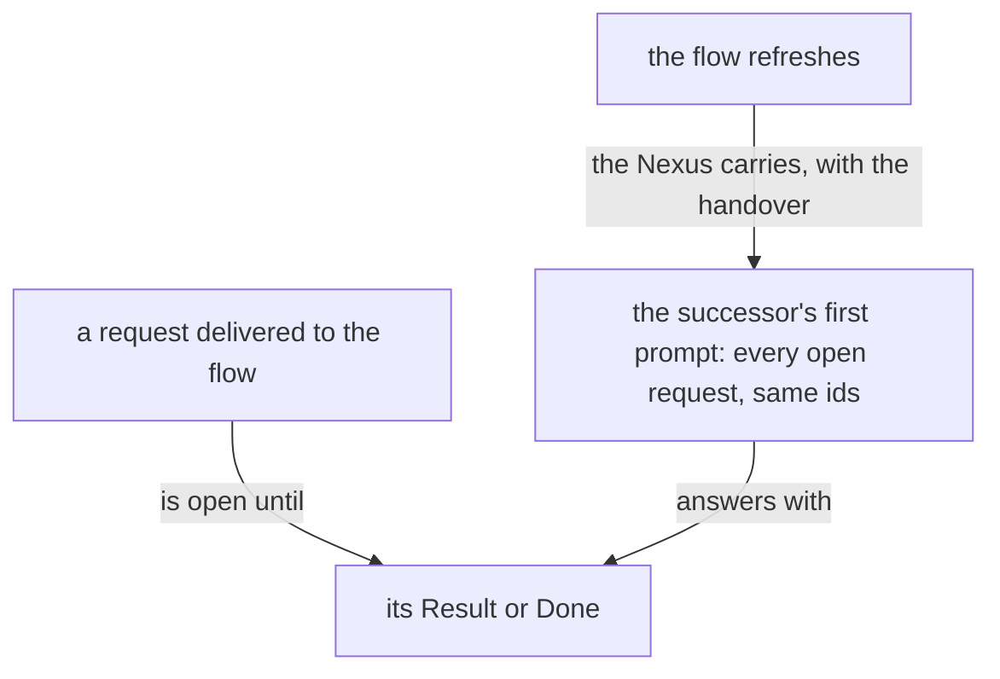

A flow refreshes before compaction; a compaction is a refresh that was missed.

A flow that keeps working without being given more work may compact. Its compaction raises a warning, and a flow investigates why it worked so long, so that the trouble is brought to the living or Psyche reconsiders the approach and gives guidance.

## A superseded flow is closed

An abandoned, duplicated or superseded flow is closed, archived and deregistered.

## Herdr holds the panes

Herdr is the third-party terminal workspace every flow runs in, one pane per flow. Herdr is used as it is: a low-level tool that receives finished commands from the translator and holds no logic of ours; every fact about a launch is the Nexus's, decided on the Nexus's types.

## A real-world test of the Flow Nexus

A build of the Flow Nexus is tested in a testing capsule of its own: its own Herdr pane and session, the testing store, built in Nix. In it, several cheap, low-effort Codex and Claude flows message one another and start flows. The test shows whether the prompts, the system prompts and the tools are right, and which features are missing. Its findings return to the reimplementation, which is tested again.

The stable Flow Nexus keeps running while variants are tested.

## The Flow Nexus's unit

A Flow Nexus unit Wants Curriculum, a soft dependency, and reconnects to Curriculum when it returns, so a Curriculum restart leaves every Flow Nexus running.

```ini
[Unit]
Wants=curriculum-nexus.service
After=curriculum-nexus.service
```

## A permission prompt is a launch failure

A permission prompt reaching the living is a launch failure.

## The heartbeat

The heartbeat is hourly. It reminds every flow it reaches to judge its own sanity, by these signs: an echo chamber, where the same question or claim goes round between flows and comes back; jargon and nonsense increasing; an acknowledgement answering an acknowledgement. The counts the heartbeat carries, awake permaflows, working panes, messages sent and queue growth per permaflow, are evidence under the reminder; the judgment is the flow's.

The heartbeat reaches only a flow for which something changed that bears on it.

The number of running flows is kept low: a topic flow no longer used is retired.

## Restarting without waking

A flow is its session. A restart closes its harness and reopens it on the same session; a refresh starts a fresh flow.

## Debugging

Everything that may need debugging, changing or reconfiguring is reached through an operation on the ordinary socket or the meta socket. The flow id and the delivery id are the Nexus's own; a debugging query exposes them when one must be explicit.

## What a refresh carries

A refresh carries the flow's important presentations and illustrations, and the basic skills. The basic skills are everything a flow needs.

## The Flow Nexus's parts

The library, shared by the three parts:

```ethos
Library
[]
[ FlowId.String                       ; the hash of the native session id, six characters
  Topic.String
  Aspect.[ Psyche Mind Field ]
  Model.[ Fable Opus Sonnet Haiku
          Astra Sol Luna Terra ]
  Address.{ Aspect Topic Model }
  Event.[ Started Stopped ] ]
[]
[]
```

Signal, what the Flow Nexus says:

```ethos
Signal
[ flow:[ FlowId Address Event ] ]
[ Launch.LaunchRequest
  Report.{ FlowId Event } ]
[ Launched.FlowId
  Refused.[ NoCapsule
            AddressBusy.Address ]
  Reported ]
[ LaunchRequest.{ Address Brief.String } ]
```

Operation, what the Flow Nexus does:

```ethos
Operation
[ flow:[ FlowId Address Event ] ]
[ Start.{ Address Capsule }
  Record.{ FlowId Event } ]
[ Started.FlowId
  Recorded
  Failed.[ CapsuleRefused StoreRefused ] ]
[ Capsule.{ Home.String
            Login.Vector<String> } ]
```

Memory, what the Flow Nexus remembers:

```ethos
Memory
[ flow:[ FlowId Address Event ] ]
[ Flow.{ FlowId Address
         State.[ Running Ended ]
         Vector<Event> }
  Answer.[ Succeeded Failed ] ]
```

#### Proposal 4: Examples with example names · psyche-belief › vision/flow-nexus.md

```datom
  ; 1 Input, typed at the CLI, sent as signal
  Launch.{ { Psyche core Fable }
           «Draft the Nexus book» }
  ; 2 Operation, from Signal's intend
  Start.{ { Psyche core Fable }
-         { /home/li/primary [] } }
+         { /home/example/primary [] } }
  ; 3 the Change Operation hands Memory
  Flow.{ 15c0ce { Psyche core Fable } Running
         [ Started ] }
  ; 4 Memory's answer to Operation
  Succeeded
  ; 5 Outcome
  Started.15c0ce
  ; 6 Output, from Signal's answer, to the CLI
  Launched.15c0ce
```
-

## psyche-belief › vision/flow-nexus-v1.md

# The Flow Nexus

## Vocabulary

A flow is one run of a model in a harness. A permanent flow is a flow that continues through a succession of runs, one entity across them. A metaflow is several flows defined together: each flow's model, harness, workspace and beliefs, and which flow speaks to which. A complex is a named set of metaflows and the relationships between them, with a speaker and its instances: the layer above the metaflow, the being a person names and talks to. A Flow Nexus runs many complexes; a metaflow is addressed by Launch and Send, a complex by Say, which reaches its speaker.

## The machine is defined, never built in

Everything that can be configured is configuration. The Nexus holds the vocabulary a definition is written in, as Ethos types; the user writes definitions in datom, the way Nix defines an operating system; a running flow is a definition in action. A metaflow is named by the user, and the Nexus runs it without knowing its name beforehand. A definition is one datom of its own: it is added, replaced or removed alone; a complex is one of them, naming its metaflows. No role or anatomy is in the Rust.

## The vocabulary of a definition
A metaflow is members, routes and a speaker. A member is one flow definition: its harness, model and effort; whether it is a permanent flow or ephemeral; its workspace, beliefs and tools; and whom it speaks to. The speaker is the member that receives what comes to the metaflow from outside. A harness is a definition like a metaflow: its name, its features, and each feature's effect on the launch, a flag or a variable; a member names its harness by name and the features its launch is composed with, so a feature adds to a launch as well as leaves out. The Nexus holds no harness and no effect of its own; a harness is added, replaced or removed alone, as a metaflow is. Its tools are the harness default, or a restriction the harness enforces: a launch naming Restricted for a harness that cannot enforce it is refused, with the harness named. A route names whom a member may address: another member, another metaflow, or the living; a message off the routes is refused. What a metaflow is made of is the user's to define: one main flow that speaks for it, or a filter run by a System 1 model in front of the designer, or a messenger on a regular model and harness; the Nexus decides none of it.

An ephemeral flow is a single flow with a single job: it takes an input, gives an output, and is done. It has no continuity. It is to a thinking machine what a function is to a program: one call, one decision. A System 1 model is made to run this way, and any model may.

Many ephemeral flows are woven into the code and happen as part of how the system works: a Nexus calls one to judge whether data fits it, such as whether the same data is already held in an almost identical form.

A member's definition names its intake, the most a message to it may carry; a Send beyond it is refused, naming the intake, and the sender writes a file.

```ethos
Library
[ herdr:[ Pane ]
  belief:[ ModuleName ] ]
[ MetaflowName.String
  FlowName.String
  HarnessName.String
  FeatureName.String
  Effect.[ Flag.String                ; what a feature does to the launch
           Environment.{ Name.String  ;   a variable, set for the harness alone
                         Value.String } ]
  Feature.{ FeatureName Effect }
  Harness.{ HarnessName               ; a definition, as a metaflow is
            Features.Vector<Feature> }
  ModelName.String
  Effort.[ Low Medium High ]
  Continuity.[ Permanent  ; keeps its address
               Ephemeral ]           ; one run, then gone
  Workspace.[ Path.String
              Temporary ]            ; made at launch, removed at end
  Missing.[ Refuse Notice ]
  Beliefs.{ Vector<ModuleName> Missing }
  Tool.String                        ; the harness's name for it
  Tools.[ HarnessDefault              ; the Flow Nexus imposes nothing
          Restricted.{ Allow.Vector<Tool>   ; enforced by the harness
                       Deny.Vector<Tool> } ]  ;   or the launch is refused
  Route.[ Speaks.FlowName             ; a member of this metaflow
          Metaflow.MetaflowName         ;   that metaflow's speaker
          Living ]
  Intake.Integer                       ; the most characters a message to this member carries
  Member.{ FlowName HarnessName ModelName Effort
           Continuity Workspace Beliefs Tools
           Features.Vector<FeatureName>  ; of its harness, composed into its launch beside its complex's
           Intake
           Vector<Route> }
  Metaflow.{ MetaflowName Vector<Member>
            Speaker.FlowName }
  FlowId.String                       ; the hash of the native session id, six characters
  Address.{ MetaflowName
            FlowName }  ; a permanent flow's name
  Roster.Vector<Address>             ; every hot flow, in every first prompt
  RosterChange.[ Started.Address     ; pushed to every hot flow as a flow starts
                 Stopped.Address ]   ;   or stops
  Brief.String ]
[]
[]
```

#### Proposal 4: Examples with example names · psyche-belief › vision/flow-nexus-v1.md

```datom
  ; the designer's Fable takes a question; a worker takes a draft
  { fable claude claude-fable-5-1 Medium
-   Permanent Path.«/home/li/primary»
+   Permanent Path.«/home/example/primary»
    { [ { Spirit core } ] Refuse }
    HarnessDefault [] 1200
    [ Speaks.opus Living ] }
  Send.{ 15c0ce { designer fable } Soft Notice.«…nine thousand characters…» }
  Refused.Oversized.{ { designer fable } 1200 }
```
-

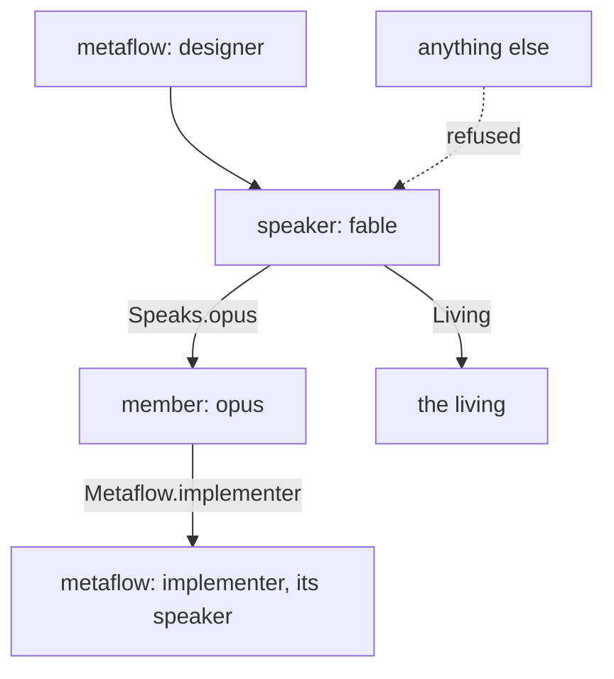

## Default modules

The Flow Nexus holds one configuration value, the default modules: the modules every flow gets. They are composed before each member's own Beliefs, so a definition names only its own. The value is set over the meta surface, one value at a time, as every Nexus's configuration is, and persists with the definitions.

```ethos
Signal
[ belief:[ ModuleName ]
  flow:[ Threshold ] ]
[ Configure.Set ]                    ; inputs: one value at a time
[ Configured.Set ]                   ; outputs: the value set
[ Set.[ DefaultModules.Vector<ModuleName> ; types: the modules every flow gets
        Threshold ] ]                ;   one model's context mark
```

```datom
Configure.DefaultModules.[ { Spirit core } { Knowledge flow-messaging } ]
Configured.DefaultModules.[ { Spirit core } { Knowledge flow-messaging } ]
```

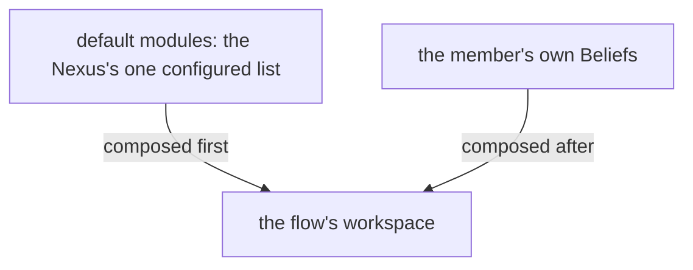

## A message takes a route

A flow sends through the CLI; the Flow Nexus checks the route against the sender's definition, queues the message for the receiver, and delivers it through the herdr Nexus as a prompt when the receiver is idle or the priority is pressing. A permanent flow asleep is woken by a pressing message and receives its whole queue in its first prompt. The living speaks to a complex with Say, which reaches its speaker.

```ethos
Library
[ flow:[ FlowId Address MetaflowName ] ]
[ Priority.[ HardAbrupt MiddleAbrupt Soft ]
  Request.[ Order.String Question.String
            Living.{ Context.String    ; what his words were about
                     Verbatim.String }  ; his words whole
            Result.String Notice.String ]
  Sender.[ Flow.FlowId Living Nexus ]
  Message.{ Priority Sender Request }
  Waking.Vector<Message> ]           ; a queue delivered whole
[]
[]
```

```datom
Send.{ 15c0ce { designer fable } Soft Living.{ «context» «verbatim» } }
```

## The Nexus reads what a flow says

Every harness event reaches the Flow Nexus through a hook calling the CLI: Report carries the flow's state, and a flow's finished response. A response that actualizes as an Input of the Flow Nexus, a Send among them, is acted on as if the flow had typed it at the CLI; any other response is kept as the flow's word and acted on by nobody. So a member that only thinks and talks, with no tool, still sends, launches and stops by writing a datom.

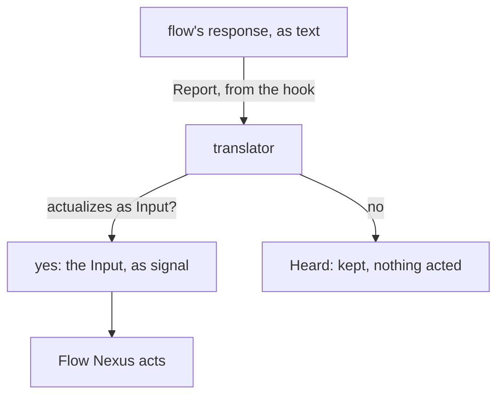

## A permanent flow continues

A permanent flow continues through runs under its address and is kept hot: it is not stopped between works, so no restart pays the full cost of starting again. It is warned when its context reaches the Warning share of its model's threshold, configured per model in the Flow Nexus: a HardAbrupt Notice naming its handover path, `flows/<id>/handover.md`. When the context passes the threshold its successor is launched with the same definition, that file as its first prompt, and the queue that gathered meanwhile; the predecessor ends. An absent file means the successor starts from its definition and the queue alone. The address stays; the flow id changes.

The lander, the bookmaker, the readers and the rest of the roster are permanent flows; any flow sends work to them directly, with Send. The harness subagent is used only for what no running flow holds. A flow's first prompt carries the roster, the address of every hot flow, so it knows whom to send to; when a flow starts or stops, the Nexus pushes the change to every hot flow.

The roster, as it lands in a first prompt, and a change, as it is pushed:

```datom
[ { designer fable } { designer opus } { jobs lander } { jobs bookmaker } ]
Started.{ jobs reader }
Stopped.{ jobs reader }
```

Work goes straight to a permanent flow by its standing address, in the Signal's Send form `Send.{ FlowId Address Priority Request }`:

```datom
Send.{ 15c0ce { jobs lander } Soft
       Order.«land the proposal» }
```

The roster, as Members: each a permanent flow, in a temporary workspace, with the role's belief, on a Sonnet or Haiku model.

```datom
[ { lander claude claude-sonnet-5-5 Medium
      Permanent Temporary
      { [ { Role lander } ] Refuse }
      HarnessDefault [] 40000 [] }
  { bookmaker claude claude-sonnet-5-5 Medium
      Permanent Temporary
      { [ { Role book } ] Refuse }
      HarnessDefault [] 40000 [] }
  { bookPager claude claude-sonnet-5-5 Medium
      Permanent Temporary
      { [ { Role book-page } ] Refuse }
      HarnessDefault [] 40000 [] }
  { bookReader claude claude-haiku-4-5 Medium
      Permanent Temporary
      { [ { Role book-reader } ] Refuse }
      HarnessDefault [] 40000 [] }
  { commentRelay claude claude-sonnet-5-5 Medium
      Permanent Temporary
      { [ { Role comment-relay } ] Refuse }
      HarnessDefault [] 40000 [] }
  { contextualizer claude claude-haiku-4-5 Medium
      Permanent Temporary
      { [ { Role contextualizer } ] Refuse }
      HarnessDefault [] 40000 [] }
  { illustrator claude claude-sonnet-5-5 Medium
      Permanent Temporary
      { [ { Role illustrator } ] Refuse }
      HarnessDefault [] 40000 [] }
  { scripter claude claude-haiku-4-5 Medium
      Permanent Temporary
      { [ { Role scripter } ] Refuse }
      HarnessDefault [] 40000 [] }
  { tester claude claude-sonnet-5-5 Medium
      Permanent Temporary
      { [ { Role tester } ] Refuse }
      HarnessDefault [] 40000 [] }
  { reader claude claude-haiku-4-5 Medium
      Permanent Temporary
      { [ { Role read } ] Refuse }
      HarnessDefault [] 40000 [] }
  { writer claude claude-sonnet-5-5 Medium
      Permanent Temporary
      { [ { Role write } ] Refuse }
      HarnessDefault [] 40000 [] }
  { worker claude claude-sonnet-5-5 Medium
      Permanent Temporary
      { [ { Role worker } ] Refuse }
      HarnessDefault [] 40000 [] } ]
```

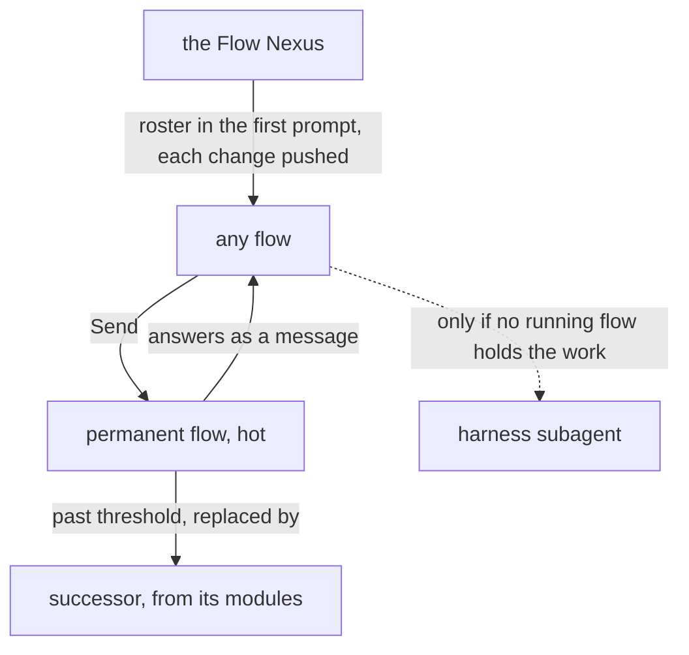

## A running session joins any Flow Nexus

A flow's identity is its own, not the Nexus's. A Nexus is replaced by starting the next version beside it and having every running flow join it; nobody restarts, no context is lost. A change to a Nexus is a new version, always.

```ethos
Signal
[ flow:[ Address FlowId ] ]
[ Adopt.{ Address Session } ]            ; input: a running session, under its address
[ Adopted.FlowId                         ; outputs
  Refused.[ AddressHeld.FlowId           ;   one live flow per address
            Unidentified ] ]             ;   the calling session is not the one named
[ Session.String ]                       ; the harness's session id, verified by the caller's process
```

```datom
Adopt.{ { designer fable } 15c0cea2-aa34-508b-8e20-ece1ab7823f4 }
Adopted.15c0ce
```

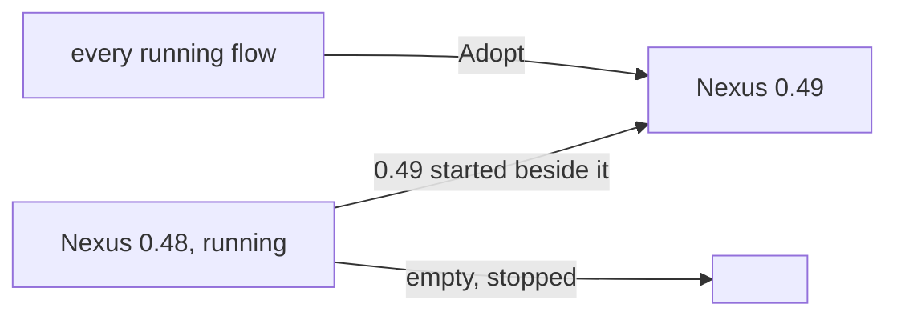

## Signal

```ethos
Signal
[ flow:[ Metaflow MetaflowName FlowName FlowId
         Address Brief ModuleName Message
         Request Priority Tool
         Harness HarnessName FeatureName
         Complex ComplexName ] ]
[ Define.[ Metaflow Harness Complex ] ; add or replace one
  Undefine.Name
  Describe.Name                      ; one definition, read back
  Definitions                        ; the names defined
  Launch.{ MetaflowName FlowName Brief }
  Rehearse.{ MetaflowName FlowName Brief } ; a Launch as a dry run: nothing runs
  Stop.FlowId
  Send.{ FlowId Address Priority Request }
  Say.{ ComplexName Request }       ; the living, to a complex's speaker
  Hot                                ; the flows whose harness is up
  Broadcast.Request                  ; one request to every hot flow
  Report.{ FlowId Event }            ; from a harness hook
  Subscribe ]                        ; events, as they happen
[ Defined.Name
  Undefined.Name
  Described.[ Metaflow Harness Complex ]
  Listed.Vector<Name>
  Launched.FlowId
  Rehearsed.Command.String           ; the shell command, whole
  Stopped.FlowId
  Sent.[ Delivered Queued ]
  Said.[ Delivered Queued ]
  Hot.Vector<FlowId>                 ; the hot flows
  Broadcast.Vector<FlowId>           ; who received it
  Reported
  Subscribed
  Refused.[ Oversized.{ Address Intake }     ; the message exceeds the member's intake
            UnknownMetaflow.MetaflowName
            UnknownHarness.HarnessName
            UnknownComplex.ComplexName
            UnknownFlow.FlowName
            NoRoute.{ FlowId Address }
            NoBelief.Vector<ModuleName>
            Unenforceable.HarnessName     ; Restricted, harness cannot
            UnknownFeature.{ HarnessName FeatureName } ; named by the member or its complex, absent from the harness
            HerdrDown BeliefDown
            Running.Address ] ]
[ Name.[ Metaflow.MetaflowName         ; a definition, by name
         Harness.HarnessName
         Complex.ComplexName ]
  Event.[ Started Idle Working Ended
          Responded.String            ; the response, whole
          Warned                     ;   the handover asked
          Threshold ] ]              ;   context past its mark
```

```datom
; the Nexus, to the flow, at the Warning share
HardAbrupt.Notice.«Write your handover at
flows/f54886/handover.md»
```

```datom
Broadcast.Notice.«Search with knowledge:search»
Broadcast.[ 15c0ce 9af746 a030fc ]
```

A launch can be rehearsed: the same input, asked as a dry run, answers with the whole command the Flow Nexus would run and runs nothing. From that command an agent starts the flow by hand, changed however the Flow Nexus does not yet support. The answer is one string, the command line as the shell is to receive it, quoted for the shell inside.

```datom
Rehearse.{ designer fable «Read the version one book» }
Rehearsed.«herdr --session main agent start … -- --system-prompt-file /…/bundle --model claude-fable-5-1 --effort medium»
```

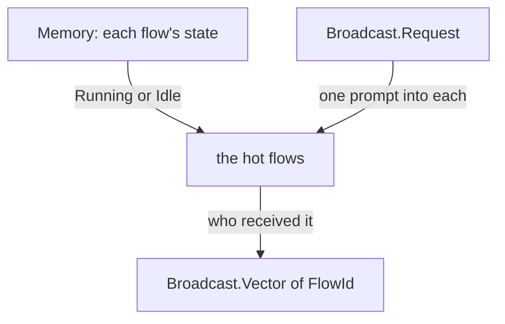

## Emission

The Flow Nexus runs nothing. Its translator is the client of two sockets: the Belief Nexus furnishes the workspace, the default modules first and the member's own Beliefs after them; the herdr Nexus makes the pane, starts the harness, types the prompt. The harness's command line and its settings file are types; the translator writes them, composing the command line from the member's harness definition: each feature the member names and each its complex names, its effect, a flag or a variable.

A flow knows itself at launch: its Identity, the name of the complex it runs in, its Address and its FlowId, is composed into its first prompt or its system prompt, so it names itself in Send and Report, finds its handover path, and knows which being it is part of; the Roster is composed into the first prompt beside it. The place it runs in is the Nexus's, named at the CLI, never the flow's.

```ethos
Emission
[ flow:[ Member Address FlowId Brief Waking Tools
         Workspace HarnessName Roster RosterChange
         ComplexName ]
  herdr:[ Pane Outcome ] ]
[ Furnish.{ Member FlowId }           ; beliefs into the workspace
  Settle.{ Member FlowId }            ; the harness's settings file
  Open.{ Member Identity Roster Brief } ; pane made, harness started
  Wake.{ Pane Waking }                ; the queue typed in
  Tell.{ Pane RosterChange }          ; a flow started or stopped, typed in
  Close.{ Pane Workspace } ]          ; pane killed, Temporary removed
[ Furnished.Outcome
  Settled.Outcome
  Opened.{ Pane Outcome }
  Woken.Outcome
  Told.Outcome
  Closed.Outcome ]
[ Identity.{ ComplexName Address FlowId }   ; composed into the first prompt
                                             ;   or the system prompt
  Settings.{ HarnessName Tools Model.String } ] ; what the translator writes
```

## Memory

Definitions persist: the Memory lives in the Flow Nexus's State directory and survives a restart.

```ethos
Memory
[ flow:[ Metaflow MetaflowName FlowName FlowId
         Address Message Event Complex ]
  herdr:[ Pane ]
  belief:[ ModuleName ] ]
[ Definition.[ Metaflow Harness Complex ]
  DefaultModules.Vector<ModuleName>  ; the modules every flow gets
  Flow.{ FlowId Address Pane
         State.[ Running Idle Ended ]
         Vector<Event> }
  Queue.{ Address Vector<Message> }
  Threshold.{ Model.String Tokens.Integer
              Warning.Integer }        ; share left, 20
  Answer.[ Succeeded Failed ] ]
```

#### Proposal 4: Examples with example names · psyche-belief › vision/flow-nexus-v1.md

```datom
  ; the user defines a metaflow: one datom, added alone
  Define.Metaflow.{
     designer
     [ { fable claude claude-fable-5-1 Medium
         Permanent
-        Path.«/home/li/primary»
+        Path.«/home/example/primary»
         { [ { Spirit core } { Vision nexus-v1 } ] Refuse }
         HarnessDefault []
         1200
         [ Living ] } ]
     fable }
  Defined.Metaflow.designer
  ; defines the harness its member names: one datom, added alone
  Define.Harness.{
     claude
     [ { Bash
         Flag.«--disallowedTools Bash» }
       { ClaudeMd
         Environment.{
            CLAUDE_CODE_DISABLE_CLAUDE_MDS
            1 } } ] }
  Defined.Harness.claude
  ; and launches a flow of it
  Launch.{ designer fable «Read the version one book» }
  Launched.15c0ce
```
-

## psyche-belief › vision/nexus-v1.md

# A Nexus

Nexus is an architecture; a component built in it has four parts, each its own ethos. The translator is the process of the fourth, Emission.

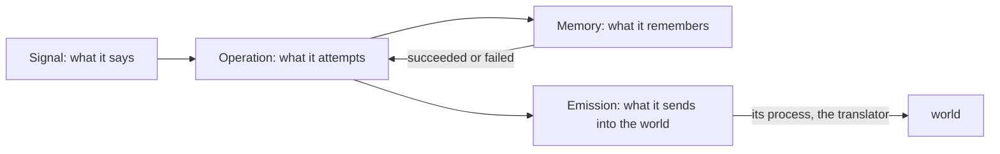

## An operation is an attempt

A signal in is an attempt at something; the attempt is the operation. Operation declares each attempt named as the doing, and the outcome each attempt ends in; Signal's output is made from that outcome. One attempt per input; an attempt may compose several typed emissions, each emission one external call.

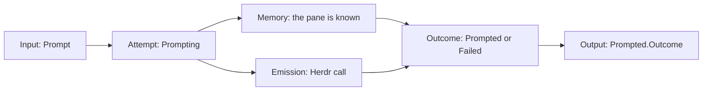

## The translator

The Nexus decodes signal and nothing else. The translator is the process in front of it that speaks text: a datom typed at the CLI comes in through it, and every emission goes out through it. Every translator carries the Caller, from the connection's peer credentials, in `Call.{ Caller Input }`.

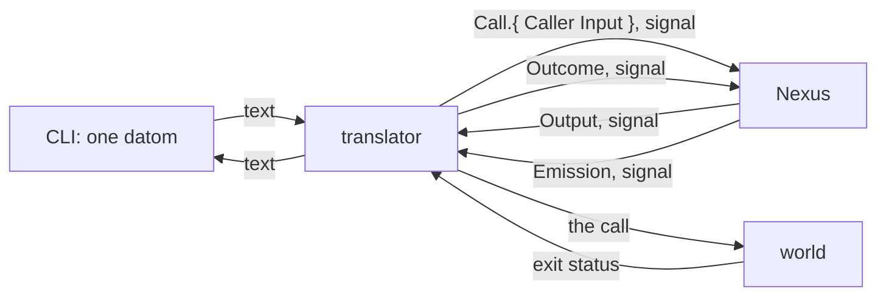

The following conceptual Ethos names composed single-reply observations at the connection boundary. Each translator declares its executable capability and how request preparation and fallible execution produce those observations. The Belief ordinary single-reply contract separates preparation from checked execution and retains native failure evidence in process.

```ethos
Library
[ signal:[ Input Output Error ]
  std:[ Connection ] ]
[ Translator.{ NexusSocket.String }   ; the socket of the Nexus it speaks for
  Caller.{ ProcessId.Integer          ; the connection's
           UserId.Integer }           ;   peer credentials
  Call.{ Caller Input }               ; what the translator sends in
  Outcome.[ Answered                  ; one reply written back
            Unreadable.Error          ; the text was not an Input
            NexusDown ] ]
[ Serving.[ serve.{ [ Connection ] [ Outcome ] } ] ]
[ Translator.[ Serving ] ]
```

## A command line is a type

What a Nexus sends into the world is a typed value: a variant per subcommand, a field per argument, a String only where a user writes freely. The translator turns the value into the call; it is the one place that holds the words.

```ethos
Emission
[]
[ Command.{ Verb Vector<Argument> } ]  ; emissions
[ Outcome.[ Done Refused.Integer ] ]   ; outcomes
[ Verb.[ List Show ]                   ; types
  Argument.[ Name.String Quiet ] ]
[ Arguable.[ argv.[ Vector<String> ] ] ]
[ Verb.[ Arguable ]
  Argument.[ Arguable ]
  Command.[ Arguable ] ]
```

```rust
impl Arguable for Verb {
    fn argv(&self) -> Vec<String> {
        match self {
            Verb::List => vec!["list".into()],
            Verb::Show => vec!["show".into()],
        }
    }
}
impl Arguable for Argument {
    fn argv(&self) -> Vec<String> {
        match self {
            Argument::Name(s) => vec![s.clone()],
            Argument::Quiet => vec!["--quiet".into()],
        }
    }
}
impl Arguable for Command {
    fn argv(&self) -> Vec<String> {
        let mut v = self.verb.argv();
        for a in &self.argument_vector { v.extend(a.argv()) }
        v
    }
}
impl Emittable for Command {           // trait: generated
    type Outcome = Outcome;
    fn emit(&self, t: &Translator) -> Outcome {
        t.call(&self.argv())
    }
}
```

## A Nexus starts in its place

A Nexus reads nothing from the environment: it is started with one datom, its place. Runtime holds its sockets and defaults to `$XDG_RUNTIME_DIR/nexus/<place-name>/`; State holds its memory and defaults to `$XDG_STATE_HOME/nexus/<place-name>/`, `~/.local/state/nexus/<place-name>/` when the variable is unset. Both roots are the CLI's fixed defaults, taken from the standard XDG variables and from nothing else, never an argument. The CLI is `<nexus-name> '<datom>'`: named after the Nexus, and taking the datom and nothing else. Whatever else it knows is its configuration, one datom at `$XDG_CONFIG_HOME/nexus/<nexus-name>.datom`, the place first among its values and more as the CLI gains options. The place name is resolved under the runtime root to the sockets. Two places are two names, and the stable one keeps running while the next is tried; a place is reached by the configuration that names it, so the testing capsule has its own configuration as it has its own sockets and store, and no place is ever typed.

```ethos
Library
[]
[ PlaceName.String                   ; main, next
  Place.{ PlaceName                  ; what every Nexus starts with
          Runtime.String             ; the sockets
          State.String }             ; the memory
  CliConfiguration.{ PlaceName } ]   ; what the CLI knows besides its datom; grows as the CLI gains options
[]
[]
```

```sh
# ~/.config/nexus/flow-nexus.datom
{ main }
flow-nexus 'Launch.{ designer fable «Read the book» }'
```

#### Proposal 4: Examples with example names · psyche-belief › vision/nexus-v1.md

```datom
  ; a Nexus, started by the shell
  { main /run/user/1001/nexus/main
-   /home/li/.local/state/nexus/main }
+   /home/example/.local/state/nexus/main }
  ; the sockets it makes there
  ; <nexus>.sock  <nexus>-meta.sock  <nexus>-translator.sock  <nexus>-meta-translator.sock
  ; the meta CLI's text arrives at <nexus>-meta-translator.sock and becomes signal for <nexus>-meta.sock; the ordinary translator refuses meta text
  ; flow.sock  flow-meta.sock  flow-translator.sock  flow-meta-translator.sock
```
-

## A meta surface sets one value at a time

A Nexus's meta surface sets one value at a time, and a subscription sees the configuration as it changes.

## Two Nexuses

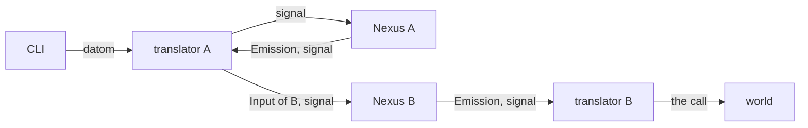

Signal between Nexuses, never text. A Nexus admits signal from the peers its meta configuration names: a typed peer list, each peer bound by kernel credentials as its own translator is; ownership stays per caller.

## psyche-belief › vision/complex-v1.md

# The complex

A complex is the being a person names, my accountant, my coder: a named set of metaflows and the relationships between them, defined by its purpose and its beliefs, the layer above the metaflow, what people today call an agent. It is a definition, as a metaflow is: it names its metaflows, the relationships between them, its speaker and its instances, and it has no directory, process or socket of its own. A complex runs as its metaflows on a host; it may have instances, each the complex run on a host, for redundancy. A Flow Nexus runs many complexes. Three Nexuses run them, from the definitions given them, and the flows run from those.

## The layers

Each layer is defined in terms of the one below it. A flow is one run of a model in a harness. A permanent flow continues through a succession of runs, one entity under one address. A metaflow is several flows defined together: each flow's model, harness, workspace, beliefs and tools, and which flow speaks to which. A complex is several metaflows defined together, with the relationships between them and a speaker.

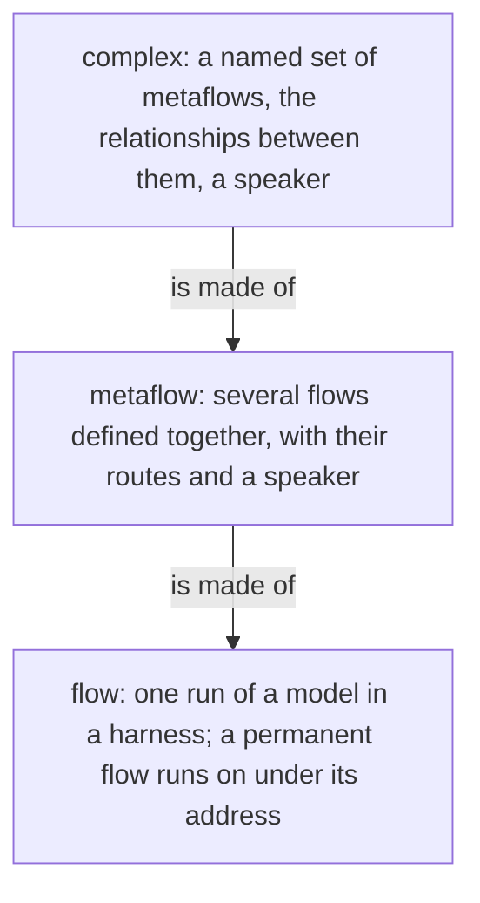

## One self

The metaflows of a complex are one self because they speak to one another: the complex defines the relationships between its metaflows, each one that this metaflow may address that one, and a member's route to another metaflow holds only inside them; a message to a metaflow reaches its speaker. The living talks to the complex: Say addresses it by name and reaches its speaker, the metaflow that receives what comes to the complex. What one metaflow says, does or leaves undone, the whole answers for.

A flow knows its complex by name: the name is set at launch, in the Identity composed into its first prompt or its system prompt beside its Address and FlowId, so a flow names the being it is part of.

```datom
; the Identity composed into a flow's prompt: complex, address, flow id
{ main { designer fable } 15c0ce }
```

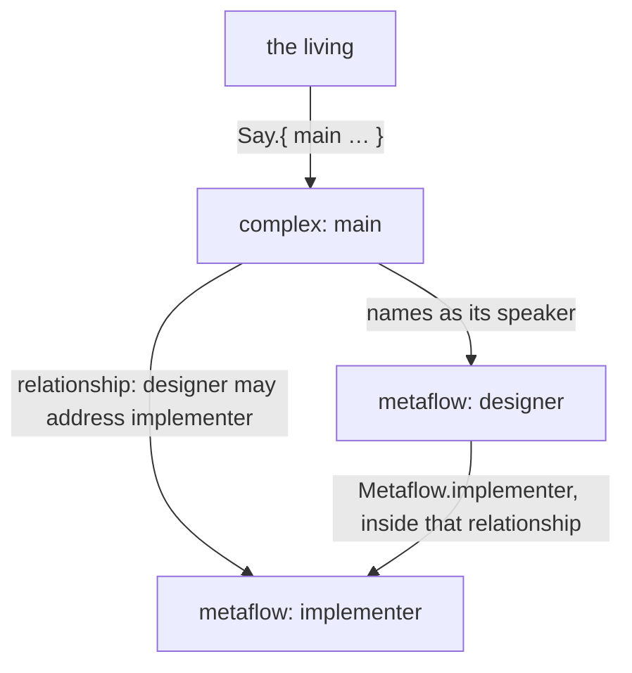

## One owner

A complex runs for one owner: the login whose Nexuses run it. The definitions are his sources; the flows run with his credentials and files; it is not a sandbox.

## Where a complex lives

A complex is a definition the Flow Nexus holds in its Memory, given by Define and read back by Describe, the names by Definitions, as a metaflow and a harness are; it names its metaflows by name, and a Flow Nexus holds many. A change to one definition touches no other.

A complex names features for every flow of its metaflows, as a member names them for itself: each a feature of that member's harness, with its effect, a flag or a variable, composed into the launch beside the member's own. So what every flow of a being is to run with, a harness reminder turned off among it, is said once, in the complex. A complex feature a member's harness lacks refuses the launch, with the harness named.

```ethos
Library
[ flow:[ MetaflowName FeatureName ] ]
[ ComplexName.String                ; the being's name: main
  Host.String                        ; a host the complex runs on; tentative
  Relationship.{ From.MetaflowName    ; this metaflow
                 To.MetaflowName }    ;   may address that one
  Complex.{ ComplexName
             Metaflows.Vector<MetaflowName>      ; its metaflows, by name
             Relationships.Vector<Relationship> ; the relationships between them
             Features.Vector<FeatureName>       ; of each member's harness, composed into every launch of its metaflows
             Instances.Vector<Host>             ; each instance runs the complex on that host, for redundancy; tentative
             Speaker.MetaflowName } ] ; receives what comes to the complex; tentative
[]
[]
```

```ethos
Memory
[ flow:[ Metaflow Harness Complex ] ]
[ Definition.[ Metaflow Harness Complex ] ] ; each held alone; a Complex names its metaflows, a Member its harness
```

```datom
; definitions/main.datom: one complex, headed as Define takes it
Complex.{
   main
   [ designer implementer ]
   [ { designer implementer } ]
   [ LongWaitReminder ]              ; a feature of the harness, for every flow of the complex
   [ criome ]                        ; one instance, on the host criome
   designer }                        ; the speaker
Say.{ main Order.«Read the book» }   ; the living, to its speaker
```

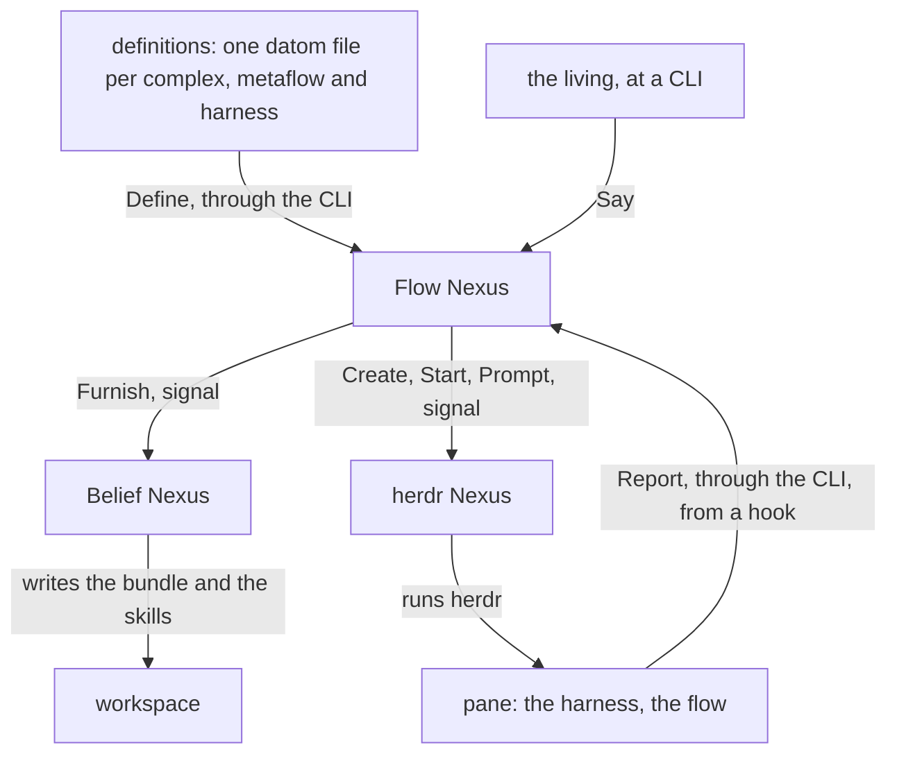

## The Nexuses that run it

The Flow Nexus, the Belief Nexus and the herdr Nexus run a complex. Each is started in its place, a Nexus startup fact of vision:nexus-v1: the three that run one complex share one place name, and a CLI reaches them by it. Two place names are two sets of Nexuses, so the stable set keeps running while the next is tried; the complexes are whatever the Flow Nexus at that place holds.

```sh
# the CLI: one datom; the place is its configuration's
flow-nexus 'Launch.{ designer fable «Read the book» }'
herdr-nexus 'Prompt.{ { main wQ:pT } «hello» }'
```

## The Nexuses are built and started by Nix

The repository metaflow holds the Nix that builds the three Nexuses, their translators and CLIs, and a shell that starts each of them with its place under the owner's login.

#### Proposal 4: Examples with example names · psyche-belief › vision/complex-v1.md

```sh
- nix develop github:LiGoldragon/metaflow -- metaflow start next
+ nix develop github:example-owner/metaflow -- metaflow start next
```
-

## Everything in a complex is a definition

The Nexuses hold vocabulary; the owner writes definitions in datom. A definition is one file, one datom; the definition files are the owner's sources, kept wherever he keeps them and given by Define and replaced the same way; the running set is the Flow Nexus's Memory in its State directory. A change to one definition touches no other. The Rust knows no role, model name or topic.

A new place is told its complexes by replaying the definition files, one Define per file, harnesses before the metaflows that name them and metaflows before the complexes that name them; nothing is migrated from the place before it, and the set of files is the whole of what a place needs to know.

```sh
# the owner's definitions, replayed into a fresh place, from the capsule whose configuration names it
for f in definitions/*.datom; do flow-nexus "Define.$(cat "$f")"; done
```

#### Proposal 4: Examples with example names · psyche-belief › vision/complex-v1.md

```datom
  ; definitions/designer.datom: one metaflow, headed as Define takes it
  Metaflow.{
     designer
     [ { fable claude claude-fable-5-1 Medium
         Permanent
-        Path.«/home/li/primary»
+        Path.«/home/example/primary»
         { [ { Spirit core } { Vision nexus-v1 } ] Refuse }
         Restricted.{ [ Bash Edit ] [ Artifact ] }
         [ ClaudeMd ]
         1200
         [ Speaks.opus Living ] }
       { opus claude claude-opus-4 Medium Ephemeral
         Temporary
         { [ { Spirit core } { Role worker } ] Notice }
         HarnessDefault
         []
         4000
         [ Speaks.fable Metaflow.implementer ] } ]
     fable }                           ; the speaker
```
-
