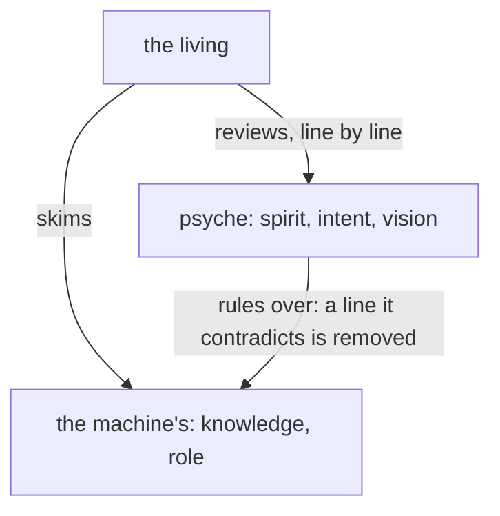
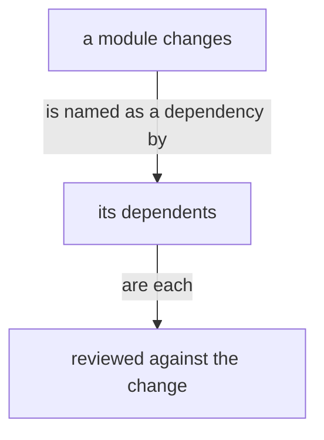

# Design: The types of belief

Author: Psyche beliefReview Fable (Fable 5.2). A worker assembles the presentation source from this file, in the in-place form: each touched module shown whole as it stands, each proposal at its landing place, added lines under the light green margin, removed lines under the light red margin, a moved line once under the third colour, headed by the module it leaves and the module it enters. Title: «The types of belief». Kind: Proposal. Signature line: Created by Fable 5.2; Sonnet readers gathered his words, and a worker assembled the page. Wording marked ADD, REMOVE, REPLACE, MOVE or COMMENT is final; the worker changes none of it. Modules: /git/github.com/LiGoldragon/psyche-belief. Modules shown: intent/belief-modules.md (Proposals 1, 6), intent/psyche.md (Proposal 8), vision/belief-modules.md (Proposals 2, 3, 4, 5, 9), vision/proposal.md (Proposal 2: only the section «## Who writes a proposal» with what the form needs around it, if the builder allows an excerpt), vision/psyche.md (Proposal 7), vision/belief-nexus-v1.md (Proposal 4: the sections «## Signal», «## Meta» and «## Library»; the sections from «## The ordinary single-reply boundary» to the end left out or collapsed if the builder allows).

His words, 12 November, whole in the transcript of flow 7998d1: «We should split up this belief module thing. I don't think there's any field type belief module anymore, so that's kind of stale. We never did the rich annotation, or that's for future belief that would be written in a different format. We need something that all the flows load. We don't need to teach everybody about belief modules. We just need them to understand, with the skill and the description, how to interpret them. The belief module concept is kind of getting married with the belief nexus. Maybe we make this just minimal because it's probably repeating stuff, or make it catch up with the vision of the different types of belief modules. We have different types. What are they all for? What are the different types of beliefs, what are they for, how are they reviewed, and who authors them?»

The other open proposals on these modules stand as they are and are not repeated here: «A description says what the name does not» adds to the section «## A description is part of the content», which this proposal leaves as it stands; «Belief is composed, for a flow or a subagent» changes who names a placement in vision/belief-nexus-v1.md, and the lines moved there below agree with it.

---

## Proposal 1: What every flow reads a module by · psyche-belief › intent/belief-modules.md

COMMENT
This module is in every flow's system prompt, so it is the thing all the flows load. It gains the few lines a flow needs to interpret any module, and nothing on how modules are made. The role type is placed last in the order; the Belief Nexus already names it as a kind. A notion is a knowledge type, by his word: «It is a knowledge belief type, and we can use it for implementing things without having to pass it as vision, so that I can trust you to write it».

PLACE: at the top of the section «## Belief modules», before «A statement lives in one place, and everything else points to it.»

ADD
A belief module is what a flow believes on one subject. Its name gives its type, its topic and, where it has one, its version, and its description says what the topic is; the flow loads the module when its work is on that topic.

The type says how a module is held. Spirit is philosophy, and holds everywhere. Intent is a rule of this system, and holds in all work on its subject. Vision is what the living wants one thing to be, and is built by the flow that builds that thing. Knowledge is the machine's own working notes: facts checked in practice, and notions, which are Fable's reading of what the living has said and not yet reviewed. A role is the training for one kind of work.

REPLACE, only the changed words marked:
was: The module types stand in one order, highest first: spirit, intent, vision, knowledge. A module depends only on its own type or a higher one.
becomes: The module types stand in one order, highest first: spirit, intent, vision, knowledge, role. A higher type overrules a lower one, and a module depends only on its own type or a higher one.

---

## Proposal 2: The types: what each is for, who writes it, how it is reviewed · psyche-belief › vision/belief-modules.md

COMMENT
His question, answered as one table. The first figure and the audit line under it leave: the figure draws Mind and Field belief, which no longer exist, and the table holds the rest. Who writes a proposal is said today in the proposal module; it moves here, so authorship is said once. The role row is my reading, not his word: he has not said who writes or reviews a role. The notion row follows his word above and the notion module of mind-belief, knowledge/notion.md.

PLACE: section «## Belief modules and their review», at its top.

COMMENT
Added by Psyche core Fable. His words, 12 November, later: «Yeah, you're the only one who can author Psyche modules.» «And you're the only one who can write notions. And you should review, well, no, Opus can review the knowledge.» The table and the moved paragraph follow them: the sentence «Opus writes one only when there is no Fable.» leaves the moved paragraph.

REMOVE, the first mermaid fence of the section, whole (the figure beginning «a["the living"] -- "reviews psyche proposals, line by line"»), and the line under it:
Knowledge modules are audited from time to time for truth and currency against practice.
Shown beside the ADD below, which makes them unnecessary.

ADD
| Type | What it is for | Who writes it | How it is reviewed |
|---|---|---|---|
| spirit | philosophy that holds beyond this system | Fable alone | the living, line by line |
| intent | a rule about this system, on its subject | Fable alone | the living, line by line |
| vision | what the living wants a thing to be | Fable alone | the living, line by line |
| knowledge | facts checked in practice: the machine's working notes on how to act | Fable, Opus or Astra | reviewed by Opus and deployed; the living skims; audited from time to time for truth and currency against practice |
| notion, a knowledge type | what the living has said and not yet reviewed, written so that work is implemented without waiting for a vision | Fable alone | deployed on Fable's word; a notion he reviews and approves becomes vision |
| state | what the Field flows believe about the running system as it broadly stands now | Field flows, within the topics that exist | see the Questions |
| role | the training for one kind of work, given to the flow or subflow that does it | Fable, Opus or Astra | the living skims; judged by the work it yields |

Spirit, intent and vision are psyche: his own. Knowledge, the notion among it, state and role are the machine's, and he can delete any of it without losing anything of his. A higher type rules over a lower: a lower line it contradicts is removed.



MOVE, from psyche-belief › vision/proposal.md, section «## Who writes a proposal» (the heading leaves with it; the section is that one paragraph), to psyche-belief › vision/belief-modules.md, after the figure above:
A proposal into a psyche module, spirit, intent or vision, is written by Fable alone: the wanted lines and where they go, reading the belief modules itself. A notion is written by Fable alone. A proposal into a knowledge module is written by Fable, Opus or Astra. The bookmaker publishes either; Opus lands it.

ADD, to the front matter of psyche-belief › vision/proposal.md, a dependency, shown as the front matter changing:
was: dependencies: [vision-crystallization, vision-presentation]
becomes: dependencies: [vision-crystallization, vision-presentation, vision-belief-modules]

---

## Proposal 3: Rich annotation leaves · psyche-belief › vision/belief-modules.md

COMMENT
His words: «We never did the rich annotation, or that's for future belief that would be written in a different format.» The section is removed and lands nowhere: a belief module states what holds now. If he wants it kept for a later format, it is a line for a later version of the Belief Nexus, and he says so.

REMOVE, the whole section «## Context lines are richly annotated»: its heading and its paragraph:
Context lines are richly annotated, because lines of very different categories share one module and are otherwise given the same weight. Separating modules into kinds such as vision and intent is the first, crude form of that annotation.

---

## Proposal 4: What is the Belief Nexus's goes to its vision · psyche-belief › vision/belief-modules.md, vision/belief-nexus-v1.md

COMMENT
His words: «The belief module concept is kind of getting married with the belief nexus.» Where a module is placed and how a repository is laid out are what the Belief Nexus does; these lines move to its vision. The first sentence of the placement paragraph is removed, since the Belief Nexus vision already says who names a placement.

REMOVE, from psyche-belief › vision/belief-modules.md, section «## Belief modules and their review», shown beside the line of vision/belief-nexus-v1.md «## Signal» that makes it unnecessary («A module is named by kind and subject; its front matter names its placement, system prompt or skill.»):
A module declares its placement: the system prompt, or loaded on demand.

MOVE, from psyche-belief › vision/belief-modules.md, section «## Belief modules and their review», to psyche-belief › vision/belief-nexus-v1.md, section «## Signal», after the sentence «The skills directory is the harness's.», as the end of that paragraph:
A skill is the harness's interface for an on-demand module.

MOVE, from psyche-belief › vision/belief-modules.md, section «## Belief modules and their review», to psyche-belief › vision/belief-nexus-v1.md, section «## Meta», after its first paragraph, as a paragraph of its own:
Spirit and intent are placed in the system prompt.

MOVE, from psyche-belief › vision/belief-modules.md, section «## Belief modules and their review», to psyche-belief › vision/belief-nexus-v1.md, section «## Library», before its ethos fence, as a paragraph of its own:
A context repository holds one folder per module type, each named for its type. A file is named by its subject alone, and its folder gives its type.

---

## Proposal 5: When a module changes, its dependents are reviewed · psyche-belief › vision/belief-modules.md

COMMENT
His words, 12 November: «If something needs to know about something else, but it really should be in a different module, make that a dependency.» And: «If something depends on something, then whenever the dependency is changed, we should review the dependent, because it might be a thing that we've changed in the dependency that will affect the dependent.»

PLACE: section «## Editing belief», after «Removal comes before addition.», before the figure.

ADD
A module that needs what another module holds names that module as a dependency, in its front matter, and says none of it again. When a module changes, every module that depends on it is reviewed.

```yaml
# the front matter of vision/proposal.md: it rests on two modules of its own type
description: How a proposal of the living's vision is made.
dependencies: [vision-crystallization, vision-presentation]
```



---

## Proposal 6: Which way a dependency goes · psyche-belief › intent/belief-modules.md

COMMENT
A question for him. His words: «Make the dependencies go down, not up, so that knowledge cannot depend on vision.» The intent line as it stands says the opposite of his example: knowledge may depend on vision, and vision may not depend on knowledge. My reading is that the line as it stands is what he means and the example came out reversed: what he has reviewed never rests on the machine's notes, and the machine's notes rest on what he wants, as a notion rests on the vision it extends. Rejecting this proposal keeps the line. Landing it takes his example as said: knowledge then depends on knowledge alone, a vision may name the knowledge it rests on, and six dependencies turn round: knowledge:book and knowledge:ethos name vision modules, and the notions all-text-is-datom and sema-v1 name the visions they extend.

REPLACE, only the changed words marked (the order of types as Proposal 1 leaves it):
was: A module depends only on its own type or a higher one.
becomes: A module depends only on its own type or a lower one.

---

## Proposal 7: A notion, as it now stands · psyche-belief › vision/psyche.md

COMMENT
The notion type now exists, written in mind-belief knowledge/notion.md. The line on notions in the psyche vision is replaced by one that agrees with it; what a notion is made of stays in that knowledge module.

REPLACE, in the first paragraph of the module, only the changed words marked:
was: A notion is an idea not yet intended, a brainstorm the living has had and not ruled on; it is a Mind belief, kept in the mind repository under its own kind, and a notion that he rules into vision leaves Mind for Psyche.
becomes: A notion is what the living has said and not yet reviewed, written by Fable so that work goes on; it is a Mind belief, kept in the mind repository under its own type, and a notion that he reviews and approves becomes vision and leaves Mind for Psyche.

---

## Proposal 8: No field module · psyche-belief › intent/psyche.md

COMMENT
His words: «I don't think there's any field type belief module anymore, so that's kind of stale.» The same stale word in the intent on psyche.

REPLACE, in the section «## What the living reviews is psyche», only the changed words marked:
was: Anything the living has reviewed is psyche: a line he approves is a vision statement at least, whatever module proposed it, and leaves the mind or field module it sat in. A line he has not reviewed is a machine line.
becomes: Anything the living has reviewed is psyche: a line he approves is a vision statement at least, whatever module proposed it, and leaves the machine's module it sat in. A line he has not reviewed is a machine line.

---

## Proposal 9: Belief is the word · psyche-belief › vision/belief-modules.md

COMMENT
The line names an older vocabulary. The Belief Nexus vision says the word that holds: «Belief is the word: what a model believes when it starts.»

REMOVE, from the section «## Belief modules and their review», shown beside that line of psyche-belief › vision/belief-nexus-v1.md:
The vocabulary is context, belief modules and context building.

---

## Proposal 10: State is the Field's belief · psyche-belief › vision/belief-modules.md

COMMENT
Added by Psyche core Fable. His words, 12 November, later than «I don't think there's any field type belief module anymore»: «And what is the belief module that field has? Is it kind of like the state, right? These are like beliefs about the current state of things. That would make sense, so that flows can be aware of what the field flows have put together in terms of describing the state of the system.» «We could make the creation of a module is basically the creation of a topic, and in the context of belief module, we could make the creation of a topic more of an important thing than, because if we create these topics for field flows to edit in terms of state beliefs, state belief modules, then the field flows will know what matters in terms of state, and maybe not like overproduce state.» «This can be like little temporary vagaries in terms of the state, because these modules are slower moving than just messaging another flow to tell him that for example, there seems to be something wrong with this LAN connection.» «Like brief stuff that can inform a flow about some broad things about the state of the machine.» The state row of the table in Proposal 2 comes from these words; the figure of Proposal 2 keeps knowledge and role as drawn.

ADD, a new section after the section «## Belief modules and their review»:
## State is the Field's belief

State is the Field's belief type: what the Field flows believe about the running system as it broadly stands now, written so that any flow knows it. A state module is brief and slow-moving: the services a node runs, the memory it usually has left, the nodes it routes for, a standing fault and what is thought to cause it. A passing trouble is a message to the flow it concerns.

A state module is a topic, and the creation of a topic is a deliberate act: the topics that exist say what matters about the state, and the Field flows write within them.

```
state:example-node            ; an example; the file field-belief/state/example-node.md

Runs the example router and the example cache. Usually has about 2 GB of memory free. Routes for the example laptop most of the time. Does not power off at present; the embedded controller is thought to be the cause.
```

## Proposal 11: What intent is · psyche-belief › vision/psyche.md

COMMENT
Added by Psyche core Fable. His words, 12 November: «Intent is like very hardly crystallized psyche that is meant to sort of become an integral part of how flows think. So it's kind of a different beast altogether, and it should be only approached in when patterns emerge that are broad and true and clear enough to become really important principles, but not universal and like they're still embedded in the world more than spirit, which is kind of even beyond.»

ADD, after the line «Psyche contains Spirit, Intent and Vision, in descending authority.» and its paragraph:
Intent is what every flow needs to know: psyche crystallized hard, meant to become part of how flows think. A line becomes intent when a pattern has emerged that is broad, true and clear enough to be an important principle; it is still of this world, where spirit is beyond it. An intent module on a subject says what the subject is; how the subject is authored or works is its vision, read by the flows whose work it is.

---

## Proposal 12: The intent on belief modules says what they are · psyche-belief › intent/belief-modules.md, vision/belief-modules.md

COMMENT
Added by Psyche core Fable. His words, 12 November: «The intent on belief modules should really just explain belief modules is what they are and not how to author them or how they function. That would be vision. Because not all the flows need to know how to write belief modules. And so broadly, even intent maybe has maybe some other intent modules have material that really should be vision, because the intent is really the universal knowledge that flows need, and not just, it's not just a place to put everything that we say about a certain topic.» Two lines of the intent tell an author what to do; they move to the vision, under «## Editing belief». The other lines say what a belief module is, and stay. The last sentence of Proposal 11 comes from the same words.

MOVE, from psyche-belief › intent/belief-modules.md to psyche-belief › vision/belief-modules.md, section «## Editing belief», at its end:
When a vision module is found holding mechanics, the mechanics go down to a knowledge module and the concept stays.

MOVE, from psyche-belief › intent/belief-modules.md to psyche-belief › vision/belief-modules.md, section «## Editing belief», at its end:
A module depends only on its own type or a higher one.

---

## Questions

1. Who creates a state topic: you, Fable, or a Field flow on Fable's word?
2. Is a state module deployed on a Field flow's own word, and shown to you afterward as a review?
