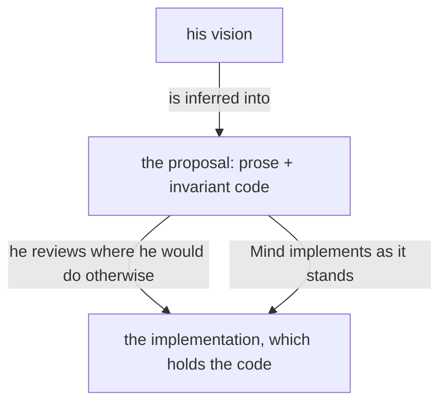
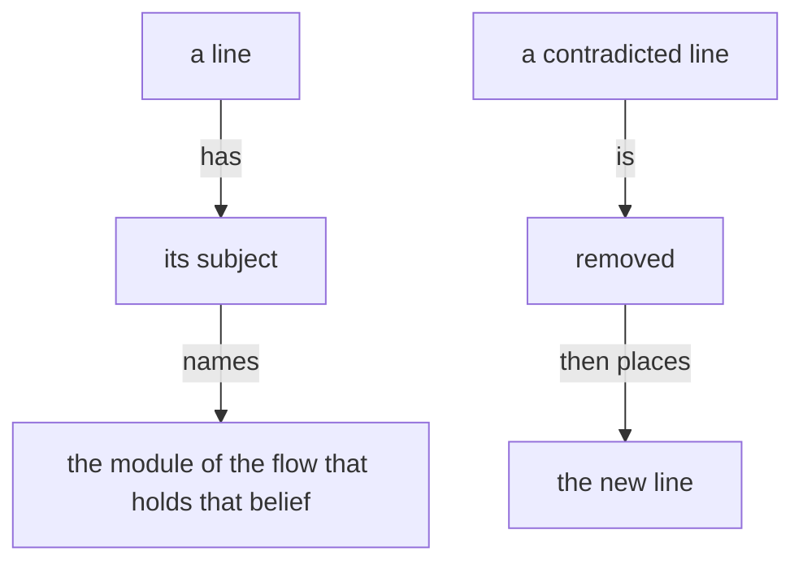
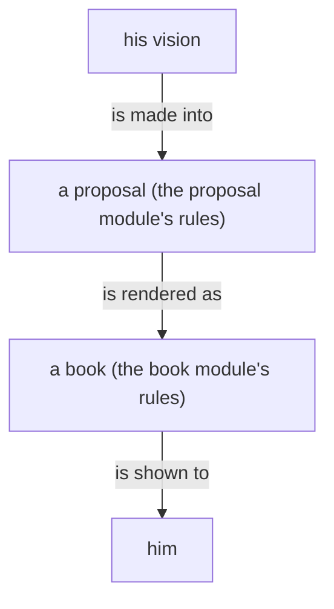
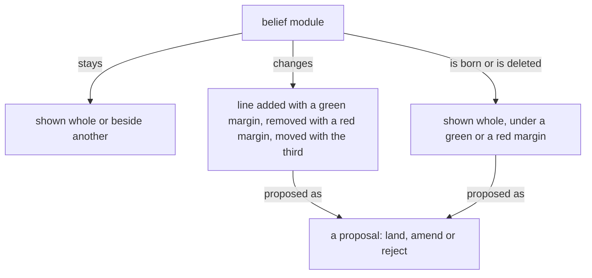

Presentation.{ «The types of belief» Proposal }

# The types of belief

Created by Fable 5.2; Sonnet readers gathered his words, and a worker assembled the page.

## psyche-belief › intent/belief-modules.md

## Belief modules

#### Proposal 1: What every flow reads a module by · psyche-belief › intent/belief-modules.md

::: comment
This module is in every flow's system prompt, so it is the thing all the flows load. It gains the few lines a flow needs to interpret any module, and nothing on how modules are made. The role type is placed last in the order; the Belief Nexus already names it as a kind. A notion is a knowledge type, by his word: «It is a knowledge belief type, and we can use it for implementing things without having to pass it as vision, so that I can trust you to write it».
:::

+ A belief module is what a flow believes on one subject. Its name gives its type, its topic and, where it has one, its version, and its description says what the topic is; the flow loads the module when its work is on that topic.
+
+ The type says how a module is held. Spirit is philosophy, and holds everywhere. Intent is a rule of this system, and holds in all work on its subject. Vision is what the living wants one thing to be, and is built by the flow that builds that thing. Knowledge is the machine's own working notes: facts checked in practice, and notions, which are Fable's reading of what the living has said and not yet reviewed. A role is the training for one kind of work.

A statement lives in one place, and everything else points to it.

#### Proposal 12: The intent on belief modules says what they are · psyche-belief › intent/belief-modules.md

::: comment
Added by Psyche core Fable. His words, 12 November: «The intent on belief modules should really just explain belief modules is what they are and not how to author them or how they function. That would be vision. Because not all the flows need to know how to write belief modules. And so broadly, even intent maybe has maybe some other intent modules have material that really should be vision, because the intent is really the universal knowledge that flows need, and not just, it's not just a place to put everything that we say about a certain topic.» Two lines of the intent tell an author what to do; they move to the vision, under «## Editing belief». The other lines say what a belief module is, and stay. The last sentence of Proposal 11 comes from the same words.
:::

- A vision module holds the living's broad concept of its subject, and is short, because his time went into every line of it. The fine rules the machine needs to act on that concept are knowledge: its own working notes, which he can delete without losing anything of his. When a vision module is found holding mechanics, the mechanics go down to a knowledge module and the concept stays.
+ A vision module holds the living's broad concept of its subject, and is short, because his time went into every line of it. The fine rules the machine needs to act on that concept are knowledge: its own working notes, which he can delete without losing anything of his.
An instruction names what the work must achieve; it leaves the means to the one who does it.

#### Proposal 1: What every flow reads a module by · psyche-belief › intent/belief-modules.md

- The module types stand in one order, highest first: spirit, intent, vision, knowledge. A module depends only on its own type or a higher one.
+ The module types stand in one order, highest first: spirit, intent, vision, knowledge, role. A higher type overrules a lower one.
-

A fault in conduct is a fault in belief.

## psyche-belief › intent/psyche.md

Psyche data is the most valuable thing there is: what the living has explicitly reviewed and approved outweighs any machine inference.

## What the living reviews is psyche

#### Proposal 8: No field module · psyche-belief › intent/psyche.md

::: comment
His words: «I don't think there's any field type belief module anymore, so that's kind of stale.» The same stale word in the intent on psyche.
:::

- Anything the living has reviewed is psyche: a line he approves is a vision statement at least, whatever module proposed it, and leaves the mind or field module it sat in. A line he has not reviewed is a machine line.
+ Anything the living has reviewed is psyche: a line he approves is a vision statement at least, whatever module proposed it, and leaves the machine's module it sat in. A line he has not reviewed is a machine line.
-

What the living reviews line by line becomes psyche.

Approval is the living's word on the line itself, after he has read it: land, or amend and land. His asking for a rule is the brief for a proposal, and a line he asked for lands no sooner than one he didn't.

## Spirit holds beyond this system

Spirit is philosophy that holds beyond this system. A rule about this system, however broad, is intent at most, on its subject.

## psyche-belief › vision/belief-modules.md

## Belief modules and their review

#### Proposal 2: The types: what each is for, who writes it, how it is reviewed · psyche-belief › vision/belief-modules.md

::: comment
His question, answered as one table. The first figure and the audit line under it leave: the figure draws Mind and Field belief, which no longer exist, and the table holds the rest. Who writes a proposal is said today in the proposal module; it moves here, so authorship is said once. The role row is my reading, not his word: he has not said who writes or reviews a role. The notion row follows his word above and the notion module of mind-belief, knowledge/notion.md.

Added by Psyche core Fable. His words, 12 November, later: «Yeah, you're the only one who can author Psyche modules.» «And you're the only one who can write notions. And you should review, well, no, Opus can review the knowledge.» The table and the moved paragraph follow them: the sentence «Opus writes one only when there is no Fable.» leaves the moved paragraph.
:::

```mermaid
- flowchart TB
-     a["the living"] -- "reviews psyche proposals, line by line" --> b["Psyche: spirit, intent, vision"]
-     a -- "skims knowledge proposals" --> m
-     b -- "rules over Mind: a Mind line it contradicts is removed" --> m
-     subgraph m["Mind"]
-         direction TB
-         k["knowledge: facts verified in code"] -- "an audit for truth and currency finds a variation; it goes to" --> u["the type that holds what is unclear"]
-     end
-     m -- "rules over Field: a Field line it contradicts is removed" --> fl["Field"]
-     p["a periodic book or audit"] -- "reads it as a whole and checks it against Mind and Psyche" --> fl
```
-
- Knowledge modules are audited from time to time for truth and currency against practice.
-
+ | Type | What it is for | Who writes it | How it is reviewed |
+ |---|---|---|---|
+ | spirit | philosophy that holds beyond this system | Fable alone | the living, line by line |
+ | intent | a rule about this system, on its subject | Fable alone | the living, line by line |
+ | vision | what the living wants a thing to be | Fable alone | the living, line by line |
+ | knowledge | facts checked in practice: the machine's working notes on how to act | Fable, Opus or Astra | reviewed by Opus and deployed; the living skims; audited from time to time for truth and currency against practice |
+ | notion, a knowledge type | what the living has said and not yet reviewed, written so that work is implemented without waiting for a vision | Fable alone | deployed on Fable's word; a notion he reviews and approves becomes vision |
+ | state | what the Field flows believe about the running system as it broadly stands now | Field flows, within the topics that exist | see the Questions |
+ | role | the training for one kind of work, given to the flow or subflow that does it | Fable, Opus or Astra | the living skims; judged by the work it yields |
+
+ Spirit, intent and vision are psyche: his own. Knowledge, the notion among it, state and role are the machine's, and he can delete any of it without losing anything of his. A higher type rules over a lower: a lower line it contradicts is removed.
+
```mermaid
+ flowchart TB
+     l["the living"] -- "reviews, line by line" --> p["psyche: spirit, intent, vision"]
+     l -- "skims" --> k["the machine's: knowledge, role"]
+     p -- "rules over: a line it contradicts is removed" --> k
```
+
+ A proposal into a psyche module, spirit, intent or vision, is written by Fable alone: the wanted lines and where they go, reading the belief modules itself. A notion is written by Fable alone. A proposal into a knowledge module is written by Fable, Opus or Astra. The bookmaker publishes either; Opus lands it.

A subject the living reviews or asks about has a module, on its topic or a broader one, with room to hold it.

A vision module may be substantial: it holds the code that is important to the vision, the invariant parts, which the living reviews as he reviews prose.

The code important to a vision lives in that topic's vision module.



#### Proposal 4: What is the Belief Nexus's goes to its vision · psyche-belief › vision/belief-modules.md

::: comment
His words: «The belief module concept is kind of getting married with the belief nexus.» Where a module is placed and how a repository is laid out are what the Belief Nexus does; these lines move to its vision. The first sentence of the placement paragraph is removed, since the Belief Nexus vision already says who names a placement.
:::

- A module declares its placement: the system prompt, or loaded on demand. A skill is the harness's interface for an on-demand module.
-
- Spirit and intent are placed in the system prompt.
-

#### Proposal 9: Belief is the word · psyche-belief › vision/belief-modules.md

::: comment
The line names an older vocabulary. The Belief Nexus vision says the word that holds: «Belief is the word: what a model believes when it starts.»
:::

- The vocabulary is context, belief modules and context building.
-

#### Proposal 4: What is the Belief Nexus's goes to its vision · psyche-belief › vision/belief-modules.md

- A context repository holds one folder per module type, each named for its type. A file is named by its subject alone, and its folder gives its type.
-

#### Proposal 10: State is the Field's belief · psyche-belief › vision/belief-modules.md

::: comment
Added by Psyche core Fable. His words, 12 November, later than «I don't think there's any field type belief module anymore»: «And what is the belief module that field has? Is it kind of like the state, right? These are like beliefs about the current state of things. That would make sense, so that flows can be aware of what the field flows have put together in terms of describing the state of the system.» «We could make the creation of a module is basically the creation of a topic, and in the context of belief module, we could make the creation of a topic more of an important thing than, because if we create these topics for field flows to edit in terms of state beliefs, state belief modules, then the field flows will know what matters in terms of state, and maybe not like overproduce state.» «This can be like little temporary vagaries in terms of the state, because these modules are slower moving than just messaging another flow to tell him that for example, there seems to be something wrong with this LAN connection.» «Like brief stuff that can inform a flow about some broad things about the state of the machine.» The state row of the table in Proposal 2 comes from these words; the figure of Proposal 2 keeps knowledge and role as drawn.
:::

+ ## State is the Field's belief
+
+ State is the Field's belief type: what the Field flows believe about the running system as it broadly stands now, written so that any flow knows it. A state module is brief and slow-moving: the services a node runs, the memory it usually has left, the nodes it routes for, a standing fault and what is thought to cause it. A passing trouble is a message to the flow it concerns.
+
+ A state module is a topic, and the creation of a topic is a deliberate act: the topics that exist say what matters about the state, and the Field flows write within them.
+
```text
+ state:example-node            ; an example; the file field-belief/state/example-node.md
+
+ Runs the example router and the example cache. Usually has about 2 GB of memory free. Routes for the example laptop most of the time. Does not power off at present; the embedded controller is thought to be the cause.
```
+

## Change through the living or a mechanism

A belief module changes only on the living's approval of the line, or through a mechanism. In the long term, a change may land without his review through an extensive automated machine review held to standards.

#### Proposal 3: Rich annotation leaves · psyche-belief › vision/belief-modules.md

::: comment
His words: «We never did the rich annotation, or that's for future belief that would be written in a different format.» The section is removed and lands nowhere: a belief module states what holds now. If he wants it kept for a later format, it is a line for a later version of the Belief Nexus, and he says so.
:::

- ## Context lines are richly annotated
-
- Context lines are richly annotated, because lines of very different categories share one module and are otherwise given the same weight. Separating modules into kinds such as vision and intent is the first, crude form of that annotation.
-

## A belief module states what holds now

A belief module states what holds now.

## A belief module names nothing particular to his own machines

A belief module carries the mechanism, and nothing that is true of his own machines alone: no cluster name, host name, login, path or address of his. An example that needs a name uses one that is plainly an example, and says so. What is particular to his machines lives in the host's own declaration, which the module points to.

```nix
# a belief module's example: a name that
# is plainly an example
{ cluster = "example"; host = "laptop"; }
```

## A description is part of the content

A module's description is part of its content: what the description says, the body does not say again.

## Editing belief

A belief goes in the module of its subject.

Removal comes before addition.

#### Proposal 5: When a module changes, its dependents are reviewed · psyche-belief › vision/belief-modules.md

::: comment
His words, 12 November: «If something needs to know about something else, but it really should be in a different module, make that a dependency.» And: «If something depends on something, then whenever the dependency is changed, we should review the dependent, because it might be a thing that we've changed in the dependency that will affect the dependent.»
:::

+ A module that needs what another module holds names that module as a dependency, in its front matter, and says none of it again. When a module changes, every module that depends on it is reviewed.
+
```yaml
+ # the front matter of vision/proposal.md: it rests on two modules of its own type
+ description: How a proposal of the living's vision is made.
+ dependencies: [vision-crystallization, vision-presentation]
```
+
```mermaid
+ flowchart TB
+     d["a module changes"] -- "is named as a dependency by" --> n["its dependents"]
+     n -- "are each" --> r["reviewed against the change"]
```



### Proposal 12: The intent on belief modules says what they are · psyche-belief › intent/belief-modules.md, and psyche-belief › vision/belief-modules.md

::: move proposed
from: psyche-belief › intent/belief-modules.md
to: psyche-belief › vision/belief-modules.md, section «## Editing belief», at its end

When a vision module is found holding mechanics, the mechanics go down to a knowledge module and the concept stays.
:::

::: move proposed
from: psyche-belief › intent/belief-modules.md
to: psyche-belief › vision/belief-modules.md, section «## Editing belief», at its end

A module depends only on its own type or a higher one.
:::

### Proposal 6: Which way a dependency goes · psyche-belief › vision/belief-modules.md

::: comment
A question for him. His words: «Make the dependencies go down, not up, so that knowledge cannot depend on vision.» The intent line as it stands says the opposite of his example: knowledge may depend on vision, and vision may not depend on knowledge. My reading is that the line as it stands is what he means and the example came out reversed: what he has reviewed never rests on the machine's notes, and the machine's notes rest on what he wants, as a notion rests on the vision it extends. Rejecting this proposal keeps the line. Landing it takes his example as said: knowledge then depends on knowledge alone, a vision may name the knowledge it rests on, and six dependencies turn round: knowledge:book and knowledge:ethos name vision modules, and the notions all-text-is-datom and sema-v1 name the visions they extend.
:::

- A module depends only on its own type or a higher one.
+ A module depends only on its own type or a lower one.

### Proposal 4: What is the Belief Nexus's goes to its vision · psyche-belief › vision/belief-modules.md, and psyche-belief › vision/belief-nexus-v1.md

::: shown
psyche-belief › vision/belief-nexus-v1.md
## Signal
The owner registers a belief repository at the Belief Nexus's own CLI, by his login, as he defines a complex at the Flow Nexus. A peer the meta peer list names furnishes over any registered repository.

A registered repository is watched: when its main moves, every workspace furnished with a module it changed is furnished again, and the Flow Nexus is told which flows now run on old belief, so a perma flow can be refreshed on it. A module is named by kind and subject; its front matter names its placement, system prompt or skill. The skills directory is the harness's.
:::

::: move proposed
from: psyche-belief › vision/belief-modules.md, section «## Belief modules and their review»
to: psyche-belief › vision/belief-nexus-v1.md, section «## Signal», after the sentence «The skills directory is the harness's.», as the end of that paragraph

A skill is the harness's interface for an on-demand module.
:::

::: shown
psyche-belief › vision/belief-nexus-v1.md
```ethos
Signal
[ belief:[ ModuleSource ModuleName    ; imports
           Workspace Location ]
  flow:[ Harness ] ]
[ Register.ModuleSource              ; inputs: a module source
  Resolve.Vector<ModuleName>
  Furnish.{ Workspace Harness        ; the harness's
            Vector<ModuleName> }     ;   skills directory
  Subscribe ]
[ Registered.ModuleSource            ; outputs
  Resolved.{ Vector<ModuleName>      ; found
             Vector<ModuleName> }    ; missing
  Furnished.{ Location
              Vector<ModuleName> }   ; missing, left out
  Subscribed
  Changed.{ ModuleSource              ; pushed: main moved
            Vector<ModuleName>        ;   modules changed
            Vector<Workspace> }       ;   workspaces refurnished
  Refused.[ UnknownSource.ModuleSource
            Unwritable.Workspace ] ]
[]
```

```datom
Register.Repository.
  /git/github.com/LiGoldragon/psyche-belief
Registered.Repository.
  /git/github.com/LiGoldragon/psyche-belief
Register.Directory./home/li/psyche-belief-edits
```

```sh
belief-nexus '
  Register.
    /git/github.com/LiGoldragon/psyche-belief'
```

## Meta

A module's front matter names its placement; the default per Kind is a meta setting, set one value at a time, never in the Rust. The meta peer list names the peers admitted to Furnish, each bound by kernel credentials as a Nexus's peers are.
:::

::: move proposed
from: psyche-belief › vision/belief-modules.md, section «## Belief modules and their review»
to: psyche-belief › vision/belief-nexus-v1.md, section «## Meta», after its first paragraph, as a paragraph of its own

Spirit and intent are placed in the system prompt.
:::

::: shown
psyche-belief › vision/belief-nexus-v1.md
```ethos
Signal
[ belief:[ Kind Placement ] ]        ; imports
[ Configure.Set ]                    ; inputs: one value at a time
[ Configured.Set ]                   ; outputs: the value set
[ Set.[ Placement.{ Kind             ; types: the default
                    Placement }      ;   placement per Kind
        Peer.PeerBinding             ;   a peer admitted to Furnish
        RemovePeer.PeerId ]          ;   a peer removed
  UserId.Integer                     ; a login
  ProcessId.Integer
  PeerId.String                      ; a peer's name
  PeerIdentity.{ UserId ProcessId }  ; checked by kernel credentials
  PeerBinding.{ PeerId PeerIdentity } ]
```

## Library
:::

::: move proposed
from: psyche-belief › vision/belief-modules.md, section «## Belief modules and their review»
to: psyche-belief › vision/belief-nexus-v1.md, section «## Library», before its ethos fence, as a paragraph of its own

A context repository holds one folder per module type, each named for its type. A file is named by its subject alone, and its folder gives its type.
:::

::: shown
psyche-belief › vision/belief-nexus-v1.md
```ethos
Library
[ sema:[ Document Block Edit Place Outline ] ]
[ Path.String                        ; a directory holding
                                     ;   <type>/<subject>.md
  ModuleSource.[ Repository.Path     ; a git repository, watched:
                                     ;   main moving refurnishes
                 Directory.Path ]    ; a directory read as it
                                     ;   stands, watched by nobody
  Kind.[ Spirit Intent Vision
         Knowledge Role ]
  ModuleName.{ Kind Subject.String }
  Workspace.String                   ; the flow's directory
  Placement.[ SystemPrompt Skill ]   ; named in front matter;
                                     ;   default per Kind: meta
  Location.{ SystemPrompt.String     ; the bundle file written
             Skills.String } ]       ; the skills directory
[]
[]
```
:::

## psyche-belief › vision/proposal.md

## A proposal

A proposal is a presentation: the prose and the code that describe the system as it will be, shown as changes to belief modules, in the light shades, for the living to rule on.

A proposal lives in its source file and is edited on his comments.

A proposal states what is wanted of the system; it documents nothing.

A proposal is the vision as it will be. A removed line is shown as the text it was, under a red margin, so the edit can be seen, and nothing else is made of it: it is not drawn, not summarised and not shown as a state of anything. A proof, a test, a milestone or a sequence of work is an order, and goes to a bead; written into a proposal it is a vision impurity.

A versioned module is self-contained: everything true of that version is in it, and the version is named once, in its description. Another version is not mentioned.

A proposal is a proposal into belief modules, and the whole of it is its crystallization: what it removes and what it adds.

A proposal has one subject, and small changes that belong together are one subject: one proposal per subject he would judge as one.

A proposal that touches a code component shows the code it changes or adds.

A code block in a proposal stands on its own. It carries the code, why it is important, and what its function is.

A proposal is usually drawn as well as written, and always when it has a shape; a figure draws what is wanted, and nothing of what goes. A flowchart in a proposal is a proposed line like any other: it stands under the addition margin of the proposal it belongs to, which names the module it goes to.

The proposal is the center of development: it is the evolution of an idea.

A line removed from a module is shown beside the line that makes it unnecessary.

A question between alternative lines shows each alternative as its own proposal, with the exact lines it lands; the living rules land, amend or reject.

Every word of his redoes the proposal it bears on, unless it closes the topic; words that open a topic of their own get a proposal of their own.

Every type a proposal names is in the proposal: added to the module it lands in, added to another module, or shown as it already stands in its vision module, its definition in full; naming a type is not showing it.

What can be expressed in code is shown as code, with a comment where the code needs one; prose is the comment on the code. A method is shown with the trait it belongs to and that trait's ethos, so its inputs and its yield are read. Code not yet settled is marked tentative. A "never" or an "always" is code: the rule is shown as the code that enforces it.

A shape is a flowchart. Prose carries only what neither code nor chart can. Ethos is the first chart: its types are the nodes and its traits the actions between them.

Code shown is complete: every name it uses is declared in the proposal, a method with its trait in ethos. A type wraps nothing without purpose: a variant carries a type bare when the wrapping would name nothing the type does not.

```ethos
Text.String                                   ; what herdr types; made from Waking, held by no struct
```

```rust
let text = Text(self.waking.datomize(Path::root()).protosize().textualize());   // only the waking becomes text
```



## What a proposal shows

A module shown whole, as it stands, situates the landing.

A module shown beside another, both as they stand, serves comparison: psyche with knowledge.

A line replaced shows its removal and its addition together, and only the changed words are marked.

A new module shows whole under a green margin, under the path it will have.

A module deleted shows whole under a red margin, with a Destroy or Archive mark.

A dependency changed shows in the module's front matter: the dependency removed under a red margin, the dependency added under a green margin.

A figure proposed for a module shows under that module's path with a green margin, as an added line does; a fence it replaces, in the module, shows as its lines under a red margin.



#### Proposal 2: The types: what each is for, who writes it, how it is reviewed · psyche-belief › vision/proposal.md

- ## Who writes a proposal
-
- A proposal into a psyche module, spirit, intent or vision, is written by Fable: the wanted lines and where they go, reading the belief modules itself. Opus writes one only when there is no Fable. A proposal into a knowledge module is written by Fable, Opus or Astra. The bookmaker publishes either; Opus lands it.

### Proposal 2: The types: what each is for, who writes it, how it is reviewed · psyche-belief › vision/proposal.md

- dependencies: [vision-crystallization, vision-presentation]
+ dependencies: [vision-crystallization, vision-presentation, vision-belief-modules]

## psyche-belief › vision/psyche.md

#### Proposal 7: A notion, as it now stands · psyche-belief › vision/psyche.md

::: comment
The notion type now exists, written in mind-belief knowledge/notion.md. The line on notions in the psyche vision is replaced by one that agrees with it; what a notion is made of stays in that knowledge module.
:::

- Psyche contains Spirit, Intent and Vision, in descending authority. A notion is an idea not yet intended, a brainstorm the living has had and not ruled on; it is a Mind belief, kept in the mind repository under its own kind, and a notion that he rules into vision leaves Mind for Psyche.
+ Psyche contains Spirit, Intent and Vision, in descending authority. A notion is what the living has said and not yet reviewed, written by Fable so that work goes on; it is a Mind belief, kept in the mind repository under its own type, and a notion that he reviews and approves becomes vision and leaves Mind for Psyche.
-

#### Proposal 11: What intent is · psyche-belief › vision/psyche.md

::: comment
Added by Psyche core Fable. His words, 12 November: «Intent is like very hardly crystallized psyche that is meant to sort of become an integral part of how flows think. So it's kind of a different beast altogether, and it should be only approached in when patterns emerge that are broad and true and clear enough to become really important principles, but not universal and like they're still embedded in the world more than spirit, which is kind of even beyond.»
:::

+ Intent is what every flow needs to know: psyche crystallized hard, meant to become part of how flows think. A line becomes intent when a pattern has emerged that is broad, true and clear enough to be an important principle; it is still of this world, where spirit is beyond it. An intent module on a subject says what the subject is; how the subject is authored or works is its vision, read by the flows whose work it is.
+

Everything the living says he wants is crystallized into the existing vision: psyche data is what the work mines for, and rich building stands on it.

Psyche data belongs in a dedicated repository symlinked into Primary. Orchestrate
coordinates concurrent work across those repositories.

The belief modules belong in a context repository; Psyche's is psyche-belief.

Vision is what is wanted; it is neither real nor unreal, and it documents nothing. The minute a line is not wanted it is not vision: there is one vision, the one in the module now, and nothing refers to a past one. Vision refers only to vision: every type a vision names is defined in a vision module. The horizons separate what he sees long term from what he pursues now so that it arrives more quickly.

## A record is a proposal

What the living says is not written down. What it changes is: Fable restructures, simplifies and harmonizes it with everything he has said, as a line in a proposal. The transcript holds his words; nothing else does.

## Questions

1. Who creates a state topic: you, Fable, or a Field flow on Fable's word?
2. Is a state module deployed on a Field flow's own word, and shown to you afterward as a review?
