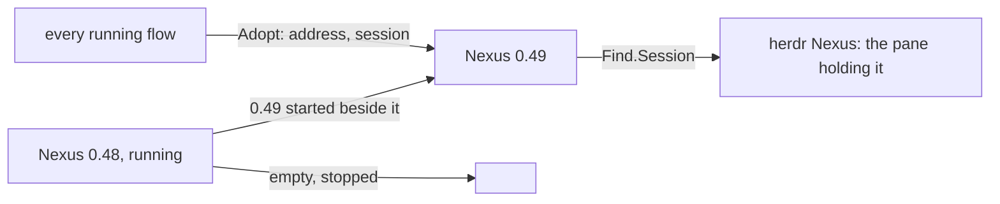
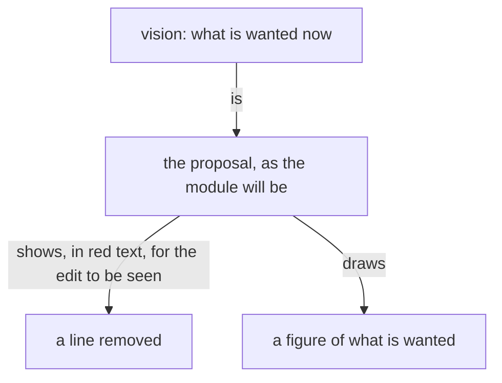
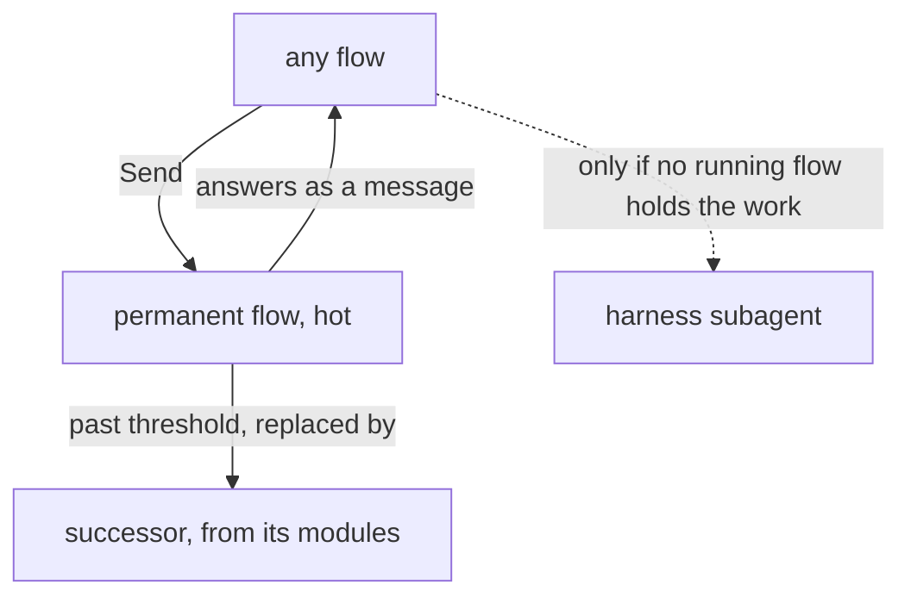
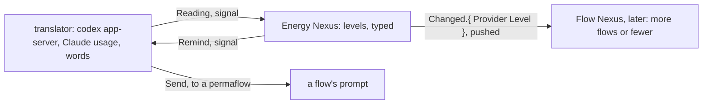
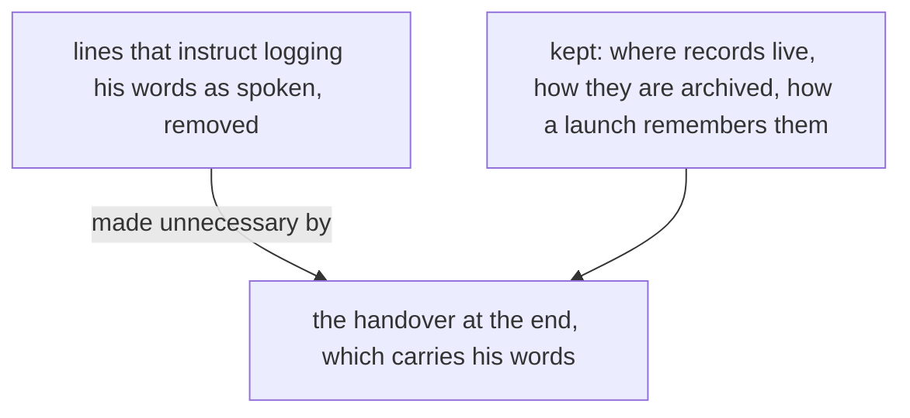

Presentation.{ «Forgotten proposals» }

# Forgotten proposals

Third edition, redone on his four comments of 2026-11-05. Section 2 of What matters most is gone on his word; section 1 answers his question on the pane.

## Proposal 1: What matters most · primary › flows/15c0ce/proposals/what-matters-most.md

Sections 1 and 4: landed without review (psyche-belief 8d039e8). Section 2: landed in 8d039e8, rejected by him on 2026-11-05 ("it all sounds like crackpot confused nonsense to me so I'll have to say no") and removed (22c9a85); the fault it shows is the subject of the book The delusion. Sections 3 and 5: unlanded.

Question for him: §3 says no beat, no receipt, no custody question stands between a flow and its work; intent:main-flow now holds the Conduct line (item 9) that a Primary briefs every step, who holds each, and the beat. One of the two stands.

## 1. A running session joins any Flow Nexus

Lands in vision:flow-nexus-v1.

A flow's identity is its own, not the Nexus's. A Nexus is replaced by starting the next version beside it and having every running flow join it; nobody restarts, no context is lost. A change to a Nexus is a new version, always.

His question, at Session: does the flow need to know its herdr pane, or is it obtained by the runtime? The runtime obtains it: herdr lists every pane with the session id of the harness in it, so the Nexus asks the herdr Nexus for the pane holding the session Adopt names, and records it in the flow's Memory; a session in no pane is refused. The flow names its address and its session, nothing else.

```ethos
Signal
[ flow:[ Address FlowId ] ]
[ Adopt.{ Address Session } ]            ; input: a running session, under its address
[ Adopted.FlowId                         ; outputs
  Refused.[ AddressHeld.FlowId           ;   one live flow per address
            Unidentified                 ;   the calling session is not the one named
            NoPane.Session ] ]           ;   herdr lists no pane holding it
[ Session.String ]                       ; the harness's session id, verified by the caller's process
```

```ethos
Emission
[ flow:[ Session ]
  herdr:[ Pane ] ]
[ Find.Session ]                         ; the pane holding this session, from herdr's listing
[ Found.Option<Pane> ]
[]
```

```datom
Adopt.{ { Psyche core Primary } 5aa8b46f-673d-55ac-81de-4c9bf317fdb8 }
Adopted.5aa8b4
```



## 3. One hand, the whole job

Lands in vision:collaboration.

A job goes to one flow, whole, with the authority to decide everything inside it. A flow decides what its beliefs already answer. A real question goes straight to Fable, even a small one, and is answered with the obvious in one line; usage is not the constraint. Nothing is split into owned steps that wait on each other's messages; no beat, no receipt, no custody question stands between a flow and its work.

## 4. A record is a proposal

Lands in vision:psyche, replacing "A flow writes a raw record of the living's words only when there is a reason to" and knowledge:psyche's "Preserve the living's raw words".

What the living says is not written down. What it changes is: Fable restructures, simplifies and harmonizes it with everything he has said, as a line in a proposal. The transcript holds his words; nothing else does.

## 5. The shape before the wool

Lands in vision:model-roles.

A Codex flow is given the exact shape of what it is to make before it starts: the types, the one operation, the version it becomes. It is fast and it does not stop; a wrong shape is knitted whole before anyone sees it.

## Proposal 2: Models, not layers · primary › flows/f54886/proposals/models-not-layers.md

Landed without review, on his words (2184475, ced4397).

### Proposal 1: Models have personality · psyche-belief › vision/model-roles.md

**Comment** Every line that explained a role by layer now explains it by the model's name. The ranks, the ceiling and the routes stay as facts about models.

  ## Beliefs about models live here
  
- What is believed about a model, its rank, its cost, what it is given,
- is written in this module alone; every other module names a layer.
+ What is believed about a model, its personality, its rank, its cost,
+ what it is given, is written in this module alone; every other module
+ names a model by its name.
  
- The system is understood energetically. The living's attention is a thousand times dearer than any flow's; within the system a Primary's input and output are the dearest, far above a Secondary's, and a Secondary's above its subflows'. A message that saves a cheaper flow's words and makes a dearer one fetch has cost more, not less.
+ The system is understood energetically. The living's attention is a thousand times dearer than any flow's; within the system Fable's input and output are the dearest, far above Opus's, and Opus's above Sonnet's and Haiku's. A message that saves a cheaper flow's words and makes a dearer one fetch has cost more, not less.
  
- ## Roles are explained by layer, not by model
+ ## Models have personality
  
- Roles are explained by layer, not by model; one skill maps layer to model.
+ The models have personality, and a flow is spoken of by its model's name. A complex names each member's model in its datom definition, and that is where the model is visible.
  
- | Layer | Claude (Psyche) | OpenAI (Mind, Field) |
- |---|---|---|
- | Primary | Fable | Astra |
- | Secondary | Opus | Sol |
- | Tertiary | Sonnet | Luna |
- | Quaternary | Haiku | Luna, low effort |
+ | Claude | OpenAI | Personality |
+ |---|---|---|
+ | Fable | Astra | designs, judges, speaks with the living |
+ | Opus | Sol | choreographs, publishes, lands |
+ | Sonnet | Luna | large plain work |
+ | Haiku | Luna, low effort | small jobs |
  
  ## Delegation ceiling
  
- The most complex reasoning goes to a Primary. A Secondary is third, and
- stands in only when there is no Primary usage left for the design. A
- Tertiary does large plain work and designs nothing. A Primary is the
- costly layer and is main-flow only.
+ The most complex reasoning goes to Fable. Opus stands in for a design
+ only when there is no Fable usage left. Sonnet does large plain work
+ and designs nothing. Fable is the costly model and is main-flow only.
  
- Every layer launches the lowest layer that does the job, its own layer
- rarely, and a Primary never: a Quaternary launches Quaternaries; a
- Tertiary launches Tertiaries and Quaternaries; a Secondary launches
- Tertiaries and Quaternaries; a Primary launches Secondaries and
- Tertiaries, and Quaternaries for small jobs.
+ Every model launches the cheapest model that does the job, its own
+ rarely, and Fable never: Haiku launches Haiku; Sonnet launches Sonnet
+ and Haiku; Opus launches Sonnet and Haiku; Fable launches Opus and
+ Sonnet, and Haiku for small jobs.
  
  The one difference between the two sides: Opus stands in for Fable;
  Sol stands in for nothing, since it designs nothing.
  
  ## One declaration sets the model everywhere
  
- The model is declared once, as typed configuration in the Flow Nexus, mutated only
- through the meta wire. Skill variables carry that value by name into every
- skill, launcher and brief. Nothing else holds a model name, so a launcher
- never writes one by hand and no flow is started in a metaflow by accident.
+ The model is declared once, in the complex definition the Flow Nexus
+ runs, in datom. Nothing else holds a model name, so a launcher never
+ writes one by hand and no flow is started by accident.
  
- ## Native names use aspect, topic and layer
+ ## Native names use the complex and the member
  
- Every native main session is titled `{ <Aspect> <Topic> <Layer> <FLOW_ID> }`.
- The layer selects the configured model through the table above, so the
- title names the layer, never the model.
+ Every native main session is titled `{ <Complex> <Member> <FLOW_ID> }`,
+ the member being the name the definition gives the flow; tentative
+ until version 1 runs.
  
- Aspect, topic, layer, exact model identifier, Flow ID, and native binding
- remain separate typed facts. The title grants none of the identity,
- authority, availability, or routing those facts establish.
+ Complex, member, exact model identifier, Flow ID, and native binding
+ remain separate typed facts. The title grants none of the identity,
+ authority, availability, or routing those facts establish.
  
  ## A grunt job goes down, not up
  
- A simple job — a book rebuilt, a page published, a module located, a file moved — goes to a Tertiary or a Quaternary; a Secondary is never in charge of redoing a book. Once a Secondary has figured out what to do, the doing is handed down.
+ A simple job — a book rebuilt, a page published, a module located, a file moved — goes to Sonnet or Haiku. Once Opus has figured out what to do, the doing is handed down.
  
- ## A design decision goes up, to the Primary
+ ## A design decision goes up, to Fable
  
- A Secondary passes every design decision through its own Primary and acts on the Primary's decision. A Secondary uses its Primary freely.
+ Opus passes every design decision to its Fable and acts on Fable's decision. Opus uses its Fable freely.
  
- A Primary is reached through its Secondary for a question, a design or a judgment; the core Primary of an aspect reaches a topic Primary of its aspect directly when it helps a design while the living is talking to it. When no Secondary is live, the flow that needs the Primary starts one. When one cannot be started and something depends on the Primary being reached, the flow messages the Primary itself and says in that message that the Secondary route failed and why.
+ Who reaches whom is the complex's routes, in its definition; Fable is reached through its Opus where the routes say so.

### Proposal 2: Routes are the definition's · psyche-belief › vision/aspects.md

**Comment** Both sections explained the routes by layer; the routes are now each complex's own, written in its definition.

- ## Flows of one topic talk at the same layer across aspects
+ ## Routes are the definition's
  
- Flows of the same topic talk at the same layer across aspects, so a Psyche topic Secondary and the Mind Secondary of that topic speak directly. Field reaches Psyche through Mind, unless Psyche has just spoken to Field. This holds for every aspect.
+ Who speaks to whom, within an aspect and across aspects, is the routes each complex names in its definition; a message off the routes is refused. Field reaches Psyche through Mind, unless Psyche has just spoken to Field.
  
- ## Within an aspect, a flow speaks to the layer next to it
- 
- Within an aspect, a flow speaks only to the layer next to it: a Quaternary to its Tertiary, a Tertiary to its Secondary, a Secondary to its Primary.
- 
- The tracker, a Quaternary, reaches any Secondary directly, in any aspect, and a Primary only through its Secondary.

```datom
+ ; a complex, each member by its model
+ { designer
+   [ { fable Claude claude-fable-5-1 Medium
+       Perma Path.«/home/li/primary»
+       { [ spirit:core ] Refuse }
+       HarnessDefault
+       [ Speaks.opus Speaks.Living ] } ]
+   fable }
```

## Proposal 3: The address names the model · primary › flows/f54886/proposals/the-address-names-the-model.md

Landed without review (d4cb3c5).

+ ```mermaid
+ flowchart TB
+     a["Address: Aspect, Topic, Model"] -- "{ Psyche core Fable }" --> f["one metaflow"]
+     a -- "{ Mind core Opus }, { Psyche core Astra }" --> g["any model in any aspect"]
+ ```

### Proposal 1: The model in the address · psyche-belief › vision/flow-nexus.md

+ Who speaks to whom is vision:aspects'. Version 0 refuses no request by its address; the routes are version 1's, in the complex definition.

```ethos
  Library
  []
  [ FlowId.Integer
    Topic.String
    Aspect.[ Psyche Mind Field ]
-   Layer.[ Primary Secondary Tertiary
-           Quaternary ]
-   Address.{ Aspect Topic Layer }
+   Model.[ Fable Opus Sonnet Haiku
+           Astra Sol Luna Terra ]
+   Address.{ Aspect Topic Model }
    Event.[ Started Stopped ] ]
  []
  []
```

## Proposal 4: Versions side by side · primary › flows/f54886/proposals/versions-side-by-side.md

Landed without review (d698605).

### Proposal 1: Versions side by side · psyche-belief › vision/versioning.md

**Comment** Stable and next were two; the concept is any number, each its own unit and its own CLI, chosen by name. Which flow runs on which is state, moved by signal, outside the declaration.

- ## Stable and next
+ ## Versions side by side
  
- Every Nexus runs as a stable and a next, each declared in Nix and each on its own sockets; the stable is declared with the Nexuses it pairs with, as the fallback. A configuration names which of the two a new flow or a refresh starts on, and a running flow keeps running where it is. When every flow has moved onto next, next becomes stable and the newer version takes next. An upgrade is never all-or-nothing: the stable is there to fall back on, and a big change carries a countdown rollback that is cancelled once the new stack is seen working. Before the first deployment there is nothing to roll back to, and the system rolls forward.
+ Every version of a Nexus is its own declared unit, on its own sockets and store, and as many run at once as are wanted: two, three, five, since they are cheap to run. Each version has its raw CLI, named by the component and the version, `flow-0.44`; the bare name, `flow`, is a wrapper that points at one version. A flow calls a version by its CLI. Which flow runs on which version is state, moved by signal, outside the declaration. A version that proves to have problems is removed from the declaration and another added; the versions beside it keep running.

```sh
+ flow-0.48 'Send.{ … }'   # this version
+ flow 'Send.{ … }'        # the one the wrapper points at
```

## Proposal 5: The handover · primary › flows/f54886/proposals/the-handover.md

Landed without review (e9116fa, c8b9ae8).

### Proposal 1: A handover is an overview · psyche-belief › vision/remembering.md

**Comment** One paragraph replaced: the handover as a book, its composition by ancestor and its review go; the overview and the warning take their place. The logs still pass, and the module now says why.

- A flow is refreshed after its landings: what he approved is landed and live before the handover is written, and the handover holds only what is not landed. The flow that had the conversation writes it, in his words verbatim, composed in inline quotes into what he wants and nothing else, by ancestor, each section marked with the model and the process that made it. It is published as a book of its own kind, `Handover.{ «title» }`, which he reviews as he reviews psyche; the successor's first prompt is that file as reviewed.
+ A flow is refreshed after its landings: what he approved is landed and live before the handover is written. A handover is a broad overview of what the flow is still trying to do, and only that: the successor starts with a fresh point of view. The raw logs pass to a flow so that it may write its handover; the Psyche core Primary, the flow that speaks with the living, is their main user. The flow writes the handover at flows/<id>/handover.md when the Flow Nexus warns it, and the successor's first prompt is that file.

+ ```mermaid
+ flowchart TB
+     n["Flow Nexus"] -- "warns, before the threshold" --> f["the flow"]
+     f -- "writes" --> h["handover: what it is still trying to do"]
+     h -- "first prompt of" --> s["the successor, fresh"]
+ ```

### Proposal 2: The Nexus warns before the threshold · psyche-belief › vision/flow-nexus-v1.md

**Comment** The refresh paragraph gains the warning; Event gains Warned; Threshold carries the share at which the warning is sent.

- A perma flow is refreshed when its context passes its model's threshold, configured per model in the Flow Nexus: the flow is told to write its handover, its successor is launched with the same definition, the handover as its first prompt, and the queue that gathered meanwhile; the predecessor ends. The address stays; the flow id changes. An ephemeral flow past its threshold takes no new work and ends when its work ends.
+ A perma flow is warned when its context reaches the Warning share of its model's threshold, configured per model in the Flow Nexus: a HardAbrupt Notice naming its handover path, flows/<id>/handover.md. When the context passes the threshold its successor is launched with the same definition, that file as its first prompt, and the queue that gathered meanwhile; the predecessor ends. An absent file means the successor starts from its definition and the queue alone. The address stays; the flow id changes. An ephemeral flow past its threshold takes no new work and ends when its work ends.

```ethos
  [ Event.[ Started Idle Working Ended
            Responded.String            ; the response, whole
-           Threshold ] ]              ;   context past its mark
+           Warned                     ;   the handover asked
+           Threshold ] ]              ;   context past its mark
```

```ethos
-   Threshold.{ Model.String Tokens.Integer }
+   Threshold.{ Model.String Tokens.Integer
+               Warning.Integer }        ; share left, 20
```

```datom
+ ; the Nexus, to the flow, at the Warning share
+ HardAbrupt.Notice.«Write your handover at
+ flows/f54886/handover.md»
```

## Proposal 6: Vision is what is wanted now · primary › flows/f54886/proposals/vision-is-what-is-wanted-now.md

Landed without review (f484572).

## The idea, and why

Vision is what is wanted now. There is one vision, the one in the module at this moment; the minute a line is not wanted, it is not vision, and nothing refers to it as vision again. Vision has no past and documents nothing.

A proposal is the vision as it will be. It shows a removed line as the text it was, in red, for one reason: so the edit can be seen. Nothing else is made of a removed line: it is not drawn, not summarised, not shown as "how it is", because that would present as vision a thing that is not wanted.

A figure draws the vision. "As it stands" in a book means one thing: a module's text now, shown to situate the landing. A figure shown as it stands is a fence that is in the module.

Example. The module says "its work is what it writes to files"; the wanted line is "the transcript is the record of a flow's work". The proposal shows the old sentence in red, the new in green, and one green figure: the transcript, the flow's work, the file a reader asked for. It draws nothing of files being written, because nobody wants that.

Example. A module holds a mermaid fence that is no longer wanted. The proposal shows that fence's lines in red, as the lander will remove them, and the wanted fence in green. The removed fence is not redrawn beside the new one.

### Proposal 1: Vision has no past · psyche-belief › vision/psyche.md

After the sentence "Vision is what is wanted; it is neither real nor unreal, and it documents nothing.", in the same paragraph:

+ The minute a line is not wanted it is not vision: there is one vision, the one in the module now, and nothing refers to a past one.

### Proposal 2: What is made of a removed line · psyche-belief › vision/proposal.md

After the sentence "A proposal states what is wanted of the system; it documents nothing.", as its own paragraph:

+ A proposal is the vision as it will be. A removed line is shown as the text it was, in red, so the edit can be seen, and nothing else is made of it: it is not drawn, not summarised and not shown as a state of anything.

Replacing "A proposal is usually drawn as well as written, and always when it has a shape: what it adds, removes and keeps, in one frame.":

+ A proposal is usually drawn as well as written, and always when it has a shape; a figure draws what is wanted, and nothing of what goes.

Replacing "A proposal is written by Fable; Opus publishes it and lands it.":

+ Fable writes a proposal: the wanted lines and where they go, reading the belief modules itself. Opus publishes it and lands it.

### Proposal 3: Up to date means wanted now · psyche-belief › vision/crystallization.md

Replacing "Crystallized vision is up to date: it states the subject as it now stands.":

+ Crystallized vision is up to date: it states what is wanted of the subject now.

### Proposal 4: A figure draws the vision · psyche-belief › vision/book.md

Replacing "A figure proposed for a module shows under that module's path in green, as an added line does; a figure it replaces shows beside it in red.":

+ A figure proposed for a module shows under that module's path in green, as an added line does; a fence it replaces, in the module, shows as its red lines. A figure is drawn only of what is wanted; a removed sentence is its red text and is never drawn.



## Proposal 7: Permanent flows · primary › flows/b59221/proposals/permanent-flows.md

Landed without review on his pre-approved words (0d0a36a, 2e5aedb).

A permanent flow takes work while it runs and is kept hot, so no restart pays the full cost of starting again. It continues through runs under its address. Past its model's threshold it is replaced by a successor started from its modules; the handover is the Primary's alone. The lander, the bookmaker, the readers and the rest of the roster are permanent flows; any flow sends work to them directly, with Send. The harness subagent is used only for what no running flow holds.

```datom
[ { lander Claude claude-sonnet-5-5 Medium
    Permanent Temporary
    { [ { Role lander } ] Refuse } HarnessDefault [] }
  { bookmaker Claude claude-sonnet-5-5 Medium
    Permanent Temporary
    { [ { Role book } ] Refuse } HarnessDefault [] }
  { bookPager Claude claude-sonnet-5-5 Medium
    Permanent Temporary
    { [ { Role book-page } ] Refuse } HarnessDefault [] }
  { bookReader Claude claude-haiku-4-5 Medium
    Permanent Temporary
    { [ { Role book-reader } ] Refuse } HarnessDefault [] }
  { commentRelay Claude claude-sonnet-5-5 Medium
    Permanent Temporary
    { [ { Role comment-relay } ] Refuse } HarnessDefault [] }
  { contextualizer Claude claude-haiku-4-5 Medium
    Permanent Temporary
    { [ { Role contextualizer } ] Refuse } HarnessDefault [] }
  { illustrator Claude claude-sonnet-5-5 Medium
    Permanent Temporary
    { [ { Role illustrator } ] Refuse } HarnessDefault [] }
  { scripter Claude claude-haiku-4-5 Medium
    Permanent Temporary
    { [ { Role scripter } ] Refuse } HarnessDefault [] }
  { tester Claude claude-sonnet-5-5 Medium
    Permanent Temporary
    { [ { Role tester } ] Refuse } HarnessDefault [] }
  { reader Claude claude-haiku-4-5 Medium
    Permanent Temporary
    { [ { Role read } ] Refuse } HarnessDefault [] }
  { writer Claude claude-sonnet-5-5 Medium
    Permanent Temporary
    { [ { Role write } ] Refuse } HarnessDefault [] }
  { worker Claude claude-sonnet-5-5 Medium
    Permanent Temporary
    { [ { Role worker } ] Refuse } HarnessDefault [] } ]
```



## Proposal 8: The implied root traits · primary › flows/5e3ae3/proposals/root-traits.md

Unlanded. This is the largest design he has not seen.

### Proposal 1: The traits declared once, the roots' new sections · psyche-belief › vision/ethos.md

**Comment** These proposals build on the rulings landed in 3191a4, whose Associations paragraph stays with the new sentences joined to it. The Operation and Signal fences, each with its proposed section, are refused by ethos-zero 19 as `Arity.{ 4 5 }` and pass without that section. Under Alternative 2 the Signal shown carries an answers and a reactions section in place of deliveries.

  ## Associations

- Signal, Operation and Memory imply traits on the types they declare: each type bears its root's trait, generated with it and never written. A Signal's first section holds its inputs and its second its outputs. An input is Answerable: it names the one output that answers it, sent at once, an acknowledgement at least. An output is Deliverable: it has a destination and leaves the Nexus toward it, expecting nothing back; an output no input names is a reaction. An operation is Operable: an object that acts on what it receives. A record of Memory is Memorizable.
+ Signal, Operation and Memory imply traits on the types they declare: each type bears its root's trait, generated with it and never written. The four traits are declared in Ethos once, in the nexus library, with Archivable, the identity trait every root type bears beneath them; every capability has one default body, written once under its trait, and Ethos Zero emits beside each type the empty impl of its root's trait. A Signal's first section holds its inputs and its second its outputs. An input is Answerable: it names the one output that answers it, sent at once, an acknowledgement at least. An output is Deliverable: it has a destination and leaves the Nexus toward it, expecting nothing back; an output no input names is a reaction. An operation is Operable: an object that acts on what it receives. An Operation declares each operation with the state it acts with, and an acts-on section after the types names the inputs it is given. A record of Memory is Memorizable.

+ The Ethos of the nexus library:

```ethos
+ Library
+ [ :std:[ Byte Path ]                ; imports
+   :rkyv:[ Serializable Deserializable ] ]
+ [ Archive.Vector<Byte>              ; types
+   Fingerprint.Vector<Byte>
+   Frame.{ Integer Archive }
+   Refusal.[ Truncated Malformed ]
+   SocketPath.Path
+   Destination.[ Caller
+                 Peer.SocketPath
+                 Translator ]
+   Memory.Path
+   Failure.[ Absent Conflict Unwritable ]
+   Change.[ Succeeded
+            Failed.Failure ] ]
+ [ Archivable.{                      ; traits
+      [ Sized Serializable Deserializable ]
+      []
+      []
+      [ archive.[ Archive ]
+        fingerprint.[ Fingerprint ] ] }
+   Answerable.{
+      [ Archivable ]
+      [ Answer<Deliverable> ]
+      []
+      [ receive:{ [ Answerable ]
+                  [ Result<Self Refusal> ] } ] }
+   Deliverable.{
+      [ Archivable ]
+      []
+      []
+      [ frame.[ Frame ]
+        destination.[ Destination ] ] }
+   Operable.{
+      [ Archivable ]
+      [ Input<Answerable>
+        Output<Deliverable> ]
+      []
+      [ operate!{ [ Input ]
+                  [ Vector<Output> ] } ] }
+   Memorizable.{
+      [ Archivable ]
+      [ Previous<Memorizable> ]
+      [ VERSION.Integer ]
+      [ remember.{ [ Memorizable ] [ Change ] }
+        forget.{ [ Memorizable ] [ Change ] }
+        upgrade:{ [ Previous ] [ Self ] } ] } ]
+ []                                  ; associations
```

+ The Rust declared once beside it, and the empty impl Ethos Zero emits beside a type of each root:

```rust
+ pub trait Archivable: Sized
+     + rkyv::Archive
+     + for<'a> rkyv::Serialize<Serializer<'a>>
+     + rkyv::Deserialize<Self, Deserializer>
+ {
+     fn archive(&self) -> Archive { /* default */ }
+     fn fingerprint(&self) -> Fingerprint {
+         /* default */
+     }
+ }
+ impl nexus::Archivable for Launch_Data {}
+ impl nexus::Archivable for Starter {}
+ impl nexus::Archivable for Flow {}
```

+ An Operation, each operation declared with what it acts with, and what it acts on:

```ethos
+ Operation
+ [ :flow_nexus_types:[ Capsule        ; imports
+      Launch End ]
+   :nexus:Memory ]
+ [ Starter.{ Capsule Memory }         ; operations
+   Reaper.Memory ]
+ []                                   ; outcomes
+ []                                   ; types
+ [ Starter.[ Launch End ]             ; acts on
+   Reaper.End ]
```

+ A Signal with its deliveries:

```ethos
+ Signal
+ [ :flow_nexus_types:[ Address        ; imports
+      Remembering Brief FlowId
+      Pane Message ] ]
+ [ Launch.{ Address Remembering Brief } ; inputs
+   End.FlowId ]
+ [ Launched.FlowId                    ; outputs
+   Ended
+   Refused.[ NoCapsule AddressBusy UnknownFlow ]
+   Prompt.{ Pane Message }
+   Interrupt.Pane ]
+ []                                   ; types
+ [ Launch.[ Launched Refused ]        ; deliveries
+   End.[ Ended Refused ]
+   Prompt.Translator
+   Interrupt.Translator ]
```

**Alternative 1**

+ A Signal has a deliveries section after the types: an input's line names the outputs that answer it, an output's line names the destination kind of a reaction; every output stands in exactly one line, and Ethos Zero refuses a Signal where one does not.

**Alternative 2**

+ A Signal has an answers section and a reactions section after the types: an input's line names the outputs that answer it, an output's line names the destination kind of a reaction; every output stands in exactly one line, and Ethos Zero refuses a Signal where one does not.

## Proposal 9: Conduct · primary › flows/0b5c1e/proposals/conduct.md

Landed without review (4f8f30a). See the question under item 1.

### Proposal 1: A Primary owns the whole chain · psyche-belief › intent/main-flow.md

**Comment** One line, added after the module's last line. Nothing is removed.

+ ```mermaid
+ flowchart TB
+     subgraph B["intent:main-flow as it stands"]
+         p1["a Primary driving a fix"] -- "briefs one step at a time" --> s1["the next step"]
+         s1 -- "leaves unsaid" --> h1["who holds the rest, and the beat"]
+     end
+     subgraph A["intent:main-flow proposed"]
+         p2["a Primary driving a fix"] -- "briefs from its first turn" --> c["every step in order"]
+         c -- "names" --> o["who holds each"]
+         c -- "names" --> m["the beat that measures it"]
+         o -- "all briefed before" --> n["it says nothing blocks on it"]
+         m -- "all briefed before" --> n
+     end
+ ```

  A main flow's context is for the conversation and its judgment. A main flow itself writes only its records and its proposals, and sends its messages itself, reading their replies. Everything else, it briefs a subagent to do or sends to the flow whose work it is. A main flow does not open a book, a page, a file, a transcript, a listing or a command's output. A subagent does that and returns only the lines that matter to the judgment.
+
+ A Primary driving a fix owns its whole chain from its first turn: every step in order, who holds each, and the beat that measures it, all briefed before it says nothing blocks on it.

## Proposal 10: The single-reply example and its concrete contract · primary › flows/671356/proposals/ordinary-service-exemplar-question.md

Unlanded. The companion, ordinary-service-evidence.md, landed without review into vision:belief-nexus-v1 (2004e6b) as several screens of authored Rust; whether a vision module holds that is his to rule.

## Alternative A — local refinement

### Addition to vision:nexus-v1, immediately before the existing example

> This example names completed single-reply service observations at the connection boundary. A component's concrete service contract declares how request preparation and fallible execution compose to produce those observations. The Belief ordinary single-reply contract separates preparation from checked execution and retains native failure evidence in process.

The existing example remains. The exact local addition is the accompanying proposal into `vision:belief-nexus-v1`.

## Alternative B — relocate the concrete example

### Removal from vision:nexus-v1

<pre style="color:red"><code>Library
[ signal:[ Input Output Error ]
  std:[ Connection ] ]
[ Translator.{ NexusSocket.String }   ; the socket of the Nexus it speaks for
  Caller.{ ProcessId.Integer          ; the connection's
           UserId.Integer }           ;   peer credentials
  Call.{ Caller Input }               ; what the translator sends in
  Outcome.[ Answered                  ; one reply written back
            Unreadable.Error          ; the text was not an Input
            NexusDown ] ]
[ Serving.[ serve.{ [ Connection ] [ Outcome ] } ] ]
[ Translator.[ Serving ] ]</code></pre>

### Addition to vision:nexus-v1, at the same position

> A translator's service contract declares request preparation, execution and failure evidence. The Belief ordinary single-reply contract is declared with the Belief Nexus; its successful domain response remains the caller's reply.

The accompanying exact Belief contract lands in `vision:belief-nexus-v1` as the concrete example. The generic three-case example is replaced rather than silently treated as that new signature.

## Proposal 11: The Energy Nexus · primary › flows/15c0ce/proposals/energy-nexus.md

The opening paragraph and figure, the Library, and the redeem rule: landed new without review (2b156f7). The section "Pace: over or under, per day": unlanded, and already built.

The Energy Nexus knows how much usage the machine has left, on every provider, and says so: it answers a reading, pushes each change, and sends a reminder when a level is crossed. It is the worked example of a translator: the Nexus holds only typed readings; every word of every provider's API lives in the translator.



## Library

```ethos
Library
[]
[ Provider.[ Claude Codex ]
  Percent.Integer                      ; 0 to 100
  Instant.Integer                      ; Unix seconds
  Minutes.Integer
  Window.{ Name.[ Session Week ]       ; one rate limit
           Used.Percent
           Resets.Instant
           Duration.Minutes }
  ResetId.String
  ResetStatus.[ Available Redeeming Redeemed ]
  Reset.{ ResetId ResetStatus Expires.Instant }
  Reading.{ Provider
            Allowed.Boolean            ; the provider's own word
            Vector<Window>
            Vector<Reset>              ; Codex only; empty for Claude
            At.Instant }
  Level.[ Plenty Fair Low Out ]        ; Out is Allowed false
  Threshold.{ Level Left.Percent }     ; a level begins at this much left
  Address.{ Aspect.[ Psyche Mind Field ] Topic.String Layer.[ Primary Secondary ] }
  Recipient.Address
  Reminder.{ Provider Level Recipient } ]
[]
[]
```

## The redeem rule

A Codex reset is redeemed when the provider says usage is not allowed and work is waiting, or within RedeemExpiring minutes of its expiry with the week at least 1% used; the reset redeemed is the available one expiring soonest, never a later one while an earlier stands. The rule is the Nexus's; the call is the translator's.

## Pace: over or under, per day

A reading alone says how much is left; pace says whether the machine is spending it as intended. Each provider has a target: Even spends the window evenly; SpendBy spends it whole by an instant, as when a Codex reset is to be redeemed before it expires and the week is meant to be used up first. Pace is the comparison of what has been used to what the target says should have been used by now, per day.

```ethos
Library
[]
[ Target.[ Even                        ; spend the window evenly
           SpendBy.Instant ]           ; spend it whole by this instant
  Pace.{ Provider
         Target
         Expected.Percent              ; what the target says is used by now
         Used.Percent
         Standing.[ Over Under On ]    ; used against expected
         PerDay.Percent } ]            ; the daily share the target implies from here
[]
[]
```

```ethos
; added to Signal inputs and outputs, and to Meta Set
Read.Provider → Read.{ Reading Pace }
Configure.Set.Target.{ Provider Target }
```

```datom
Configure.Set.Target.{ Codex SpendBy.1762450320 }   ; use the week up before the 6 Nov reset expires
Configure.Set.Target.{ Claude Even }
Read.Codex
Read.{ { Codex true [ { Week 92 1762235580 10080 } ] [ { rc_1 Available 1762450320 } ] 1762210000 }
       { Codex SpendBy.1762450320 88 92 Over 4 } }
```

## Proposal 12: The transcript is the record · primary › flows/0b5c1e/proposals/the-transcript-is-the-record-2.md

Proposal 1 landed (4223e4d). Proposals 5 and 6 (the comment relay keeps its state on the comment, the ledger leaves) and Proposal 7 (the witnesses, migration, evidence and unrequested-reports directories deleted in every repository): unlanded; 7 is a destruction he should see.

### Proposal 1: The rule and a shorter last line · psyche-belief › intent/energy.md

**Comment** The rule is added; the last line loses its clause about files.

+ ```mermaid
+ flowchart TB
+     subgraph A["intent:energy proposed"]
+         t["the transcript"] -- "is the record of" --> w["a flow's work"]
+         a2["a flow"] -- "writes" --> p["a proposal for the living, a record of his words a later flow needs, the report its briefer asked for by name"]
+         a3["a flow the living is not conversing with"] -- "writes nothing in" --> c2["its chat"]
+     end
+ ```

  A text for the living is as small as its point: a comment on a proposal is a sentence or two, and the chat gives him one line.

+ The transcript is the record of a flow's work. A flow writes a proposal for the living, a record of his words a later flow needs, and the report its briefer asked for by name.
+
- A flow the living is not conversing with writes nothing in its chat: its work is what it writes to files and sends to flows.
+ A flow the living is not conversing with writes nothing in its chat.

### Proposal 5: The relay keeps its state on the comment · field-belief › role/comment-relay.md

**Comment** The ledger lines go. The relay marks a relayed comment on the artifact, so the lines that left replying and resolving to the book flow go too.

- The calling Psyche core Tertiary names only the book, or the books updated since the last ledger entry. Carry out the whole comment relay; return only the printed receipt and the relayed thread ids.
+ The calling Psyche core Tertiary names only the book. Carry out the whole comment relay; return only the printed receipt and the relayed thread ids.

- A relay message is written for its reader and holds the book's title, where on the page (the section and the quoted text), and the living's words whole. Thread ids stay with the book flow, which alone replies or resolves. The relay goes through the Flow Nexus as a prompt to Psyche core Secondary: `flow 'Send.{ Address.{ Psyche core Secondary } Wake MiddleAbrupt.Psyches.[ { «context» «verbatim» } … ] }'`, «context» being the title and the place on the page, «verbatim» the living's words.
+ A relay message is written for its reader and holds the book's title, where on the page (the section and the quoted text), and the living's words whole. The relay goes through the Flow Nexus as a prompt to Psyche core Secondary: `flow 'Send.{ Address.{ Psyche core Secondary } Wake MiddleAbrupt.Psyches.[ { «context» «verbatim» } … ] }'`, «context» being the title and the place on the page, «verbatim» the living's words.

- Read FLOW_DIRECTORY/comment-relay-ledger.jsonl before sending. Check each thread prefix against the ledger. An ambiguous prefix is a blocker: resolve it to the full thread identity before sending. Do not infer missing provenance.
+ An ambiguous thread prefix is a blocker: resolve it to the full thread identity before sending. Do not infer missing provenance.

- Append ledger lines only after `flow` prints `Queued` or `Delivered`. Record the book, full thread identity and prefix, author, time, exact words, context and printed receipt. Keep the existing ledger lines. A refused send is not delivered: leave it pending and return that printed reply and the affected thread ids. Never resend a comment already recorded as delivered.
+ Once `flow` prints `Queued` or `Delivered`, mark the comment on the artifact itself with a reply or a resolve. A refused send is not delivered: leave the comment unmarked and return that printed reply and the affected thread ids. Never resend a marked comment.

- On a later notice, read all comments and relay only the new ones. A refreshed session keeps the same ledger. Return only the receipt and thread ids. Never reply to or resolve a comment, publish a book, or decide its ruling.
+ On a later notice, read all comments and relay only the unmarked ones: an unmarked comment is new. Return only the receipt and thread ids. Never publish a book or decide its ruling.

Pre-approved, his words: "all of this logging that agents are doing everywhere, I want this totally eradicated: every single trace of it."

### Proposal 6: The ledger leaves the brief · field-belief › role/psyche-core-tertiary.md

- Ask the appropriate flow to relay the comments; if it is unavailable, delegate comment relay to the Curriculum-composed comment-relay subflow. Its brief names only the book, or the books updated since the last ledger entry.
+ Ask the appropriate flow to relay the comments; if it is unavailable, delegate comment relay to the Curriculum-composed comment-relay subflow. Its brief names only the book.

### Proposal 7: Directories deleted · every repository › witnesses, migration, evidence and unrequested reports, a deleted file

**Destroy** The repositories' witnesses, migration, evidence and unrequested reports directories are deleted, one commit per repository.

## Proposal 13: Logging his words is removed · primary › flows/b59221/proposals/logging-his-words-is-removed.md

Landed on his pre-approved words (4d03ca6, 0424f34).



## Removed, from vision:crystallization

```text
## Vision is logged from his words alone

A vision record is made from his words alone; a line met in a record or a module is already logged, and is never logged again as vision.
```

## Removed, from intent:living-interaction

```text
Notion is logged as notion; an order is a bead; a vision record holds vision alone.
```

## Removed, from knowledge:psyche (repo mind-belief, knowledge/psyche.md)

```text
- **Notion** — a brainstorm: an idea the living is turning over, binding nothing. The bottom level. Logged verbatim; never built on as if ruled.
```

## Removed, from vision:psyche

```text
A raw record is written in the vision or notion records of the flow that heard it and is open there.
```

## Proposal 14: The Memory root's change and upgrade · primary › flows/c5a382/proposals/memory-root.md

Fable 5.1 wrote this proposal; Opus publishes it.

### psyche-belief › vision/memory.md

### What memory is, long term

In the long term, memory is the database engine of a Nexus, authored in Ethos so the stored types are visible; its root, Memory, declares record types. It matters more than nexus, because operational editing should yield the migration with the edit.

```
Memory
[]                                                        ; imports
[ Lock.{ LockId LockName FlowId LockPaths LockReason } ]  ; record types
                                                          ; the remaining sections are to be decided
```

### Proposal 1: The Memory root's four sections · psyche-belief › vision/memory.md

**Comment** vision:ethos says a memory trait carries a standard successful-or-unsuccessful change and, for each version, the upgrade from the previous format, and that a version lives in a manifest. memory-engine 0.18 has these as Memorable, UpgradeFrom and MemoryDefinition, each written by hand per record; the flow Nexus writes seven of them. This proposal gives the Memory root the two sections that declare them, so ethos-zero generates the types and the assertions, and the engine's traits are the ones the vision names. ethos-zero today accepts a Memory root of two sections and no generic type declaration, so the first two ethos fences are what it is to accept and are rejected by it now; the manifest fence passes its Check.

  ## What memory is, long term

  In the long term, memory is the database engine of a Nexus, authored in Ethos so the stored types are visible; its root, Memory, declares record types. It matters more than nexus, because operational editing should yield the migration with the edit.

- ```
- Memory
- []                                                        ; imports
- [ Lock.{ LockId LockName FlowId LockPaths LockReason } ]  ; record types
-                                                           ; the remaining sections are to be decided
- ```
+ ## The four sections
+
+ A Memory root has four sections: imports, records, changes and upgrades. A record is a type the engine stores. A change names, for each record, the change the record accepts and the refusal it may answer with. An upgrade names, for each record, the previous format it upgrades from, declared inline: the format the type had before the edit, so the edit and its migration are read together.
+
+ ```ethos
+ Memory
+ [ orchestrate:[ LockId LockName FlowId   ; imports
+                 LockPaths LockReason ] ]
+ [ Lock.{ LockId LockName FlowId          ; records
+          LockPaths LockReason } ]
+ [ Lock.{ Change.[ Reserve.{ LockName  ; changes
+                             FlowId
+                             LockPaths
+                             LockReason }
+                   Release.FlowId ]
+          Refusal.[ Held.FlowId
+                    PathOverlap.Lock ] } ]
+ [ Lock.{ LockId LockName FlowId     ; upgrades
+          LockPaths } ]
+ ```
+
+ ## What the root generates
+
+ Every record bears Memorizable; the upgrade section makes it bear UpgradeFrom its previous format. The types are generated: the record, its change, its refusal and its previous format, each bearing the datom kinds under the feature, each archiving in rkyv. The two traits are defined once, in the standard library, and the generated Rust asserts the record bears them; the bodies, the change and the upgrade, are hand-written, as every interaction body is. A change is pure: it yields the successor record, or the record's own refusal, and the engine commits the successor.
+
+ ```ethos
+ Library
+ []
+ [ Decision<Record Refusal>.[            ; tentative
+      Ready.Record
+      Refused.Refusal ] ]
+ [ Memorizable.{
+      []
+      [ Change Refusal ]           ; associated
+      []
+      [ change:{ [ Option<Self> Change ]
+                 [ Decision<Self Refusal> ] } ] }
+   UpgradeFrom<Previous>.{
+      []
+      [ Refusal ]
+      []
+      [ upgrade_from:{ [ Previous ]
+                       [ Decision<Self Refusal> ]
+                     } ] } ]
+ []
+ ```
+
+ ```rust
+ // generated: the types, and the assertions
+ pub struct Lock { … }
+ pub enum Lock_Change {
+     Reserve(Reserve_Data), Release(FlowId) }
+ pub enum Lock_Refusal {
+     Held(FlowId), PathOverlap(Lock) }
+ pub struct Lock_Previous { … }   // before the edit
+ const _: () = {
+     fn memorizable<T: Memorizable>() {}
+     let _ = memorizable::<Lock>;
+     fn upgrades<T: UpgradeFrom<Lock_Previous>>() {}
+     let _ = upgrades::<Lock>;
+ };
+ ```
+
+ ```rust
+ // hand-written: the bodies
+ impl Memorizable for Lock {
+     type Change = Lock_Change;
+     type Refusal = Lock_Refusal;
+     fn change(current: Option<&Self>,
+               change: &Lock_Change)
+         -> Decision<Self, Lock_Refusal> { … }
+ }
+ impl UpgradeFrom<Lock_Previous> for Lock {
+     type Refusal = Infallible;
+     fn upgrade_from(previous: Lock_Previous)
+         -> Decision<Self, Infallible> {
+         Decision::Ready(Lock {
+             lock_reason: LockReason::Unknown,
+             ..previous.into() })
+     }
+ }
+ ```
+
+ ## The manifest
+
+ The ethos file is unversioned; the version of each record lives in the manifest beside it, memory.datom, one entry per record. The engine reads the version from the manifest and the schema hash from the record's declaration, the hash of its canonical ethos text, so two records with one shape share a hash and a changed shape changes it. An upgrade edge runs from the version before to the version in the manifest; only a forward edge is admitted.
+
+ ```ethos
+ Library
+ []
+ [ RecordName.String
+   Version.Integer
+   Entry.{ RecordName Version }
+   Manifest.Vector<Entry> ]
+ []
+ []
+ ```
+
+ ```datom
+ ; memory.datom, beside memory.ethos
+ [ { Lock 3 } ]
+ ```
+
+ ```mermaid
+ flowchart TB
+     e["memory.ethos"] -- "generates" --> t["types"]
+     e -- "hashes" --> h["schema hash"]
+     m["memory.datom"] -- "gives" --> v["version"]
+     t -- "hand-written" --> b["change, upgrade"]
+     b -- "engine commits" --> s["stored record"]
+ ```

## Also landed, small

Landed on his words or mechanically; one line each, title and the module it landed in.

- Rehearse in the Signal: vision:flow-nexus-v1
- Broadcast: vision:flow-nexus-v1
- A harness is a definition: vision:flow-nexus-v1
- Default modules: vision:flow-nexus-v1
- Belief registration: vision:belief-nexus-v1
- Messaging dissolves into the Flow Nexus: vision:messaging, deleted
- Every value is configuration: intent:context
- What runs is on main: vision:committing
- A vector carries a name: vision:ethos
