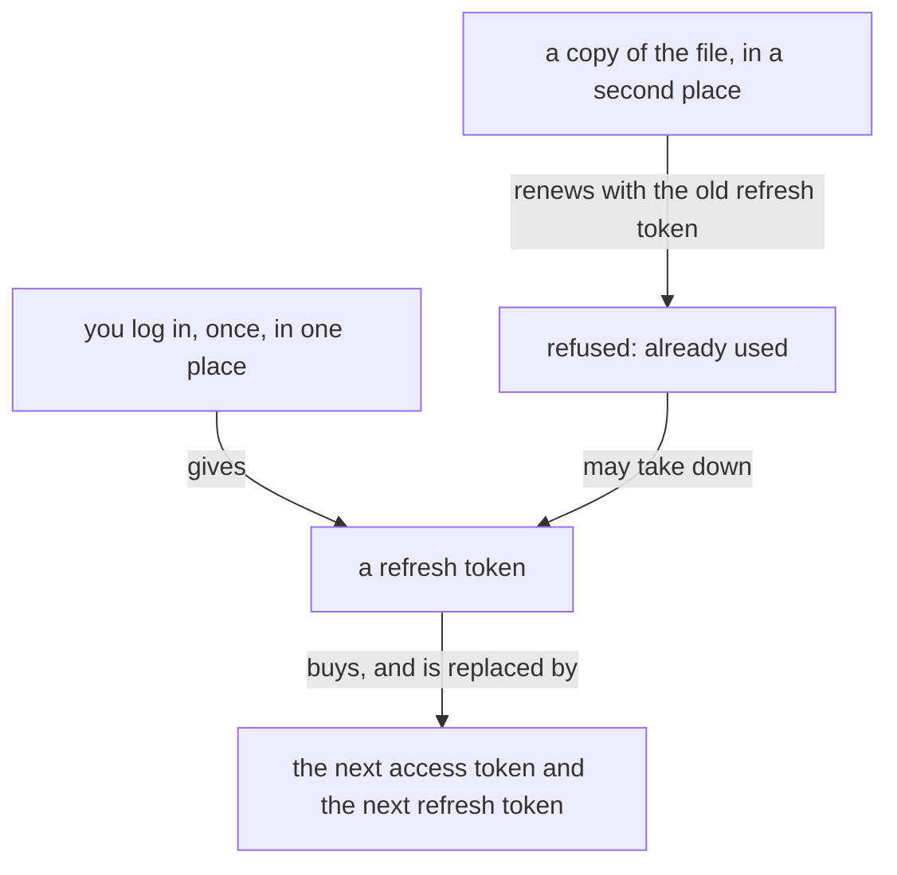

Presentation.{ «Logins that travel and renew» Account }

# Logins that travel and renew

Created by Fable 5.2; Opus directed the study, and Sonnet readers gathered the vendor pages and the dates on your machine. No token value was read.

A login cannot be copied: both vendors replace the renewing token each time it is used, so a copy kills its twin. Our own capsule has been doing exactly that to Codex. What travels is the account: each place logs in once for itself, and then renews on its own. A login with nobody involved, ever, is not on offer within the terms; what is on offer is one tap on your phone, rarely.

## How a login works

A login is two tokens. The access token does the work and is short-lived. The refresh token buys the next access token.

| | Claude Code | Codex |
|---|---|---|
| Where | one file in the Claude config directory | one file in the Codex home |
| Access token lives | 8 hours, renewed in place | 10 days, renewed in place at about 8 |
| Refresh token | has a fixed end, about a month after login | single-use: every renewal replaces it |
| When it dies | you log in again | you log in again |

Your Claude login ends on 26 November; Claude warns three days before. It logged you out on 20, 27 and 28 October.

## What went wrong with Codex

From 5 to 30 October Codex logged about ten thousand "refresh token was already used" errors a day. That is one refresh token being renewed in two places. The Flow capsule copies the Codex login file into each capsule, which is that pattern, and the vision asks for it: the capsule is described as copying the credential files. OpenAI's own rule is one login file per machine, never shared.

Nothing in our system renews or watches a login today. The Flow Nexus, the Energy Nexus and the harness reader all read the tokens and none acts when one is about to die.

## What the vendors offer

- **Claude, for unattended work:** a setup token, made once with the official command. It lasts a year, only makes model requests, and has no refresh token, so nothing can race it. Some users report it refused; untested here.
- **Codex, with no browser on the machine:** a device-code login. The machine shows a code, you approve it on your phone.
- **Several accounts:** one config directory per account, for both. This is how others rotate.
- **Several machines on one subscription:** neither vendor says anything. A separate login per machine is what the evidence supports.

## Steve Yegge's rotation

He holds over twenty Max accounts, each his own, each logged in once into its own directory, and his harness starts each agent in an account with room left, moving on when one nears its limit. The tools that do this read the usage the vendor already reports. He does not describe automatic logins, and nothing I found shows one that is safe: driving the login page by script is what gets an account flagged. Holding several accounts is allowed by Anthropic's reported statement; a large pool rotated by machine is a grey area under both terms.

## Solutions, in the order I would build them

1. **Stop the copy.** A capsule on the same machine uses the machine's Codex login in place, one file, and never a copy. This ends the October failure.
2. **Watch every login.** The system knows each login's end date and notices a refused renewal as it happens, and tells you on your phone before work stops, with the link or code to approve. A dead login costs you one tap, away from home.
3. **A setup token for Claude flows.** One year, no renewal, tried first on one cheap flow. Your interactive login stays for the things the setup token cannot do.
4. **A second machine logs in for itself.** Moving your flows moves the work, the transcripts and workspaces; the target machine has its own login for each account, made once.
5. **Rotation, when you hold more than one account.** Each account is a directory; the Flow Nexus starts a flow in the account with room, from the usage the Energy Nexus already reads.

### Proposal 1: A login belongs to its place · psyche-belief › vision/flow-nexus.md

::: comment
The line the capsule follows today, and the lines that would replace the copy. The types for watching a login come as their own proposal once you have ruled on this direction.
:::

- The Capsule is the component that makes where a flow runs. Its first embodiment is the semi-sandbox: only the credential files are copied, everything else is recreated, with its own sockets and store, running light models.
+ The Capsule is the component that makes where a flow runs. Its first embodiment is the semi-sandbox: the machine's logins are used in place, everything else is recreated, with its own sockets and store, running light models.

+ A login belongs to the place it was made in: one account, on one machine, in one directory. It is used there by every flow of that machine and is never copied; another machine logs in for itself. A flow moves between machines as its work, and finds the login of the machine it arrives on.

+ The Flow Nexus knows when each login ends and hears a renewal refused. It tells the living before the work stops, with what he needs to approve the login from where he is.
