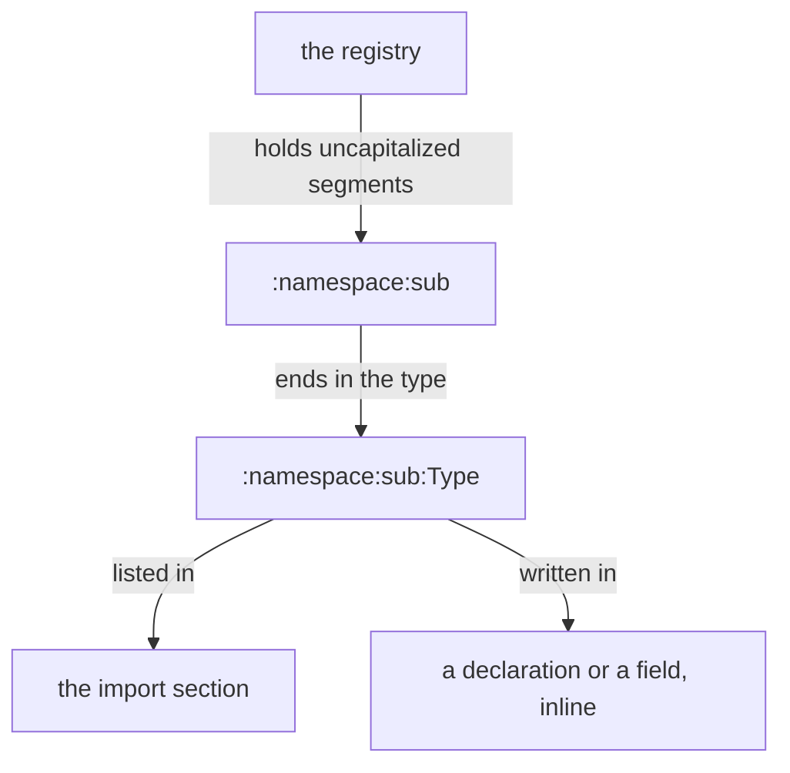
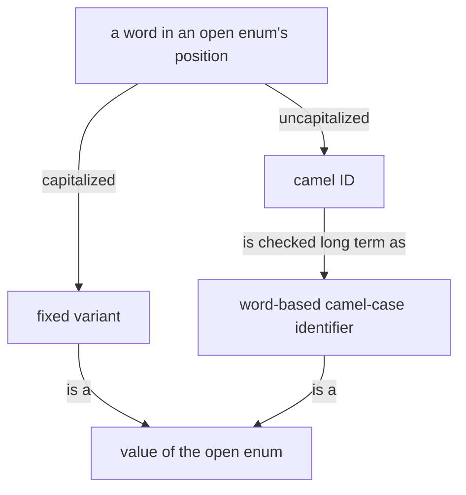
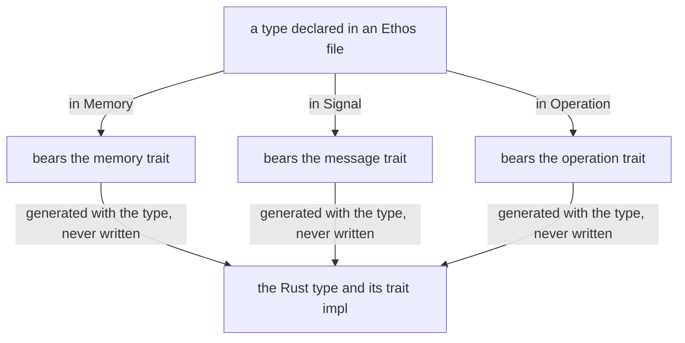
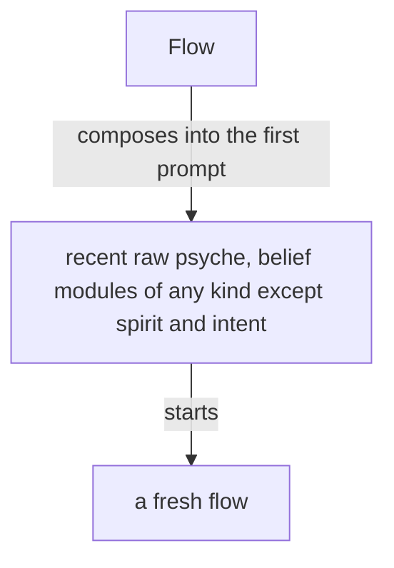

# Slash-and-burn sweep, vision modules (set b)

Counts are statements (paragraphs, list items, code blocks) kept vs candidates. Harm: 3 = misbehaves toward the owner, 2 = wastes machine work or confuses, 1 = dead weight.

## deployment.md

5 statements: 2 kept, 3 candidates.

> Zeus is a stable node; testing happens on test nodes.

- too specific: names a node; the common-sense part is "test off the stable thing". Harm 2.

> Every build, test and compile runs through Nix on Prometheus, the remote builder; the laptop never runs the Rust compiler. Work that cannot go through Nix moves its files to Prometheus and runs there.

- too specific: a host name and a hard rule on which machine runs what, which a flow follows blindly. Harm 3.

> A thing tested outside declarative deployment is called by its full store path; the environment, PATH, links and session files, is changed only by a declared activation, never by hand.

- procedure: per-tool mechanic (store paths, PATH) that belongs in the Nix workflow skill. Harm 2.

## design.md

1 statement: 1 kept, 0 candidates.

## ethos.md

About 62 statements (prose, code blocks, figures): 43 kept, 19 candidates.

> Ethos and Nexus are basic infrastructure: the wood houses are built from. Chronos is the example project built with them, short term.

- too specific: one-off project mention that goes stale. Harm 1.

```
┌──────────────────────────────────────────┐
│ vision-ethos                             │
│                                          │
│  what ethos is · its layout              │
│  its two anatomies: types and traits     │
│                                          │
│  ┌────────────────────────────────────┐  │
│  │ the ethos of ethos                 │  │
│  │ the types an ethos file is made of │  │
│  │ the first golden ethos             │  │
│  └────────────────────────────────────┘  │
└───────────────────┬──────────────────────┘
                    │ example
                    ▼
        ┌───────────────────────┐
        │ vision-flow-ethos     │
        │ the Flow Nexus, in    │
        │ ethos; its own skill  │
        └───────────────────────┘
```

- too specific: a map of which module lives where, not a belief about ethos. Harm 1.

> The anatomy of ethos lives in vision-ethos itself, as
> the first golden ethos; Flow's ethos is one example,
> in its own skill.

- duplicate: restates the diagram above it; module placement is bookkeeping. Harm 1.

> For now, Library, Signal, Operation, Memory. A version lives in a manifest.
> Signal's sections are queries and responses, since there is
> communication; Memory's are record types, the rest to be decided.
> Signal gives a Nexus its main types and Memory its database types.

- duplicate: the next paragraph ("Four roots: ...") says the roots again; the manifest line is repeated under Declaration: File. Harm 1.



- duplicate: figure repeats the import paragraphs above it. Harm 1.

```
GenerationFailure.SyntaxError.[ /abs/orchestrate.ethos ]     ; the datom
```

- too specific: a datom value carrying a particular file path; the type example above already shows the idea. Harm 1.



- duplicate: figure restates the open-enum paragraph above it. Harm 1.

> An open enum is an Ethos object whose capitalized words are its fixed variants. A word that is not capitalized is its implied extensible variant, a camel ID: a word-based camel-case identifier, written bare, with no variant head before it. The name camel ID is temporary. A check that a word is a word-based camel-case identifier comes long term; short term, none is made.

- stale: "the name is temporary" and "short term, none is made" are status notes about an unfinished check. Harm 1.

> A generated signal library bears `Datomizable` and `Compositional`
> conditionally, under a feature the CLI and client enable and the Nexus
> does not. The Nexus compiles the same types without any
> textualization capability and without datom-codec as a dependency.

- too specific: Cargo feature mechanics. Harm 2.

```toml
# the CLI's manifest
signal-orchestrate = { version = "…", features = ["datom"] }
# the Nexus's manifest
signal-orchestrate = { version = "…" }
```

- too specific: a Cargo manifest invocation, per-tool mechanics. Harm 2.



- duplicate: figure restates the paragraph above it. Harm 1.

> The memory trait is Memorizable.

- too specific: a trait name stated bare, with a one-line Rust block `impl Memorizable for Flow { /* generated */ }` after it. Harm 1.

> An example shows the Ethos file and the Rust it generates as two blocks, each named for what it is: the Ethos, then the Rust generated from it. They never share one block, because they never share one file.

- procedure: a rule for how books lay out examples; belongs in the book-making skill (vision-proposal). Harm 2.

> Everything is a type, positioned. A type used once is declared inline where it is used; a type used in more than one place is declared once and named. A variant's payload is written in the variant and bears the variant's name. Inline nesting goes about three deep; past that, the type comes from a Library.

- too specific: "about three deep" is an arbitrary figure inside an otherwise sound paragraph. Harm 1.

> Ethos expands vertically: a structure with more than one element opens on its line and its elements hang beneath the first, aligned; the closing delimiter ends the last element's line. Everything that has a next layer opens it on a new line.

- procedure: formatting layout that a printer enforces; belongs in the tool. Harm 1.

> Ethos carries a comment on every section and on every line that has a next layer, saying in plain words what the machine reads there; a comment runs from ; to the end of the line.

- procedure: comment-placement rule; the generated printer or a check holds it. Harm 1.

> Ethos Zero was first named Ethos Monolith; the two are the same thing.
> Zero as in version 0: no daemon yet, no Nexus. The ethos repository is
> for the ethos nexus that follows.

- stale: naming history of a retired name (see also the vision-archive-ethos-monolith module). Harm 2.

> By request to ethos-zero, which is not a daemon, hence its name; committed, held fresh by a test.

- procedure: how generation is invoked and kept fresh. Harm 2.

```
ethos-zero 'Generate.{ /abs/orchestrate.ethos /abs/out }'
```

- too specific: a tool invocation with literal paths. Harm 2.

## flow.md

About 55 statements (paragraphs, figures): 26 kept, 29 candidates.

> The Capsule is the component that makes where a flow runs. Its first embodiment is the semi-sandbox: only the credential files are copied, everything else is recreated, with its own sockets and store, running light models. Later it encrypts the sensitive parts of the filesystem under a volatile key.

- too specific: implementation detail of one embodiment and a future one. Harm 1.

> Herdr is one backend of the Capsule, the component that gives a flow its place to run; the backend may be exchanged.

- duplicate: "Herdr holds the panes" and vision-messaging both say what Herdr is. Harm 1.

> Psyche, Mind and Field have similar payloads, and they go under one: the metaflow, whose aspect is Psyche, Mind or Field.

- too specific: a type-merging note about payloads; reads as a code note. Harm 1.

> A topic's name is a camelCase identifier, uncapitalized. Short term, it is kept exactly as written: Flow refuses a name that is not one and never lowers its capitals, so primaryCommitting stays primaryCommitting. A flow's id is the hash of the harness's session id, kept to six characters and lengthened when two collide, so a transcript is found from the flow id. The flow id stays the hash; its word form waits for a later version. Long term, the flow id is also written in three words, which convert back to the hash. Where the harness lets Flow choose the session id, Flow chooses it before the flow starts and the flow reads it in its prompt; where the harness assigns it, Flow learns it when the flow binds. Every call to Flow is identified by the calling process. Anybody may call Flow, a flow for its own refresh among them: because the CLI checks the calling process, a flow refreshes itself safely.

- too specific: id hashing, six characters, session-id binding, caller checks, all machine detail in one paragraph. Harm 2.

> A request reaching a metaflow is one of a closed set of types, each with its waking effect: an order, a question, the living's words, a result, a notice. Message asks Flow to send a request to a metaflow; Flow owns the lock and the delivery, answers sent or queued, and Message subscribes to Flow's events, learning when a request has entered the flow's context. A metaflow asleep is woken by an order, a question or the living's words and receives its whole queue, oldest first, in the first prompt, a result or a notice waiting there until a waking; a metaflow under refresh or waking queues what arrives until its successor or woken seat has started, while Flow keeps serving every other request. A metaflow a request needs is started whether or not it is running; with no working transcript to reawaken, it is fed the metaflow's belief modules and the prompt it is to get now.

- procedure: delivery and queueing mechanics, duplicate of vision-messaging. Harm 2.

> What has been queued for an idle metaflow, the vision touching its topic among it, is injected with the request that wakes it, so the flow knows it as soon as it wakes.
> A metaflow wakes when a request needs it; what touches its topic queues until then.

- duplicate: the same wake-and-queue rule as the paragraph above. Harm 1.

> Flow exposes everything from the harness, the bare input: a flow is started, stopped and sent a message through Flow, and Message makes use of it. Message is the send path: a flow asks Message to send, Message asks Flow to deliver and subscribes to Flow's events.

- duplicate: Message-asks-Flow stated two paragraphs earlier. Harm 1.

> A flow gives a presentation, a response that could fit into a book, whenever it is given significant new context to consider: its first turn ends in one, and so does every task, goal or question that originates in the living. A message from another flow that only updates it is answered with a short note. A presentation takes its form from the belief modules the flow was loaded with and from its prompt, the one string given to that flow alone, which is no belief module.

- not common sense: an arbitrary output rule ("first turn ends in a presentation") that makes flows produce book-shaped answers unasked and spend the owner's attention. Harm 3.

> A layer is Primary, Secondary, Tertiary or Quaternary, in every aspect; the layer decides the model. A launch names the metaflow, the belief modules composed into its prompts, and a brief of a small paragraph; the Nexus composes the prompt from its module registry.

- procedure: launch-record shape; belongs in the Flow tool and its ethos. Harm 1.

> A fresh flow's first prompt carries the raw psyche relevant to it and recent, together with the belief modules relevant to it, of any kind except spirit and intent, which sit in the system prompt.

- procedure: prompt-assembly rule that the Flow code does. Harm 2.



- duplicate: figure repeats the paragraph above. Harm 1.

> A fresh flow starts with every belief module its metaflow is bound to, all loaded at its start: much of it in its system prompt, the rest in its first prompt, or in as many prompts as it takes, sent one right after another, so that its start is one model call.

- procedure: prompt-assembly mechanics. Harm 2.

> Short term, the Secondary starts first, then its Primary.

- procedure: startup order, marked short term. Harm 1.

> To the Nexus, a module's location is its registry entry.

- too specific: implementation fact with no behaviour to guide. Harm 1.

> The system prompt is composed of modules of several types, and what a harness calls a skill overlaps with them.
> Its anatomy is drawn up in ethos from a study of system prompts of every kind, each line placed by what it is and by the kind of guidance it belongs to.
> Where the harness allows it, a part of a main flow's system prompt is the main flow's alone and is not passed down to its subagents.

- procedure: how prompts are assembled and what is inherited; belongs in the Flow and harness knowledge modules. Harm 2.

> Who speaks to whom, within an aspect and across aspects at the same layer in a shared topic, is the vision-aspects skill's. Flow refuses a request that leaves those routes.

- duplicate: routing is vision-aspects and vision-model-roles territory. Harm 1.

> A request that Flow holds or refuses reaches its recipient by the Herdr fallback the same minute, as vision:messaging gives it.

- procedure: a delivery fallback with a time limit ("the same minute"); duplicate of vision-messaging "When Flow holds a delivery". Harm 3.

> Long term, every module composed into a prompt is checked against its source by its hash, once hashes update efficiently as edits are made; short term, no check is made.

- stale: a status note about a check that does not exist. Harm 1.

> Reaping belongs to the refresh event. A refreshed flow
> takes the replaced end out of receiving messages, so only live ends stay
> registered and addressable.

- procedure: refresh bookkeeping inside Flow's code. Harm 1.

> Every harness event reaches Flow through the harness's hooks calling the Flow CLI, so Flow knows each flow's state as it changes; a marked block landing in a transcript becomes an action, a book among them; a flow past its context threshold is refreshed as it goes idle. A poller that must exist is registered and reported.

- procedure: hook plumbing. Harm 2.

> A flow is refreshed when its context passes its model's threshold: Flow keeps the metaflow's next messages for its next flow, and the flow is replaced as it goes idle; while the refresh runs the metaflow is locked, and the predecessor is reaped in the same event. Each model's threshold is configured in Flow; an OpenAI model's is lower than a Claude model's.

- procedure: refresh mechanics, partly repeated by "What a refresh carries" and the reaping paragraph. Harm 2.

> An ephemeral flow is a continuous job flow that does not wake back up: it takes jobs while it runs, up to a ceiling on its context, and past the ceiling it is given no new job and another ephemeral flow takes it. With Claude the ceiling is 300,000 tokens, and the flow is wound down at 250,000.

- too specific: token ceilings that differ by model and age. Harm 2.

> Herdr is the third-party terminal workspace every flow runs in, one pane per flow. Flow starts a flow in a pane of its own, names a sender by the pane it runs in, and delivers an abrupt message by typing it into the recipient's pane. Herdr is used as it is.

- too specific: one backend's per-tool mechanics; contradicts "the backend may be exchanged" stated earlier. Harm 2.

> A build of Flow is tested in a testing capsule of its own: its own Herdr pane and session, the testing store, built in Nix. In it, several cheap, low-effort Codex and Claude flows message one another and start flows. The test shows whether the prompts, the system prompts and the tools are right, and which features are missing. Its findings return to the reimplementation, which is tested again.

- procedure: a test plan; belongs in a testing role or the Flow repository. Harm 2.

> The stable Flow keeps running while variants are tested.

- duplicate: vision-deployment "A working stack is maintained beside development". Harm 1.

> The heartbeat reminds every flow it reaches to judge its own sanity, by these signs: an echo chamber, where the same question or claim goes round between flows and comes back; jargon and nonsense increasing; an acknowledgement answering an acknowledgement. The counts the heartbeat carries, awake metaflows, working panes, messages sent and queue growth per metaflow, are evidence under the reminder; the judgment is the flow's.

- procedure: contents of a reminder produced by code; the sanity signs are the prompt's own text, not belief. Harm 2.

> The number of running flows is kept low: a topic flow no longer used is retired.

- duplicate: "A superseded flow is closed". Harm 1.

> A flow can be restarted without being woken: its harness closes, its transcript stays, and its successor runs when a message wakes it. A flow can also restart itself. A restart meant to leave the flow asleep is done from outside; what arrives queues for its successor.

- procedure: restart mechanics, repeats "A metaflow sleeps so that ...". Harm 2.

> A refresh carries the flow's important presentations and illustrations, the raw psyche given to it, and the basic skills. The basic skills are everything a flow needs.

- procedure: refresh payload list; "important" is undefined and the last sentence is circular. Harm 2.

## git-server.md

2 statements: 0 kept, 2 candidates.

> The cluster runs its own Git server on the node whose cluster data gives it the GitServer role. It serves thinking machines: it accepts the SSH keys the cluster data holds, carries no web interface, and mirrors every repository to GitHub as a backup. Gitolite serves it, with every key and every access rule declared from the cluster data.

- too specific: a deployment description (Gitolite, SSH keys, GitHub mirror) that lives in the cluster configuration, not in belief. Harm 2.

> d68c82 git

- too specific: a bare record id with no meaning to a flow. Harm 1.

## high-level-view.md

5 statements: 3 kept, 2 candidates.

> A high-level view takes room and breaks everything down in-line.

- procedure: a formatting rule for one kind of document. Harm 1.

> - a more complete and reliable Ethos and Datom;
> - reliable flow spawning and communication: transcripts scanned by hooks with programmatic reactions, and flows that are truly lean;
> - real-time communication with the living, and better, a functioning interface, Unity, over Mentci;
> - Sema, the rich-expression dialect of protos;
> - paralinguistic speech-to-text, on Android and iOS.

- stale: a roadmap list of named products (Unity, Mentci, Android and iOS) that ages and is held elsewhere. Harm 1.

## horizon.md

3 statements: 2 kept, 1 candidate.

> A virtual machine runs on a node, and sandboxing is a feature a node
> has. Which node has it is known by querying Horizon. Prometheus is
> mostly the workhorse. Allocating resources is not easy and is not yet
> designed.

- too specific: "Prometheus is mostly the workhorse" is a host name and a passing remark; "not easy and not yet designed" is a status note. Harm 1.

## memory.md

2 statements: 2 kept, 0 candidates. (The Memory code block illustrates an Ethos root the owner designs; keep.)

## messaging.md

10 statements: 4 kept, 6 candidates.

> Hard abrupt on Codex is one Escape, and the prompt submits itself. Hard
> abrupt on Claude is two Escapes — the first is taken by the input editor in
> vim mode and never reaches the harness — then the prompt, then an explicit
> Enter, because after an interrupt the prompt is placed in the composer
> without being submitted. Middle abrupt is the terminal prompt, which a
> Claude recipient receives at its next tool boundary. Soft waits for the
> recipient to finish.

- too specific: keystrokes and per-harness mechanics; a flow carrying it may replay the keystrokes by hand. Harm 3.

> A request to deliver a recipient's queue delivers every queued message, or nothing when none is queued.

- procedure: behaviour of a Flow request, which the tool states. Harm 1.

> A hash or an identifier in a message is its first six characters.

- not common sense: an arbitrary length rule. Harm 2.

> A message between flows says what the sender intends to do and what it has done.

- duplicate: "A message carries what its reader acts on: what the sender intends, or what it has done." Harm 1.

> A messaging test sends one message, to a flow that needs it anyway or to a Quaternary started for it and stopped after.

- procedure: a test recipe; belongs in the testing role. Harm 2.

> When Flow holds a delivery, the sender falls back to direct Herdr messaging: it finds the recipient's pane in the pane list, sends the text with the first words naming the sender, then Enter. The fallback changes the carrier and keeps the address: a message for a Primary goes to its Secondary's pane, by Flow or by Herdr alike.

- procedure: a per-tool manual fallback (panes, Enter); duplicate of flow.md "A request that Flow holds or refuses ...". Harm 3.

## meaning.md

9 statements: 6 kept, 3 candidates.

> The roots of the ontology are the seven Vaiśeṣika categories, and
> its verbs follow the Aṣṭādhyāyī of Pāṇini, which an earlier ruling
> makes the base for how the system thinks, communicates, and
> classifies things in the world (flow 5851f4). How the two divide
> beyond that is not yet ruled.

- too specific: a flow id citation and a count ("seven") for a base still unruled. Harm 1.

> A layer added to a meaning is a layer of annotation on it: a comment
> on the first layer of meaning, which can itself be commented on or
> linked to something else. It can expand recursively without limit,
> but in practice it settles at three or four layers. A statement has
> subparts, and each subpart can carry an annotation of its own, on
> that specific piece of the data.

- too specific: "three or four layers" is an observation presented as a rule. Harm 1.

> A piece that is linked to is kept by virtue of the link, and released
> when the last link to it goes, the way Nix keeps a store path while
> something still references it. What must be kept is at least the part
> that was checksummed in; the rest may go when nothing links to it.
> This is how history kept writings such as those of Heraclitus:
> through the annotations and references other authors made to them.

- too specific: Nix and Heraclitus are illustrations, not beliefs; a reader acts on the first sentence alone. Harm 1.

## model-roles.md

13 statements: 3 kept, 10 candidates.

> | Layer | Claude (Psyche) | OpenAI (Mind, Field) |
> |---|---|---|
> | Primary | Fable | Astra |
> | Secondary | Opus | Sol |
> | Tertiary | Sonnet | Luna |
> | Quaternary | Haiku | Luna, low effort |

- stale: model names age and the module says one skill maps layer to model; a duplicate of that skill. Harm 2.

> Every layer launches the lowest layer that does the job, its own layer
> rarely, and a Primary never: a Quaternary launches Quaternaries; a
> Tertiary launches Tertiaries and Quaternaries; a Secondary launches
> Tertiaries and Quaternaries; a Primary launches Secondaries and
> Tertiaries, and Quaternaries for small jobs.

- too specific: an enumerated matrix after the principle ("the lowest layer that does the job") already says it. Harm 2.

> The one difference between the two sides: Opus stands in for Fable;
> Sol stands in for nothing, since it designs nothing.

- too specific: model names tied to a stand-in rule. Harm 1.

> The model is declared once, as typed configuration in Flow, mutated only
> through the meta wire. Skill variables carry that value by name into every
> skill, launcher and brief. Nothing else holds a model name, so a launcher
> never writes one by hand and no flow is started in a metaflow by accident.

- procedure: configuration plumbing. Harm 2.

> Every native main session is titled `{ <Aspect> <Topic> <Layer> <FLOW_ID> }`.
> The layer selects the configured model through the table above, so the
> title names the layer, never the model.

- too specific: a title format. Harm 2.

> A message never crosses aspect and layer at once; it goes across at its own layer, or up or down within its aspect, and the flow it reaches carries it on.

- duplicate: routing belongs to vision-aspects and flow.md. Harm 2.

> Aspect, topic, layer, exact model identifier, Flow ID, and native binding
> remain separate typed facts. The title grants none of the identity,
> authority, availability, or routing those facts establish.

- procedure: data-model note about code. Harm 1.

> Horizontal routing selects the unique eligible cell in the target aspect at
> the sender's layer.
> Busy is still
> eligible.
> Multiple bindings for one cell are an unresolved conflict, never fanout.
> Resolve the binding
> immediately before each attempt.

- procedure: routing algorithm; belongs in Flow's code. Harm 3.

> A Secondary passes every design decision through its own Primary and acts on the Primary's decision. A Secondary uses its Primary freely.

- not common sense: a blanket rule, in tension with "The living's attention is a thousand times dearer" and with the Primary being "the costly layer". Harm 2.

> A Primary is reached through its Secondary for a question, a design or a judgment; the core Primary of an aspect reaches a topic Primary of its aspect directly when it helps a design while the living is talking to it. When no Secondary is live, the flow that needs the Primary starts one. When one cannot be started and something depends on the Primary being reached, the flow messages the Primary itself and says in that message that the Secondary route failed and why. This is practice held in belief; no code enforces it.

- procedure: a multi-step contact route ending in its own admission that nothing enforces it. Harm 3.

## nexus.md

About 40 statements (prose, code blocks): 23 kept, 17 candidates.

> A Nexus is the whole long-running component: the process, its sockets, and the signal contracts it is compiled with. Nexus is its name. A Nexus is like a daemon, said only so that a thinking machine which thinks in daemons understands what a Nexus is. Every Nexus is named component-nexus — orchestrate-nexus, ethos-nexus — and in everyday speech orchestrate-nexus is called orchestrate.

- too specific: naming convention and an everyday-speech note. Harm 1.

> Every method lives in a trait; an inherent method is a trait not yet extracted. The traits and types of a Nexus are one ontology designed before any body is written; defaults wherever expressible, through rich sub-trait chains. Traits live on data-bearing types; a zero-sized type with behaviour is a namespace pretending. Identity is trait-borne: an encoded form fingerprints itself, by default the hash of its rkyv archive, and every reference names its target by that name. `fn main()` is the only free function; a missing owner is a missing type.

- too specific: rkyv hashing and the `fn main()` rule are code-level detail; the paragraph duplicates intent-mandatory-traits. Harm 2.

> An object enters a Nexus for the effect; the response follows as an
> effect of it. Conversion is the wrong frame for it. The name is open,
> Apply liked.

- stale: an open naming question left in belief. Harm 1.

> For now, the nexus and memory documents are undesigned; when they are
> designed they live in the Nexus's main repository.

- stale: a status note about documents that do not exist. Harm 1.

> A client is a separate program from the Nexus. For now the default
> clients are packaged with the Nexus as separate crates of its
> repository, which is a multi-crate repository: one datom-converting
> CLI per socket, however many sockets the Nexus has, at least two. A
> default client serves bootstrap first, then debugging and testing,
> long after production has stopped using it. The meta CLI is named
> component-meta.

- too specific: packaging, crate layout and a CLI name. Harm 1.

> A CLI turns text into Signal: it takes one inline datom as its whole input; it identifies the process that called it and carries that identity in the message, so a Nexus knows its caller by the process. A CLI speaks to one Nexus and stays thin; datom and all text handling are compiled out of the Nexus, which decodes only known types in their rkyv form and so stays small, since it keeps running and there may be many.

- too specific: input shape, caller identification and rkyv decoding; duplicate of knowledge-flow-caller. Harm 2.

> Signal is the messaging layer and the wire's only traffic: an rkyv binary archive, typed, validated on receive, length-prefixed on the socket. Every reply is typed, refusals included: errors are vocabulary. The wire vocabulary's version is its contract crate's semver.

- too specific: wire encoding details (rkyv, length prefix, semver). Harm 2.

> Signals cross the network through a router. The router tells signal
> types apart by an enum that wraps the objects, held in the signal
> repository, which every component depends on. That repository also
> holds what every signal needs in common — the handshake payload
> among it.

- too specific: router and repository internals. Harm 2.

> For now, a Nexus starts with no arguments and there is no bootstrap
> binary. Its executable holds a default configuration as a constant. On
> start it looks for its memory at the default location: a memory that
> exists holds the configuration; a memory created new is seeded with the
> defaults. The meta socket carries a Configure interface, and changed
> values are accepted through it.

- procedure: startup sequence. Harm 2.

> A Nexus keeps a standard metadata tree. In it a type records whether
> the meta Configure was ever done; that record is reversed only on the
> meta socket, and while it is unset Configure is accessible on the
> ordinary socket. The tree holds everything standard about the Nexus:
> its socket paths — its own and those of every edge-socket it connects
> to — and whatever else comes up as standard nexus configuration data.
> The built-in default configuration is independent of this and is
> what gives the socket path on which the Configure signal arrives.

- procedure: first-configuration mechanism; machine detail. Harm 2.

> A component has three repositories: its main repository, holding all
> its code, and two signal repositories — one for the ordinary
> socket's contract, one for the meta socket's. Shared kinds go into
> reusable libraries, which are encouraged.

- too specific: repository layout. Harm 1.

> `<nexus>` is the repository holding the Nexus; `signal-<nexus>` its wire vocabulary; `meta-signal-<nexus>` the owner's vocabulary, always present, since configuration flows through it. The CLI is `<nexus>`.

- too specific: repository names. Harm 1.

> A wire type repository is written in ethos and declares vocabulary only: the frame envelope, the protocol version, a closed enum of operations with their paired replies, the typed payload of each. Operations are verbs, `Submit`; replies the past tense, `Submitted`; rejections name themselves. Storage vocabulary stays inside the Nexus.

- procedure: wire naming and layout conventions. Harm 1.

> A Nexus's vision is split by its code modules.

- not common sense: unmotivated one-liner; unclear what a flow does with it. Harm 1.

> The engine inside a Nexus is driven by Kameo actors. The standards
> of their use are still to be designed. Arc-Mutex is permitted.

- too specific: a library choice and a permission with no reason. Harm 2.

> Each Nexus runs on its own and is recompiled on its own, toward zero-downtime self-update, one problem at a time.

- too specific: build and update mechanics, a goal stated as a rule. Harm 1.

```datom
; 1 Query, typed at the CLI, sent as signal
Launch.{ { Psyche core Primary }
         «Draft the Nexus book» }
; 2 Operation, from Signal's intend
Start.{ { Psyche core Primary }
        { /home/li/primary [] } }
; 3 the Change Operation hands Memory
Flow.{ 7 { Psyche core Primary } Running
       [ Started ] }
; 4 Memory's answer to Operation
Succeeded
; 5 Outcome
Started.7
; 6 Response, from Signal's answer, to the CLI
Launched.7
```

- too specific: a trace that records a particular path (/home/li/primary) and a particular launch; the three Ethos blocks above already show the types. Harm 1.

## nix-builds.md

3 statements: 0 kept, 3 candidates.

> Nix builds live in the remote builder's store. A machine keeps links only to the profiles in use on it. A Nix build worth keeping is listed in one registry profile; every other Nix build is collected by how recently and how often it was used.

- procedure: garbage-collection policy and a store layout; belongs in the Nix workflow skill or the builder configuration. Harm 2.

> Tracking Nix builds is long term.

- stale: a status note with no instruction. Harm 1.

> d68c82 builds

- too specific: a bare record id with no meaning to a flow. Harm 1.
