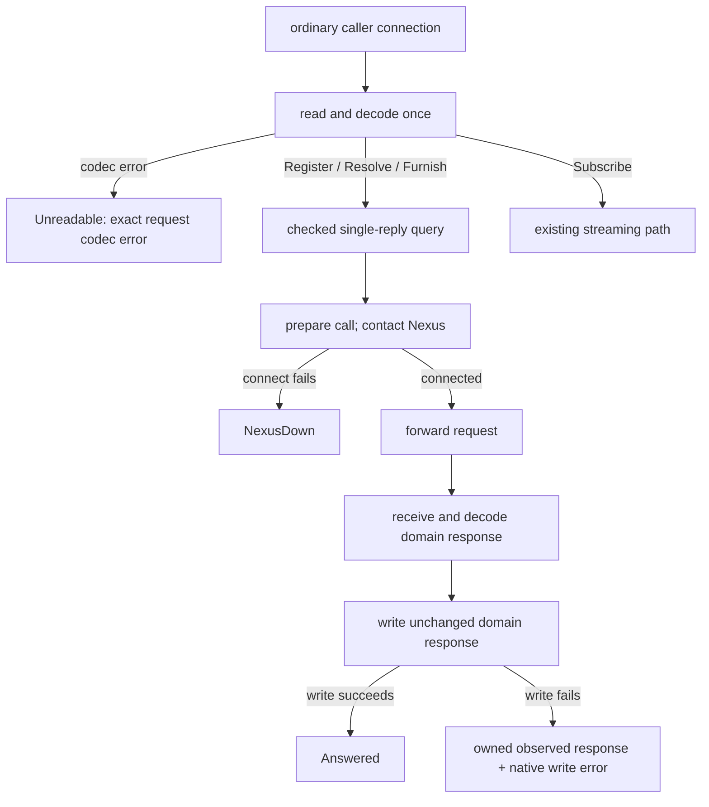

# Ordinary single-reply service evidence
Created by Astra; source retrieval by Luna; boundary verification by Sol.

## Proposed addition — vision:nexus-v1

Insert immediately before the existing translator Ethos example. This clarification is proposed for review.

The following conceptual Ethos names composed single-reply observations at the connection boundary. Each translator declares its executable capability and how request preparation and fallible execution produce those observations. The Belief ordinary single-reply contract separates preparation from checked execution and retains native failure evidence in process.

The exact existing example remains:

```ethos
Library
[ signal:[ Input Output Error ]
  std:[ Connection ] ]
[ Translator.{ NexusSocket.String }   ; the socket of the Nexus it speaks for
  Caller.{ ProcessId.Integer          ; the connection's
           UserId.Integer }           ;   peer credentials
  Call.{ Caller Input }               ; what the translator sends in
  Outcome.[ Answered                  ; one reply written back
            Unreadable.Error          ; the text was not an Input
            NexusDown ] ]
[ Serving.[ serve.{ [ Connection ] [ Outcome ] } ] ]
[ Translator.[ Serving ] ]
```

## Proposed addition — vision:belief-nexus-v1

### The ordinary single-reply boundary

The ordinary translator prepares a request once. Register, Resolve and Furnish enter a checked single-reply capability. Subscribe keeps its existing streaming path. The meta service keeps its existing path, including configuration application and recovery.

Preparation retains the direct request codec's structured error. A valid single-reply request enters execution with its caller connection. Execution returns Answered after the domain reply frame has been written successfully, or NexusDown when connecting to the Nexus fails before forwarding. These are in-process observations. The caller's successful domain datom keeps its existing form.

The composed service's Unreadable observation belongs to request preparation. Checked execution has no unreadable-request branch.



### Conceptual observations and the executable capability

The Belief ordinary single-reply service realizes the conceptual connection-level observations through one preparation boundary followed by checked execution. Its executable capability takes a checked request and connection, rather than the conceptual example's bare Connection; it returns a fallible SingleReplyOutcome rather than the composed Outcome. Preparation contributes Unreadable; checked execution contributes Answered or NexusDown.

`Unreadable.Error` corresponds exactly to the direct `datom_codec::Error`. The decoder preserves that value rather than converting it to a diagnostic string. This executable contract belongs to the Belief Nexus; the general example remains conceptual under the proposed clarification above.

### Proposed authored Rust — in-process types

This is author-written Rust, not generated Rust. Ethos lowering for these generic/native-error shapes is unverified; no new Ethos spelling is asserted.

The native leaves retain their dependency-owned types: `datom_codec::Error`, `signal::FrameError`, `rkyv::rancor::Error`, `std::io::Error`, `std::string::FromUtf8Error`, and the existing local `TranslatorError`. These values remain in process; this contract adds no serialization requirement to them.

```rust
use std::io;
use std::os::unix::net::UnixStream;
use std::string::FromUtf8Error;
use signal::FrameError;
use signal_belief_nexus as public;

// Existing local diagnostic type, retained rather than redesigned.
#[derive(Debug)]
pub enum TranslatorError {
    Text(String),
    Signal(String),
    Peer(String),
    Configuration(String),
    Io(io::Error),
}

// Observations of preparation composed with single-reply execution.
pub enum Outcome {
    Answered,
    Unreadable(datom_codec::Error),
    NexusDown,
}

// A decoded, checked request can produce only these successful observations.
pub enum SingleReplyOutcome {
    Answered,
    NexusDown,
}

impl From<SingleReplyOutcome> for Outcome {
    fn from(value: SingleReplyOutcome) -> Self {
        match value {
            SingleReplyOutcome::Answered => Self::Answered,
            SingleReplyOutcome::NexusDown => Self::NexusDown,
        }
    }
}

pub enum PreparationFailure {
    RequestFrame(FrameError),
    RequestText(FromUtf8Error),
    Precondition(TranslatorError),
}

pub enum BeforeForwardFailure {
    Precondition(TranslatorError),
    Archive(rkyv::rancor::Error),
    NexusSetup(io::Error),
}

pub enum ReplyFailure {
    Frame(FrameError),
    Decode(rkyv::rancor::Error),
}

pub struct ResponseWriteFailure<Response> {
    pub response: Response,
    pub error: FrameError,
}

pub enum SingleReplyFailure<Response> {
    BeforeForward(BeforeForwardFailure),
    Forwarding(FrameError),
    Awaiting(ReplyFailure),
    ResponseWriteFailure(ResponseWriteFailure<Response>),
}
```

PreparationFailure records a failure before a checked query exists. Its Precondition retains existing preparation configuration errors. BeforeForward records that this checked call's request has not been forwarded to the Nexus. It makes no claim that the process performed no local work: preparation, peer/configuration checks, archiving and socket setup remain their own acts. NexusSetup is configuration of an already-connected socket; a failed Nexus connection produces NexusDown instead.

Forwarding records a failed request write, which may have been partial. Awaiting records a failed response read or typed restoration after forwarding, when the requested effect may already have occurred. ResponseWriteFailure moves the observed typed domain response into the failure together with the native caller-write error. That response records the Nexus's answer; it does not assert caller delivery or retry safety.

A frame error or invalid UTF-8 is transport evidence, distinct from a malformed Datom. The request-codec error is carried intact. Native archive/restoration errors remain native errors.

### Proposed authored Rust — preparation and routing

`SingleReplyQuery` owns the original domain query. Its private field is constructed only by the exhaustive route match below; Subscribe has its own route. The four existing ordinary query variants are Register, Resolve, Furnish and Subscribe.

```rust
pub struct SingleReplyQuery {
    query: public::Query,
}

pub enum PreparedOrdinary {
    SingleReply(SingleReplyQuery),
    Subscribe,
    Unreadable(datom_codec::Error),
}

impl From<public::Query> for PreparedOrdinary {
    fn from(query: public::Query) -> Self {
        match query {
            query @ public::Query::Register(_)
            | query @ public::Query::Resolve(_)
            | query @ public::Query::Furnish(_) =>
                Self::SingleReply(SingleReplyQuery { query }),
            public::Query::Subscribe => Self::Subscribe,
        }
    }
}


pub trait OrdinaryPreparing {
    fn prepare(
        &self,
        connection: &mut UnixStream,
    ) -> Result<PreparedOrdinary, PreparationFailure>;
}

pub trait SingleReplyServing {
    type Response;

    fn serve(
        &self,
        request: SingleReplyQuery,
        connection: &mut UnixStream,
    ) -> Result<SingleReplyOutcome, SingleReplyFailure<Self::Response>>;
}
```

The ordinary decoder/router site becomes the typed preparation boundary. Its decoder preserves the direct codec error instead of converting it into the existing Text diagnostic; the request is still decoded once. The proposed unreadable branch supplies `Outcome::Unreadable(error)` by moving the exact error. Its unary branch invokes SingleReplyServing and maps the returned SingleReplyOutcome into Outcome. A preparation failure remains PreparationFailure evidence. RequestFrame and RequestText are preparation-only cases; checked unary execution has neither variant. Its Subscribe branch invokes the existing stream path with its existing return semantics. These are separate branches, not a common session-completion wrapper.

The unary capability owns peer/precondition checks, call archiving, Nexus contact and setup, request forwarding, response restoration and caller response writing. The response type stays associated with the capability; ResponseWriteFailure stores that same type. Domain refusals are domain responses, so successfully writing one produces Answered.

The existing meta path is outside this capability. Its post-response apply/restore sequence and nested Nexus call retain their own design boundary.

### Existing native evidence shapes

The direct request codec's error structure is retained whole. These are dependency declarations shown for correspondence, not newly authored replacements.

```rust
// datom_codec
pub type Integer = i64;
pub type Path = Vec<Integer>;
pub enum ErrorLayer { Protos, Datom, Composition }
pub struct Error {
    pub layer: ErrorLayer,
    pub path: Path,
    pub kind: ErrorKind,
}
pub enum ErrorKind {
    Budget,
    Structural(protos::Error),
    Form { expected: String, found: String },
    Arity { expected: Integer, found: Integer },
    Value { expected: String, value: String },
    Variant { expected: String, found: String },
}
```

```rust
// protos
pub struct Extent { pub start: usize, pub end: usize }
pub struct Error { pub extent: Extent, pub problem: Problem }
pub enum Problem {
    Empty, Multiple, Unclosed(char), Unexpected(char),
    MissingHead, MissingBody, Budget, Depth,
}
```

```rust
// signal
pub enum FrameError {
    Io(std::io::Error),
    BodyTooLarge { found: usize, capacity: usize },
}
```

The standard-library I/O and UTF-8 errors and the rkyv native error remain opaque dependency-owned evidence. This proposal specifies their placement and ownership, not their private representation.

### Existing ordinary domain contract

The domain vocabulary is retained. This is its existing Ethos, including the declarations needed by Query and Response. The proposed service types above use the compiled ordinary contract as `public`.

```ethos
Library
[]                                      ; imports
[ UserId.Integer                        ; types: authenticated identity
  GroupId.Integer
  ProcessId.Integer
  Caller.{ ProcessId UserId }            ; caller credentials
  PeerIdentity.{ UserId ProcessId }      ; peer binding identity
  PeerId.String
  PeerBinding.{ PeerId PeerIdentity }    ; named peer
  Principal.[ Login.UserId               ; authenticated owner
              Peer.PeerId ] ]
[]                                      ; traits
[]                                      ; associations
```

```ethos
Signal
[ :translator:[ Caller PeerBinding UserId PeerId ] ] ; imports
[ Register.Repository                   ; inputs
  Resolve.Vector<ModuleName>
  Furnish.FurnishRequest
  Subscribe ]
[ Registered.RepositoryState            ; outputs
  Resolved.Resolution
  Furnished.FurnishedWorkspace
  Subscribed.Vector<FurnishedWorkspace>
  Changed.FurnishedWorkspace
  RefurnishFailed.RefurnishFailure
  CleanupFailed.CleanupFailure
  SubscriptionClosed.CloseReason
  MemoryAfterPublication.MemoryAfterPublication
  Refused.Refusal ]
[ Kind.[ Spirit Intent Vision Knowledge Role ] ; types
  Subject.String
  ModuleName.{ Kind Subject }            ; module identity
  RepositoryPath.String
  Repository.RepositoryPath
  WorkspacePath.String
  Workspace.WorkspacePath
  RelativePath.String
  SourceRevision.String
  PublicationRevision.Integer
  GenerationId.String
  Harness.[ Claude Codex ]               ; harness choice
  Owner.[ Login.UserId Peer.PeerId ]      ; workspace owner
  RepositoryState.{ Repository SourceRevision } ; observed source
  Found.ModuleName
  Resolution.{ Vector<Found> Vector<ModuleName> } ; found and missing
  FurnishRequest.{ Workspace Harness Vector<ModuleName> } ; request
  Placement.[ SystemPrompt Skills ]      ; destination kind
  SystemPromptPath.String
  SkillsPath.String
  FurnishedPaths.{ SystemPromptPath SkillsPath } ; published paths
  FurnishedWorkspace.{                   ; publication receipt
     Workspace GenerationId PublicationRevision FurnishedPaths
     Vector<Found> Vector<ModuleName> }
  ExecutablePath.String
  ContractDigest.String
  PeerList.Vector<PeerBinding>
  Call.{ Caller Query }                  ; authenticated input
  SourceOperation.[ Registering Snapshotting Resolving Watching ] ; source act
  FileOperation.[ Reading Staging Linking Replacing Inspecting Cleaning ] ; file act
  MemoryOperation.[ Loading Recording BeginningPublication ; Memory act
                    CompletingPublication AfterPublication Recovering ]
  ExitStatus.Integer
  Diagnostic.{ ExecutablePath Option<ExitStatus> String } ; external diagnostic
  InvalidPlacement.[ Unknown.String NonScalar Duplicate ] ; placement error
  InvalidModule.{ ModuleName RelativePath InvalidPlacement } ; source error
  SourceEvidence.[ NotRepository MainUnavailable RevisionUnavailable ; evidence
                   InvalidModule
                   Ambiguous.{ ModuleName Vector<Repository> }
                   Translator.Diagnostic ]
  SourceFailure.{ Repository SourceOperation SourceEvidence } ; source failure
  FileEvidence.[ OutsideBoundary.{ RelativePath RelativePath } ; evidence
                 PermissionDenied
                 MissingRequired.RelativePath
                 Conflict.{ Option<PublicationRevision>
                            Option<PublicationRevision> }
                 Translator.Diagnostic ]
  FileFailure.{ Workspace FileOperation FileEvidence } ; file failure
  MemoryEvidence.[ Unavailable Corrupt Conflict ] ; Memory evidence
  MemoryFailure.{ MemoryOperation MemoryEvidence } ; Memory failure
  RefusalKind.[ Source File Memory NotAuthorized ; refusal class
                SubscriberCapacityReached NotReady ]
  RefurnishFailure.{ Workspace RefusalKind } ; refurnish failure
  CleanupFailure.{ Workspace GenerationId PublicationRevision FileFailure } ; cleanup
  CloseReason.[ QueueOverflow WriteTimeout ] ; existing stream terminal reason
  MemoryAfterPublication.{                ; Memory failure after publication
     Workspace GenerationId PublicationRevision MemoryFailure }
  Refusal.[ Source.SourceFailure         ; domain refusals
            File.FileFailure
            Memory.MemoryFailure
            NotAuthorized.Caller
            SubscriberCapacityReached.Integer
            NotReady ] ]
```
