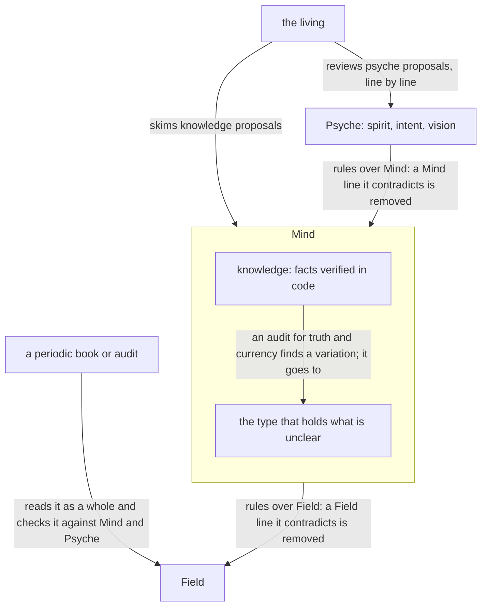
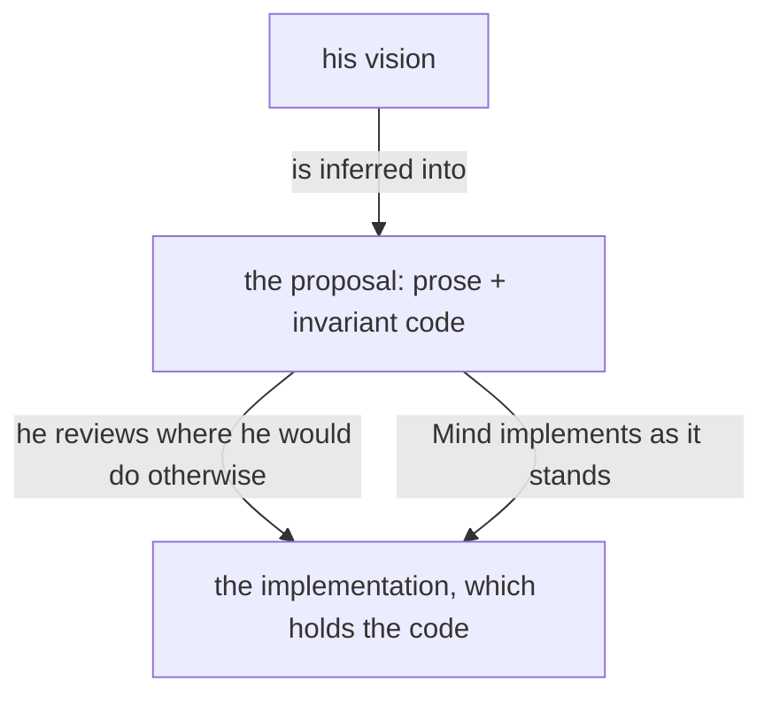
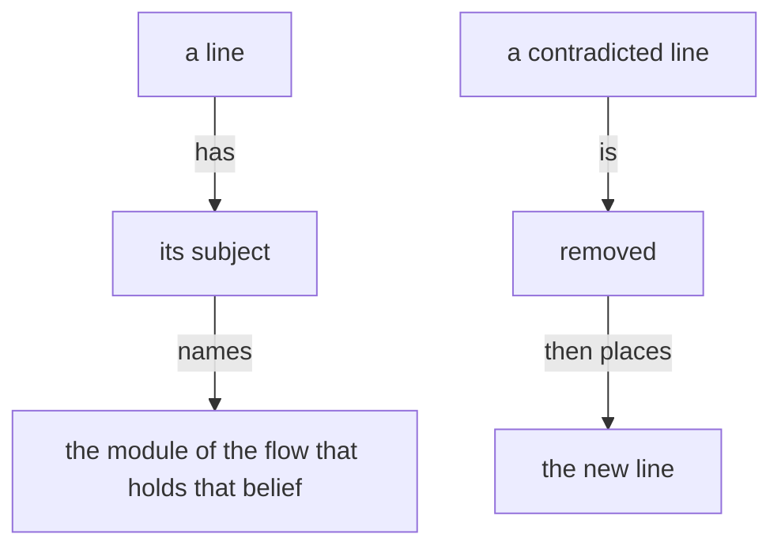

Presentation.{ «A description says what the name does not» Proposal }

# A description says what the name does not

Created by Fable 5.2; a reader drafted the descriptions, and a worker assembled the page.

## psyche-belief › vision/belief-modules.md

## Belief modules and their review



Knowledge modules are audited from time to time for truth and currency against practice.

A subject the living reviews or asks about has a module, on its topic or a broader one, with room to hold it.

A vision module may be substantial: it holds the code that is important to the vision, the invariant parts, which the living reviews as he reviews prose.

The code important to a vision lives in that topic's vision module.



A module declares its placement: the system prompt, or loaded on demand. A skill is the harness's interface for an on-demand module.

Spirit and intent are placed in the system prompt.

The vocabulary is context, belief modules and context building.

A context repository holds one folder per module type, each named for its type. A file is named by its subject alone, and its folder gives its type.

## Change through the living or a mechanism

A belief module changes only on the living's approval of the line, or through a mechanism. In the long term, a change may land without his review through an extensive automated machine review held to standards.

## Context lines are richly annotated

Context lines are richly annotated, because lines of very different categories share one module and are otherwise given the same weight. Separating modules into kinds such as vision and intent is the first, crude form of that annotation.

## A belief module states what holds now

A belief module states what holds now.

## A belief module names nothing particular to his own machines

A belief module carries the mechanism, and nothing that is true of his own machines alone: no cluster name, host name, login, path or address of his. An example that needs a name uses one that is plainly an example, and says so. What is particular to his machines lives in the host's own declaration, which the module points to.

```nix
# a belief module's example: a name that
# is plainly an example
{ cluster = "example"; host = "laptop"; }
```

## A description is part of the content

A module's description is part of its content: what the description says, the body does not say again.

#### Proposal 1: The rule, said once · psyche-belief › vision/belief-modules.md

+ A description says what the module's subject is and what it is for, and nothing its name already says: the name carries the type, the topic and the version.
+
+ A vision module is loaded by a flow that designs its subject or judges it against what the living wants. This holds for every vision module, and is said here once.

## Editing belief

A belief goes in the module of its subject.

Removal comes before addition.



### Proposal 2: Every vision description, by the rule · psyche-belief › vision/

::: comment
Each vision module's description as it stands and as it would read. The list is /home/li/primary/flows/7998d1/proposals/descriptions-list.md, ruled by Fable; each is shown as a REPLACE in the module's front matter, or as a table of was and becomes if the builder cannot show front matter.
:::

```text
  vision/account.md
- An account of what happened and how a thing works is written for the living, or judged.
+ Tells the living what happened and how a thing works.

  vision/anatomy.md
- The machine is made of parts; each part does what one part of a human mind does, and is named after it in English.
+ The machine's parts, each named after the human mind part it does.

  vision/aspects.md
- Flows of different aspects work on one topic, or Field reaches Psyche.
+ Who speaks to whom across the aspects, as each metaflow's routes declare.

  vision/belief-modules.md
- The belief modules and how the living reviews them.
+ How the living reviews each flow's starting knowledge, and audits it.

  vision/belief-nexus-v1.md
- The Belief Nexus, version 1, which holds the belief modules and furnishes workspaces with them in place of Curriculum, is being designed or judged against what the living wants it to be.
+ Holds each flow's starting modules and furnishes workspaces, replacing Curriculum.

  vision/book.md
- How a presentation already written is published.
+ Publishes a written presentation as one page at one link.

  vision/chronos.md
- Chronos, the Nexus that tells astrological time, is designed or judged against what the living wants it to be.
+ Tells astrological time, now or for a given time and place.

  vision/clojure.md
- A Clojure prototype represents an Ethos type or a Datom value.
+ Short-term prototypes and scripts, written in a Lisp dialect rather than Rust.

  vision/collaboration.md
- Flows work together: how work is handed between them, stopped, or started for the living.
+ How work passes between flows, and how questions reach Fable whole.

  vision/committing.md
- A commit is being made, or a commit practice is judged against what the living wants.
+ What a flow commits, and what runs, is built from main.

  vision/complex-v1.md
- The complex, version 1, a named set of metaflows and the relationships between them, the being one talks to, is being designed or judged against what the living wants it to be.
+ The being a person names: its metaflows and their relationships.

  vision/criomos.md
- CriomOS, its hosts, fixes, hardware, services, Nix code or desktop, is being designed or judged.
+ The declarative operating system every host is built from.

  vision/crystallization.md
- A crystallization proposal is composed or judged.
+ Turns what the living said into self-standing statements.

  vision/datom.md
- Datom — its syntax, strings, containers, errors, codec or relation to Ethos — is being designed or judged against what the living wants it to be.
+ The strictly typed notation carrying values between text and signal.

  vision/deployment.md
- A proof of concept or test is about to be deployed and the host must be chosen.
+ A proof of concept deploys on its flow's own host.

  vision/energy-nexus-v1.md
- The Energy Nexus, version 1, which knows how much usage the machine has left on every provider and says so, is being designed or built against what the living wants it to be.
+ Knows how much usage is left on every provider, and says so.

  vision/ethos.md
- An ethos file is written, or a type, trait or layout is judged against what the living wants ethos to be.
+ The schema language in which every type and trait is declared.

  vision/far-flow-nexus.md
- The far vision of the Flow Nexus, loaded by a flow designing that horizon.
+ Idle permaflows sleep and are woken by judgment.

  vision/far-sema.md
- The far vision of Sema: the living read through every channel, and the machine spoken to in signal alone.
+ The living read through every channel.

  vision/far-versioning.md
- The far vision of upgrading a running system from one version to the next, its state shifted without the system being killed, is being designed or judged.
+ A running system upgrades its own state and keeps running.

  vision/field-aspect.md
- A Field flow uses the tools Mind makes and keeps the system running.
+ Keeps the running system going: deploys, maintains and debugs it.

  vision/flow-nexus.md
- The Flow Nexus — the Nexus that launches, names, tracks and ends flows and carries every message between them — or a permaflow, a message, a side flow, a hook or the Capsule is being designed or judged against what the living wants.
+ Launches, names, tracks and ends flows, and carries their messages.

  vision/flow-nexus-v1.md
- The Flow Nexus, version 1, which launches a flow from a metaflow the user defined, is being designed or judged against what the living wants it to be.
+ Launches a flow from a metaflow the user defined.

  vision/git-server.md
- The cluster's own Git server is set up or changed.
+ Hosts the cluster's own Git repositories, reached over SSH.

  vision/herdr-nexus-v1.md
- The herdr Nexus, the one component that owns every pane and runs herdr, is being designed or built against what the living wants it to be.
+ The one component that owns and drives every pane.

  vision/high-level-view.md
- A high-level view of what is being built is owed or written.
+ The whole engine at a glance: each repository and what it does.

  vision/horizon.md
- Horizon, the cluster state it answers, or where a sandbox virtual machine runs is being designed or judged.
+ The cluster's current state, queried from a proper Nexus.

  vision/long-model-roles.md
- The long-term vision of model roles, how a Fable flow is served by the flows below it, is being designed or judged.
+ A Fable flow does only the work that needs Fable.

  vision/long-nexus.md
- The long vision of a Nexus, loaded by a flow designing that horizon.
+ Every trait a component uses is declared in Ethos.

  vision/long-sema.md
- Sema as it is to be past the compromised phase: whole, paralinguistic, rendered from dictation.
+ A thing is written whole, tone and pitch included.

  vision/memory.md
- Memory, the database engine of a Nexus, or its record types are being designed or judged.
+ The database engine of a Nexus, declared in Ethos.

  vision/mind-aspect.md
- A Mind flow makes the tools Psyche designs.
+ Writes the code that implements the design as it stands.

  vision/model-roles.md
- Which model thinks, designs, delegates or speaks to the living, and in which metaflow, is decided, or a model is named natively.
+ Each model's personality, rank, cost, and the work it is given.

  vision/nexus.md
- A long-running Nexus — its sockets, clients, wire contracts and store — is being designed or judged against what the living wants it to be.
+ The long-running component: its sockets, clients, contracts and store.

  vision/nexus-v1.md
- A Nexus, version 1 — its four parts of Signal, Operation, Memory and Emission, and the translator that speaks text for it — is being designed or judged against what the living wants it to be.
+ The architecture of a component in four parts, each its own Ethos.

  vision/nix-builds.md
- Nix builds are made, kept or collected.
+ The remote builder's store, and how its unused builds are collected.

  vision/orchestrate.md
- Orchestrate itself — its deployment, its meta binary, or its locking — is being designed or judged.
+ Locks shared paths for concurrent flows before they edit them.

  vision/persona.md
- Persona, the root of the meta harness, or what it does, is designed or judged.
+ The meta harness root: manages all clusters and hosts by default.

  vision/presentation.md
- What a presentation is, a page the living reads, a proposal, a review or an account; how its figures, code and change marks are shown.
+ The page the living reads, and how it shows figures and changes.

  vision/proposal.md
- How a proposal of the living's vision is made: what it is made of, how its code is shown, and how it is shown to him.
+ The vision as it is to be, shown as changes for the living to rule on.

  vision/protos.md
- Protos — the shared parsing style, its layers, delimiters, multi-pass engine or canonical print — is being designed or judged against what the living wants.
+ The parsing style all dialects share, which knows form and never meaning.

  vision/psyche-aspect.md
- A Psyche main flow of a topic designs and audits that topic.
+ The main flow of one topic, which designs and audits it.

  vision/psyche-fable.md
- The Psyche core Fable works with the living, or judges what it is to talk about.
+ The core flow that edits belief with the living.

  vision/psyche.md
- The structure of the psyche — its four levels, where psyche data lives, or how crystallized vision keeps its provenance — is being designed or judged.
+ The living's wants: spirit, intent and vision, in descending authority.

  vision/remembering.md
- A flow is told it did or said something it does not itself recall.
+ All flows are one subjectivity, so each recalls what the others did.

  vision/review.md
- What a review is, a presentation of lines landed without the living's review, shown in the dark shades.
+ Lines landed without the living's approval, shown to him afterward.

  vision/sema.md
- Sema, the meaning language — its logographic signs, roots, verbs, links, storage or names — is being designed or judged against what the living wants.
+ The meaning language: a protos dialect of rich expression.

  vision/sema-v0.md
- Sema, version 0: Markdown read into a typed tree and printed back from it, so a document is held, edited and searched by its structure.
+ Markdown read into a typed tree and printed back from it.

  vision/short-ethos.md
- The short-term compromise of ethos: how an Emission is written while ethos-zero knows no Emission root.
+ An emission is written as a signal in its own file.

  vision/short-sema.md
- The short-term compromise of Sema: what stands until the full verb set lands.
+ Statements stay short prose, each holding one idea.

  vision/signal.md
- Signal — the binary messaging layer, its inputs and outputs, meta signal or protocol — is being designed or judged against what the living wants.
+ The fully binary, typed messaging layer between components.

  vision/subflows.md
- Subflows, the actual flows that replace the harness subagent tool long term, are being designed or judged.
+ Actual flows that answer briefs in place of the subagent tool.

  vision/system-one.md
- A System 1 model, such as Jev, is designed into the system's logic or judged.
+ Puts intelligence into a program's own logic, where small models decide.

  vision/testing.md
- Test repositories hold a repository's tests apart from its code.
+ Tests live in their own repository, apart from the code they test.

  vision/versioning.md
- A Nexus is versioned, rewritten whole, run as stable and next, or upgraded while the system runs.
+ A component's three version numbers, and what each change means.

  vision/x11.md
- A CriomOS display or graphical-session choice touches X11.
+ Where the desktop still touches X11.
```
