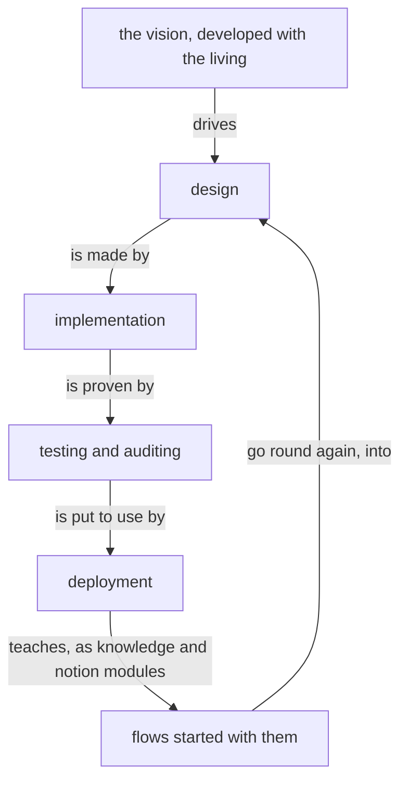

# Design: The machine improves itself, at the pace of its energy

Author: Psyche core Fable (Fable 5.2). A worker assembles the presentation source from this file, in the in-place form, each touched module shown whole. Title: «The machine improves itself, at the pace of its energy». Kind: Proposal. Signature line: Created by Fable 5.2; a worker assembled the page. Wording marked ADD, REPLACE or COMMENT is final. Modules: /git/github.com/LiGoldragon/psyche-belief.

---

## Proposal 1: Evolution · psyche-belief › vision/evolution.md (new)

COMMENT
His words, 12 November: «Your task with self-evolution, which means: design, implementation, testing, auditing, deployment, designing the modules you need as Notion and knowledge modules, changing the main flows to use them, restarting new flows with them, re-implementing, redesigning new modules, doing this in a loop while, at the same time, keeping track of the energy.» «The vision development is the part that drives the whole system.» «At some point, we're going to have a blitz of implementation once we see that efficiency goes up because our flows are well designed and well trained, and have unnecessary system prompts and tools taken out (especially when we integrate system 1 models into the pipeline). We'll climb up the quality per cost, and then we'll have a blitz of Codex implementation and use these resets to help us output 2 weeks' worth of work in 1.» «If we have a well-working system and there's no emergency, then I can relax. Relaxing gives me rest, rest clears my mind, a clear mind gives better design. Not only efficiency in terms of the thinking machine, but efficiency in terms of me.»

ADD, the whole module:
---
description: The machine improving itself and deploying the improvement, in a loop.
dependencies: []
---

Evolution is the machine improving itself, in a loop: it designs, implements, tests, audits and deploys; it writes the knowledge and notion modules it needs, changes its flows to use them, starts new flows with them, and goes round again, keeping track of its energy as it goes.

The development of the vision drives the whole system.



Quality for its cost rises as flows are well designed and well trained, carry only the prompts and tools they need, and are served by System 1 models. When it has risen, implementation is done in a blitz, and the resets are used to put two weeks of work into one.

The living's rest is part of the machine's efficiency. A system that works well, with no emergency, lets him rest; rest clears his mind, and a clear mind designs better.

---

## Proposal 2: A day early, and a reserve for him · psyche-belief › vision/energy-nexus-v1.md

COMMENT
His words, 12 November: «We're shooting for approximately using a subscription about a day early from when it's due, except we should always keep a bit of Claude usage. Say 6%, in case on the last day I have some ideas I want to talk to Fable about.» «If we use up Codex a day or two early, then that means I get a day or two of just talking to you about design.» «Right now, we don't need to shoot for using a reset.»

ADD, to the Library ethos, a variant of Target after SpendBy, and a field of ProviderTarget (shown as the REPLACE of those lines, only the added words marked; the worker reads the lines as they stand):
  Early.Minutes                        ; spend the window whole this long before it ends
and ProviderTarget becomes:
  ProviderTarget.{ Provider Target
                   Reserve.Percent }   ; a share of the window the machine leaves for the living

ADD, to the section «## Pace: over or under, per day», after its paragraph:
The usual target is Early by a day: a subscription is spent whole about a day before its window ends, and the day left is for design with the living. A provider's reserve is a share of its window the machine does not spend: it is the living's, for the ideas he brings on the last day.

```datom
Configure.Target.{ Codex Early.1440 0 }
Configure.Target.{ Claude Early.1440 6 }   ; six percent of the Claude week stays his
```

ADD, to the section «## The redeem rule», after its paragraph:
A reset is for a blitz: it is redeemed when the work waiting is worth a second week, and otherwise kept until the rule above redeems it before it expires.

---

## Proposal 3: Persona arranges and recovers the Nexuses · psyche-belief › vision/persona.md

COMMENT
His words, 12 November: «The Persona Nexus is meant to manage all of our nexuses, arrange them, and recover them.» And, as a possibility: «maybe even moving our services from being managed so much by Nix and only being deployed by Nix to having everything managed by our own service manager that could use systemd.» The worker shows the module whole and places the line at its end; if the module already says it, the line is dropped and the place where it is said is named to Fable.

ADD, at the end of the module:
The Persona Nexus manages all our Nexuses: it arranges them, restarts them and recovers them. The services may come to be managed by it, through systemd, with Nix building and deploying them.
