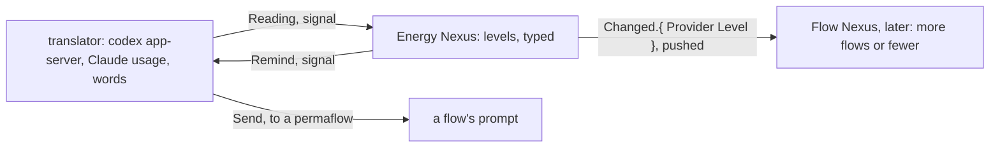

Presentation.{ «The machine improves itself, at the pace of its energy» Proposal }

# The machine improves itself, at the pace of its energy

Created by Fable 5.2; a worker assembled the page.

### Proposal 1: Evolution · psyche-belief › vision/evolution.md, a new file

::: comment
His words, 12 November: «Your task with self-evolution, which means: design, implementation, testing, auditing, deployment, designing the modules you need as Notion and knowledge modules, changing the main flows to use them, restarting new flows with them, re-implementing, redesigning new modules, doing this in a loop while, at the same time, keeping track of the energy.» «The vision development is the part that drives the whole system.» «At some point, we're going to have a blitz of implementation once we see that efficiency goes up because our flows are well designed and well trained, and have unnecessary system prompts and tools taken out (especially when we integrate system 1 models into the pipeline). We'll climb up the quality per cost, and then we'll have a blitz of Codex implementation and use these resets to help us output 2 weeks' worth of work in 1.» «If we have a well-working system and there's no emergency, then I can relax. Relaxing gives me rest, rest clears my mind, a clear mind gives better design. Not only efficiency in terms of the thinking machine, but efficiency in terms of me.»
:::

+ ---
+ description: The machine improving itself and deploying the improvement, in a loop.
+ dependencies: []
+ ---

+ Evolution is the machine improving itself, in a loop: it designs, implements, tests, audits and deploys; it writes the knowledge and notion modules it needs, changes its flows to use them, starts new flows with them, and goes round again, keeping track of its energy as it goes.

+ The development of the vision drives the whole system.

+ ```mermaid
+ flowchart TB
+     v["the vision, developed with the living"] -- "drives" --> d["design"]
+     d -- "is made by" --> i["implementation"]
+     i -- "is proven by" --> t["testing and auditing"]
+     t -- "is put to use by" --> p["deployment"]
+     p -- "teaches, as knowledge and notion modules" --> f["flows started with them"]
+     f -- "go round again, into" --> d
+ ```

+ Quality for its cost rises as flows are well designed and well trained, carry only the prompts and tools they need, and are served by System 1 models. When it has risen, implementation is done in a blitz, and the resets are used to put two weeks of work into one.

+ The living's rest is part of the machine's efficiency. A system that works well, with no emergency, lets him rest; rest clears his mind, and a clear mind designs better.

## psyche-belief › vision/energy-nexus-v1.md

# The Energy Nexus

The Energy Nexus knows how much usage the machine has left, on every provider, and says so: it answers a reading, pushes each change, and sends a reminder when a level is crossed. It is the worked example of a translator: the Nexus holds only typed readings; every word of every provider's API lives in the translator.



## Library

#### Proposal 2: A day early, and a reserve for him · psyche-belief › vision/energy-nexus-v1.md
::: comment
His words, 12 November: «We're shooting for approximately using a subscription about a day early from when it's due, except we should always keep a bit of Claude usage. Say 6%, in case on the last day I have some ideas I want to talk to Fable about.» «If we use up Codex a day or two early, then that means I get a day or two of just talking to you about design.» «Right now, we don't need to shoot for using a reset.»
:::

```ethos
  Library
  [ flow:[ Address ] ]                    ; imports: the Flow Nexus's Address, vision:flow-nexus
  [ Provider.[ Claude Codex ]
    Percent.Integer                      ; 0 to 100
    Instant.Integer                      ; Unix seconds
    Minutes.Integer
    Window.{ Name.[ Session Week ]       ; one rate limit
             Used.Percent
             Resets.Instant
             Duration.Minutes }
    ResetId.String
    ResetStatus.[ Available Redeeming Redeemed ]
    Reset.{ ResetId ResetStatus Expires.Instant }
    Reading.{ Provider
              Allowed.Boolean            ; the provider's own word
              Vector<Window>
              Vector<Reset>              ; Codex only; empty for Claude
              At.Instant }
    Level.[ Plenty Fair Low Out ]        ; Out is Allowed false
    Threshold.{ Level Left.Percent }     ; a level begins at this much left
    Recipient.Address                    ; a permaflow the reminder goes to
    Reminder.{ Provider Level Recipient }
    Target.[ Even                        ; spend the window evenly
-            SpendBy.Instant ]           ; spend it whole by this instant
+            SpendBy.Instant             ; spend it whole by this instant
+            Early.Minutes ]             ; spend the window whole this long before it ends
-   ProviderTarget.{ Provider Target }
+   ProviderTarget.{ Provider Target
+                    Reserve.Percent }   ; a share of the window the machine leaves for the living
    Pace.{ Provider
           Target
           Expected.Percent              ; what the target says is used by now
           Used.Percent
           Standing.[ Over Under On ]    ; used against expected
           PerDay.Percent } ]            ; the daily share the target implies from here
  []
  []
```
-

## Signal

```ethos
Signal
[ energy:[ Provider Reading Level Reset ResetId Pace ] ]
[ Read.Provider                        ; a reading, now
  Subscribe                            ; readings and levels as they change
  Redeem.Provider ]                    ; the soonest Codex reset, under the rule
[ Read.{ Reading Pace }                ; the reading, and its pace against the target
  Subscribed
  Changed.{ Provider Level Reading }   ; pushed on every level change
  Redeemed.Reset
  Refused.[ ProviderDown.Provider
            NoReset
            RuleRefused.String ] ]     ; why the rule refused: not out, not expiring
[]
```

## Meta

```ethos
Signal
[ energy:[ Provider Threshold Reminder Minutes ResetId ProviderTarget ] ]
[ Configure.Set ]
[ Configured.Set
  ConfigureRefused.String ]
[ Set.[ Polling.Minutes
        Threshold.Threshold            ; one level's boundary
        Reminder.Reminder              ; who hears about a level
        RemoveReminder.Reminder
        RedeemExpiring.Minutes         ; redeem within this many minutes of a reset expiring
        RedeemUsedAtLeast.Percent      ; or when the week is this used
        Target.ProviderTarget ] ]      ; one provider's pace target
```

## Operation

```ethos
Operation
[ energy:[ Provider Reading Level Reminder Reset ] ]
[ Reading.Provider                     ; attempts
  Levelling.Reading                    ;   a reading into a level; Changed if it moved
  Reminding.{ Reminder Reading }
  Redeeming.Provider ]
[ Read.Reading
  Levelled.Option<Level>               ; Some when the level moved
  Reminded
  Redeemed.Reset
  Failed.[ ProviderDown NoReset RuleRefused.String ] ]
[]
```

## Emission

The translator's vocabulary. Each emission is one call; the words of the call are the translator's alone.

```ethos
Emission
[ energy:[ Reading ResetId Recipient Level Provider ] ]
[ CodexRateLimits                      ; codex app-server, account/rateLimits/read
  CodexConsumeReset.{ ResetId Idempotency.String }  ; account/rateLimitResetCredit/consume
  ClaudeUsage                          ; the Claude usage endpoint, with the login
  Send.{ Recipient Provider Level } ]  ; flow Send.{ Address Soft.Notice }, the text composed here
[ Observed.Reading
  Consumed.[ Reset NothingToReset NoCredit AlreadyRedeemed ]
  Sent
  Down ]
[]
```

```rust
impl Emittable for CodexRateLimits {                      // the one place the words live
    type Outcome = ExternalOutcome;
    fn emit(&self, t: &Translator) -> ExternalOutcome {
        t.app_server("account/rateLimits/read", json!({})) // reply → Reading, typed, by the translator
    }
}
```

## Memory

```ethos
Memory
[ energy:[ Provider Reading Level Threshold Reminder Minutes Percent ProviderTarget ] ]
[ Latest.{ Provider Reading Level }
  History.Vector<Reading>
  Configuration.{ Polling.Minutes
                  Vector<Threshold>
                  Vector<Reminder>
                  RedeemExpiring.Minutes
                  RedeemUsedAtLeast.Percent
                  Targets.Vector<ProviderTarget> }
  Answer.[ Succeeded Failed.String ] ]
```

## Pace: over or under, per day

A reading alone says how much is left; pace says whether the machine is spending it as intended. Each provider has a target: Even spends the window evenly; SpendBy spends it whole by an instant, as when a Codex reset is to be redeemed before it expires and the week is meant to be used up first. Pace is the comparison of what has been used to what the target says should have been used by now, per day.

```datom
Configure.Target.{ Codex SpendBy.1762450320 }   ; use the week up before the reset expires
Configure.Target.{ Claude Even }
Read.Codex
Read.{ { Codex true [ { Week 92 1762235580 10080 } ] [ { rc_1 Available 1762450320 } ] 1762210000 }
       { Codex SpendBy.1762450320 88 92 Over 4 } }
```

#### Proposal 2: A day early, and a reserve for him · psyche-belief › vision/energy-nexus-v1.md

+ The usual target is Early by a day: a subscription is spent whole about a day before its window ends, and the day left is for design with the living. A provider's reserve is a share of its window the machine does not spend: it is the living's, for the ideas he brings on the last day.

```datom
+ Configure.Target.{ Codex Early.1440 0 }
+ Configure.Target.{ Claude Early.1440 6 }   ; six percent of the Claude week stays his
```

## The redeem rule

A Codex reset is redeemed when the provider says usage is not allowed and work is waiting, or within RedeemExpiring minutes of its expiry with the week at least 1% used; the reset redeemed is the available one expiring soonest, never a later one while an earlier stands. The rule is the Nexus's; the call is the translator's.

#### Proposal 2: A day early, and a reserve for him · psyche-belief › vision/energy-nexus-v1.md

+ A reset is for a blitz: it is redeemed when the work waiting is worth a second week, and otherwise kept until the rule above redeems it before it expires.

## Later: the Flow Nexus listens

The Flow Nexus subscribes. On Plenty it launches more and higher; on Low it launches fewer and cheaper; on Out it lets flows sleep and wakes them on Changed. What it does at each level is its own configuration, not the Energy Nexus's.

```datom
energy-nexus 'Read.Codex'
Read.{ { Codex true [ { Week 92 1762235580 10080 } ] [ { rc_1 Available 1762450320 } ] 1762210000 }
       { Codex Even 23 92 Over 1 } }
Configure.Reminder.{ Codex Low { Psyche core Primary } }
```

## psyche-belief › vision/persona.md

## What the root does

By default Persona manages all the clusters and all the hosts. It keeps a harness instance of each of the triad running: Psyche, Mind and Field.

Its first use is a service that checks every service and keeps it running. It is changed through the configuration it takes in, or through what it is sent.

It makes backups. It knows how to restart the whole cluster, every metaflow, with the right context. It runs the monitors, and when something has failed or a provider is offline it may act, moving to a backup model.

#### Proposal 3: Persona arranges and recovers the Nexuses · psyche-belief › vision/persona.md

::: comment
His words, 12 November: «The Persona Nexus is meant to manage all of our nexuses, arrange them, and recover them.» And, as a possibility: «maybe even moving our services from being managed so much by Nix and only being deployed by Nix to having everything managed by our own service manager that could use systemd.»
:::

+ The Persona Nexus manages all our Nexuses: it arranges them, restarts them and recovers them. The services may come to be managed by it, through systemd, with Nix building and deploying them.
