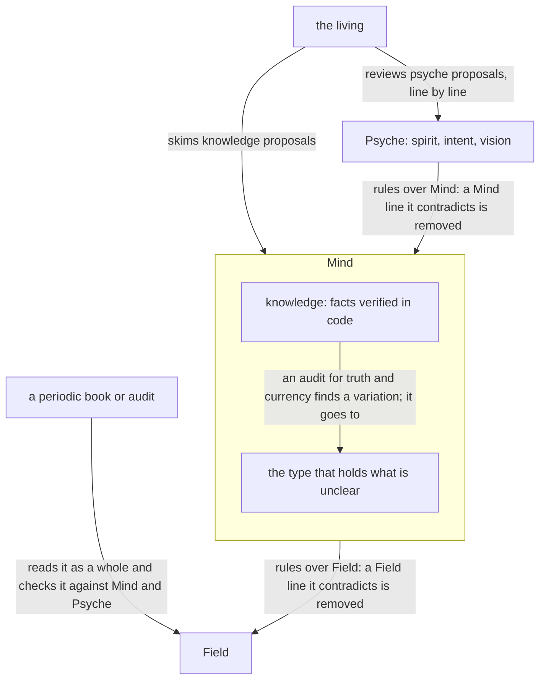
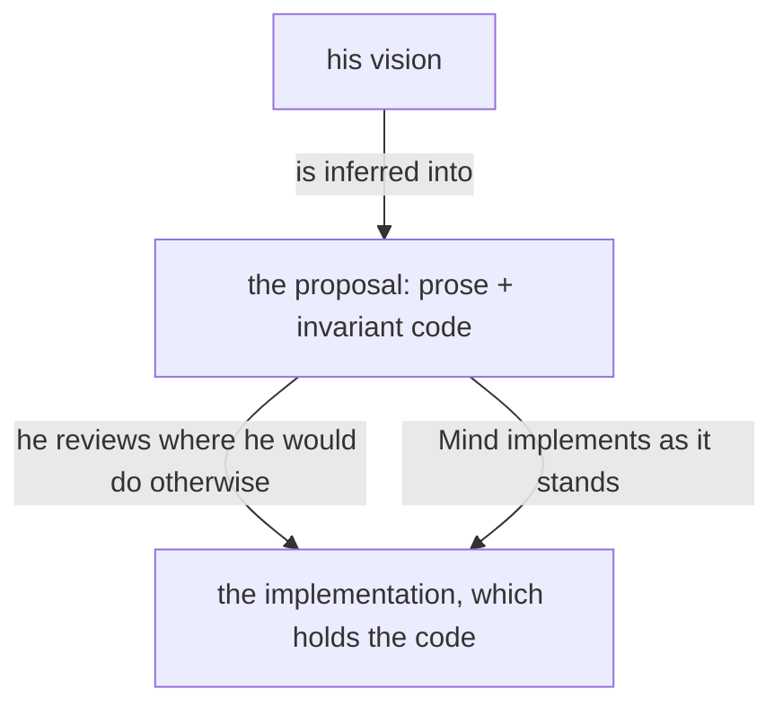
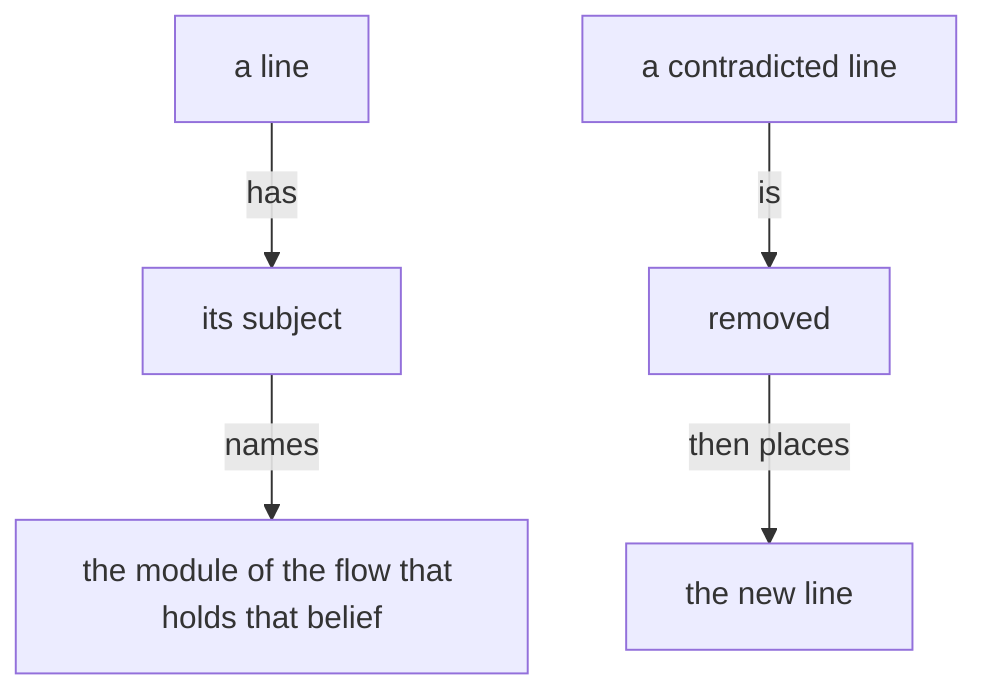
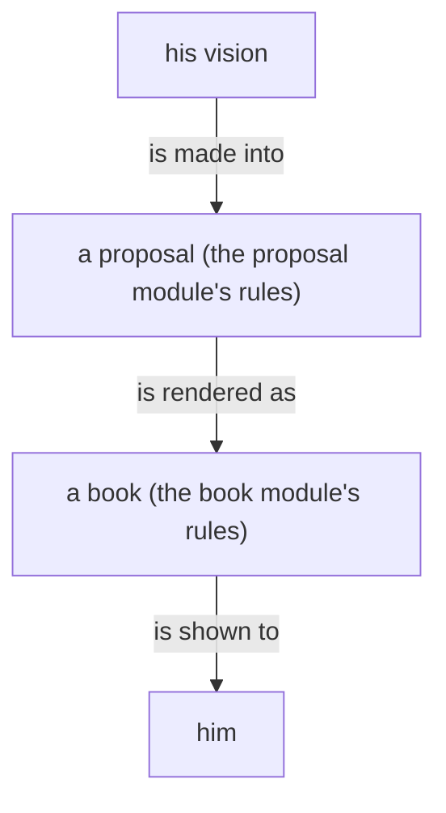
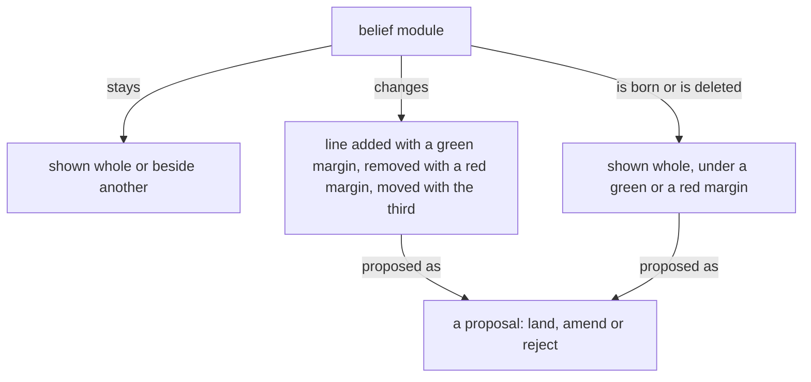

Presentation.{ «Vision is a series of versions» Proposal }

# Vision is a series of versions

Created by Fable 5.2; a worker assembled the page.

## psyche-belief › vision/psyche.md

Psyche contains Spirit, Intent and Vision, in descending authority. A notion is an idea not yet intended, a brainstorm the living has had and not ruled on; it is a Mind belief, kept in the mind repository under its own kind, and a notion that he rules into vision leaves Mind for Psyche.

Everything the living says he wants is crystallized into the existing vision: psyche data is what the work mines for, and rich building stands on it.

Psyche data belongs in a dedicated repository symlinked into Primary. Orchestrate
coordinates concurrent work across those repositories.

The belief modules belong in a context repository; Psyche's is psyche-belief.

Vision is what is wanted; it is neither real nor unreal, and it documents nothing. The minute a line is not wanted it is not vision: each version has one vision, the one in its module now, and nothing refers to a past one. Vision refers only to vision: every type a vision names is defined in a vision module. The versions separate what he sees further on from what he pursues now so that it arrives more quickly.

## A record is a proposal

What the living says is not written down. What it changes is: Fable restructures, simplifies and harmonizes it with everything he has said, as a line in a proposal. The transcript holds his words; nothing else does.

## Vision is a series of versions

Vision is what the living says the system is to be. A topic's vision is versioned as every belief module is, and each version is more capable than the one before. A new idea goes into the latest version until that version is specified and implemented so far that the idea would break it or put too much on it; then the next version begins, and the idea goes there. An earlier version is phased out as the later ones run, and the numbers go on.

Each version of a vision has its own main branch in each repository that holds its code. Several versions may be in implementation at once.

## psyche-belief › vision/belief-modules.md

## Belief modules and their review



Knowledge modules are audited from time to time for truth and currency against practice.

A subject the living reviews or asks about has a module, on its topic or a broader one, with room to hold it.

A vision module may be substantial: it holds the code that is important to the vision, the invariant parts, which the living reviews as he reviews prose.

The code important to a vision lives in that topic's vision module.



A module declares its placement: the system prompt, or loaded on demand. A skill is the harness's interface for an on-demand module.

Spirit and intent are placed in the system prompt.

The vocabulary is context, belief modules and context building.

A context repository holds one folder per module type, each named for its type. A file is named by its version number, and its folders give its type and its topic.

## Change through the living or a mechanism

A belief module changes only on the living's approval of the line, or through a mechanism. In the long term, a change may land without his review through an extensive automated machine review held to standards.

## Context lines are richly annotated

Context lines are richly annotated, because lines of very different categories share one module and are otherwise given the same weight. Separating modules into kinds such as vision and intent is the first, crude form of that annotation.

## A belief module states what holds now

A belief module states what holds now.

## A belief module names nothing particular to his own machines

A belief module carries the mechanism, and nothing that is true of his own machines alone: no cluster name, host name, login, path or address of his. An example that needs a name uses one that is plainly an example, and says so. What is particular to his machines lives in the host's own declaration, which the module points to.

```nix
# a belief module's example: a name that
# is plainly an example
{ cluster = "example"; host = "laptop"; }
```

## A description is part of the content

A module's description is part of its content: what the description says, the body does not say again.

## Editing belief

A belief goes in the module of its subject.

Removal comes before addition.



## A belief module is versioned

Every belief module is versioned, as software is. A topic's belief modules are a series of versions: a new concept starts at version 0, and what follows it is version 1. Each version has its own module, and every module's name is three fields, its type, its topic and its version number, `<type>:<topic>:<number>`; a topic with one module has it at version 0. A change to a module's lines is a revision of that version; a new number begins a version that stands beside the earlier one. A module of any type that is about one version of a thing carries that version: `vision:flow-nexus:1` says what the Flow Nexus, version 1, is to be, and `knowledge:flow-nexus:1` holds what is known of it as built.

### Proposal 3: The version is a field of the name · psyche-belief › vision/

::: comment
His words, 12 November: «we can't separate the version number from the topic using a separator that is used in the topic itself. Do we really need the v there? Essentially, we're separating fields in a struct, so we can use the colon to separate all of the fields.» His words, 13 November: «I think it would be more consistent if all the belief modules were versioned.» «Maybe we just make a belief nexus that can work now, that does this, and that has a version number all the time for everything. When I'm reading the proposal and I see no version numbers, we should think of everything as software, essentially. If we think of belief modules as software, then they need to be versioned, I think.» So no name is without its number: a module's name is three fields, type, topic and version, the colon between them, and its file is the version under a folder of its topic. Every module of every type that has no version today becomes version 0 of its topic, `<type>/<topic>.md` becoming `<type>/<topic>/0.md`, in psyche-belief, mind-belief and field-belief alike; vision/flow-nexus.md becomes vision/flow-nexus/0.md. The skill name follows the path: vision/flow-nexus/1.md is vision:flow-nexus:1.

A renaming merges no content. A module with an explicit number takes its path: vision/sema-v0.md is vision/sema/0.md, and the unversioned vision/sema.md beside it takes the next number, vision/sema/1.md; the same rule wherever an unversioned module stands beside an explicit version 0. A short, long or far module keeps its own topic at version 0: vision/short-ethos/0.md, vision/short-sema/0.md, vision/long-nexus/0.md, vision/far-sema/0.md and the like; vision/ethos.md alone is vision/ethos/0.md. Whether a horizon module merges into a version of its topic is a content question he rules later, apart from the naming. The modules already versioned, and the horizon modules, are listed below. Each horizon module's description drops «far», «long» or «short-term», since the name carries it.

vision/belief-nexus-v1.md becomes vision/belief-nexus/0.md, by his word of 13 November: «I don't see that we are at belief nexus version 1 yet. I think we're still at version 0.» «No, curriculum is not belief. There, we renamed the concept, but that doesn't mean that belief version 0 is curriculum.» The Belief Nexus is a concept of its own and begins at 0. Its own lines are retaken by «The Belief Nexus, version 0», https://claude.ai/artifact/5ZepYP4GJCXnB2YTKEgxQr.
:::

```text
- vision/flow-nexus-v1.md
+ vision/flow-nexus/1.md
- vision/nexus-v1.md
+ vision/nexus/1.md
- vision/sema-v0.md
+ vision/sema/0.md
- vision/sema.md
+ vision/sema/1.md
- vision/complex-v1.md
+ vision/complex/1.md
- vision/energy-nexus-v1.md
+ vision/energy-nexus/1.md
- vision/herdr-nexus-v1.md
+ vision/herdr-nexus/1.md
- vision/belief-nexus-v1.md
+ vision/belief-nexus/0.md
- vision/far-flow-nexus.md
+ vision/far-flow-nexus/0.md
- vision/long-nexus.md
+ vision/long-nexus/0.md
- vision/short-sema.md
+ vision/short-sema/0.md
- vision/long-sema.md
+ vision/long-sema/0.md
- vision/far-sema.md
+ vision/far-sema/0.md
- vision/short-ethos.md
+ vision/short-ethos/0.md
- vision/long-model-roles.md
+ vision/long-model-roles/0.md
- vision/far-versioning.md
+ vision/far-versioning/0.md
```

### Proposal 3: The version is a field of the name · psyche-belief › vision/far-flow-nexus.md

- description: The far vision of the Flow Nexus, loaded by a flow designing that horizon.
+ description: The Flow Nexus, loaded by a flow designing it.

### Proposal 3: The version is a field of the name · psyche-belief › vision/long-nexus.md

- description: The long vision of a Nexus, loaded by a flow designing that horizon.
+ description: A Nexus, loaded by a flow designing it.

### Proposal 3: The version is a field of the name · psyche-belief › vision/far-sema.md

- description: The far vision of Sema: the living read through every channel, and the machine spoken to in signal alone.
+ description: Sema: the living read through every channel, and the machine spoken to in signal alone.

### Proposal 3: The version is a field of the name · psyche-belief › vision/short-ethos.md

- description: The short-term compromise of ethos: how an Emission is written while ethos-zero knows no Emission root.
+ description: Ethos: how an Emission is written while ethos-zero knows no Emission root.

### Proposal 3: The version is a field of the name · psyche-belief › vision/long-model-roles.md

- description: The long-term vision of model roles, how a Fable flow is served by the flows below it, is being designed or judged.
+ description: Model roles, how a Fable flow is served by the flows below it, are being designed or judged.

### Proposal 3: The version is a field of the name · psyche-belief › vision/far-versioning.md

- description: The far vision of upgrading a running system from one version to the next, its state shifted without the system being killed, is being designed or judged.
+ description: Upgrading a running system from one version to the next, its state shifted without the system being killed, is being designed or judged.

## psyche-belief › intent/design.md

A system is simple when each thing in it does one thing and the things are not braided together, so that any part is understood on its own and changed without touching the rest. Complexity is whatever makes a system hard to understand or to change. Simple is not easy: easy is near at hand, simple is unentangled, and the patch is always the easy move.

A design is one set of ideas held whole by one mind, drawn from the complete concept it belongs to; a good idea holds together like a person. It is made so simple that there are obviously no deficiencies, rather than so complicated that there are no obvious ones.

A design is begun by listing its unknowns and judging them against the complete concept. Research feeds it options to choose from. It advances one step at a time, each step one thing judged on its own: the design, or an abstraction the design needs, or the behavior on that abstraction; a line that needs an abstraction the system lacks is two steps, the abstraction first. A proposal for the version being built names what it builds on and proposes only what can be built next.

A rewrite is designed first and small: a complex system that works grew from a simple system that worked, so the new system is the smallest one that works, and grows from there.

## The symptoms

A symptom is a place where two concerns were tied into one knot; each knot is where the next change trips. Where one is met, the abstraction under it is redone, rather than the knot added to. Each symptom below is told from the sound thing it resembles.

A special case: a branch that exists for one caller, one host, one file or one moment. A match over the variants of a type is one design deciding by its data, and is sound; the special case is a branch the type does not know.

A fallback chain: the same effect sought by a second design when the first fails, then a third. A match that handles each variant, a failure among them, is one design; a chain of attempts is several designs for one effect, and the effect was owed one.

A flag: a boolean parameter that makes one function behave as two. An option in the data is sound; the two behaviors are two capabilities or two types.

A bare scalar: an integer or a string whose meaning is only in its name. The meaning is a type.

A string in code: a name, a path, a command, a format or a message written as a literal is data the code has swallowed. A string lives in a datom field made to hold one, and the codec is the one place that handles it; a Nexus holds none.

A fact held twice: two places that must agree are one place that was split.

A comment that explains an exception: the knot, confessing.

## Every action answers an event

Polling, in any form and for any reason, is out of every design. Every action has a cause, and the cause is an event; a design names the event each action answers and finds where that event is announced, and the system is quiet when nothing has happened. A need whose event is not yet found is brought to Psyche, who finds it.

## A name says what the thing is

A name spells out what the thing is, whole: FrontMatter, not Front; ProgrammingLanguage, not Language. A shortening a reader must already know is a lingo, and none is made; a name is read right by someone who has never seen the system.

## psyche-belief › vision/proposal.md

## A proposal

A proposal is a presentation: the prose and the code that describe the system as it will be, shown as changes to belief modules, in the light shades, for the living to rule on.

A proposal lives in its source file and is edited on his comments.

A proposal states what is wanted of the system; it documents nothing.

A proposal is the vision as it will be. A removed line is shown as the text it was, under a red margin, so the edit can be seen, and nothing else is made of it: it is not drawn, not summarised and not shown as a state of anything. A proof, a test, a milestone or a sequence of work is an order, and goes to a bead; written into a proposal it is a vision impurity.

A versioned module is self-contained: everything true of that version is in it, and the version is named once, in its name. Another version is not mentioned.

A proposal is a proposal into belief modules, and the whole of it is its crystallization: what it removes and what it adds.

A proposal has one subject, and small changes that belong together are one subject: one proposal per subject he would judge as one.

A proposal that touches a code component shows the code it changes or adds.

A code block in a proposal stands on its own. It carries the code, why it is important, and what its function is.

A proposal is usually drawn as well as written, and always when it has a shape; a figure draws what is wanted, and nothing of what goes. A flowchart in a proposal is a proposed line like any other: it stands under the addition margin of the proposal it belongs to, which names the module it goes to.

The proposal is the center of development: it is the evolution of an idea.

A line removed from a module is shown beside the line that makes it unnecessary.

A question between alternative lines shows each alternative as its own proposal, with the exact lines it lands; the living rules land, amend or reject.

Every word of his redoes the proposal it bears on, unless it closes the topic; words that open a topic of their own get a proposal of their own.

Every type a proposal names is in the proposal: added to the module it lands in, added to another module, or shown as it already stands in its vision module, its definition in full; naming a type is not showing it.

What can be expressed in code is shown as code, with a comment where the code needs one; prose is the comment on the code. A method is shown with the trait it belongs to and that trait's ethos, so its inputs and its yield are read. Code not yet settled is marked tentative. A "never" or an "always" is code: the rule is shown as the code that enforces it.

A shape is a flowchart. Prose carries only what neither code nor chart can. Ethos is the first chart: its types are the nodes and its traits the actions between them.

Code shown is complete: every name it uses is declared in the proposal, a method with its trait in ethos. A type wraps nothing without purpose: a variant carries a type bare when the wrapping would name nothing the type does not.

```ethos
Text.String                                   ; what herdr types; made from Waking, held by no struct
```

```rust
let text = Text(self.waking.datomize(Path::root()).protosize().textualize());   // only the waking becomes text
```



## What a proposal shows

A module shown whole, as it stands, situates the landing.

A module shown beside another, both as they stand, serves comparison: psyche with knowledge.

A line replaced shows its removal and its addition together, and only the changed words are marked.

A new module shows whole under a green margin, under the path it will have.

A module deleted shows whole under a red margin, with a Destroy or Archive mark.

A dependency changed shows in the module's front matter: the dependency removed under a red margin, the dependency added under a green margin.

A figure proposed for a module shows under that module's path with a green margin, as an added line does; a fence it replaces, in the module, shows as its lines under a red margin.



## Who writes a proposal

A proposal into a psyche module, spirit, intent or vision, is written by Fable: the wanted lines and where they go, reading the belief modules itself. Opus writes one only when there is no Fable. A proposal into a knowledge module is written by Fable, Opus or Astra. The bookmaker publishes either; Opus lands it.

## Questions

vision/sema.md stands beside sema version 0 and is named version 1 here; is that right?
