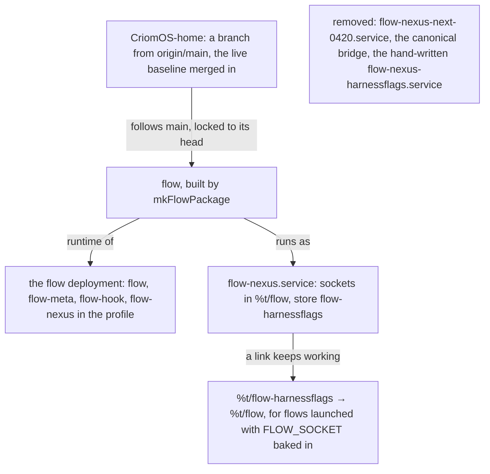

# The Flow Nexus, declared in CriomOS-home

Created by Opus (the Psyche core Secondary); research by Opus subflows.

Step 5 of the migration. What runs now was set up by hand: the new Nexus is a hand-written user unit, and the profile's `flow`, `flow-meta` and `flow-hook` are still the old build. These CLIs point at `/run/user/1001/flow/`, which is now empty, so with no `FLOW_SOCKET` set they reach nothing. This proposal declares what runs, in CriomOS-home, so that a home switch reproduces it.



## 1. Reconcile home's main with what is live

Three things differ. Live was built from the worktree branch `codex/live-baseline-0166` (the generation records no revision, so the attribution rests on the matching unit text and flow lock). Local `main` is 4 commits ahead of `origin/main` and 39 behind it. And the main checkout has uncommitted changes whose owner is unknown.

Wanted: a new branch from `origin/main`, with the live baseline merged into it. Where `flow.nix` conflicts, it resolves to the shape in section 3. The uncommitted changes in the main checkout are left alone. The merge brings in what live has and `origin/main` lacks: the canonical Flow sockets and the 0.44 Flow. `origin/main`'s own Flow parts are replaced by section 3: its lock on a flow commit that is not on main, `flow-03521`, `initialize-declared-flow`, `wait-declared-flow-ready`, and the Requires on `curriculum-nexus.service`.

The Flow Nexus unit carries no Requires, Wants or After on `curriculum-nexus.service` or `codex-remote-control.service`. The Flow Nexus needs Curriculum at a launch, not at its start, so a Curriculum redeploy leaves the Flow Nexus and its state running.

## 2. The flow input follows main; the lock pins it

The new Nexus runs flow at main's head, the commit "Add configured harness flags and launch rehearsal". The flow input is the bare repository URL, which follows main; the flake lock holds the commit, and `nix flake lock --update-input flow` moves it to main's head. The package is built by `lib.mkFlowPackage` with the arguments recorded in the Mind witness of that build. Flow's `packages.default` is still the unconfigured package, so CriomOS-home calls `mkFlowPackage` itself.

The flow input, which follows main; the lock holds its commit:

```nix
flow.url = "github:LiGoldragon/flow";
```

The runtime, built with the witnessed arguments so that it is the store path running now (tentative):

```nix
runtime = inputs.flow.lib.mkFlowPackage {
  inherit pkgs;
  defaultConfiguration = …;                          # as in the witness
  runtimeDirectory = "/run/user/1001/curriculum";    # where Curriculum's socket now is
};
```

Acceptance: after the lock update, the lock names main's head, and the built `runtime` is the store path the running Nexus runs from. Any other result is a difference, and is brought back before anything is switched.

The heartbeat commits are not in this line: the old live build had them, main does not. That matches your ruling to drop the heartbeat for now, and it stays a recorded gap.

## 3. One Flow Nexus unit, sockets in the canonical place

The CLIs' default socket directory is the constant `flow` under `$XDG_RUNTIME_DIR`. Their default therefore reaches the new Nexus only if its sockets are in `%t/flow/`. Flows already launched carry `FLOW_SOCKET=/run/user/1001/flow-harnessflags/flow.sock`, so a link keeps that path working until the last of those flows has been replaced.

The one Flow Nexus unit, on the canonical sockets and the store that holds every seat (tentative); the next-0420 unit and the canonical bridge lines go:

```nix
stateDirectory = "flow-harnessflags";          # the store that holds every seat now

systemd.user.services.flow-nexus = {
  Unit.Description = "Flow Nexus";
  Service = {
    Environment = [ "FLOW_CORE_PRESENTATION_PROMPT=%h/primary/flows/e3c8c1/presentation-role.md" ];
    ExecStart = ''${runtime}/bin/flow-nexus "{ «%t/flow/flow.sock» «%t/flow/flow-meta.sock» «%h/.local/state/${stateDirectory}/flow.sema» None }"'';
    ExecStartPost = "${pkgs.coreutils}/bin/ln -sfn %t/flow %t/flow-harnessflags";   # flows launched with FLOW_SOCKET baked in
    Restart = "on-failure";
  };
  Install.WantedBy = [ "default.target" ];
};
```

The deployment package keeps symlinking `flow`, `flow-meta`, `flow-hook` and `flow-nexus` from `runtime`. With the new runtime, the profile's CLIs become the new build, defaulting to the new sockets. Nothing in the profile is changed by hand.

## 4. The switch, at a moment no launch is in flight

The Nexus must move its sockets, so the switch includes one restart. That restart is verified to lose nothing: seats, bindings and queues come back from the store, and Codex threads resume.

1. Build the home configuration and compare: the runtime store path (section 2), and the unit text against section 3.
2. Check that nothing is in flight: no prompt memfd, only the Codex proxies as children, and Metaflows unchanged across two reads.
3. Stop and disable the hand-written `flow-nexus-harnessflags.service`, then delete it.
4. Activate the home generation. It starts the new `flow-nexus.service` on `%t/flow/`, with the link in place.
5. Verify: every seat reads Awake, as before. A `flow` call with no `FLOW_SOCKET` answers. A call through the old path answers through the link. A Rehearse of { Psyche core Primary } composes with the flag once. Codex flows send.

## Not in this proposal

- The Curriculum empty-records fix. It follows this switch, through the same lock update, at a moment no launch is in flight.
- The Nexuses of versions 0.45, 0.46 and 0.47, still running from other units. They are not touched here.

## Two facts you asked for

- **vision:aspects in your prompt:** it is a dependency, not a configured module. `vision:collaboration` declares `dependencies: [vision-aspects, vision-messaging]` in its front matter, and the running Curriculum expands dependencies when it furnishes a prompt.
- **The rising triple** after `Some.{ Psyche compaction Tertiary } 30` is the configuration's `Counters`, the next id for each of the logical delivery, queue attempt and send outcome families. It rises with every delivery and send, and is not a setting.
