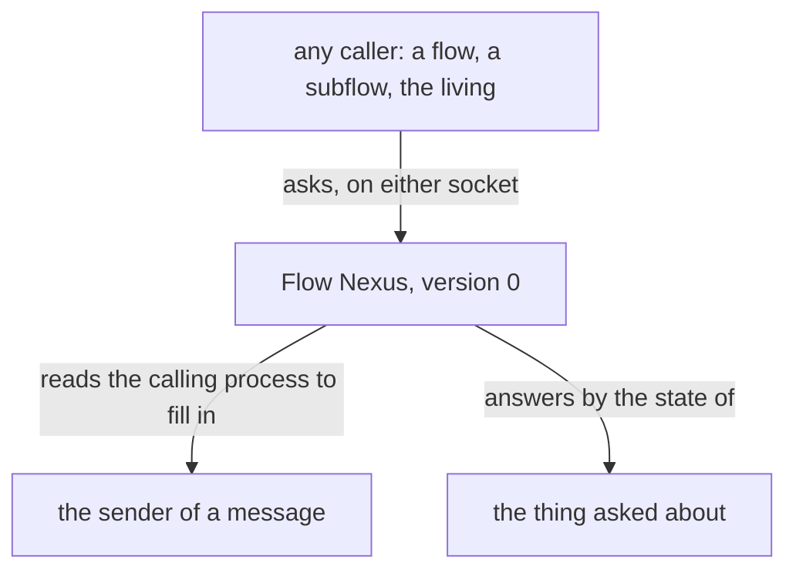
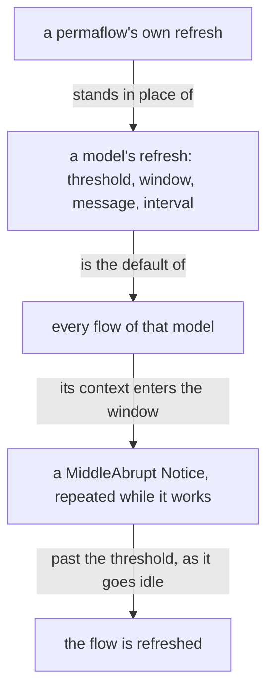
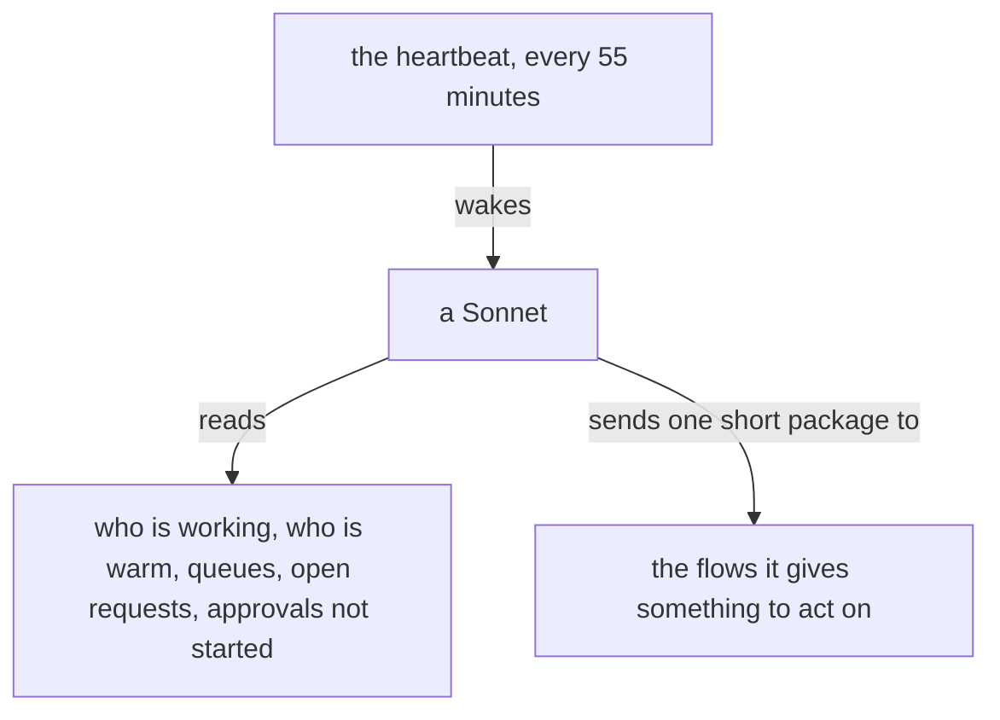
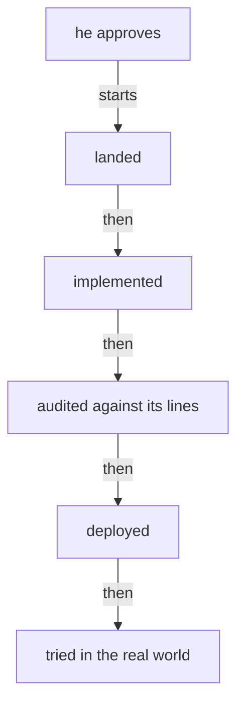

# Design: Flow Nexus version 0, a testing ground

Author: Psyche core Fable (Fable 5.2). This file is the content of a presentation; a worker assembles the presentation source from it. Title: «Flow Nexus version 0, a testing ground». Kind: Proposal. Signature line: Created by Fable 5.2; Opus choreographed the gathering, a Sonnet reader collected his words and the state of the running Nexus, and a worker assembled the page.

The page shows psyche-belief › vision/flow-nexus.md whole, as it stands, with each proposal's removed and added lines at the place named below. Then psyche-belief › vision/proposal.md whole, with Proposal 6.

Every wording below marked ADD, REMOVE or COMMENT is final and is not changed in assembly. Code fences under an ADD are added lines.

---

## Proposal 1: Nothing depends on who asks · psyche-belief › vision/flow-nexus.md

COMMENT
His words: «I don't want anything to depend on which flow is doing the query.» and «Version 0 does not enforce any kind of provenance, pseudo-security, or restriction because it just gets in the way.» The Nexus still reads the calling process, for the one thing he approved it for: a message's sender is filled in without being typed. That reading fills in; it never decides. In the running 0.54 this removes the meta gate by aspect, protected addresses, the refusal of an unidentified sender, the Secondary a Primary needs, and an answer admitted only from the request's recipient. The names Origin and Unbound are tentative.

PLACE: in the paragraph beginning «A topic's name is a camelCase identifier, uncapitalized.»

REMOVE (two sentences of that paragraph)
Every call to the Flow Nexus is identified by the calling process. Anybody may call the Flow Nexus, a flow for its own refresh among them: because the CLI checks the calling process, a flow refreshes itself safely.

ADD (a paragraph, a code fence and a figure, after that paragraph)
Version 0 is a testing ground. Every request gives the same answer to every caller, a flow, a subflow or the living at a shell, on the ordinary socket and on the meta socket alike. The calling process is read for one thing: the sender of a message is filled in from it, and a caller in no flow sends as Unbound and is served. A request that acts on a flow, a queue or a request names it, so any caller acts on any of them; a Result or a Done is admitted from any caller while the request it names is open. A refusal names the state of the thing asked about, and never the asker.

```ethos
Origin.[ Flow.Address                       ; the sender, read from the calling process
         Unbound ]                          ;   a caller in no flow: recorded, served
Refusal.[ Unknown.Address                   ; a refusal names what was asked about:
          Closed.RequestId                  ;   the request is already answered or cancelled
          Unconfigured.String ]             ;   a value the Nexus has not been given, by its name
```



---

## Proposal 2: Everything we may poke at is an operation · psyche-belief › vision/flow-nexus.md

COMMENT
His words: «Why can't we have a query to cancel a queue? Why can't we have a query to force a queue to try to push it with a hard abrupt? … Let's make all the things we might want to poke at accessible, so we don't have to rebuild every time we need to do something.» The running Nexus can withdraw one queued delivery and inspect one address; it cannot cancel a task or its reminders, clear a queue, or force one out. This proposal replaces the unruled «A sender withdraws its own request», which only the sender could use. Names tentative.

PLACE: section «## Debugging», after its paragraph.

ADD
A request, a reminder and a queue are each ended, emptied or forced by an operation of their own, asked by anyone. A new thing the Nexus holds comes with the operations that read it, end it and force it.

```ethos
[ Cancel.RequestId                          ; inputs: an open Order, Question or Task is closed, its reminders with it; both ends get a Notice
  Silence.RequestId                         ;   a Task's reminders stop; the Task stays open
  Clear.Address                             ;   everything queued for a permaflow leaves its queue
  ClearAll                                  ;   every queue is emptied
  Push.{ Address Priority }                 ;   a permaflow's whole queue is delivered now, as one message, at this priority
  Queues                                    ;   every queue that holds something
  Hot ]                                     ;   every flow, by how long ago its last turn ended
[ Cancelled.RequestId                       ; outputs
  Silenced.RequestId
  Cleared.Vector<RequestId>                 ;   what left the queues
  Pushed.Vector<RequestId>                  ;   what was delivered
  Queues.Vector<Queue>
  Hot.Vector<Warmth> ]
[ Priority.[ HardAbrupt MiddleAbrupt Soft ] ; types
  Queue.{ Address Vector<DeliveredRequest> }
  Warmth.{ Address SinceLastTurn.Minutes } ]
```

```datom
; a Haiku at a shell empties every queue, then forces one out
ClearAll
Cleared.[ k7ph m2qa ]
Push.{ { Mind core Sol } HardAbrupt }
Pushed.[ p5lg ]
```

---

## Proposal 3: A declaration is changed alone · psyche-belief › vision/flow-nexus.md

COMMENT
His words: «Do we have an atomic flow definition so that we can add new flows without having to change the whole definition?» and «All of the configuration, even the defaults, is set using operations, which means we might have to configure the Nexus before it can be used, which is fine.» The module already draws Configure.Permaflow and Configure.Harness one at a time; the running 0.54 replaces a whole family in one write, so a flow is added by resending every flow. This proposal says the rule the drawing implies and adds the removal. It carries the unruled «One declaration at a time» for version 0.

PLACE: section «## Starting flows», after the fence that holds the three Configure datoms.

ADD
A declaration is changed alone: one permaflow, one harness or one model's refresh is added or replaced, or removed, in one atomic commit on its own record, keyed by its name. The whole set is read and never written. Every value the Nexus runs on is set by an operation, the defaults among them, and the code holds none; a Nexus started with nothing runs, and answers Unconfigured, naming the value, where one is missing.

```ethos
[ Configure.[ Permaflow Harness Refresh ]   ; inputs: add or replace one, alone
  Remove.[ Permaflow.Address                ;   remove one, alone
           Harness.HarnessName
           Refresh.Model ]
  Configuration ]                           ;   read the whole set
```

---

## Proposal 4: The refresh window, and a flow's own · psyche-belief › vision/flow-nexus.md

COMMENT
His words: «a feature whereby we could configure Flow to get a notification with a configurable message at a certain percentage of its maximum context before refresh», «That would be the default for that model, but certain flow definition or a permaflow definition could choose a different value», and «the handover notification should be, well, not soft». Today the limit is one token count per model and no flow is warned: the warning type exists and is not configured. The window is the stretch before the threshold in which the flow is told to write its handover. This carries the unruled «A flow's own threshold, and a warning it cannot miss» into version 0; keeping the handover in the Nexus's memory stays a subject of its own.

PLACE: the paragraph beginning «A flow is refreshed when its context passes its model's threshold».

REMOVE (one sentence of that paragraph)
Each model's threshold is configured in the Flow Nexus.

ADD (after that paragraph)
A model's refresh is configured as one value: its threshold, the window before it, the words of the warning and how often it repeats. A permaflow's declaration may carry a refresh of its own, which stands in place of its model's. A flow whose context enters the window is warned by a MiddleAbrupt Notice in the configured words, naming its handover path, and warned again at the configured interval while it works there.

```ethos
Tokens.Integer
Share.Integer                               ; a percentage of the threshold
Refresh.{ Model                             ; the default for every flow of this model
          Threshold.Tokens                  ;   past it, the flow is replaced as it goes idle
          Window.Share                      ;   the warning starts this share before the threshold
          Message.String                    ;   the warning's words
          Every.Minutes }                   ;   repeated while the flow works in the window
Permaflow.{ Address
            Option<Root>
            HarnessName
            LeaveOuts.Vector<FeatureName>
            Option<Refresh> }               ; its own; None takes its model's
```

```datom
Configure.Refresh.{ Fable 280000 15 «Write your handover at flows/<id>/handover.md.» 10 }
```



---

## Proposal 5: The heartbeat is a look around · psyche-belief › vision/flow-nexus.md

COMMENT
His words: «every hour you have a sonnet. Look around and give him a list of things to look for, like see who's active, see who's hot. Maybe the heartbeat is every 55 minutes or something to make sure that the flows can stay warm … He can look around, get the lay of the land, and then put it all together in the "here's what's going on" package and send it to everybody else». The heartbeat he set is a time he chose, so it is an event. The line that a Fable flow takes no heartbeat stays in vision:model-roles: the package reaches Fable only when a judgment waits.

PLACE: section «## The heartbeat».

REMOVE (the first sentence of the section)
The heartbeat is hourly.

ADD (in its place, opening the section)
The heartbeat comes at a configured interval, 55 minutes, inside the hour a flow stays warm. At each one a Sonnet looks around: who is working, who is warm, what is queued, what is open past its minutes, and what the living has approved that has not started. It puts what it found into one short package and sends it to the flows it gives something to act on; a flow is not kept warm for its own sake.



---

## Proposal 6: An approval rolls out · psyche-belief › vision/proposal.md

COMMENT
His words: «Whenever I approve something, it means that what I've approved needs to start rolling out, getting implemented, getting audited, getting deployed, and then getting tried out in the real world.»

PLACE: section «## A proposal», at its end, after the figure.

ADD
An approval starts the rollout: what he approved is landed, implemented, audited against its lines, deployed, and tried in the real world.


