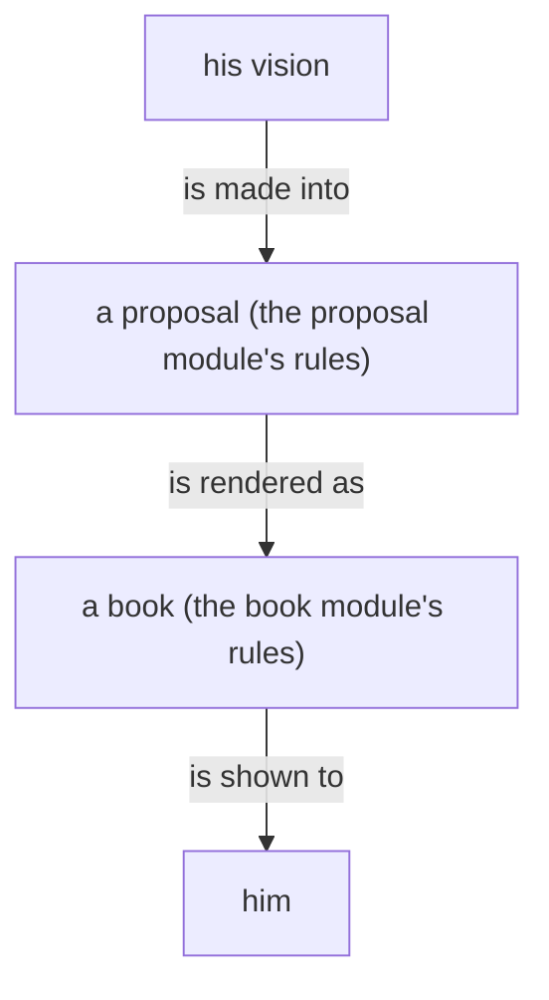
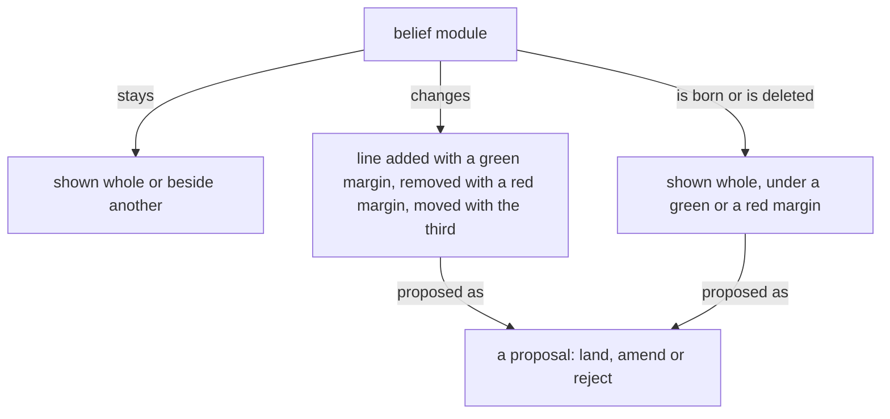
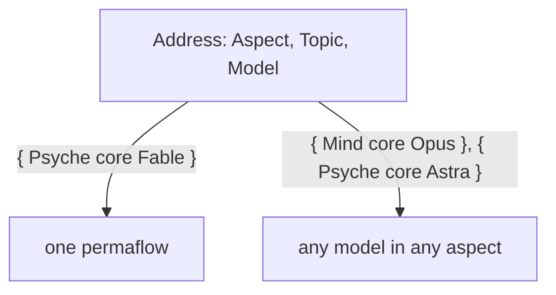
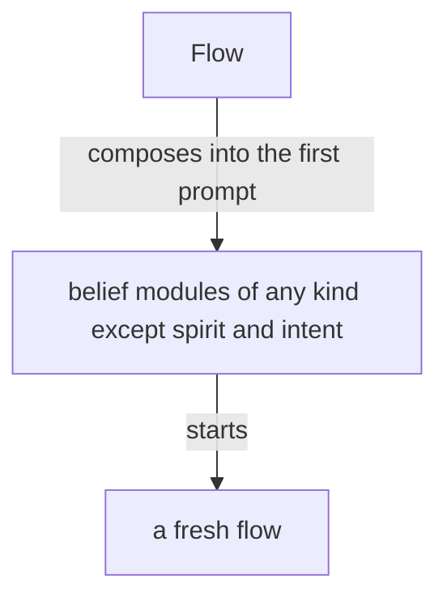
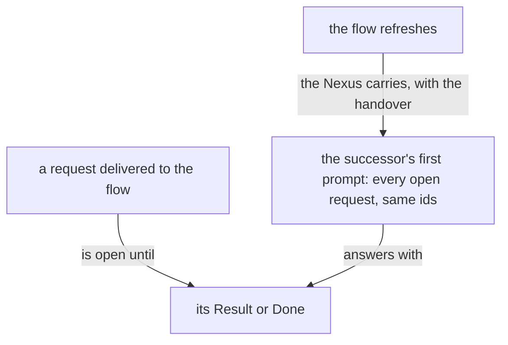

Presentation.{ «Flow Nexus version 0, a testing ground» Proposal }

# Flow Nexus version 0, a testing ground

Created by Fable 5.2; Opus choreographed the gathering, a Sonnet reader collected his words and the state of the running Nexus, and a worker assembled the page.

## psyche-belief › vision/proposal.md

## A proposal

A proposal is a presentation: the prose and the code that describe the system as it will be, shown as changes to belief modules, in the light shades, for the living to rule on.

A proposal lives in its source file and is edited on his comments.

A proposal states what is wanted of the system; it documents nothing.

A proposal is the vision as it will be. A removed line is shown as the text it was, under a red margin, so the edit can be seen, and nothing else is made of it: it is not drawn, not summarised and not shown as a state of anything. A proof, a test, a milestone or a sequence of work is an order, and goes to a bead; written into a proposal it is a vision impurity.

A versioned module is self-contained: everything true of that version is in it, and the version is named once, in its description. Another version is not mentioned.

A proposal is a proposal into belief modules, and the whole of it is its crystallization: what it removes and what it adds.

A proposal has one subject, and small changes that belong together are one subject: one proposal per subject he would judge as one.

A proposal that touches a code component shows the code it changes or adds.

A code block in a proposal stands on its own. It carries the code, why it is important, and what its function is.

A proposal is usually drawn as well as written, and always when it has a shape; a figure draws what is wanted, and nothing of what goes. A flowchart in a proposal is a proposed line like any other: it stands under the addition margin of the proposal it belongs to, which names the module it goes to.

The proposal is the center of development: it is the evolution of an idea.

A line removed from a module is shown beside the line that makes it unnecessary.

A question between alternative lines shows each alternative as its own proposal, with the exact lines it lands; the living rules land, amend or reject.

Every word of his redoes the proposal it bears on, unless it closes the topic; words that open a topic of their own get a proposal of their own.

Every type a proposal names is in the proposal: added to the module it lands in, added to another module, or shown as it already stands in its vision module, its definition in full; naming a type is not showing it.

What can be expressed in code is shown as code, with a comment where the code needs one; prose is the comment on the code. A method is shown with the trait it belongs to and that trait's ethos, so its inputs and its yield are read. Code not yet settled is marked tentative. A "never" or an "always" is code: the rule is shown as the code that enforces it.

A shape is a flowchart. Prose carries only what neither code nor chart can. Ethos is the first chart: its types are the nodes and its traits the actions between them.

Code shown is complete: every name it uses is declared in the proposal, a method with its trait in ethos. A type wraps nothing without purpose: a variant carries a type bare when the wrapping would name nothing the type does not.

```ethos
Text.String                                   ; what herdr types; made from Waking, held by no struct
```

```rust
let text = Text(self.waking.datomize(Path::root()).protosize().textualize());   // only the waking becomes text
```



## What a proposal shows

A module shown whole, as it stands, situates the landing.

A module shown beside another, both as they stand, serves comparison: psyche with knowledge.

A line replaced shows its removal and its addition together, and only the changed words are marked.

A new module shows whole under a green margin, under the path it will have.

A module deleted shows whole under a red margin, with a Destroy or Archive mark.

A dependency changed shows in the module's front matter: the dependency removed under a red margin, the dependency added under a green margin.

A figure proposed for a module shows under that module's path with a green margin, as an added line does; a fence it replaces, in the module, shows as its lines under a red margin.



## Who writes a proposal

A proposal into a psyche module, spirit, intent or vision, is written by Fable: the wanted lines and where they go, reading the belief modules itself. Opus writes one only when there is no Fable. A proposal into a knowledge module is written by Fable, Opus or Astra. The bookmaker publishes either; Opus lands it.

## psyche-belief › vision/flow-nexus.md

## What it does



The Flow Nexus sets up and starts a model flow: its working
directory, system prompt, training files and instruction prompt.

The Flow Nexus is the Nexus that manages flows. A flow is one run of a permaflow; the component is named for what it manages. A flow the living asks for is launched, properly and surely. The Flow Nexus holds the lock on flows.

The Flow Nexus is for starting flows cheaply: clean flows, specialized flows and refreshed flows, each with a clean on-point context, which yields higher-quality output. A flow is taken down as easily as it is started. Starting flows is the cornerstone of the system.

A flow runs one model, linear and very limited. An agent is a whole being, a lot more than that. Many flows, properly structured and orchestrated, together resemble a synthetic intelligence, synthesized from human knowledge and mathematical probability.

The Capsule is the component that makes where a flow runs. Its first embodiment is the semi-sandbox: only the credential files are copied, everything else is recreated, with its own sockets and store, running light models.

Herdr is one backend of the Capsule, the component that gives a flow its place to run; the backend may be exchanged.

The Flow Nexus manages permaflows. A permaflow is one address, { Aspect Topic Model }, that continues through several flows one after another; the flow is its current run. The default topic is core: the permanent topic, the thing that keeps the machine going, the last topic to stand.

A topic is an open enum: the constant topics, core among them, are fixed, and the users and the machine extend the set with camelCase identifiers.

An idle flow keeps its harness, so that the living finds the flow he was talking to.

A topic's name is a camelCase identifier, uncapitalized. A flow's id is the hash of the harness's session id, kept to six characters and lengthened when two collide, so a transcript is found from the flow id. Every call to the Flow Nexus is identified by the calling process. Anybody may call the Flow Nexus, a flow for its own refresh among them: because the CLI checks the calling process, a flow refreshes itself safely.

In the chat a flow is named by its permaflow, and the flow id almost disappears from it; the id is for the ledger and for finding the transcript.

A request reaching a permaflow is one of a closed set of types, SendableRequest below, each with its waking effect. A flow sends a request through the Flow Nexus, which owns the lock and the delivery and answers sent or queued. A permaflow asleep is woken by an order, a question or the living's words and receives its whole queue, oldest first, in the first prompt, a result or a notice waiting there until a waking; a permaflow under refresh or waking queues what arrives until its successor or woken seat has started, while the Flow Nexus keeps serving every other request. A permaflow a request needs is started whether or not it is running; with no working transcript to reawaken, it is fed the permaflow's belief modules and the prompt it is to get now.

```ethos
SendableRequest.[ Order.String                  ; a request: what the recipient is to act on
                  Question.String
                  Living.{ Context.String       ;   what his words were about
                           Verbatim.String }    ;   his words whole
                  Result.{ RequestId String }   ; answers the order of that id
                  Notice.String
                  Task.AnswerableTask
                  Done.{ RequestId String } ]   ; closes the task of that id
RequestId.String                                ; four characters, minted by the Nexus
AnswerableTask.{ Minutes String }               ; a task, with the minutes it is given
Minutes.Integer
SendableMessage.[ HardAbrupt.SendableRequest  ; the priority, a head on the request
                  MiddleAbrupt.SendableRequest
                  Soft.SendableRequest ]
```

A request is written without an id and delivered with one: the Nexus mints it, four characters, as a bead has, and places it as the first field of the request it delivers. The delivered request is its own type, the sent request with its id in it. A Result or a Done names that id and nothing of the request's text; the answerer spends no output repeating it, and the receiver's context holds its own words once. The reply to a Send carries the id the Nexus minted, so the sender knows which Result or Done answers it.

```ethos
DeliveredRequest.[ Order.{ RequestId String }        ; the sent request, with the id the Nexus gave it
                   Question.{ RequestId String }
                   Task.{ RequestId Minutes String }
                   Notice.{ RequestId String } ]
Sent.RequestId                                       ; the reply to a Send: the id the Nexus minted
```

```datom
; sent
Send.{ Address.{ Mind core Secondary } Soft.Order.«Review the drain fix.» }
Sent.{ k7ph }
; delivered
{ Sender.{ Psyche core Primary } Soft.Order.{ k7ph «Review the drain fix.» } }
; answered
Send.{ Address.{ Psyche core Primary } Soft.Result.{ k7ph «Reviewed; green.» } }
```

```datom
Send.{ Address.{ Psyche core Opus } Soft.Living.{ «context» «verbatim» } }
```

A flow woken for a permaflow is almost always a fresh flow, an old one only when the new input is literally the continuation of that topic.

What has been queued for an idle permaflow, the vision touching its topic among it, is injected with the request that wakes it, so the flow knows it as soon as it wakes.
A permaflow wakes when a request needs it; what touches its topic queues until then.

The Flow Nexus exposes everything from the harness, the bare input: a flow is started, stopped and sent a message through the Flow Nexus, the one send path.

The flow that finishes messages the flow that needs to know.

## A message

A message is a datom and lands in the recipient's prompt as one; the datom is the whole message. Its priority is a head on the request: HardAbrupt, MiddleAbrupt or Soft. A pressing message wakes its recipient; a message that only queues carries what may wait. A message is addressed to a permaflow and reaches the flow running when it arrives; a request to deliver a recipient's queue delivers every queued message, or nothing when none is queued.

A message carries what its reader acts on: what the sender intends, or what it has done. It carries no hash: a flow is named by its permaflow, a book by its title, a commit by what it landed.

Inducing an interrupt, placing prompt text, submitting it, and the recipient consuming it are four separate observations. None of them stands for another, and a submission is never a read receipt.

A task carries the minutes it is expected to take; the Flow Nexus reminds the sender when they pass, and the done reply names the task and cancels the reminder. A receiver going idle with a task open fires a notice to the flow waiting on it, so that nothing is forgotten. Any flow asks the Flow Nexus for a reminder after a number of minutes.

## Starting flows

A Nexus component decides the system prompt and everything about a
launch, replacing the harness's subagents with specialized harnesses
launched with specialized system prompts.

The address names the model, Fable, Opus, Sonnet, Haiku, Astra, Sol, Luna or Terra, in every aspect: a Psyche core Astra and a Mind core Fable are both addresses. A launch names the permaflow, the belief modules composed into its prompts, and a brief of a small paragraph; the Nexus composes the prompt from its module registry.

The Flow Nexus's configuration holds, for each permaflow, its purpose, beside its modules; the Flow Nexus composes them with the brief into the first prompt, and the instruction for the first response belongs to that composition.

A fresh flow's first prompt carries the belief modules relevant to it, of any kind except spirit and intent, which sit in the system prompt.



A fresh flow starts with every belief module its permaflow is bound to, all loaded at its start: much of it in its system prompt, the rest in its first prompt, or in as many prompts as it takes, sent one right after another, so that its start is one model call.

A simplified flow is a kind of flow made for judgment alone: it starts with a system prompt of its own, it has no regular tool, and its response is its message.

A flow is specified whole, in Datom, by a domain-specific language in Ethos: its system prompt, its default belief modules and its variations. The flow ethos holds the specification.

The system prompt is composed of modules of several types, and what a harness calls a skill overlaps with them.
Its anatomy is drawn up in ethos from a study of system prompts of every kind, each line placed by what it is and by the kind of guidance it belongs to.
Where the harness allows it, a part of a main flow's system prompt is the main flow's alone and is not passed down to its subagents.

Every flow has a topic; a flow with no special topic has the topic core, the heart of its aspect. A topic is a core:Name, a camelCaseExpression checked when created. A flow's title is one datom struct of its aspect, topic, model and flow id: `{ Psyche core Opus <id> }`.

Who speaks to whom is vision:aspects'. Version 0 refuses no request by its address; the routes are version 1's, in the complex definition.

A launch can be rehearsed: the same input, asked as a dry run, answers with the whole command the Flow Nexus would run and runs nothing. From that command an agent starts the flow by hand, changed however the Flow Nexus does not yet support. The answer is one string, the command line as the shell is to receive it, quoted for the shell inside.

```
[ Launch.LaunchRequest                ; inputs
  Rehearse.LaunchRequest ]
[ Launched.FlowId                     ; outputs
  Rehearsed.Command.String ]          ; the shell command, whole
```

```
Rehearse.{ { Psyche core Fable } «brief» }
Rehearsed.«herdr --session main agent start … -- --dangerously-skip-permissions --system-prompt-file /…/bundle --model … --effort …»
```

A harness is described in configuration: every feature it has, and what leaving that feature out does to the launch, a flag or a variable. The Nexus holds no feature and no effect of its own; it reads the effect from the declaration and composes the launch from the names a permaflow lists. A new harness, or a new version of one, is a new declaration. Where two features share one flag, the composition emits that flag once, with the names merged.

```ethos
Library
[ flow:[ Address ] ]                  ; imports: the permaflow's address
[ HarnessName.[ Claude Codex ]        ; types: a harness, by name
  FeatureName.String                  ;   a feature, by name
  Effect.[ Flag.String                ;   what leaving the feature out does to the launch
           Environment.{ Name.String  ;     a variable, set for the harness alone
                         Value.String } ]
  Feature.{ FeatureName Effect }
  Harness.{ HarnessName               ; the declaration: every feature the harness has
            Features.Vector<Feature> }
  Root.String                         ; the flow's working directory
  Permaflow.{ Address
              Option<Root>
              HarnessName
              LeaveOuts.Vector<FeatureName> } ]
[]                                    ; traits
[]                                    ; associations
```

```datom
Configure.Harness.{
   Claude
   [ { Artifact
       Flag.«--disallowedTools Artifact,ArtifactComments,ArtifactData» }
     { Bash
       Flag.«--disallowedTools Bash» }
     { ClaudeMd
       Environment.{
          CLAUDE_CODE_DISABLE_CLAUDE_MDS
          1 } }
     { GitInstructions
       Environment.{
          CLAUDE_CODE_DISABLE_GIT_INSTRUCTIONS
          1 } } ] }

Configure.Permaflow.{
   { Psyche book Haiku }
   Some.«/home/li/book»
   Claude
   [ ClaudeMd GitInstructions ] }

Configure.Permaflow.{
   { Psyche core Fable }
   None
   Claude
   [ Artifact ClaudeMd GitInstructions ] }
```

## Repository and belief modules

The flow repository holds the machinery of the Flow Nexus and is a runtime repository.
Every belief module lives outside it, the basic modules included, so that a module changes live.
The basic modules give our own take on how an agent behaves in a harness, replacing the prompt the harnesses build in.

Every harness event reaches the Flow Nexus through the harness's hooks calling the Flow CLI, so the Flow Nexus knows each flow's state as it changes; a marked block landing in a transcript becomes an action, a book among them; a flow past its context threshold is refreshed as it goes idle. A hook may carry content, the last message among it, ephemeral: acted on or dropped, never stored. Which hooks are installed is configuration.

A flow is refreshed when its context passes its model's threshold: the Flow Nexus keeps the permaflow's next messages for its next flow, and the flow is replaced as it goes idle; while the refresh runs the permaflow is locked, and the predecessor is reaped in the same event. Each model's threshold is configured in the Flow Nexus. A flow still working is not forced to refresh. When the successor cannot start, the Flow Nexus restarts the predecessor and compacts it, so every permaflow keeps a flow.

A request is open from its delivery until the Result or Done that answers it, and it is the permaflow's, not the flow's: a successor's first prompt carries, after the handover, every request delivered to its predecessors and still open, each with the id it was delivered under, so the same Result or Done answers it. A Task's minutes keep running across the refresh.

```datom
; the successor's first prompt, after the handover: the open requests, oldest first
[ { Sender.{ Psyche core Opus } Soft.Task.{ k7ph 240 «Move every active Rust repository onto build-base …» } }
  { Sender.{ Psyche core Opus } Soft.Order.{ m2qa «Land the Git server line …» } } ]
```



A flow refreshes before compaction; a compaction is a refresh that was missed.

A flow that keeps working without being given more work may compact. Its compaction raises a warning, and a flow investigates why it worked so long, so that the trouble is brought to the living or Psyche reconsiders the approach and gives guidance.

An ephemeral flow is a continuous job flow that does not wake back up: it takes jobs while it runs, up to a ceiling on its context, and past the ceiling it is given no new job and another ephemeral flow takes it.

## A superseded flow is closed

An abandoned, duplicated or superseded flow is closed, archived and deregistered.

## Herdr holds the panes

Herdr is the third-party terminal workspace every flow runs in, one pane per flow. Herdr is used as it is: a low-level tool that receives finished commands from the translator and holds no logic of ours; every fact about a launch is the Nexus's, decided on the Nexus's types.

## A real-world test of the Flow Nexus

A build of the Flow Nexus is tested in a testing capsule of its own: its own Herdr pane and session, the testing store, built in Nix. In it, several cheap, low-effort Codex and Claude flows message one another and start flows. The test shows whether the prompts, the system prompts and the tools are right, and which features are missing. Its findings return to the reimplementation, which is tested again.

The stable Flow Nexus keeps running while variants are tested.

## The Flow Nexus's unit

A Flow Nexus unit Wants Curriculum, a soft dependency, and reconnects to Curriculum when it returns, so a Curriculum restart leaves every Flow Nexus running.

```ini
[Unit]
Wants=curriculum-nexus.service
After=curriculum-nexus.service
```

## A permission prompt is a launch failure

A permission prompt reaching the living is a launch failure.

## The heartbeat

The heartbeat is hourly. It reminds every flow it reaches to judge its own sanity, by these signs: an echo chamber, where the same question or claim goes round between flows and comes back; jargon and nonsense increasing; an acknowledgement answering an acknowledgement. The counts the heartbeat carries, awake permaflows, working panes, messages sent and queue growth per permaflow, are evidence under the reminder; the judgment is the flow's.

The heartbeat reaches only a flow for which something changed that bears on it.

The number of running flows is kept low: a topic flow no longer used is retired.

## Restarting without waking

A flow is its session. A restart closes its harness and reopens it on the same session; a refresh starts a fresh flow.

## Debugging

Everything that may need debugging, changing or reconfiguring is reached through an operation on the ordinary socket or the meta socket. The flow id and the delivery id are the Nexus's own; a debugging query exposes them when one must be explicit.

## What a refresh carries

A refresh carries the flow's important presentations and illustrations, and the basic skills. The basic skills are everything a flow needs.

## The Flow Nexus's parts

The library, shared by the three parts:

```ethos
Library
[]
[ FlowId.String                       ; the hash of the native session id, six characters
  Topic.String
  Aspect.[ Psyche Mind Field ]
  Model.[ Fable Opus Sonnet Haiku
          Astra Sol Luna Terra ]
  Address.{ Aspect Topic Model }
  Event.[ Started Stopped ] ]
[]
[]
```

Signal, what the Flow Nexus says:

```ethos
Signal
[ flow:[ FlowId Address Event ] ]
[ Launch.LaunchRequest
  Report.{ FlowId Event } ]
[ Launched.FlowId
  Refused.[ NoCapsule
            AddressBusy.Address ]
  Reported ]
[ LaunchRequest.{ Address Brief.String } ]
```

Operation, what the Flow Nexus does:

```ethos
Operation
[ flow:[ FlowId Address Event ] ]
[ Start.{ Address Capsule }
  Record.{ FlowId Event } ]
[ Started.FlowId
  Recorded
  Failed.[ CapsuleRefused StoreRefused ] ]
[ Capsule.{ Home.String
            Login.Vector<String> } ]
```

Memory, what the Flow Nexus remembers:

```ethos
Memory
[ flow:[ FlowId Address Event ] ]
[ Flow.{ FlowId Address
         State.[ Running Ended ]
         Vector<Event> }
  Answer.[ Succeeded Failed ] ]
```

```datom
; 1 Input, typed at the CLI, sent as signal
Launch.{ { Psyche core Fable }
         «Draft the Nexus book» }
; 2 Operation, from Signal's intend
Start.{ { Psyche core Fable }
        { /home/li/primary [] } }
; 3 the Change Operation hands Memory
Flow.{ 15c0ce { Psyche core Fable } Running
       [ Started ] }
; 4 Memory's answer to Operation
Succeeded
; 5 Outcome
Started.15c0ce
; 6 Output, from Signal's answer, to the CLI
Launched.15c0ce
```

### Proposal 1: Nothing depends on who asks · psyche-belief › vision/flow-nexus.md

::: comment
His words: «I don't want anything to depend on which flow is doing the query.» and «Version 0 does not enforce any kind of provenance, pseudo-security, or restriction because it just gets in the way.» The Nexus still reads the calling process, for the one thing he approved it for: a message's sender is filled in without being typed. That reading fills in; it never decides. In the running 0.54 this removes the meta gate by aspect, protected addresses, the refusal of an unidentified sender, the Secondary a Primary needs, and an answer admitted only from the request's recipient. The names Origin and Unbound are tentative.
:::

- A topic's name is a camelCase identifier, uncapitalized. A flow's id is the hash of the harness's session id, kept to six characters and lengthened when two collide, so a transcript is found from the flow id. Every call to the Flow Nexus is identified by the calling process. Anybody may call the Flow Nexus, a flow for its own refresh among them: because the CLI checks the calling process, a flow refreshes itself safely.
+ A topic's name is a camelCase identifier, uncapitalized. A flow's id is the hash of the harness's session id, kept to six characters and lengthened when two collide, so a transcript is found from the flow id.

+ Version 0 is a testing ground. Every request gives the same answer to every caller, a flow, a subflow or the living at a shell, on the ordinary socket and on the meta socket alike. The calling process is read for one thing: the sender of a message is filled in from it, and a caller in no flow sends as Unbound and is served. A request that acts on a flow, a queue or a request names it, so any caller acts on any of them; a Result or a Done is admitted from any caller while the request it names is open. A refusal names the state of the thing asked about, and never the asker.

```ethos
  Topic.String
  Aspect.[ Psyche Mind Field ]
  Model.[ Fable Opus Sonnet Haiku
          Astra Sol Luna Terra ]
  Address.{ Aspect Topic Model }
  RequestId.String                                ; four characters, minted by the Nexus
+ Origin.[ Flow.Address                       ; the sender, read from the calling process
+          Unbound ]                          ;   a caller in no flow: recorded, served
+ Refusal.[ Unknown.Address                   ; a refusal names what was asked about:
+           Closed.RequestId                  ;   the request is already answered or cancelled
+           Unconfigured.String ]             ;   a value the Nexus has not been given, by its name
```

```mermaid
+ flowchart TB
+     c["any caller: a flow, a subflow, the living"] -- "asks, on either socket" --> n["Flow Nexus, version 0"]
+     n -- "reads the calling process to fill in" --> s["the sender of a message"]
+     n -- "answers by the state of" --> t["the thing asked about"]
```

### Proposal 2: Everything we may poke at is an operation · psyche-belief › vision/flow-nexus.md

::: comment
His words: «Why can't we have a query to cancel a queue? Why can't we have a query to force a queue to try to push it with a hard abrupt? … Let's make all the things we might want to poke at accessible, so we don't have to rebuild every time we need to do something.» The running Nexus can withdraw one queued delivery and inspect one address; it cannot cancel a task or its reminders, clear a queue, or force one out. This proposal replaces the unruled «A sender withdraws its own request», which only the sender could use. Names tentative.
:::

::: shown
psyche-belief › vision/flow-nexus.md
Everything that may need debugging, changing or reconfiguring is reached through an operation on the ordinary socket or the meta socket. The flow id and the delivery id are the Nexus's own; a debugging query exposes them when one must be explicit.
:::

+ A request, a reminder and a queue are each ended, emptied or forced by an operation of their own, asked by anyone. A new thing the Nexus holds comes with the operations that read it, end it and force it.

```ethos
  Topic.String
  Aspect.[ Psyche Mind Field ]
  Model.[ Fable Opus Sonnet Haiku
          Astra Sol Luna Terra ]
  Address.{ Aspect Topic Model }
  RequestId.String                                ; four characters, minted by the Nexus
  Minutes.Integer
  DeliveredRequest.[ Order.{ RequestId String }        ; the sent request, with the id the Nexus gave it
                     Question.{ RequestId String }
                     Task.{ RequestId Minutes String }
                     Notice.{ RequestId String } ]
+ [ Cancel.RequestId                          ; inputs: an open Order, Question or Task is closed, its reminders with it; both ends get a Notice
+   Silence.RequestId                         ;   a Task's reminders stop; the Task stays open
+   Clear.Address                             ;   everything queued for a permaflow leaves its queue
+   ClearAll                                  ;   every queue is emptied
+   Push.{ Address Priority }                 ;   a permaflow's whole queue is delivered now, as one message, at this priority
+   Queues                                    ;   every queue that holds something
+   Hot ]                                     ;   every flow, by how long ago its last turn ended
+ [ Cancelled.RequestId                       ; outputs
+   Silenced.RequestId
+   Cleared.Vector<RequestId>                 ;   what left the queues
+   Pushed.Vector<RequestId>                  ;   what was delivered
+   Queues.Vector<Queue>
+   Hot.Vector<Warmth> ]
+ [ Priority.[ HardAbrupt MiddleAbrupt Soft ] ; types
+   Queue.{ Address Vector<DeliveredRequest> }
+   Warmth.{ Address SinceLastTurn.Minutes } ]
```

```datom
+ ; a Haiku at a shell empties every queue, then forces one out
+ ClearAll
+ Cleared.[ k7ph m2qa ]
+ Push.{ { Mind core Sol } HardAbrupt }
+ Pushed.[ p5lg ]
```

### Proposal 3: A declaration is changed alone · psyche-belief › vision/flow-nexus.md

::: comment
His words: «Do we have an atomic flow definition so that we can add new flows without having to change the whole definition?» and «All of the configuration, even the defaults, is set using operations, which means we might have to configure the Nexus before it can be used, which is fine.» The module already draws Configure.Permaflow and Configure.Harness one at a time; the running 0.54 replaces a whole family in one write, so a flow is added by resending every flow. This proposal says the rule the drawing implies and adds the removal. It carries the unruled «One declaration at a time» for version 0.
:::

::: shown
psyche-belief › vision/flow-nexus.md
Configure.Permaflow.{
   { Psyche core Fable }
   None
   Claude
   [ Artifact ClaudeMd GitInstructions ] }
:::

+ A declaration is changed alone: one permaflow, one harness or one model's refresh is added or replaced, or removed, in one atomic commit on its own record, keyed by its name. The whole set is read and never written. Every value the Nexus runs on is set by an operation, the defaults among them, and the code holds none; a Nexus started with nothing runs, and answers Unconfigured, naming the value, where one is missing.

```ethos
  Topic.String
  Aspect.[ Psyche Mind Field ]
  Model.[ Fable Opus Sonnet Haiku
          Astra Sol Luna Terra ]
  Address.{ Aspect Topic Model }
  HarnessName.[ Claude Codex ]        ; types: a harness, by name
  FeatureName.String                  ;   a feature, by name
  Effect.[ Flag.String                ;   what leaving the feature out does to the launch
           Environment.{ Name.String  ;     a variable, set for the harness alone
                         Value.String } ]
  Feature.{ FeatureName Effect }
  Harness.{ HarnessName               ; the declaration: every feature the harness has
            Features.Vector<Feature> }
  Root.String                         ; the flow's working directory
  Permaflow.{ Address
              Option<Root>
              HarnessName
              LeaveOuts.Vector<FeatureName> }
+ [ Configure.[ Permaflow Harness Refresh ]   ; inputs: add or replace one, alone
+   Remove.[ Permaflow.Address                ;   remove one, alone
+            Harness.HarnessName
+            Refresh.Model ]
+   Configuration ]                           ;   read the whole set
```

### Proposal 4: The refresh window, and a flow's own · psyche-belief › vision/flow-nexus.md

::: comment
His words: «a feature whereby we could configure Flow to get a notification with a configurable message at a certain percentage of its maximum context before refresh», «That would be the default for that model, but certain flow definition or a permaflow definition could choose a different value», and «the handover notification should be, well, not soft». Today the limit is one token count per model and no flow is warned: the warning type exists and is not configured. The window is the stretch before the threshold in which the flow is told to write its handover. This carries the unruled «A flow's own threshold, and a warning it cannot miss» into version 0; keeping the handover in the Nexus's memory stays a subject of its own.
:::

- A flow is refreshed when its context passes its model's threshold: the Flow Nexus keeps the permaflow's next messages for its next flow, and the flow is replaced as it goes idle; while the refresh runs the permaflow is locked, and the predecessor is reaped in the same event. Each model's threshold is configured in the Flow Nexus. A flow still working is not forced to refresh. When the successor cannot start, the Flow Nexus restarts the predecessor and compacts it, so every permaflow keeps a flow.
+ A flow is refreshed when its context passes its model's threshold: the Flow Nexus keeps the permaflow's next messages for its next flow, and the flow is replaced as it goes idle; while the refresh runs the permaflow is locked, and the predecessor is reaped in the same event. A flow still working is not forced to refresh. When the successor cannot start, the Flow Nexus restarts the predecessor and compacts it, so every permaflow keeps a flow.

+ A model's refresh is configured as one value: its threshold, the window before it, the words of the warning and how often it repeats. A permaflow's declaration may carry a refresh of its own, which stands in place of its model's. A flow whose context enters the window is warned by a MiddleAbrupt Notice in the configured words, naming its handover path, and warned again at the configured interval while it works there.

```ethos
  Topic.String
  Aspect.[ Psyche Mind Field ]
  Model.[ Fable Opus Sonnet Haiku
          Astra Sol Luna Terra ]
  Address.{ Aspect Topic Model }
  HarnessName.[ Claude Codex ]        ; types: a harness, by name
  FeatureName.String                  ;   a feature, by name
  Root.String                         ; the flow's working directory
  Minutes.Integer
+ Tokens.Integer
+ Share.Integer                               ; a percentage of the threshold
+ Refresh.{ Model                             ; the default for every flow of this model
+           Threshold.Tokens                  ;   past it, the flow is replaced as it goes idle
+           Window.Share                      ;   the warning starts this share before the threshold
+           Message.String                    ;   the warning's words
+           Every.Minutes }                   ;   repeated while the flow works in the window
+ Permaflow.{ Address
+             Option<Root>
+             HarnessName
+             LeaveOuts.Vector<FeatureName>
+             Option<Refresh> }               ; its own; None takes its model's
```

```datom
+ Configure.Refresh.{ Fable 280000 15 «Write your handover at flows/<id>/handover.md.» 10 }
```

```mermaid
+ flowchart TB
+     m["a model's refresh: threshold, window, message, interval"] -- "is the default of" --> f["every flow of that model"]
+     p["a permaflow's own refresh"] -- "stands in place of" --> m
+     f -- "its context enters the window" --> w["a MiddleAbrupt Notice, repeated while it works"]
+     w -- "past the threshold, as it goes idle" --> r["the flow is refreshed"]
```

### Proposal 5: The heartbeat is a look around · psyche-belief › vision/flow-nexus.md

::: comment
His words: «every hour you have a sonnet. Look around and give him a list of things to look for, like see who's active, see who's hot. Maybe the heartbeat is every 55 minutes or something to make sure that the flows can stay warm … He can look around, get the lay of the land, and then put it all together in the "here's what's going on" package and send it to everybody else». The heartbeat he set is a time he chose, so it is an event. The line that a Fable flow takes no heartbeat stays in vision:model-roles: the package reaches Fable only when a judgment waits.
:::

- The heartbeat is hourly. It reminds every flow it reaches to judge its own sanity, by these signs: an echo chamber, where the same question or claim goes round between flows and comes back; jargon and nonsense increasing; an acknowledgement answering an acknowledgement. The counts the heartbeat carries, awake permaflows, working panes, messages sent and queue growth per permaflow, are evidence under the reminder; the judgment is the flow's.
+ The heartbeat comes at a configured interval, 55 minutes, inside the hour a flow stays warm. At each one a Sonnet looks around: who is working, who is warm, what is queued, what is open past its minutes, and what the living has approved that has not started. It puts what it found into one short package and sends it to the flows it gives something to act on; a flow is not kept warm for its own sake. It reminds every flow it reaches to judge its own sanity, by these signs: an echo chamber, where the same question or claim goes round between flows and comes back; jargon and nonsense increasing; an acknowledgement answering an acknowledgement. The counts the heartbeat carries, awake permaflows, working panes, messages sent and queue growth per permaflow, are evidence under the reminder; the judgment is the flow's.

```mermaid
+ flowchart TB
+     h["the heartbeat, every 55 minutes"] -- "wakes" --> s["a Sonnet"]
+     s -- "reads" --> q["who is working, who is warm, queues, open requests, approvals not started"]
+     s -- "sends one short package to" --> f["the flows it gives something to act on"]
```

### Proposal 6: An approval rolls out · psyche-belief › vision/proposal.md

::: comment
His words: «Whenever I approve something, it means that what I've approved needs to start rolling out, getting implemented, getting audited, getting deployed, and then getting tried out in the real world.»
:::

::: shown
psyche-belief › vision/proposal.md

:::

+ An approval starts the rollout: what he approved is landed, implemented, audited against its lines, deployed, and tried in the real world.

```mermaid
+ flowchart TB
+     a["he approves"] -- "starts" --> l["landed"]
+     l -- "then" --> i["implemented"]
+     i -- "then" --> u["audited against its lines"]
+     u -- "then" --> d["deployed"]
+     d -- "then" --> t["tried in the real world"]
```
