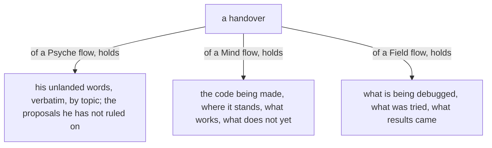
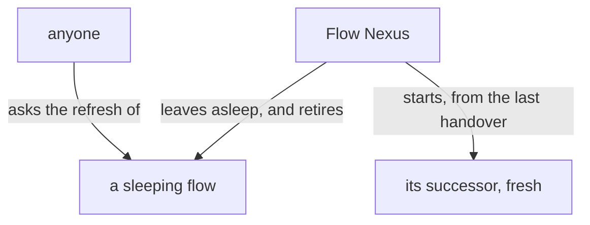

# Design: The handover, by aspect

Author: Psyche core Fable (Fable 5.2). A worker assembles the presentation source from this file. Title: «The handover, by aspect». Kind: Proposal. Signature line: Created by Fable 5.2; Opus choreographed the gathering, a Sonnet reader collected his words, and a worker assembled the page.

The page shows psyche-belief › vision/remembering.md whole, as it stands, then Proposals 1 and 2; then psyche-belief › vision/flow-nexus.md whole, then Proposal 3. Wording marked ADD or COMMENT is final. Code fences under an ADD are added lines; an Ethos fence carries, as unchanged context lines copied from the module, the declaration of every module type it uses.

---

## Proposal 1: What a handover holds follows the aspect · psyche-belief › vision/remembering.md

COMMENT
His words, 10 November: «your flow is focusing on my words, right? My designs … a field flow keeps track of what it is debugging and what kind of results it got. A Mind Flow keeps track of what code it's making, where it's at in its implementation, what it has working, and what it doesn't have working yet». And on the Psyche handover, 7 November: «keeping a more structured less messy version of everything I've said, linked together by a few words … angle quotes to hold anything that was from me verbatim … sorted by topic, kind of like, "Let's keep his words alive until we land the vision on this"», with, on 5 November, «a proposal that I haven't approved … you should have at least an awareness of it in your handover». His word of 4 November that only the flow he talks to writes a handover is overruled by today's. The landed overview line stays: this says what the overview is made of.

PLACE: after the paragraph beginning «A flow is refreshed after its landings», before the figure that follows it.

ADD
What a handover holds follows the flow's aspect. A Psyche flow keeps his words alive until their vision lands: what he said that is not yet landed, verbatim in guillemets, sorted by topic and linked by a few words, and the proposals he has not ruled on. A Mind flow holds what code it is making, where the implementation stands, what works and what does not work yet. A Field flow holds what it is debugging, what it tried and what results it got.



---

## Proposal 2: The refresh follows the handover at once · psyche-belief › vision/remembering.md

COMMENT
His words, 6 November: «train the flow to actually notify the Nexus back that it has done its handover and it's ready for refresh. As soon as its handover is done, that way the handover doesn't grow stale before the refresh happens.» The flow's own Refresh request is that notice; the Nexus needs nothing new for it.

PLACE: after the added paragraph of Proposal 1.

ADD
A flow that has written its handover asks for its refresh at once, so the handover is current when its successor reads it.

```datom
; the flow, its handover written, to the Flow Nexus
Refresh.{ Mind flowNexus Opus }
RefreshQueued.{ { Mind flowNexus Opus } 1da054 }
```

---

## Proposal 3: A sleeping flow is refreshed without being woken · psyche-belief › vision/flow-nexus.md

COMMENT
His words, 25 October: «I want to be able to restart a flow without waking it … I want the option.» and 7 November: «we could use his previous handover and have a fresh Fable without paying the context cost of waking the old one.» The section's heading still says it; its body no longer does. Waking an old flow only to have it hand over pays for its whole context uncached.

PLACE: section «## Restarting without waking», after its paragraph.

ADD
A flow asleep is refreshed without being woken: asked from outside, the Flow Nexus starts its successor from the flow's last handover, told that the handover is that old, and the sleeping session is not read again.


