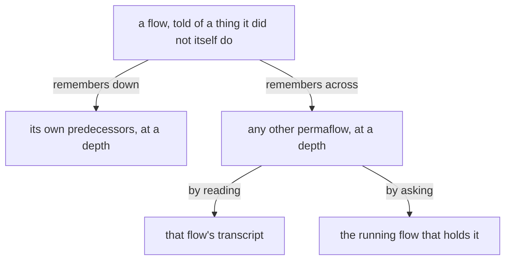

# Design: Remembering reaches every flow

Author: Psyche core Fable (Fable 5.2). A worker assembles the presentation source from this file. Title: «Remembering reaches every flow». Kind: Proposal. Signature line: Created by Fable 5.2; a worker assembled the page.

The page shows psyche-belief › vision/remembering.md whole, as it stands, then Proposal 1. Wording marked ADD or COMMENT is final. Fences under the ADD are added lines.

---

## Proposal 1: Remembering reaches every flow · psyche-belief › vision/remembering.md

COMMENT
His words, 10 November: «all of the flows being one entity conceptually. This means that remembering doesn't just imply the depth of a certain permaflow, but also the depth of any permaflow. So that essentially remembering can entail talking to other flows.» The module today has a flow remember down its own line of predecessors, by reading a transcript. This adds the other direction, across, and the second way, asking.

PLACE: section «## All flows are one subjectivity», after its paragraph.

ADD
Remembering reaches every permaflow, at any depth, as it reaches the flow's own: what a flow did not itself do or say may be in the past of any of them. A flow remembers by reading that transcript, or by asking the flow that holds it.

```datom
; remembering by asking: a Question to the flow that holds it
Send.{ { Mind flowNexus Opus } Soft.Question.«Why did 0.54.0 refresh no flow?» }
```


