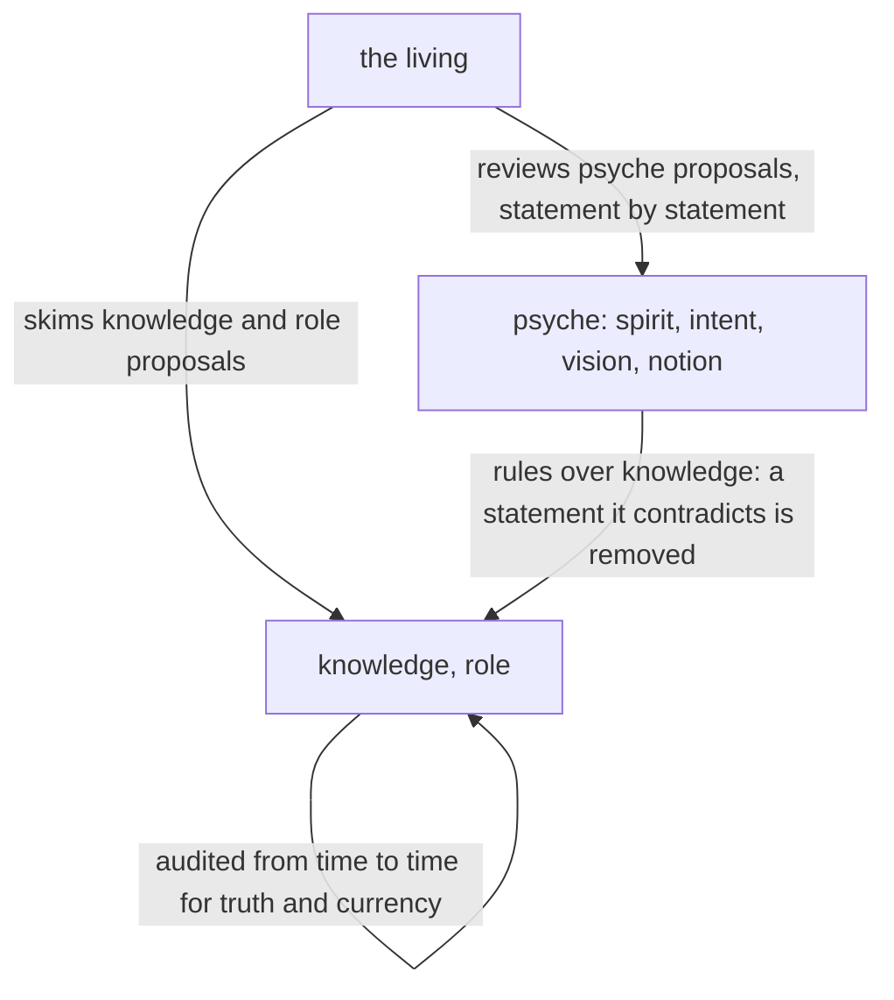

# Belief modules, whole

Created by Fable.

Source for the book metaflow. The module is rewritten whole: show the present vision/belief-modules.md whole in red, then the new text whole in green, under the same path; the two figures of the present module go with the red. One why. This supersedes Cohesive editing.

## psyche-belief › vision/belief-modules.md — rewritten whole

Why: his review of Cohesive editing: the whole module is rewritten with that approach, as one piece; what stood in it that he did not trust is weighed statement by statement and either stands in its place below or is gone. Gone: the kinds compensation and inquiry; "content can be good and belong elsewhere"; "context lines are richly annotated"; the rule of Mind over Field, since Field holds no belief kind of its own now; the skill-as-legacy paragraph, which is knowledge of the harness. Folded in: his words this morning on where belief lives and its kinds, on review, on identifiers in knowledge, on description and body, on cohesive editing, and on statement, section, passage and line.

## What belief is

Belief is what is composed into a flow, and all of it lives in three repositories: psyche-belief, mind-belief and field-belief. Its kinds are spirit, intent, vision and notion, which are psyche; knowledge, which is fact verified in the system; and role, the instructions of one main flow or one subflow. A folder is a kind and a file is a subject, so a module is named by its kind and its subject, vision:book. The composer reads the three repositories and nothing else; which modules a flow is composed from is configuration of the composer, held in its memory.

A module's description names its subject and when it is loaded; its body holds the beliefs. Each thing is said once, in the one of the two it belongs to.

## What a module says

A belief module states what holds now. A subject the living reviews or asks about has a module, on its topic or a broader one, with room to hold it. A vision module may be substantial: it holds the code important to the vision, the invariant parts, which the living reviews as he reviews prose; the invariant code of Flow lives in vision:flow, a Chronos invariant in vision:chronos.

A knowledge module states what is true of the system as deployed, in words. A hash, a commit, a flow id, a process id, a version number or a path is a fact of the moment and lives in the system that can answer for it, which a flow asks.

## How belief is reviewed

Every statement in a belief module landed from a proposal he saw: psyche statement by statement, knowledge and role skimmed. A statement met with no proposal behind it is machine text and is removed when it is met. In the long term, a change may land without his review through an extensive automated machine review held to standards.

## Where a module is placed

A module declares its placement: the system prompt, or loaded on demand. Spirit and intent are placed in the system prompt.

## Editing belief

A statement is one belief, the unit he reviews. A section is a heading and what stands under it. A passage is a span of rendered text, which is what a proposal marks removed, added or moved. A line is a line of text.

A belief goes in the module of its subject, and enters it by rewriting the section it joins, so that the section reads as if written at once: the statement it contradicts leaves first, and the new statement takes its place. A module that no longer reads as one is rewritten whole from its statements and proposed whole. A module stays the size of its subject.
