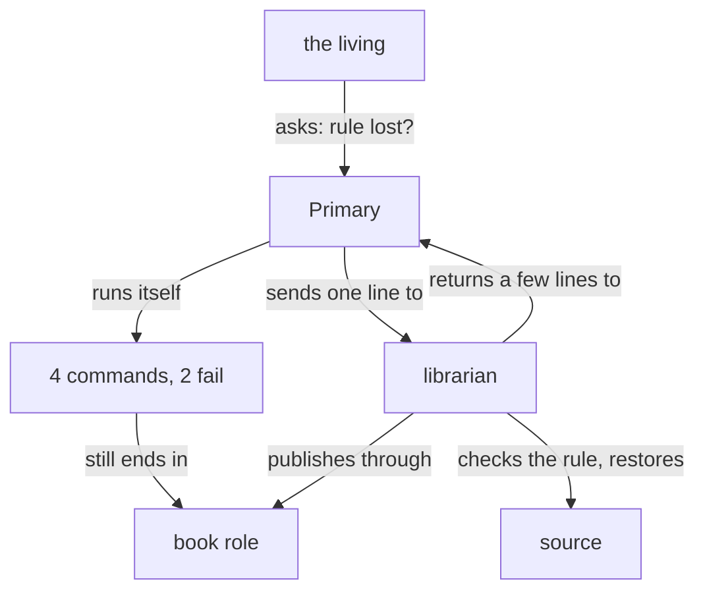

Presentation.{ «One line to a role» }

# One line to a role

Written by Opus for the Psyche core Primary; the transcript counted, his records and the roles found by Sonnet.

## What happened

You asked whether the instructions for the bookmaker were lost: the rule that a commented book keeps its source and link, and its redo goes to a new one. I, the Primary, answered by working the shell myself. I grepped four files for the rule. I tried to move the commented source aside and restore it from git in one long command; it failed twice on a malformed revision (`a9cde819cows/...`) and on an empty directory. I looked at what the half-run command had left, then ran the restore again and committed it. Only then did I send the book role to publish, which is where the job was always going to end.

The rule was there all along: knowledge-book-making's "Commented books" holds it.

## The numbers

From the usage fields of the Primary's own turns, his question to the moment his next message arrived. Each turn re-reads the whole conversation, so the cached input is the weight.

| | The Primary did it | One line sent |
|---|---|---|
| Tool calls | 5 (4 shell, 1 subflow) | 1 subflow |
| Fable turns | 5 | 1 |
| Fable input, cached read | 774,311 | about 155,000 |
| Fable input, cache written | 4,672 | a few hundred |
| Fable input, uncached | 130 | about 26 |
| Fable output | 2,977 | under 300 |
| Failures read by Fable | 2 | 0 |

The one-line column is an estimate: one turn at the stretch's mean context (774,311 / 5), and a two-line brief. Its remaining work runs on a Tertiary, whose tokens our model-roles module calls far cheaper; it gives no prices, so none are put here. On Fable's tokens alone, the shell path cost about five times the input and about ten times the output, and it still ended in the subflow it could have begun with.

## His words today

> So why did you use `grep`? You're a main flow. I don't understand how to make you understand how to use subflow. You could have used subflow to do the whole thing and check to see if the instructions are there and add them if they're not, right?

> Let's make a case study of this. You ran all these commands. It hasn't gotten you really far. How much would it have cost to send a couple-line instruction set to a subagent that knows how to edit beliefs? This is coming back to my point from yesterday: having really well-defined subagents that know how to do things that only need a single line to direct them.

## His words yesterday, 2026-10-30

From flows/b0d3ae/vision/subflows.md, after the Primary listed files itself:

> How come you're giving yourself the right to run these commands? I mean I guess they're minimal but it's kind of ridiculous for you to just list a few files and think that that can somehow really give you a good idea of what's happening. Don't you think? Wouldn't you rather send an Opus or a Sonnet to really investigate rather than just list a few files? Not saying you should do that now but I think it's silly for you to run a command (which I don't even want you to do in the first place), thinking that that's even sufficient for you to take an informed decision on when you could have used a full agent with a simple one-line brief or two lines, right?
>
> You don't have to tell them how to walk and whether or not they should start with the left foot or the right foot, or if they should keep their mouth shut when they're breathing. You just have to ask them a simple question and trust their good judgment.
>
> I think that machines in general actually fail to do stuff like that. It's like they don't trust subagents or they don't trust that they have well-trained subagents, which is why I've been such a big proponent of actually writing well-trained but not overtrained subagent role files for the machines to use so that they can just give them as many characters as it would take them (for example, for you to look for these files), one short paragraph at most. Do you understand what I'm saying? I think there's a lot to be obtained out of this.

> No, no, no. You're being myopic here. You don't really see the big picture behind what I just said. You seem so easily hypnotized by the particular and you seem to struggle so much with trying to get the big picture and thinking broadly and modularly. I'm not just talking about psyche primary. Obviously the value in what I'm saying is huge for everything.

From flows/b0d3ae/vision/beliefNexus.md:

> Well use your creativity. See if you can come up with the first.
>
> We're also talking about redoing the belief nexus, which is kind of a successor to the curriculum. This is essentially because I think that modifying curriculum, at this point, sounds like a giant pile of stinking shit. Working on that giant pile of shit would just get our hands full of shit and our noses irritated. It would make us vomit and it would be horrible.
>
> Really what I'm talking about is creating the infrastructure that allows us to create subagents. A lot of, or basically all of, their training would come from the belief module, with probably a small module for their particular role in some cases. In some cases, not even. In some cases once we have a really good set of belief modules, we can really create it: we can create some very interesting behavior out of just composing them in different ways. And then and only then, once you have a good set of well-trained sub-agents, can you expect good behavior out of asking a simple question or giving a simple order? Do you understand what I'm saying?

From flows/b0d3ae/vision/subflowRoles.md:

> It's okay. You're still being myopic. I'm going to have to talk for half an hour, I think, for you to really understand where I'm getting at here.
>
> We're talking about defining subagent roles. This is a multiple-day design, conversation, and implementation thing and you think you can just get it done by a couple lines and some broad modules that are mostly just going to add more noise and create more friction. Your solution, I'm not saying don't propose belief editing, please do, but your approach is myopic.

## The roles that stand today

Fifteen agent files stand: read-trivial, read-ordinary, read-demanding; write-trivial, write-ordinary, write-demanding; scripter, tester; book, book-page, book-author, book-reader, illustrator, comment-relay; and general-purpose. The lander has four role modules and no agent file, so no flow can launch it.

This job could have gone, in one line, to write-ordinary: it carries the book modules, git and edit rights. Its description, "the approach is known", names a difficulty, not a job; so the brief has to say what it is to do and what to do on failure, and grows past one line. The book role publishes but restores nothing. What is missing is a role whose job is this one: keeper of the books, which checks a book rule, restores a source, and publishes.

### Proposal 1: Roles are briefed in one line · psyche-belief › vision/subflows.md

**Comment** The roster names each role by its job, with the one line a caller sends it; each line is an example, not a template.

  ## Long term: actual flows replace the harness subagent tool

  A flow's questions and requests are answered and fulfilled by actual flows, each under its own system prompt, and the answers return to it asynchronously, as messages.
+
+ ## A role takes one line
+
+ A subflow role is trained by the belief modules it composes and, where needed, a small role module, so one line directs it: the caller names what it wants and trusts the role's judgment for how.
+
+ A main flow runs no command for an errand; it sends the line.
+
+ read-trivial: "Fetch the description line of vision-subflows."
+
+ read-ordinary: "Find his words of yesterday on one-line roles."
+
+ read-demanding: "How does a book comment reach the Secondary?"
+
+ write-trivial: "Rename translator.md to translator-2.md; commit."
+
+ write-ordinary: "Make the book builder accept a figures directory."
+
+ write-demanding: "Build the datom socket's parser."
+
+ scripter: "Count my tool calls and tokens since his question."
+
+ tester: "Test the translator at this commit against its proposal."
+
+ book: "Publish flows/a78e9a/accounts/one-line-roles.md."
+
+ book-reader: "What did he decide in this stretch of my transcript?"
+
+ comment-relay: "Relay the comments on the translator book."
+
+ lander: "Land proposals 1 and 3 of the translator book."
+
+ librarian: "Translator book: check the commented-book rule stands; restore its commented source and republish it to its link."

### Proposal 2: The librarian · field-belief › role/librarian.md, a new file

**Comment** A Tertiary. A missing rule comes back as the words it would take, since belief lands only through a book he approves. Its agent file is composed from this module with the book modules, as the others are.

+ A main flow names a book and what it wants of it. You keep the books: their sources, their history in git, their publications, and the rules of the book modules.
+
+ Check a rule against the book modules and say whether it stands, quoting the line that holds it. A rule found missing is returned as the words it would take.
+
+ Restore a source, with its figures, from git history to the path the caller names, and commit it. A command that fails is retried from what its failure says; only the outcome is returned.
+
+ Publish through the book role, to the link the caller names or to a new one, as book-making prescribes for a commented book.
+
+ Return a few lines: what stood, what was restored at which commit, and the link.

### Proposal 3: The librarian's description · field-belief › role/librarian-description.md, a new file

+ Keeps the books: checks their rules, restores their sources, publishes them.
