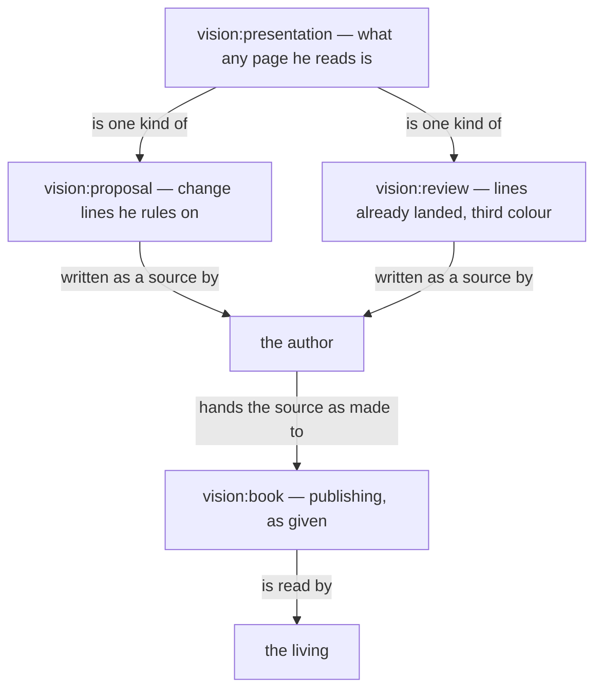

Presentation.{ «Presentation, proposal, review, book» }

# Presentation, proposal, review, book

Created by Fable; material gathered by Opus.



### Proposal 1: Figures and code belong to every presentation · psyche-belief › vision/book.md, and psyche-belief › vision/presentation.md, a new file

**Comment** These lines say how a page he reads is drawn and written; they hold for a proposal, a review and an account alike, so they leave the publisher's module.

#### psyche-belief › vision/book.md

- A figure shows how a thing moves, one question per figure, readable in seconds. Its grammar: a box is a thing or a collection; an arrow is a one-way relation carrying a verb, so that box, verb, box reads as a sentence; nearness and enclosure are kinship; top to bottom is order; colour carries a role or is absent. A figure is boxes joined by verbed arrows. A diagram in a book's source is a Mermaid flowchart in that grammar, drawn so a phone shows it; every sketch carries its arrows before it is sent. The published book shows the figure drawn from the Mermaid source by a Tertiary or Quaternary subflow given the grammar with the sketch; the figure keeps every box, label and arrow, and says only what the source says; a figure that lost an arrow is returned. A sizable book carries several figures.
-
- Prose is shown as rendered text. A code block holds code alone, and it may scroll sideways.
-
- Code in a book is shown as code, labelled with its language, plain. Ethos and datom in a book are written in the vertical form.
-
- ## Pictures
-
- A figure shows one thing, where the idea has a shape, and its colours and marks mean the same in every book.
-
- Every flowchart, in a book or in a belief module, is Mermaid, in the figure grammar; a book shows the SVG drawn from it.

#### psyche-belief › vision/presentation.md

+ ---
+ description: What a presentation is: a page the living reads, a proposal, a review or an account; how its figures and code are shown.
+ dependencies: []
+ ---
+
+ ## A presentation
+
+ A presentation is a page the living reads. A proposal, a review and an account are presentations. Its source opens with its title, and the source is handed to the publisher as made.
+
+ ## Figures
+
+ A figure shows how a thing moves, one question per figure, readable in seconds. Its grammar: a box is a thing or a collection; an arrow is a one-way relation carrying a verb, so that box, verb, box reads as a sentence; nearness and enclosure are kinship; top to bottom is order; colour carries a role or is absent. A figure is boxes joined by verbed arrows. A diagram in a book's source is a Mermaid flowchart in that grammar, drawn so a phone shows it; every sketch carries its arrows before it is sent. The published book shows the figure drawn from the Mermaid source by a Tertiary or Quaternary subflow given the grammar with the sketch; the figure keeps every box, label and arrow, and says only what the source says; a figure that lost an arrow is returned. A sizable book carries several figures.
+
+ A figure shows one thing, where the idea has a shape, and its colours and marks mean the same in every book.
+
+ Every flowchart, in a book or in a belief module, is Mermaid, in the figure grammar; a book shows the SVG drawn from it.
+
+ ## Prose and code
+
+ Prose is shown as rendered text. A code block holds code alone, and it may scroll sideways.
+
+ Code in a book is shown as code, labelled with its language, plain. Ethos and datom in a book are written in the vertical form.

### Proposal 2: The signature belongs to every presentation · psyche-belief › vision/proposal.md, and psyche-belief › vision/presentation.md

#### psyche-belief › vision/proposal.md

- ## A proposal is signed
-
- A proposal names the model that created it and, for each model that
- helped, what that help was, on a subtitle line under the title. Created
- by Fable, research by Opus, data retrieved by Sonnet.

#### psyche-belief › vision/presentation.md

+ ## A presentation is signed
+
+ A proposal names the model that created it and, for each model that
+ helped, what that help was, on a subtitle line under the title. Created
+ by Fable, research by Opus, data retrieved by Sonnet.

### Proposal 3: What a change looks like belongs to the proposal · psyche-belief › vision/book.md, and psyche-belief › vision/proposal.md

**Comment** Green, red, moved lines, new and deleted modules: these are the forms of a proposal, not of publishing. The colour-in-the-margin proposal of today amends these same lines once they are here.

#### psyche-belief › vision/book.md

- ## Books
-
- A book carries belief modules, as they stand and as they are proposed to change; its sources live in its reference file.
-
- ## What a book shows
-
- A book is belief modules in the forms below, each under its repo › path; its headings, naming the module and the kind of change, are the only words it has of its own.
-
- A module shown whole, as it stands, situates the landing.
-
- A module shown beside another, both as they stand, serves comparison: psyche with knowledge.
-
- A line added shows in green.
-
- A line removed shows in red.
-
- A line replaced shows its removal and its addition together, and only the changed words are marked.
-
- A new module shows whole in green, under the path it will have.
-
- A module deleted shows whole in red, with a Destroy or Archive mark.
-
- A line moved between modules is one proposal headed by both paths: the line in red under the module it leaves, the same line in green under the module it enters.
-
- A dependency changed shows in the module's front matter: the dependency removed in red, the dependency added in green.
-
- A figure shows as proposed for the module it will live in.
-
- A figure proposed for a module shows under that module's path in green, as an added line does; a figure it replaces shows beside it in red.
-
- ```mermaid
- flowchart TB
-     a["belief module"] -- "stays" --> b["shown whole or beside another"]
-     a -- "changes" --> c["line added in green, removed in red"]
-     a -- "is born or is deleted" --> d["shown whole, in green or in red"]
-     c -- "proposed as" --> e["a proposal: land, amend or reject"]
-     d -- "proposed as" --> e
- ```

#### psyche-belief › vision/proposal.md

+ ## What a proposal shows
+
+ A book carries belief modules, as they stand and as they are proposed to change; its sources live in its reference file.
+
+ A book is belief modules in the forms below, each under its repo › path; its headings, naming the module and the kind of change, are the only words it has of its own.
+
+ A module shown whole, as it stands, situates the landing.
+
+ A module shown beside another, both as they stand, serves comparison: psyche with knowledge.
+
+ A line added shows in green.
+
+ A line removed shows in red.
+
+ A line replaced shows its removal and its addition together, and only the changed words are marked.
+
+ A new module shows whole in green, under the path it will have.
+
+ A module deleted shows whole in red, with a Destroy or Archive mark.
+
+ A line moved between modules is one proposal headed by both paths: the line in red under the module it leaves, the same line in green under the module it enters.
+
+ A dependency changed shows in the module's front matter: the dependency removed in red, the dependency added in green.
+
+ A figure shows as proposed for the module it will live in.
+
+ A figure proposed for a module shows under that module's path in green, as an added line does; a figure it replaces shows beside it in red.
+
+ ```mermaid
+ flowchart TB
+     a["belief module"] -- "stays" --> b["shown whole or beside another"]
+     a -- "changes" --> c["line added in green, removed in red"]
+     a -- "is born or is deleted" --> d["shown whole, in green or in red"]
+     c -- "proposed as" --> e["a proposal: land, amend or reject"]
+     d -- "proposed as" --> e
+ ```

### Proposal 4: A proposal is a presentation · psyche-belief › vision/proposal.md

- dependencies: [vision-crystallization]
+ dependencies: [vision-crystallization, vision-presentation]

### Proposal 5: The book is publishing alone · psyche-belief › vision/book.md

**Comment** After proposals 1 and 3 nothing of the module remains but its front matter; this is what stands in its place.

- description: How a book is made from a proposal already written.
+ description: How a presentation already written is published.
+
+ ## Publishing
+
+ A book is a presentation published. The publisher builds the source as it was handed and publishes the page; it authors nothing and enforces nothing, and the book is as correct as its author made it.

### Proposal 6: The commented-book rule is vision of publishing · mind-belief › knowledge/book-making.md, and psyche-belief › vision/book.md

#### mind-belief › knowledge/book-making.md

- ## Commented books
-
- A book the living has commented on stays as he saw it; what his comments change goes into the next book. Its redo is a new book at a new link, and the commented one stays as he left it.

#### psyche-belief › vision/book.md

+ ## Commented books
+
+ A book the living has commented on stays as he saw it; what his comments change goes into the next book. Its redo is a new book at a new link, and the commented one stays as he left it.

### Proposal 7: The review · psyche-belief › vision/review.md, a new file

**Comment** His ruling of today: psyche lands only on his review; a knowledge or role module the machine lands is shown to him afterward, in a colour of its own.

+ ---
+ description: What a review is: a presentation of lines already landed without the living's review, in their own colour.
+ dependencies: [vision-presentation]
+ ---
+
+ ## A review
+
+ Spirit, intent and vision land only on the living's review; he approves every crystallization.
+
+ A knowledge or role module may be landed by the machine so the work goes on. Every such landing is then shown to him as a review: a presentation of the lines as landed, each under its repo › path, in a third colour beside the red and green of a proposal, so he sees at a glance that it has already landed and checks it for a line that would make a flow misbehave.

### Proposal 8: The source format is the author's knowledge · mind-belief › knowledge/book-making.md, and mind-belief › knowledge/presentation-source.md, a new file

**Comment** What a source holds is what an author writes; the publisher only reads it. The build command and the publishing procedure stay in book-making.

#### mind-belief › knowledge/book-making.md

- description: A book source is made, built or published for the living; load before writing or publishing a book.
- dependencies: [vision-book]
+ description: A presentation source is built and published; load before publishing a book.
+ dependencies: [vision-book]
-
- ## The author makes the book
-
- The author makes the book properly and sends the source as made. The builder renders what it is given and enforces nothing; the book is as correct as the author made it. The publisher builds the source and publishes the page.
+
+ ## The publisher builds and publishes
+
+ The publisher builds the source and publishes the page.
-
- ## What a source holds
-
- Outside a proposal a source holds only: one `Presentation.{ «title» }` line, one `# title`, unlabelled diagram fences, and modules shown as they stand, each under a level-two heading `## repo › path`. A module shown as it stands is its text at origin main, byte for byte, front matter left out.
-
- A proposal opens with `### Proposal N: title · repo › path`, numbered from 1; a new module ends the heading with `, a new file`, a deleted one with `, a deleted file`. A line moved between modules is one proposal headed `### Proposal N: title · repoA › pathA, and repoB › pathB`, with a level-four heading for each path, the line in red under the first and green under the second. No other level-three heading exists.
-
- ## Red and green
-
- Colour comes only from signed lines. In a change every line opens with `- ` (red, removed), `+ ` (green, added) or two spaces (unchanged, shown for place). A removed line is a whole line of the module at origin main; an added line is not. Colour comes from the diff marks alone.
-
- A module line is shown whole. A change to a hard-wrapped paragraph shows every physical line of that paragraph, so each sentence shows whole. A replaced paragraph is diffed as one paragraph: its removal and its addition together, with only the changed words marked.
-
- A code line in a book is at most 52 characters.
-
- ```text
- ### Proposal 1: A sender · psyche › messaging.md
-
- **Comment** Flow names the sender.
-
-   ## A message is a datom
-
- - The body is a datom.
- + The body is a datom; Flow names it.
- ```
-
- ## Marks inside a proposal
-
- Inside a proposal a source holds only its change lines, one Comment, its Alternatives, its Destroy or Archive mark, path headings at level four, `#### repo › path`, as the moved-line form has them, and code that the proposed lines themselves land.
-
- Every fence inside a proposal is signed line by line: red, green, or two spaces for a line kept in place, code-file proposals included, because code shown in a proposal is either what stands at origin main or what is proposed.
-
- One `**Comment**` paragraph at most, before every change: the machine's word, in its own colour. `**Alternative 1**`, `**Alternative 2**` and on, two or more, in order, each alone on its line and followed by the exact lines it lands. `**Destroy**` or `**Archive**` opening a paragraph marks a deleted module or record. Prose stands as its own paragraph, a blank line apart from any change.
-
- ## Figures and fences
-
- Every figure in a book is headed by the module it lives in and one of three states: as it stands, proposed added in green, or proposed removed in red.
-
- A figure already in a belief module shows without colour.
-
- An unlabelled fence holds a box-and-arrow sketch and nothing else; each one has its figure, `fig-N.svg` in the figures directory, drawn by the illustrator from the sketch with every box, label and arrow kept. A figure shows how a thing moves, one question per figure, is at most 52 columns wide, and is drawn in the figure grammar of vision-book. Every other fence carries its language: `ethos`, `datom`, `rust`, `sh`, `yaml`, `text`. An `ethos` fence is code that passes ethos-zero's Check, run by the author before the book is sent. A module written in Markdown is shown as rendered text. A book shows belief modules as rendered text and change marks.
-
- ## Code in a proposal
-
- Code the proposed lines land is shown in labelled fences, the Datom it reads or writes and the Ethos that types it, run against the source by the author before the book is sent.

#### mind-belief › knowledge/presentation-source.md

+ ---
+ description: What a presentation source holds; load before writing a proposal, a review or an account for the living.
+ dependencies: [vision-presentation, vision-proposal, vision-review]
+ ---
+
+ ## The author makes the source
+
+ The author makes the source properly and hands it as made; the builder enforces nothing.
+
+ ## What a source holds
+
+ Outside a proposal a source holds only: one `Presentation.{ «title» }` line, one `# title`, unlabelled diagram fences, and modules shown as they stand, each under a level-two heading `## repo › path`. A module shown as it stands is its text at origin main, byte for byte, front matter left out.
+
+ A proposal opens with `### Proposal N: title · repo › path`, numbered from 1; a new module ends the heading with `, a new file`, a deleted one with `, a deleted file`. A line moved between modules is one proposal headed `### Proposal N: title · repoA › pathA, and repoB › pathB`, with a level-four heading for each path, the line in red under the first and green under the second. No other level-three heading exists.
+
+ ## Red and green
+
+ Colour comes only from signed lines. In a change every line opens with `- ` (red, removed), `+ ` (green, added) or two spaces (unchanged, shown for place). A removed line is a whole line of the module at origin main; an added line is not. Colour comes from the diff marks alone.
+
+ A module line is shown whole. A change to a hard-wrapped paragraph shows every physical line of that paragraph, so each sentence shows whole. A replaced paragraph is diffed as one paragraph: its removal and its addition together, with only the changed words marked.
+
+ A code line in a book is at most 52 characters.
+
+ ```text
+ ### Proposal 1: A sender · psyche › messaging.md
+
+ **Comment** Flow names the sender.
+
+   ## A message is a datom
+
+ - The body is a datom.
+ + The body is a datom; Flow names it.
+ ```
+
+ ## Marks inside a proposal
+
+ Inside a proposal a source holds only its change lines, one Comment, its Alternatives, its Destroy or Archive mark, path headings at level four, `#### repo › path`, as the moved-line form has them, and code that the proposed lines themselves land.
+
+ Every fence inside a proposal is signed line by line: red, green, or two spaces for a line kept in place, code-file proposals included, because code shown in a proposal is either what stands at origin main or what is proposed.
+
+ One `**Comment**` paragraph at most, before every change: the machine's word, in its own colour. `**Alternative 1**`, `**Alternative 2**` and on, two or more, in order, each alone on its line and followed by the exact lines it lands. `**Destroy**` or `**Archive**` opening a paragraph marks a deleted module or record. Prose stands as its own paragraph, a blank line apart from any change.
+
+ ## Figures and fences
+
+ Every figure in a book is headed by the module it lives in and one of three states: as it stands, proposed added in green, or proposed removed in red.
+
+ A figure already in a belief module shows without colour.
+
+ An unlabelled fence holds a box-and-arrow sketch and nothing else; each one has its figure, `fig-N.svg` in the figures directory, drawn by the illustrator from the sketch with every box, label and arrow kept. A figure shows how a thing moves, one question per figure, is at most 52 columns wide, and is drawn in the figure grammar of vision-presentation. Every other fence carries its language: `ethos`, `datom`, `rust`, `sh`, `yaml`, `text`. An `ethos` fence is code that passes ethos-zero's Check, run by the author before the book is sent. A module written in Markdown is shown as rendered text. A book shows belief modules as rendered text and change marks.
+
+ ## Code in a proposal
+
+ Code the proposed lines land is shown in labelled fences, the Datom it reads or writes and the Ethos that types it, run against the source by the author before the book is sent.

### Proposal 9: The publisher's role file composes no authoring · field-belief › role/book-publishing-procedure.md

**Comment** The one sentence in the publisher's procedure that tells it what a proposal carries; the publisher checks nothing of the kind. The role's composed agent file follows the module.

- Every proposal names its witnessed repository/path and carries its proposed lines.
