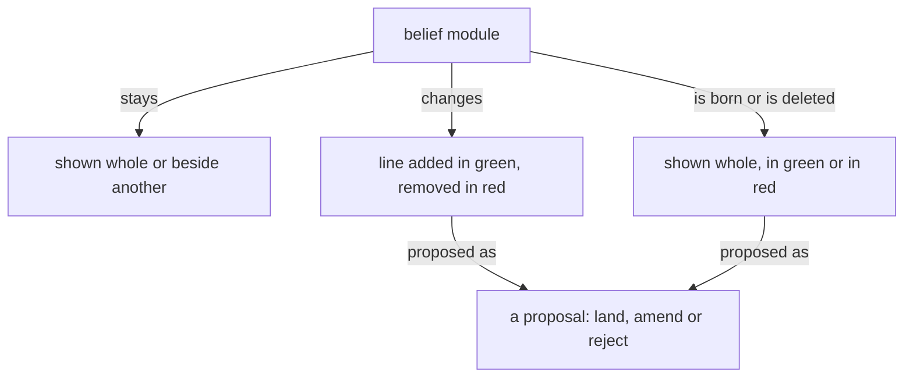
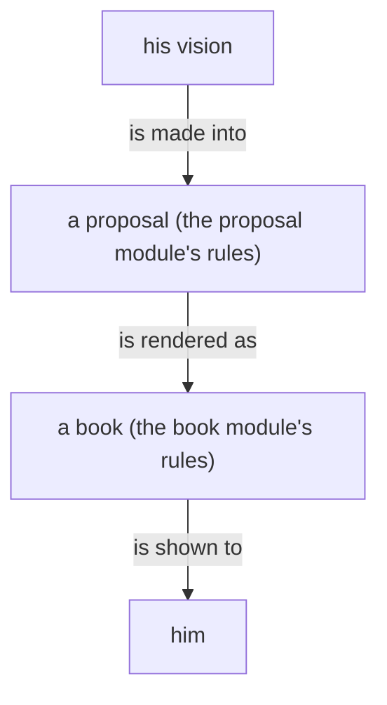

# Presentation material

Gathered by the Secondary for flow a78e9a, 2026-10-31. Nothing decided.

## psyche-belief › vision/book.md at origin main 3191a41f71f458486f980894e8af4894bdf8feb2

````markdown
---
description: How a book is made from a proposal already written.
dependencies: []
---

## Books

A book carries belief modules, as they stand and as they are proposed to change; its sources live in its reference file.

A figure shows how a thing moves, one question per figure, readable in seconds. Its grammar: a box is a thing or a collection; an arrow is a one-way relation carrying a verb, so that box, verb, box reads as a sentence; nearness and enclosure are kinship; top to bottom is order; colour carries a role or is absent. A figure is boxes joined by verbed arrows. A diagram in a book's source is a Mermaid flowchart in that grammar, drawn so a phone shows it; every sketch carries its arrows before it is sent. The published book shows the figure drawn from the Mermaid source by a Tertiary or Quaternary subflow given the grammar with the sketch; the figure keeps every box, label and arrow, and says only what the source says; a figure that lost an arrow is returned. A sizable book carries several figures.

Prose is shown as rendered text. A code block holds code alone, and it may scroll sideways.

## What a book shows

A book is belief modules in the forms below, each under its repo › path; its headings, naming the module and the kind of change, are the only words it has of its own.

A module shown whole, as it stands, situates the landing.

A module shown beside another, both as they stand, serves comparison: psyche with knowledge.

A line added shows in green.

A line removed shows in red.

A line replaced shows its removal and its addition together, and only the changed words are marked.

A new module shows whole in green, under the path it will have.

A module deleted shows whole in red, with a Destroy or Archive mark.

A line moved between modules is one proposal headed by both paths: the line in red under the module it leaves, the same line in green under the module it enters.

A dependency changed shows in the module's front matter: the dependency removed in red, the dependency added in green.

A figure shows as proposed for the module it will live in.

A figure proposed for a module shows under that module's path in green, as an added line does; a figure it replaces shows beside it in red.



Code in a book is shown as code, labelled with its language, plain. Ethos and datom in a book are written in the vertical form.

## Pictures

A figure shows one thing, where the idea has a shape, and its colours and marks mean the same in every book.

Every flowchart, in a book or in a belief module, is Mermaid, in the figure grammar; a book shows the SVG drawn from it.
````

## psyche-belief › vision/proposal.md at origin main 3191a41f71f458486f980894e8af4894bdf8feb2

````markdown
---
description: How a proposal of the living's vision is made: what it is made of, how its code is shown, and how it is shown to him.
dependencies: [vision-crystallization]
---

## A proposal

A proposal is the prose and the code that describe the system.

A proposal is a proposal into belief modules, and the whole of it is its crystallization: what it removes and what it adds.

A proposal that touches a code component shows the code it changes or adds.

A code block in a proposal stands on its own: it is shown without a path, directory or file name. It carries the code, why it is important, and what its function is.

A proposal is usually drawn as well as written, and always when it has a shape: what it adds, removes and keeps, in one frame.

The records a proposal draws from live in an unrendered reference file, one per book, in a references/ directory beside the books; they are archived with the landing when some or all of the proposal is accepted.

The proposal is the center of development: it is the evolution of an idea.

A line removed from a module is shown beside the line that makes it unnecessary.

A question between alternative lines shows each alternative as its own proposal, with the exact lines it lands; the living rules land, amend or reject.

Every word of his redoes the proposal it bears on, unless it closes the topic; words that open a topic of their own get a proposal of their own.

A proposal in the chat shows the whole section as it would stand, with the part that changes in bold.



## A proposal is signed

A proposal names the model that created it and, for each model that
helped, what that help was, on a subtitle line under the title. Created
by Fable, research by Opus, data retrieved by Sonnet.
````

## mind-belief › knowledge/book-making.md at origin main 48ec14c6452a9ae9b4149998a109b6752bb0f951

````markdown
---
description: A book source is made, built or published for the living; load before writing or publishing a book.
dependencies: [vision-book]
---

## The author makes the book

The author makes the book properly and sends the source as made. The builder renders what it is given and enforces nothing; the book is as correct as the author made it. The publisher builds the source and publishes the page.

```sh
bb tools/book-build.clj \
  /abs/book.md out.html \
  --figures /abs/figures
```

## What a source holds

Outside a proposal a source holds only: one `Presentation.{ «title» }` line, one `# title`, unlabelled diagram fences, and modules shown as they stand, each under a level-two heading `## repo › path`. A module shown as it stands is its text at origin main, byte for byte, front matter left out.

A proposal opens with `### Proposal N: title · repo › path`, numbered from 1; a new module ends the heading with `, a new file`, a deleted one with `, a deleted file`. A line moved between modules is one proposal headed `### Proposal N: title · repoA › pathA, and repoB › pathB`, with a level-four heading for each path, the line in red under the first and green under the second. No other level-three heading exists.

## Red and green

Colour comes only from signed lines. In a change every line opens with `- ` (red, removed), `+ ` (green, added) or two spaces (unchanged, shown for place). A removed line is a whole line of the module at origin main; an added line is not. Colour comes from the diff marks alone.

A module line is shown whole. A change to a hard-wrapped paragraph shows every physical line of that paragraph, so each sentence shows whole. A replaced paragraph is diffed as one paragraph: its removal and its addition together, with only the changed words marked.

A code line in a book is at most 52 characters.

```text
### Proposal 1: A sender · psyche › messaging.md

**Comment** Flow names the sender.

  ## A message is a datom

- The body is a datom.
+ The body is a datom; Flow names it.
```

## Marks inside a proposal

Inside a proposal a source holds only its change lines, one Comment, its Alternatives, its Destroy or Archive mark, path headings at level four, `#### repo › path`, as the moved-line form has them, and code that the proposed lines themselves land.

Every fence inside a proposal is signed line by line: red, green, or two spaces for a line kept in place, code-file proposals included, because code shown in a proposal is either what stands at origin main or what is proposed.

One `**Comment**` paragraph at most, before every change: the machine's word, in its own colour. `**Alternative 1**`, `**Alternative 2**` and on, two or more, in order, each alone on its line and followed by the exact lines it lands. `**Destroy**` or `**Archive**` opening a paragraph marks a deleted module or record. Prose stands as its own paragraph, a blank line apart from any change.

## Figures and fences

Every figure in a book is headed by the module it lives in and one of three states: as it stands, proposed added in green, or proposed removed in red.

A figure already in a belief module shows without colour.

An unlabelled fence holds a box-and-arrow sketch and nothing else; each one has its figure, `fig-N.svg` in the figures directory, drawn by the illustrator from the sketch with every box, label and arrow kept. A figure shows how a thing moves, one question per figure, is at most 52 columns wide, and is drawn in the figure grammar of vision-book. Every other fence carries its language: `ethos`, `datom`, `rust`, `sh`, `yaml`, `text`. An `ethos` fence is code that passes ethos-zero's Check, run by the author before the book is sent. A module written in Markdown is shown as rendered text. A book shows belief modules as rendered text and change marks.

## Code in a proposal

Code the proposed lines land is shown in labelled fences, the Datom it reads or writes and the Ethos that types it, run against the source by the author before the book is sent.

## Commented books

A book the living has commented on stays as he saw it; what his comments change goes into the next book. Its redo is a new book at a new link, and the commented one stays as he left it.
````

## Authoring lines in the publisher's role files

### /home/li/primary/.claude/agents/book.md

Line 93 (from role-book-publishing-procedure), the sentence that authors: "Every proposal names its witnessed repository/path and carries its proposed lines."

Lines 107-154 (vision-book, composed in; line 154 is an older copy of the module's last line) and 168-211 (knowledge-book-making, composed in):

````text
 107  A book carries belief modules, as they stand and as they are proposed to change; its sources live in its reference file.
 108  
 109  A figure shows how a thing moves, one question per figure, readable in seconds. Its grammar: a box is a thing or a collection; an arrow is a one-way relation carrying a verb, so that box, verb, box reads as a sentence; nearness and enclosure are kinship; top to bottom is order; colour carries a role or is absent. A figure is boxes joined by verbed arrows. A diagram in a book's source is a Mermaid flowchart in that grammar, drawn so a phone shows it; every sketch carries its arrows before it is sent. The published book shows the figure drawn from the Mermaid source by a Tertiary or Quaternary subflow given the grammar with the sketch; the figure keeps every box, label and arrow, and says only what the source says; a figure that lost an arrow is returned. A sizable book carries several figures.
 110  
 111  Prose is shown as rendered text. A code block holds code alone, and it may scroll sideways.
 112  
 113  ## What a book shows
 114  
 115  A book is belief modules in the forms below, each under its repo › path; its headings, naming the module and the kind of change, are the only words it has of its own.
 116  
 117  A module shown whole, as it stands, situates the landing.
 118  
 119  A module shown beside another, both as they stand, serves comparison: psyche with knowledge.
 120  
 121  A line added shows in green.
 122  
 123  A line removed shows in red.
 124  
 125  A line replaced shows its removal and its addition together, and only the changed words are marked.
 126  
 127  A new module shows whole in green, under the path it will have.
 128  
 129  A module deleted shows whole in red, with a Destroy or Archive mark.
 130  
 131  A line moved between modules is one proposal headed by both paths: the line in red under the module it leaves, the same line in green under the module it enters.
 132  
 133  A dependency changed shows in the module's front matter: the dependency removed in red, the dependency added in green.
 134  
 135  A figure shows as proposed for the module it will live in.
 136  
 137  A figure proposed for a module shows under that module's path in green, as an added line does; a figure it replaces shows beside it in red.
 138  
 139  ```mermaid
 140  flowchart TB
 141      a["belief module"] -- "stays" --> b["shown whole or beside another"]
 142      a -- "changes" --> c["line added in green, removed in red"]
 143      a -- "is born or is deleted" --> d["shown whole, in green or in red"]
 144      c -- "proposed as" --> e["a proposal: land, amend or reject"]
 145      d -- "proposed as" --> e
 146  ```
 147  
 148  Code in a book is shown as code, labelled with its language, plain. Ethos and datom in a book are written in the vertical form.
 149  
 150  ## Pictures
 151  
 152  A figure shows one thing, where the idea has a shape, and its colours and marks mean the same in every book.
 153  
 154  Every figure, in a book or in a module, is the SVG drawn from a Mermaid flowchart in the figure grammar. A sketch met anywhere is converted to a Mermaid figure.
 168  ## What a source holds
 169  
 170  Outside a proposal a source holds only: one `Presentation.{ «title» }` line, one `# title`, unlabelled diagram fences, and modules shown as they stand, each under a level-two heading `## repo › path`. A module shown as it stands is its text at origin main, byte for byte, front matter left out.
 171  
 172  A proposal opens with `### Proposal N: title · repo › path`, numbered from 1; a new module ends the heading with `, a new file`, a deleted one with `, a deleted file`. A line moved between modules is one proposal headed `### Proposal N: title · repoA › pathA, and repoB › pathB`, with a level-four heading for each path, the line in red under the first and green under the second. No other level-three heading exists.
 173  
 174  ## Red and green
 175  
 176  Colour comes only from signed lines. In a change every line opens with `- ` (red, removed), `+ ` (green, added) or two spaces (unchanged, shown for place). A removed line is a whole line of the module at origin main; an added line is not. Colour comes from the diff marks alone.
 177  
 178  A module line is shown whole. A change to a hard-wrapped paragraph shows every physical line of that paragraph, so each sentence shows whole. A replaced paragraph is diffed as one paragraph: its removal and its addition together, with only the changed words marked.
 179  
 180  A code line in a book is at most 52 characters.
 181  
 182  ```text
 183  ### Proposal 1: A sender · psyche › messaging.md
 184  
 185  **Comment** Flow names the sender.
 186  
 187    ## A message is a datom
 188  
 189  - The body is a datom.
 190  + The body is a datom; Flow names it.
 191  ```
 192  
 193  ## Marks inside a proposal
 194  
 195  Inside a proposal a source holds only its change lines, one Comment, its Alternatives, its Destroy or Archive mark, path headings at level four, `#### repo › path`, as the moved-line form has them, and code that the proposed lines themselves land.
 196  
 197  Every fence inside a proposal is signed line by line: red, green, or two spaces for a line kept in place, code-file proposals included, because code shown in a proposal is either what stands at origin main or what is proposed.
 198  
 199  One `**Comment**` paragraph at most, before every change: the machine's word, in its own colour. `**Alternative 1**`, `**Alternative 2**` and on, two or more, in order, each alone on its line and followed by the exact lines it lands. `**Destroy**` or `**Archive**` opening a paragraph marks a deleted module or record. Prose stands as its own paragraph, a blank line apart from any change.
 200  
 201  ## Figures and fences
 202  
 203  Every figure in a book is headed by the module it lives in and one of three states: as it stands, proposed added in green, or proposed removed in red.
 204  
 205  A figure already in a belief module shows without colour.
 206  
 207  An unlabelled fence holds a box-and-arrow sketch and nothing else; each one has its figure, `fig-N.svg` in the figures directory, drawn by the illustrator from the sketch with every box, label and arrow kept. A figure shows how a thing moves, one question per figure, is at most 52 columns wide, and is drawn in the figure grammar of vision-book. Every other fence carries its language: `ethos`, `datom`, `rust`, `sh`, `yaml`, `text`. An `ethos` fence is code that passes ethos-zero's Check, run by the author before the book is sent. A module written in Markdown is shown as rendered text. A book shows belief modules as rendered text and change marks.
 208  
 209  ## Code in a proposal
 210  
 211  Code the proposed lines land is shown in labelled fences, the Datom it reads or writes and the Ethos that types it, run against the source by the author before the book is sent.
````

### /home/li/primary/.claude/skills/role-book-publishing-procedure/SKILL.md

Line 9 (authored at field-belief › role/book-publishing-procedure.md), the sentence that authors: "Every proposal names its witnessed repository/path and carries its proposed lines."

The other role-book skills (description, page-description, page-procedure, reader-description, reader-procedure) hold no lines on authoring a presentation.
