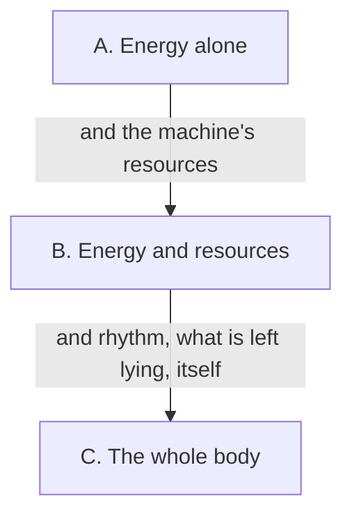
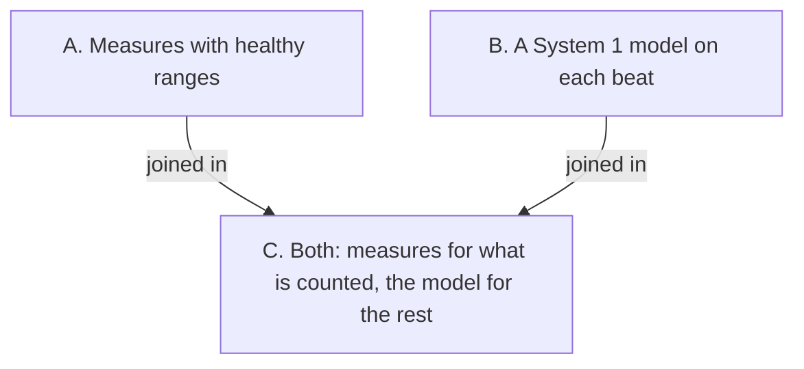
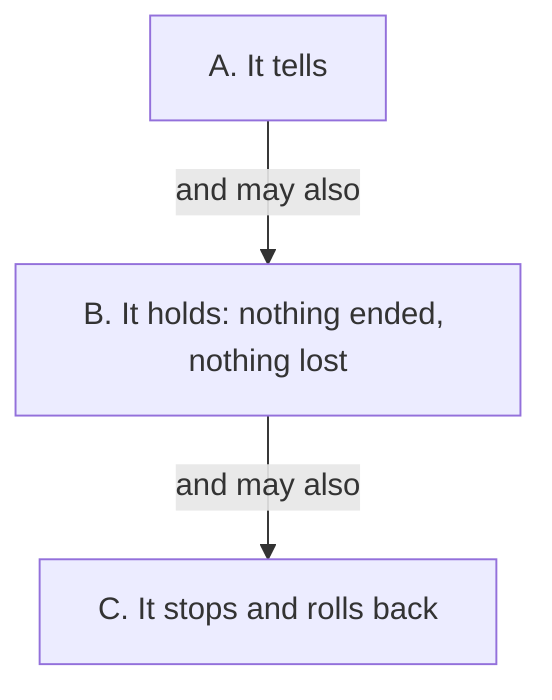

Presentation.{ «The balancing: alternatives for its first form» Proposal }

# The balancing: alternatives for its first form

Created by Fable. Sonnet researched system health.

### Proposal 1 alternatives: What it watches · psyche-belief › vision/balancing/0.md

#### Alternative A: Energy alone

+ Energy alone: how fast each provider's usage is spent against its pace, how often each permaflow is given a fresh flow, and what each flow spends.
#### Alternative B: A, and the machine's resources

+ A, and the machine's resources: each host's free disk and memory pressure, the memory each Nexus holds, and how often each Nexus is restarted.
#### Alternative C: B, and the whole body

+ B, and the whole body: the hour and the day, how much the living is interacting, how many flows are at work, what is left lying with its age, and the balancing itself.

### Proposal 2 alternatives: How it judges · psyche-belief › vision/balancing/0.md

#### Alternative A: By measures

+ By measures: each has a healthy range in configuration, and a measure outside its range is the finding.
#### Alternative B: By a System 1 model

+ By a System 1 model: on each beat it is given the measures, the recent logs and the picture of ideal health, and its answer is the finding.
#### Alternative C: By both

+ By both: a measure far outside its range is an emergency by itself; the System 1 model judges the rest, and its doubt wakes a more capable flow.

### Proposal 3 alternatives: What it may do by itself, at first · psyche-belief › vision/balancing/0.md

#### Alternative A: It tells

+ It tells: the flow that is spending, the core Opus, and the living.
#### Alternative B: It tells and it holds

+ It tells and it holds: it keeps further messages from a flow, or keeps new flows from starting, until the hold is released. A hold ends nothing and loses nothing.
#### Alternative C: It stops what is failing and brings the earlier version back to life.

+ It stops what is failing and brings the earlier version back to life.

### Proposal 4 alternatives: Its name · psyche-belief › vision/balancing/0.md

#### Alternative A: The balancing.

+ The balancing.
#### Alternative B: Homeostasis

+ Homeostasis: keeping steady.
#### Alternative C: Allostasis

+ Allostasis: stability through change.
#### Alternative D: Samāna

+ Samāna: the movement of prāṇa that assimilates and balances.
#### Alternative E: The steersman, from kybernētēs

+ The steersman, from kybernētēs: the pilot who corrects continuously.
