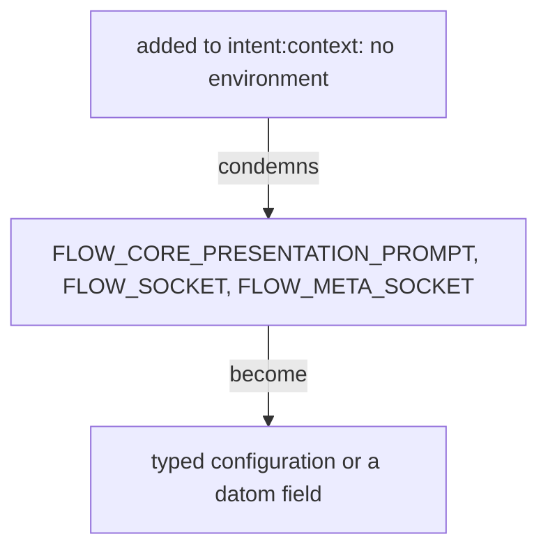

Superseded by flows/f54886/proposals/every-value-is-configuration.md

# No environment

*Created by Opus, drafted by Sonnet.*



## Added, to intent:context

## No environment

A system of ours reads nothing from its environment; every value it takes is typed configuration or a field of the datom it is given. A variable is set only for a third-party program, and the value set is itself configuration.

Pre-approved, his words: "we really do not want to use environment variables; we only set them for third-party tools we are forced to use; we ourselves never use environment variables in our own systems"

### What this condemns in our systems now

- `FLOW_CORE_PRESENTATION_PROMPT`: carries the file of the presentation prompt to the Nexus; it becomes a typed field of the Nexus configuration.
- `FLOW_SOCKET`: carries the ordinary socket of the Nexus to the `flow` CLI and to the hook in a launched pane; it becomes the metaflow name the CLI is given, from which it resolves the socket.
- `FLOW_META_SOCKET`: carries the meta socket of the Nexus to the meta CLI; it becomes the metaflow name the meta CLI is given.

```sh
flow-nexus main 'Send.{ … }'          # the metaflow name picks the sockets; nothing is read from the environment
```

### The presentation prompt as configuration (tentative)

```ethos
NexusConfiguration.{ PresentationPrompt.String }   ; tentative: the file of the presentation prompt
```
