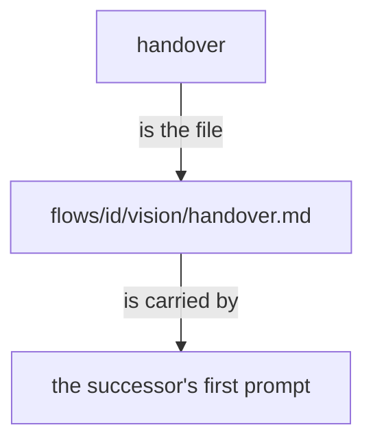

Superseded by flows/f54886/proposals/the-handover.md

# The handover is a file

*Created by Opus, drafted by Sonnet.*



## Removed, from vision:remembering

```text
It is published as a book of its own kind, `Handover.{ «title» }`, which he reviews as he reviews psyche; the successor's first prompt is that file as reviewed.
```

shown beside the line that makes it unnecessary:

```text
The handover is the file `flows/<id>/vision/handover.md`, and the successor's first prompt carries it.
```

## Added, to vision:remembering

The handover is the file `flows/<id>/vision/handover.md`, and the successor's first prompt carries it.

Pre-approved, his words: "There's no reason to make the handover into a book."
