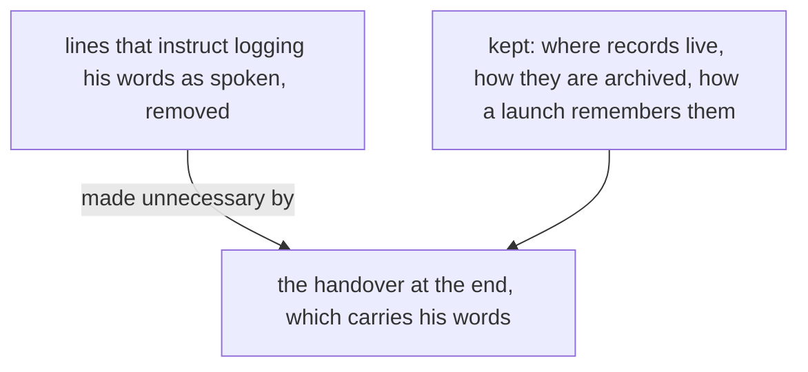

# Logging his words is removed

*Created by Opus, drafted by Sonnet.*

The living's words reach the next flow in the handover written at the end of a flow. Every line that instructs logging them as spoken is removed.



## Removed, from vision:crystallization

```text
## Vision is logged from his words alone

A vision record is made from his words alone; a line met in a record or a module is already logged, and is never logged again as vision.
```

Pre-approved, his words: "I want all these instructions to log everything all the time removed"

```text
What the living says fresh while a crystallization is being composed is logged as a raw record as it is spoken, like any other psyche, and the crystallization draws on it like any other record.
```

Pre-approved, his words: "we do not need to log my words, we are just going to do a handover at the end"

## Added, to vision:crystallization

What the living says while a crystallization is being composed reaches it in the handover, and the crystallization draws on a handover like any other record.

## Removed, from intent:living-interaction

```text
Notion is logged as notion; an order is a bead; a vision record holds vision alone.
```

Pre-approved, his words: "I want all these instructions to log everything all the time removed"

## Added, to intent:living-interaction

An order is a bead.

## Removed, from knowledge:psyche (repo mind-belief, knowledge/psyche.md)

```text
- **Notion** — a brainstorm: an idea the living is turning over, binding nothing. The bottom level. Logged verbatim; never built on as if ruled.
```

Pre-approved, his words: "I want all these instructions to log everything all the time removed"

## Added, to knowledge:psyche (repo mind-belief, knowledge/psyche.md)

- **Notion** — a brainstorm: an idea the living is turning over, binding nothing. The bottom level. Never built on as if ruled.

## Removed, from vision:psyche

```text
A raw record is written in the vision or notion records of the flow that heard it and is open there.
```

No mark: this line says where a raw record is written, and whether it is a logging instruction awaits his word.

## Added, to vision:psyche

A raw record lives in the vision or notion records of the flow that holds it and is open there.
