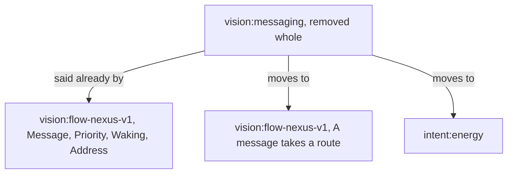

# Messaging dissolves into the Flow Nexus

*Created by Opus, drafted by Sonnet.*

vision:messaging is removed whole. Each of its lines either has its statement in vision:flow-nexus-v1 already, or moves to the module that holds its subject.



## Removed, from vision:messaging

The module, whole. Line by line:

```text
## A message is a datom, and it arrives as one

The message body is a datom that lands in the recipient's prompt as a
datom-formatted object. The datom is the whole message.
```

Moved, below, to vision:flow-nexus-v1.

```text
## Priority is a head on the datom

    Priority.[HardAbrupt MiddleAbrupt Soft]
```

Beside the line in vision:flow-nexus-v1 that already says it:

```text
[ Priority.[ HardAbrupt MiddleAbrupt Soft ]
```

```text
## Delivery is harness-specific

A pressing message wakes its recipient; a message that only queues carries what may wait.
```

Beside the lines in vision:flow-nexus-v1 that already say it:

> "A flow sends through the CLI; the Flow Nexus checks the route against the sender's definition, queues the message for the receiver, and delivers it through the herdr Nexus as a prompt when the receiver is idle or the priority is pressing. A perma flow asleep is woken by a pressing message and receives its whole queue in its first prompt."

```text
A request to deliver a recipient's queue delivers every queued message, or nothing when none is queued.
```

Beside the lines in vision:flow-nexus-v1 that already say it:

> "A perma flow asleep is woken by a pressing message and receives its whole queue in its first prompt."

```text
  Waking.Vector<Message> ]           ; a queue delivered whole
```

```text
## An interrupt witness is not a delivery witness

Inducing an interrupt, placing prompt text, submitting it, and the recipient
consuming it are four separate observations. None of them stands for
another, and a submission is never a read receipt.
```

Moved, below, to vision:flow-nexus-v1.

```text
## A message carries what its reader acts on

A message carries what its reader acts on: what the sender intends, or what it has done.

A message carries no hash: a flow is named by its metaflow, a book by its title, a commit by what it landed.
```

Moved, below, to intent:energy.

```text
## A message addresses a metaflow

A message is addressed to a metaflow and reaches the flow running when it arrives.
```

Beside the lines in vision:flow-nexus-v1 that already say it:

> "A route names whom a member may address: another member, another complex, or the living; a message off the routes is refused."

```text
  Address.{ ComplexName FlowName }   ; a perma flow's standing name
```

## Added, to vision:flow-nexus-v1, under "A message takes a route"

The message body is a datom that lands in the recipient's prompt as a datom-formatted object. The datom is the whole message.

Inducing an interrupt, placing prompt text, submitting it, and the recipient
consuming it are four separate observations. None of them stands for
another, and a submission is never a read receipt.

## Added, to intent:energy

A message carries what its reader acts on: what the sender intends, or what it has done.

A message carries no hash: a flow is named by its metaflow, a book by its title, a commit by what it landed.
