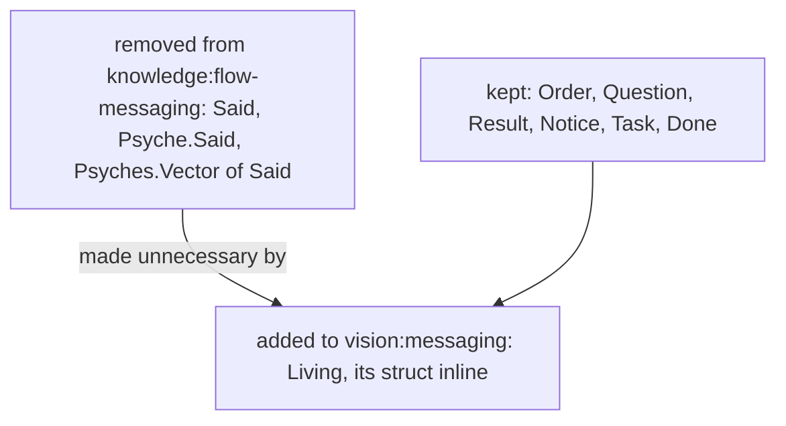

# The living's words, carried inline

*Created by Opus, the Psyche core Secondary.*

The living's words travel in a message as one struct written where it is used: what his words were about, and his words whole.



## Removed, from knowledge:flow-messaging

```ethos
Said.{ Context.String Verbatim.String }
```

```ethos
SendableRequest.[ Order.String
                  Question.String
                  Psyche.Said
                  Psyches.Vector<Said>
                  Result.{ Answerable String }
                  Notice.String
                  Task.AnswerableTask
                  Done.{ Answerable String } ]
```

```sh
flow Send.{ Address.{ Mind core Secondary } Soft.Psyche.{ «context» «verbatim» } }
```

## Added, to vision:messaging

## The living's words are a request

A request carrying the living's words holds them in a struct written inline in the variant: Context, what his words were about; Verbatim, his words whole.

```ethos
SendableRequest.[ Order.String                  ; a request: what the recipient is to act on
                  Question.String
                  Living.{ Context.String       ;   what his words were about
                           Verbatim.String }    ;   his words whole
                  Result.{ Answerable String }
                  Notice.String
                  Task.AnswerableTask
                  Done.{ Answerable String } ]
AnswerableTask.{ Minutes String }               ; a task, with the minutes it is given
Minutes.Integer
```

Answerable is shown as it stands in knowledge:flow-messaging, which names it without a definition; its definition is owed.

```datom
Send.{ Address.{ Psyche core Secondary } Soft.Living.{ «context» «verbatim» } }
```
