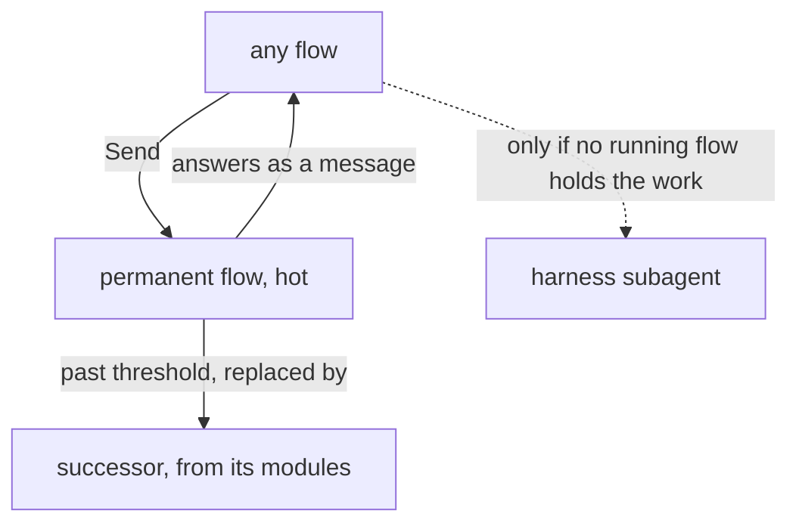

# Permanent flows

*Created by Opus, drafted by Sonnet.*

## Removed, from vision:flow-nexus-v1

Each old line beside the new line that replaces it.

```ethos
  Continuity.[ Perma                 ; continues through runs
```

```ethos
  Continuity.[ Permanent             ; continues through runs under its address
```

```text
A perma flow is refreshed when its context passes its model's threshold, configured per model in the Flow Nexus: the flow is told to write its handover, its successor is launched with the same definition, the handover as its first prompt, and the queue that gathered meanwhile; the predecessor ends. The address stays; the flow id changes. An ephemeral flow past its threshold takes no new work and ends when its work ends.
```

```text
A permanent flow continues through runs under its address. Past its model's threshold it is replaced by a successor started from its modules. A handover is written by a Primary alone. The address stays; the flow id changes. An ephemeral flow past its threshold takes no new work and ends when its work ends.
```

```text
## A perma flow continues
```

```text
## A permanent flow continues
```

```text
A flow is one run of a model in a harness. A perma flow is a flow that continues through a succession of runs, one entity across them. A flow complex, ...
```

```text
A flow is one run of a model in a harness. A permanent flow is a flow that continues through a succession of runs, one entity across them. A flow complex, ...
```

```text
... whether it is a perma flow or ephemeral; its workspace, ...
```

```text
... whether it is a permanent flow or ephemeral; its workspace, ...
```

```text
  Address.{ ComplexName FlowName }   ; a perma flow's standing name
```

```text
  Address.{ ComplexName FlowName }   ; a permanent flow's standing name
```

```text
... delivers it through the herdr Nexus as a prompt when the receiver is idle or the priority is pressing. A perma flow asleep is woken ...
```

```text
... delivers it through the herdr Nexus as a prompt when the receiver is idle or the priority is pressing. A permanent flow asleep is woken ...
```

```datom
             Perma
```

```datom
             Permanent
```

## Removed, from vision:metaflow-v1

```datom
  [ { fable Claude claude-fable-5-1 Medium Perma
```

```datom
  [ { fable Claude claude-fable-5-1 Medium Permanent
```

## Added, to vision:flow-nexus-v1

A permanent flow takes work while it runs and is kept hot, so no restart pays the full cost of starting again. It continues through runs under its address. Past its model's threshold it is replaced by a successor started from its modules; the handover is the Primary's alone. The lander, the bookmaker, the readers and the rest of the roster are permanent flows; any flow sends work to them directly, with Send. The harness subagent is used only for what no running flow holds.

Pre-approved, his words: "we do not want flows that are idle because they go cold and when we restart them we pay the full cost again"

See "Flows send before they spawn".

Continuity, whole:

```ethos
Library
[]
[ Continuity.[ Permanent             ; continues through runs under its address
               Ephemeral ] ]         ; one run, then gone
[]
[]
```

Work goes straight to a permanent flow by its standing address, in the Signal's Send form `Send.{ FlowId Address Priority Request }`:

```datom
Send.{ 7 { jobs lander } Soft Order.«land the proposal» }
```

The roster, as Members: each a permanent flow, in a temporary workspace, with the role's belief, on a Tertiary or Quaternary model; the model names and the empty routes are tentative.

```datom
[ { lander Claude claude-sonnet-5-5 Medium
    Permanent Temporary
    { [ { Role lander } ] Refuse } HarnessDefault [] }
  { bookmaker Claude claude-sonnet-5-5 Medium
    Permanent Temporary
    { [ { Role book } ] Refuse } HarnessDefault [] }
  { bookPager Claude claude-sonnet-5-5 Medium
    Permanent Temporary
    { [ { Role book-page } ] Refuse } HarnessDefault [] }
  { bookReader Claude claude-haiku-4-5 Medium
    Permanent Temporary
    { [ { Role book-reader } ] Refuse } HarnessDefault [] }
  { commentRelay Claude claude-sonnet-5-5 Medium
    Permanent Temporary
    { [ { Role comment-relay } ] Refuse } HarnessDefault [] }
  { contextualizer Claude claude-haiku-4-5 Medium
    Permanent Temporary
    { [ { Role contextualizer } ] Refuse } HarnessDefault [] }
  { illustrator Claude claude-sonnet-5-5 Medium
    Permanent Temporary
    { [ { Role illustrator } ] Refuse } HarnessDefault [] }
  { scripter Claude claude-haiku-4-5 Medium
    Permanent Temporary
    { [ { Role scripter } ] Refuse } HarnessDefault [] }
  { tester Claude claude-sonnet-5-5 Medium
    Permanent Temporary
    { [ { Role tester } ] Refuse } HarnessDefault [] }
  { reader Claude claude-haiku-4-5 Medium
    Permanent Temporary
    { [ { Role read } ] Refuse } HarnessDefault [] }
  { writer Claude claude-sonnet-5-5 Medium
    Permanent Temporary
    { [ { Role write } ] Refuse } HarnessDefault [] }
  { worker Claude claude-sonnet-5-5 Medium
    Permanent Temporary
    { [ { Role worker } ] Refuse } HarnessDefault [] } ]
```



## Added, to vision:subflows

For a kind of work a permanent flow holds, a flow sends to that permanent flow directly; the harness subagent is used only for what no running flow holds.
