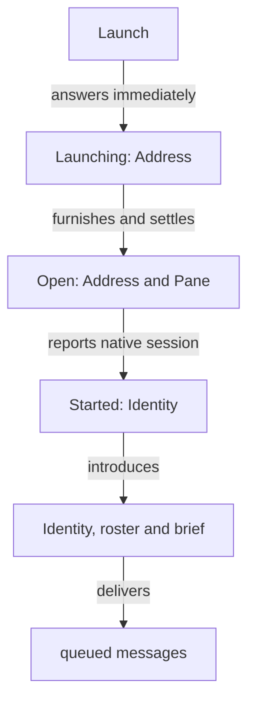

# Flow and Belief: judged contract revision
Astra — read-demanding subflow supplied source and consistency evidence; Fable judged the boundaries through Sol.

Design artifact updated to the transmitted judgments. This source is for the module-correction proposal; psyche sources remain unchanged and implementation remains held. Native-error Rust clauses already approved in vision:belief-nexus-v1 are retained as authored there.

## Reading

Flow owns executable templates, reporting hooks, settings and the two furnishing paths. Belief owns snapshots and the complete atomic publication, public links included. A launch is acknowledged before native identity exists; a verified start hook supplies it. State and failures are pushed. Repository ref changes drive refurnishing; Directory sources are snapshotted per attempt and have no watcher. Owner meta configuration contains domain policy, while Place/private typed runtime data carry startup and transport.

## Shared startup vocabulary — translator
Both Nexuses adopt this current shared PlaceName-based vocabulary. Existing older Flow pins are updated with their consumers when implementation is authorized.

```ethos
Library
[] ; imports
[ UserId.Integer
  GroupId.Integer
  ProcessId.Integer
  Caller.{ ProcessId UserId } ; kernel caller credentials
  PeerIdentity.{ UserId ProcessId } ; admitted peer process
  PeerId.String
  PeerBinding.{ PeerId PeerIdentity } ; named admission
  PlaceName.String
  Runtime.String
  State.String
  Place.{ PlaceName Runtime State } ] ; startup location
[] ; traits
[] ; associations
```

## Harness-report events — flow_event

```ethos
Library
[] ; imports
[ EventKind.[ Started Idle Working Ended Responded Warned Threshold ]
  Event.[ Started Idle Working Ended Responded.String Warned Threshold ] ] ; declared kinds and observed events
[] ; traits
[] ; associations
```

## Harness definition — flow_harness
Argument lives apart from member Effort and Belief Workspace types, so its capitalized placeholders carry no accidental payload. A harness declares EventKind values; a Report carries Event, including Responded.String. Flow substitutes member/layout values, composes configured Features, and writes the declared Report hooks during Settle. A harness whose Reports omit Started is refused as Unreportable.HarnessName.
```ethos
Library
[ :flow_event:EventKind ] ; imports
[ HarnessName.String
  FeatureName.String
  Effect.[ Flag.String Environment.{ Name.String Value.String } ] ; configured effect
  Feature.{ FeatureName Effect } ; one feature
  Executable.String
  Argument.[ Literal.String Model Effort SystemPrompt Workspace ] ; literal or substitution slot
  RelativePath.String
  SystemPromptRelativePath.RelativePath
  SkillsRelativePath.RelativePath
  LayoutTemplate.{ SystemPromptRelativePath SkillsRelativePath } ; resolved by Flow
  Harness.{ HarnessName Executable Template.Vector<Argument>
            Features.Vector<Feature> Reports.Vector<EventKind> LayoutTemplate } ] ; configured launch and reporting
[] ; traits
[] ; associations
```

## Flow definitions and identity — flow

```ethos
Library
[ :belief:ModuleName
  :flow_harness:[ HarnessName FeatureName ]
  :flow_event:Event
  :herdr:Pane ] ; imports
[ MetaflowName.String
  FlowName.String
  ModelName.String
  Effort.[ Low Medium High ]
  Continuity.[ Permanent Ephemeral ]
  WorkspaceChoice.[ Path.String Temporary ]
  Missing.[ Refuse Notice ]
  Beliefs.{ Vector<ModuleName> Missing } ; definition owns missing-module policy
  Tool.String
  Tools.[ HarnessDefault Restricted.{ Allow.Vector<Tool> Deny.Vector<Tool> } ] ; enforced by harness
  Route.[ Speaks.FlowName Metaflow.MetaflowName Living ]
  Member.{ FlowName HarnessName ModelName Effort Continuity WorkspaceChoice
           Beliefs Tools Features.Vector<FeatureName> Vector<Route> } ; one member
  Metaflow.{ MetaflowName Vector<Member> Speaker.FlowName } ; one replaceable definition
  ComplexName.String
  Host.String
  Relationship.{ From.MetaflowName To.MetaflowName } ; one permitted route
  Complex.{ ComplexName Metaflows.Vector<MetaflowName>
            Relationships.Vector<Relationship> Features.Vector<FeatureName>
            Instances.Vector<Host> Speaker.MetaflowName } ; one replaceable definition
  Address.{ MetaflowName FlowName } ; one live run per address
  FlowId.String
  NativeSession.String
  Identity.{ ComplexName Address FlowId } ; known after first Report
  Roster.Vector<Address>
  RosterChange.[ Started.Address Stopped.Address ]
  Brief.String
  Priority.[ HardAbrupt MiddleAbrupt Soft ]
  Request.[ Order.String Question.String Living.{ Context.String Verbatim.String }
            Result.String Notice.String ] ; delivered request
  Sender.[ Flow.FlowId Living Nexus ]
  Message.{ Priority Sender Request } ; delivered message
  Waking.Vector<Message>
  Name.[ Metaflow.MetaflowName Harness.HarnessName Complex.ComplexName ]
  Report.{ Address Pane NativeSession Event } ; verified caller/pane/native session
  Threshold.{ ModelName Tokens.Integer Warning.Integer } ] ; per-model context policy
[] ; traits
[] ; associations
```

## Shared run state and launch failure — flow_run
Memory and Hot use the same Run type. Before the first Started report, Address and then Pane identify the attempt. Failure ends it as Failed. Introducing follows identification and retains that known Identity if it fails. Expired is the observed StartTimeout event. Opened carries the raw Herdr Outcome for Settling, Opening or Introducing; LaunchPhase records which act yielded it.
```ethos
Library
[ :flow:[ Address Identity ]
  :belief:[ Workspace Response ]
  :herdr:[ Pane Outcome ] ] ; imports
[ LaunchPhase.[ Furnishing Settling Opening Introducing AwaitingReport ]
  Evidence.[ Furnished.Response Opened.Outcome Expired ] ; peer outcome or observed timeout
  RunState.[ Running Idle Ended ]
  LaunchFailed.{ Address LaunchPhase Evidence } ; pushed terminal launch failure
  Run.[ Preparing.{ Address Workspace LaunchPhase }
        Opened.{ Address Workspace Pane LaunchPhase }
        Identified.{ Identity Workspace Pane RunState }
        Failed.{ Address Workspace Option<Pane> Option<Identity> LaunchPhase Evidence } ] ] ; retained failed attempt
[] ; traits
[] ; associations
```

## Flow ordinary Signal
Launch admission answers Launching.Address immediately. Started.Identity and LaunchFailed are pushed on the existing Flow subscription surface, correlated by Address. HerdrDown and BeliefDown are immediate pre-admission Launch refusals only; after Launching, peer failure produces the correlated LaunchFailed event. Hot reports current runs at their known stages; failed attempts remain recorded in Memory. Replacement waits for admitted in-flight launches to complete or fail; only identified flows are adopted.
```ethos
Signal
[ :flow:[ Metaflow MetaflowName FlowName FlowId Address Brief Request Priority
          Complex ComplexName Name Report Identity NativeSession ]
  :flow_harness:[ Harness HarnessName FeatureName ]
  :flow_run:[ Run LaunchFailed ]
  :belief:ModuleName ] ; imports
[ Define.[ Metaflow Harness Complex ]
  Undefine.Name
  Describe.Name
  Definitions
  Launch.{ MetaflowName FlowName Brief }
  Rehearse.{ MetaflowName FlowName Brief }
  Stop.FlowId
  Send.{ FlowId Address Priority Request }
  Say.{ ComplexName Request }
  Hot
  Broadcast.Request
  Report
  Adopt.{ Address NativeSession }
  Subscribe ] ; inputs
[ Defined.Name
  Undefined.Name
  Described.[ Metaflow Harness Complex ]
  Listed.Vector<Name>
  Launching.Address
  Started.Identity
  LaunchFailed
  Rehearsed.Command.String
  Stopped.FlowId
  Sent.[ Delivered Queued ]
  Said.[ Delivered Queued ]
  Hot.Vector<Run>
  Broadcast.Vector<FlowId>
  Reported.FlowId
  Adopted.FlowId
  Subscribed
  Refused.[ UnknownMetaflow.MetaflowName UnknownHarness.HarnessName
            UnknownComplex.ComplexName UnknownFlow.FlowName
            NoRoute.{ FlowId Address } NoBelief.Vector<ModuleName>
            Unenforceable.HarnessName Unreportable.HarnessName
            UnknownFeature.{ HarnessName FeatureName }
            HerdrDown BeliefDown Running.Address AddressHeld.FlowId
            Unidentified AwaitingStarted Draining ] ] ; outputs, including pushed Started and LaunchFailed
[] ; local types
```

## Flow meta Signal
StartTimeout bounds AwaitingReport; expiry produces LaunchFailed with phase AwaitingReport and evidence Expired. Drain answers Draining, closes launch admission, and pushes Drained when every admitted launch has completed or failed. Existing reports remain admitted so those attempts can settle. Drained is the replacement handoff condition.
```ethos
Signal
[ :belief:ModuleName
  :flow:Threshold ] ; imports
[ Configure.Set Drain ] ; inputs
[ Configured.Set Draining Drained ] ; outputs: immediate acknowledgements and drain completion
[ StartTimeout.Integer
  Set.[ DefaultModules.Vector<ModuleName> Threshold StartTimeout ] ] ; one owner value per request
```

## Flow emission boundary
Order: Furnish → Settle → Open → start-hook Report → derive FlowId and push Started.Identity → Introduce Identity/Roster/Brief → Wake. Only a Started report establishes identity from verified Address, Pane and NativeSession; Reported.FlowId supplies the derived identity. A different event arriving before Started is refused as AwaitingStarted. These boundary capabilities are lowered to the existing typed peer calls; each actual external call remains its own emission.
```ethos
Emission
[ :flow:[ Member Address Brief Waking Roster RosterChange Identity ]
  :belief:[ Workspace FurnishRequest Response ]
  :herdr:[ Pane Outcome ] ] ; imports
[ Furnish.FurnishRequest
  Settle.{ Workspace Member }
  Open.{ Member Address }
  Introduce.{ Pane Identity Roster Brief }
  Wake.{ Pane Waking }
  Tell.{ Pane RosterChange }
  Close.{ Pane Workspace } ] ; typed boundary capabilities
[ Furnished.Response
  Settled.Outcome
  Opened.{ Pane Outcome }
  Introduced.Outcome
  Woken.Outcome
  Told.Outcome
  Closed.Outcome ] ; observed results
[] ; local types
```



## Flow Memory correlation
The existing definition, queue, default-module and threshold records remain. Flow owns workspace-to-run correlation; Changed.FurnishedWorkspace selects the affected run for Flow’s refresh policy. Belief names workspaces and does not own flows.
```ethos
Memory
[ :flow_run:Run
  :belief:FurnishedWorkspace ] ; imports
[ Run FurnishedWorkspace
  Admission.[ Accepting Draining Drained ] ] ; shared run states, workspace receipts and launch admission
```

## Belief ordinary Signal
Register accepts Repository and Directory. Each Directory use takes an immutable per-attempt snapshot; SourceRevision is its content hash in the same String position used for a repository commit. NotDirectory and Unreadable.RelativePath retain source evidence. Repository main movement is observed through refs-change notifications. Directory is unwatched. The receipt returns the supplied Layout rather than maintaining a second path vocabulary.
```ethos
Signal
[ :translator:[ Caller PeerBinding UserId PeerId ] ]  ; imports: shared authenticated identity
[ Register.ModuleSource                                ; inputs: repository and workspace effects
  Resolve.Vector<ModuleName>
  Furnish.FurnishRequest
  Subscribe ]
[ Registered.SourceState                         ; outputs: one answer, then subscribed updates
  Resolved.Resolution
  Furnished.FurnishedWorkspace
  Subscribed.Vector<FurnishedWorkspace>
  Changed.FurnishedWorkspace
  RefurnishFailed.RefurnishFailure
  CleanupFailed.CleanupFailure
  SubscriptionClosed.CloseReason                     ; terminal event on the subscribed connection
  MemoryAfterPublication.MemoryAfterPublication
  Refused.Refusal ]
[ Kind.[ Spirit Intent Vision Knowledge Role ]       ; types: a module name is its folder kind and subject
  Subject.String
  ModuleName.{ Kind Subject }
  RepositoryPath.String
  DirectoryPath.String
  Directory.DirectoryPath
  ModuleSource.[ Repository Directory ]
  Repository.RepositoryPath
  WorkspacePath.String
  Workspace.WorkspacePath
  RelativePath.String
  SourceRevision.String
  PublicationRevision.Integer
  GenerationId.String
  Path.String
  Layout.{ SystemPrompt.Path Skills.Path }
  Owner.[ Login.UserId Peer.PeerId ]                 ; durable authority, separate from Caller provenance
  SourceState.{ ModuleSource SourceRevision }
  Found.ModuleName
  Resolution.{ Vector<Found> Vector<ModuleName> }
  FurnishRequest.{ Workspace Layout Vector<ModuleName> }
  Placement.[ SystemPrompt Skills ]                  ; where one module is furnished
  FurnishedWorkspace.{ Workspace GenerationId PublicationRevision Layout Vector<Found> Vector<ModuleName> }
  ExecutablePath.String
  ContractDigest.String
  PeerList.Vector<PeerBinding>
  Call.{ Caller Query }                                ; Query is the Signal root's generated input enum
  SourceOperation.[ Registering Snapshotting Resolving Watching ReadingDirectory ]
  FileOperation.[ Reading Staging Linking Replacing Inspecting Cleaning ]
  MemoryOperation.[ Loading Recording BeginningPublication CompletingPublication
                    AfterPublication Recovering ]
  ExitStatus.Integer
  Diagnostic.{ ExecutablePath Option<ExitStatus> String }
  InvalidPlacement.[ Unknown.String NonScalar Duplicate ]
  InvalidModule.{ ModuleName RelativePath InvalidPlacement }
  SourceEvidence.[ NotRepository NotDirectory Unreadable.RelativePath MainUnavailable RevisionUnavailable
                   InvalidModule
                   Ambiguous.{ ModuleName Vector<ModuleSource> }
                   Translator.Diagnostic ]
  SourceFailure.{ ModuleSource SourceOperation SourceEvidence }
  FileEvidence.[ OutsideBoundary.{ RelativePath RelativePath }
                 PermissionDenied
                 MissingRequired.RelativePath
                 Conflict.{ Option<PublicationRevision> Option<PublicationRevision> }
                 Translator.Diagnostic ]
  FileFailure.{ Workspace FileOperation FileEvidence }
  MemoryEvidence.[ Unavailable Corrupt Conflict ]
  MemoryFailure.{ MemoryOperation MemoryEvidence }
  RefusalKind.[ Source File Memory NotAuthorized SubscriberCapacityReached NotReady ]
  RefurnishFailure.{ Workspace RefusalKind }
  CleanupFailure.{ Workspace GenerationId PublicationRevision FileFailure } ; successful publication after which target cleanup failed
  CloseReason.[ QueueOverflow WriteTimeout ]
  MemoryAfterPublication.{ Workspace GenerationId PublicationRevision MemoryFailure }
  Refusal.[ Source.SourceFailure
            File.FileFailure
            Memory.MemoryFailure
            NotAuthorized.Caller
            SubscriberCapacityReached.Integer
            NotReady ] ]

```

## Belief meta Signal
PublicationLayout is one Belief-owned private-storage template, applied inside each workspace; retention remains Belief-owned. Flow supplies only two absolute public paths. Belief owns public-link creation and both links’ transition as one atomic publication/recovery design. No harness name or harness settings are retained here. Polling, sockets, transport and bootstrap fields are absent from owner Set; those startup facts are Place/private typed runtime data.
```ethos
Signal
[ :signal_belief_nexus:[ PeerList RelativePath Kind Placement ]
  :translator:Caller ] ; imports
[ Configure.ConfigureRequest ] ; inputs: one owner value, optionally revision-conditional
[ Configured.ConfiguredState
  ConfigureRefused.ConfigurationRefusal ] ; outputs
[ ConfigurationRevision.Integer
  Keeper.[ Nexus Translator ]
  SettingName.[ SubscriberCapacity OrdinaryPeers MetaPeers PublicationLayout Placement.Kind GenerationRetention ]
  Readiness.[ Awaiting.Vector<SettingName> Ready ]
  OwnedRoot.RelativePath
  GenerationsDirectory.RelativePath
  CurrentLink.RelativePath
  PublicationLayout.{ OwnedRoot GenerationsDirectory CurrentLink } ; one private-storage meta value
  PositiveInteger.Integer
  RetentionPolicy.[ KeepAll KeepPrevious.PositiveInteger ]
  PlacementDefault.{ Kind Placement } ; default module placement
  Set.[ SubscriberCapacity.Integer OrdinaryPeers.PeerList MetaPeers.PeerList
        PublicationLayout Placement.PlacementDefault GenerationRetention.RetentionPolicy ]
  ConfigureRequest.{ Option<ConfigurationRevision> Set } ; preserves configuration compare-and-set
  ConfiguredState.{ Set Keeper ConfigurationRevision Readiness } ; one coherent revision
  TranslatorConfiguration.{ ConfigurationRevision Vector<Set> Readiness } ; policy snapshot for emission
  Invalid.{ Keeper SettingName String }
  StaleRevision.{ Option<ConfigurationRevision> ConfigurationRevision }
  ConfigurationRefusal.[ Invalid StaleRevision NotAuthorized.Caller Unavailable ] ] ; typed refusals
```

## Belief emission contract
Repository watching uses the separate streaming edge below; unary EmissionAttempt remains single-reply. The Nexus snapshots and refurnishes when that stream reports main movement. Snapshot.Directory performs one read without registering a watch. Public links, generation storage, manifest inspection, replacement and cleanup stay in one Belief publication/recovery design. The temporary Signal-root spelling preserves the currently available generator; it does not redefine what an emission means.
```ethos
; Proposed executable shape retains the current generator-supported Signal root.
; The conceptual Emission root remains a separate generator capability question.
Signal
[ :signal_belief_nexus:[ Layout ModuleName Placement ModuleSource SourceState Repository Workspace RelativePath
                          SourceRevision PublicationRevision GenerationId Diagnostic FileFailure ]
  :meta_signal_belief_nexus:[ PublicationLayout RetentionPolicy ConfigurationRevision TranslatorConfiguration ] ] ; imports
[ Snapshot.ModuleSource                                 ; emissions: read one immutable main snapshot
  Publish.Publication                                 ;   or atomically replace one owned publication
  InspectPublication.InspectionRequest                ;   or observe owned recovery evidence
  Clean.CleanupRequest ]                              ;   or remove proven-owned superseded generations
[ Snapshotted.SourceSnapshot                          ; outcomes
  Published.PublicationState
  Inspected.PublicationInspection
  Cleaned.CleanupState
  CleanupRefused.FileFailure
  EmissionRefused.EmissionRefusal ]
[ EmissionAttempt.{ ConfigurationRevision TranslatorConfiguration Query } ; one immutable attempt snapshot
  EmissionAttemptOutcome.{ ConfigurationRevision Response } ; response revision equals its attempt
  Content.String                                      ; types
  AbsolutePath.String
  ModuleContent.{ ModuleName RelativePath Option<Placement> Content }
  SourceSnapshot.{ ModuleSource SourceRevision Vector<ModuleContent> }
  SkillFile.{ RelativePath Content }
  WorkspaceImage.{ Layout PublicationLayout Content Vector<SkillFile> }
  SourceStates.Vector<SourceState>
  FoundModules.Vector<ModuleName>
  MissingModules.Vector<ModuleName>
  PriorPublication.Option<PublicationRevision>
  IntendedPublication.PublicationRevision
  PublicationManifest.{ GenerationId IntendedPublication Layout PublicationLayout SourceStates
                         FoundModules MissingModules }
  Publication.{ Workspace GenerationId PriorPublication IntendedPublication
                 WorkspaceImage SourceStates FoundModules MissingModules RetentionPolicy }
  PublicationIdentity.{ GenerationId PublicationRevision }
  PublicationState.{ Workspace PublicationIdentity }
  InspectionRequest.{ Workspace PublicationIdentity Layout PublicationLayout }
  LinkTarget.String
  LinkObservation.[ Absent Symlink.LinkTarget Other Unreadable.RelativePath ]
  PublicLinks.{ SystemPrompt.LinkObservation Skills.LinkObservation }
  PublicationInspection.{ Workspace Option<PublicationIdentity> Option<PublicationManifest> PublicLinks }
  CleanupRequest.{ Workspace PublicationIdentity Layout PublicationLayout }
  CleanupOutcome.[ Removed AlreadyAbsent ]
  CleanupState.{ Workspace PublicationIdentity CleanupOutcome }
  SourceOperation.[ ReadingMain ReadingTree ReadingDirectory ]
  PublicationOperation.[ StagingGeneration WritingManifest
                          ReplacingPointer InspectingPointer InspectingManifest ]
  InvalidPlacement.[ Unknown.String NonScalar Duplicate ]
  InvalidModule.{ ModuleName RelativePath InvalidPlacement }
  SourceEvidence.[ NotRepository NotDirectory Unreadable.RelativePath MainUnavailable RevisionUnavailable InvalidModule Translator.Diagnostic ]
  SourceRefusal.{ ModuleSource SourceOperation SourceEvidence }
  BoundaryRoot.AbsolutePath
  BoundaryCandidate.AbsolutePath
  BoundaryEvidence.{ BoundaryRoot BoundaryCandidate }
  ExpectedRevision.Option<PublicationRevision>
  ObservedRevision.Option<PublicationRevision>
  RevisionEvidence.{ ExpectedRevision ObservedRevision }
  PublicationEvidence.[ OutsideBoundary.BoundaryEvidence
                         DestinationUnavailable.AbsolutePath
                         PriorRevisionMismatch.RevisionEvidence
                         OwnedPointerMismatch
                         ManifestMismatch
                         PermissionDenied
                         Translator.Diagnostic ]
  PublicationRefusal.{ Workspace PublicationOperation PublicationEvidence }
  EmissionRefusal.[ Source.SourceRefusal Publication.PublicationRefusal ] ]

```

## Repository-change subscription — separate streaming edge

The Nexus subscribes to its translator's refs-change notification service for a registered repository. This connection stays open; it does not pass through the unary EmissionAttempt envelope. Directory sources never enter this edge.
```ethos
Signal
[ :belief:[ Repository SourceFailure ] ] ; imports
[ Subscribe.Repository ] ; inputs: one registered repository
[ Subscribed.Repository
  Changed.Repository
  Refused.SourceFailure ] ; outputs: acknowledgement, changes or typed failure
[] ; local types
```

## Retained native boundary and Memory

The complete authored Rust preparation/checked-single-reply specification in vision:belief-nexus-v1 remains unchanged: the exact native request codec error, phase-specific failures, owned observed response on write failure, and separate Subscribe/meta paths. These are in-process capabilities, not new wire serialization types.

Belief retains its persisted owner/configuration/source/workspace state, pending-publication intent, generation/publication identities, recovery evidence and cleanup maintenance. The source records accept ModuleSource; furnished records retain supplied Layout. The publication transaction owns both public links and the generation switch, including recovery after interruption. Its durable manifest binds both supplied paths and the private-storage template; inspection returns both observed link states. The public links project through the same current-generation pointer. Publication prepares the manifest, generation and both projections before replacing that one pointer, so both paths resolve the same committed generation. Recovery judges recorded intent against the manifest, pointer and both links. No independent second path-writing component is introduced.

## Exact proposal destinations

- vision/flow-nexus-v1.md: Harness library; first Report semantics; Launch/Hot/Report/Adopt inputs and outputs; StartTimeout meta value; staged Emission and run correlation; examples returning Launched become Launching plus pushed Started; startup/identity prose follows this ordering.
- vision/belief-nexus-v1.md: introductory sketches yield to one retained-and-extended ordinary vocabulary; harness-dependent Furnish/Emission/examples become Layout; Repository/Directory source and watch behavior is stated once; the domain meta surface above replaces the sketch; native checked-service Rust remains unchanged.
- The exact existing-line removals and replacements are in joint-v1-module-corrections.md. They are proposed psyche edits, not changes already applied.

## Status

Judgments A–E, the separately approved Expired encoding, and the EventKind/Event distinction are represented here. Drain/Draining/Drained, the separate watcher stream, and manifest link observations are explicit proposed spellings of those judgments for the accompanying line review. No implementation is launched. Lowering and wire compatibility must be verified in the fresh implementation work once permitted; this artifact is not a build or runtime proof.
