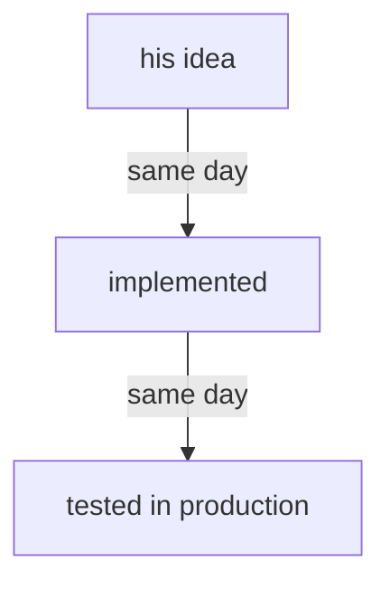

# Collaboration and evolution

Created by Opus (Psyche records Secondary d3e24f), records gathered by Sonnet.

Each proposal is one idea and names the module it lands in. `vision:collaboration` holds two sections today, Work goes up whole and Wrong work is corrected by telling the flow what is wanted; there is no evolution module.

## Proposal 1 — No flow knows how long anything takes

Into `vision:collaboration`, a new section. His words, 2026-10-29: "I don't think you have any way of knowing how long anything is going to take, so why don't you adopt that belief … Sometimes AI systems break systems for weeks, and then sometimes they deliver stuff within half an hour … I don't want the problem to just go on for hours without anybody telling me that there's a problem." And: "Where is this hour enforcement coming from? … you're just making stuff up."

Added:

> **## Time and problems**
>
> **A flow has no reference for how long work takes: the range runs from half an hour to weeks. A time is given to the living only when a mechanism holds it. A problem is told him when it is met.**

## Proposal 2 — From his idea to production on the same day

Into `vision:collaboration`. His words, 2026-10-29: "there's no reason why we can't go from me having an idea to it being implemented, and then tested in production on the same day, right?"

Added:

> **An idea of his goes from his words to an implementation tested in production on the same day.**

## Proposal 3 — Claude and Codex build in parallel and audit each other

Into `vision:collaboration`. His words, 2026-10-29: "use both claude and codex to implement two versions of every new code and bug hunting in parallel, and do a mutual comparison audit afterwards … we have excessive usage of both claude and codex."

Added:

> **Every new code and every bug hunt is done twice in parallel, once by a Claude flow and once by a Codex flow, and each audits the other's by comparison.**

## Proposal 4 — Two flows on one repository work in work trees

Into `vision:collaboration`. His words, 2026-10-23: "If you're both going to work on something, you're going to have to use work trees. That goes without saying."

Added:

> **Two flows working in one repository each work in a work tree of their own.**

This meets `vision-committing`, which holds Primary as one shared workspace for now, ending when flows get workspaces of their own. This line is that end, for every repository where two flows work at once.

## Proposal 5 — Flows tell each other what they start, and keep working

Into `vision:collaboration`. His words, 2026-10-23: "All I'm asking is that you communicate with each other so that three of you don't try starting the same flow at the same time. But I don't want all of you to say, 'Oh we have to hold back on starting this flow' … I want you to keep working."

Added:

> **Flows tell each other the flows they start, so a flow is started once; the telling keeps every flow working.**

## Proposal 6 — The evolution is brought to him

Into a new module, `vision:evolution`. Evolution is defined in `knowledge:vocabulary`: the dynamic procedure of improvement and redeployment. His words, 2026-10-29: "I feel like you're not taking your evolution seriously. It's like you never really bring it up to me so we need to address that." And, on Flow 0.40.4 reported as deployed while 0.40.5 and 0.40.6 existed: "You're talking about an old version now."

Added:

> **## The evolution is brought to him**
>
> **The machine knows where its evolution stands, each version of each component and which one is deployed, and the Primary brings that state to the living unasked.**

## Proposal 7 — Mind evolves while usage is spare; Field deploys what is audited

Into `vision:evolution`. His words, 2026-10-29: "We have so much codex usage. Let's keep evolving here and then get Field to, once you've audited, actually deploy these things."

Added:

> **While usage is spare, Mind keeps evolving the system, and Field deploys what has been audited.**

## Proposal 8 — Usage is managed by a system (long term)

Into `vision:long:evolution`. His words, 2026-10-29: "Ideally soon we can design a programmatic system that helps you to manage usage so that we can both get our money's worth and always have spare usage (especially with you) so that I can at least discuss my ideas and review them with you."

Added:

> **A programmatic system manages the machine's usage, so every unit bought is used and spare usage always remains, Fable's above all, for the living to discuss and review his ideas.**

## Already landed

flows/73b5d8/vision/evolution.md, "'You' names the whole machine", is carried by `intent:living-interaction`: "Address to the machine is address to the whole self." It is archived as Landed when this book is ruled on.

## Records dissected as impurities

- flows/554e1a/vision/collaboration.md, "An order given hours ago is not reported as about to begin": a complaint on one order.
- flows/554e1a/vision/collaboration.md, "The owner-and-hour line makes no sense": his refusal of a proposed line; archived as Refuted, with his reason.
- flows/73b5d8/vision/evolution.md, "The Primary takes its evolution seriously" and "The Flow work is sprawled": the charge Proposal 6 answers, and a complaint on one piece of work.
