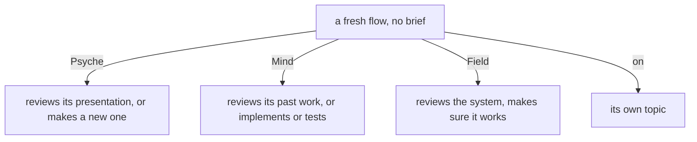
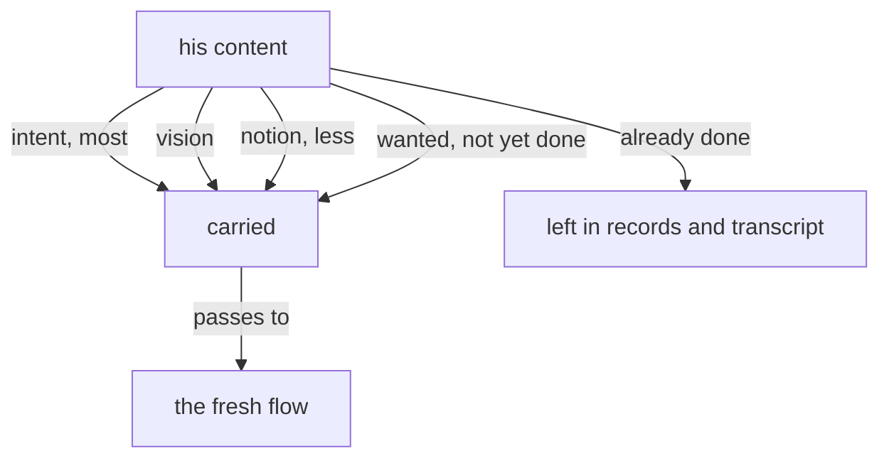

# Remembering

Created by Opus (Psyche records Secondary d3e24f), records gathered by Sonnet.

Each proposal is one idea; each names the module it lands in. The module today is `vision:remembering`.

## Proposal 1 — A fresh flow without a brief does its aspect's default work

Into `vision:remembering`, section A flow is started with a remembering. His words, 2026-10-29: "The only thing the new flow should get is context modules, vision logs, and things like that. It knows by default that it should essentially review its work … I would say the brief is optional … if it doesn't, then its job is to deal with whatever topic its topic is."

The section as it would stand; the change in bold:

> A launch names how far back the new flow remembers: the raw vision and notion logs of its predecessors to a depth, or of flows named one by one. The remembering is a field of the launch; the belief modules come from the declaration, from main; the brief comes last and carries the task alone. The logs are the record.
>
> **The brief is optional. A flow started without one does its aspect's default work on its topic: a Psyche flow reviews its presentation or makes a new one; a Mind flow reviews its past work or works on implementation or testing; a Field flow reviews the system and makes sure everything works.**



## Proposal 2 — What is important in his content

Into `vision:remembering`, section A fresh flow receives his content weighed by importance. His words, 2026-10-27: "what's important is what's thought to be vision or intent … It can just think of everything as vision. Notion is not so important, although it is important … if something is intent, that's really important … We don't want to carry the entire content of the message if the whole of the message is not important … something that I want done that hasn't been done properly yet. If it has been done, then it's not important."

The section as it would stand; the change in bold:

> A fresh flow receives the living's content weighed by importance, and only the important part.
>
> **What is important is what he wants the system to be, read as vision, and intent most of all; a notion carries a possible vision and weighs less; what he wants done and is not yet done weighs; what is done carries nothing for the next flow. The important part of a message is carried, the rest of it stays in the records.**



## Proposal 3 — Short term, the weighing is made when a record is logged

Into `vision:short:remembering`, a new module for the compromise in force now. His words, 2026-10-27: "Right now, we're using raw records, and I guess the judgment as to what is important and what is not important is made at the moment when the decision is made to log this as psyche or not."

Added:

> **The weighed content lives in the raw psyche records; the weighing is made when a flow decides what to log.**

## Proposal 4 — Short term, what a fresh flow is given has a cap

Into `vision:short:remembering`. His words, 2026-10-28: "overwhelming a system isn't going to help it address anything. There could be a sort of cap on the amount of content so that it would find that cap and then stop one file short of that. That could be a short-term remedy."

Added:

> **The open records given to a fresh flow have a cap on their size: the composition stops one file short of the cap.**

The cap is configuration in Flow, a value the running system takes:

```ethos
RecordCap.Integer
```

## Proposal 5 — What a refreshed flow remembers enters its middle stratum

Into `vision:remembering`, section A flow is started with a remembering. His words, 2026-10-29: "Make sure that whatever you remember goes in your middle stratum. Maybe we should make this standard behavior … in the long term … a properly configured system that passes over the right modules every time the Flow is refreshed."

Added:

> **What a flow remembers of its predecessors enters its middle stratum, every time it is refreshed.**

The middle stratum, as `knowledge:context-strata` defines it, is the conversation's binding text: the typed prompt, the injections the harness places into the conversation, a skill loaded through the skill interface. A log the flow opens with a tool is the bottom stratum and carries no authority; the remembering is given to it instead.

## Records dissected as impurities

These are working instructions with no vision of their own, archived when this book is ruled on:

- flows/554e1a/vision/remembering.md, "Refresh proactively … the threshold up 40%": an order to refresh and to raise the threshold by 40%; the threshold is configuration in Flow, which `vision:flow` already holds.
- flows/554e1a/vision/remembering.md, "The headroom lets him call a proactive refresh": the reason for that order.
- flows/b2b87a/vision/remembering.md and flows/d9065e/vision/remembering.md: orders to a Primary to refresh, and to scour its predecessors.
- flows/2933ce/vision/remembering.md: his warning that words may be lost when a flow refreshes before logging; an investigation, held as a bead.
