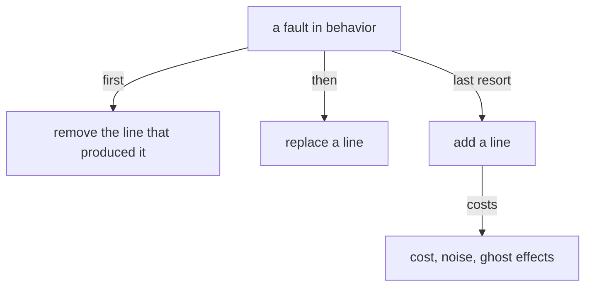

# Removal first

Created by Opus, records gathered by Sonnet.

## Proposal 1 — A fault is healed by removing, then replacing, then adding

Into `vision:belief-modules`, section Editing belief. His words, 2026-10-29: "we should look at fixing the belief first: by removing (as always), then by replacing, and then by adding as a last resort … any additional belief adds to the cost, possible noise, and possible ghost effects."

The section as it would stand; the change in bold:

> A belief goes in the module of its subject.
>
> A line that a module contradicts is edited by removing the contradicted line first.
>
> ~~Removal comes before addition.~~
> **A fault in behavior is healed in belief by removing first, then by replacing, and by adding only as a last resort: every added belief adds cost, noise and ghost effects.**

Removed: "Removal comes before addition.", which the new line holds whole.

Record drawn on: flows/2933ce/vision/belief-modules.md #4.
