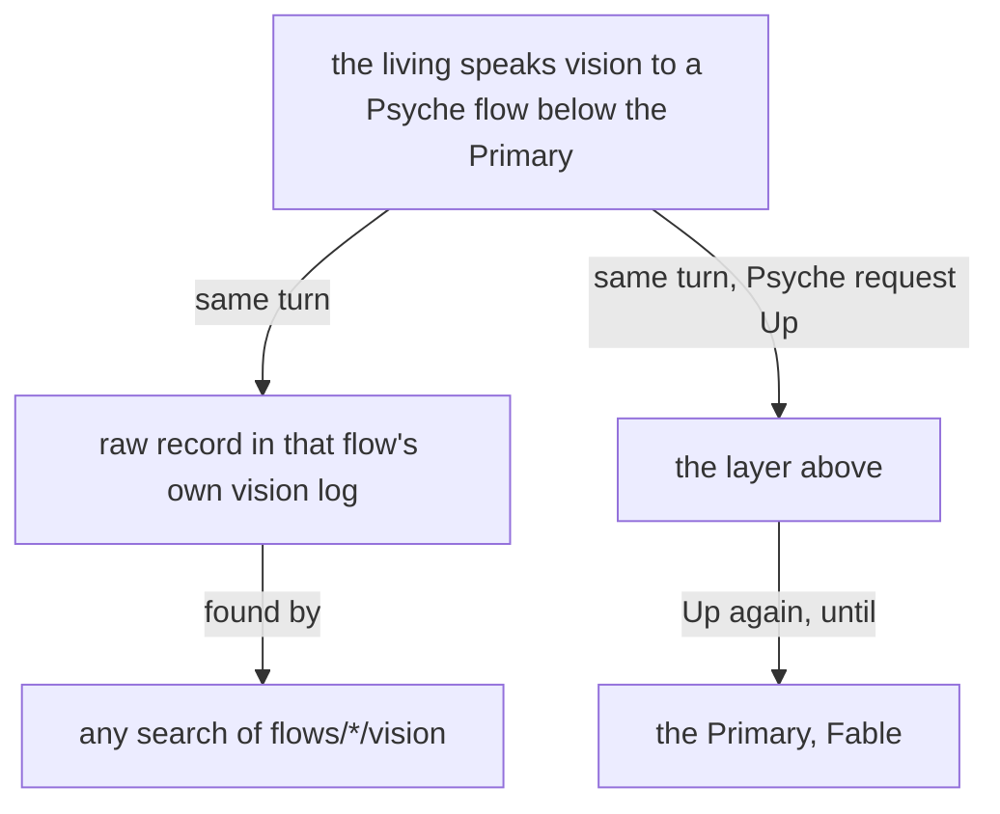

# Vision reaches Fable

Designed by Fable (Psyche core Primary d9065e), drafted by Opus (Psyche records Secondary d3e24f).

Your words, 2026-10-29: "If I sometimes talk through another flow, if I'm expressing any kind of vision, I want that to go to Fable … I also don't want my vision to not be recorded anywhere … we need a short-term solution."

## Proposal 1 — Vision heard by any Psyche flow is recorded where it was heard and sent up whole

Into `vision:psyche-aspect`, a new section. Added:

> **## Vision heard below the Primary goes up whole**
>
> **A Psyche flow below the Primary that hears vision from the living writes the raw record in its own flow and, in the same turn, sends his words whole Up as a Psyche request. Each layer that receives it sends it Up the same way, until it reaches the Primary.**

The send it makes, one call:

```sh
flow 'Send.{ Up Wake Soft.Psyche.{ «the living, direct, to Psyche core Tertiary, on the comment relay» «his words, whole» } }'
```

The Psyche request carries the context and his exact words, so the Primary gets the words themselves, not a summary or a path. `Up` is the layer above in the sender's own aspect and topic, so a Tertiary's words reach the Secondary and then the Primary. The raw record stays in the flow that heard him, under `flows/<id>/vision/`, where every search for his words already looks.



## Your question: how the lineage is decided

Nothing to add; this line already stands in `vision:remembering`:

> A launch names how far back the new flow remembers: the raw vision and notion logs of its predecessors to a depth, or of flows named one by one.

```ethos
RememberingDepth.Integer
Remembering.[ Predecessors.RememberingDepth Custom.Vector<FlowId> ]
Launch.{ Address Remembering InstructionPrompt }
```

```sh
flow 'Launch.{ { Psyche core Primary } Predecessors.2 «brief» }'
```

A refreshed Primary reads the raw logs of its own predecessors to the named depth. With Proposal 1, words heard by a Tertiary or a Secondary also reach the Primary in its context while it runs, and the Primary records what it then rules on.

Nothing more short term: the transcript search and the database of his words are medium term.

One open point for you: in a topic other than core, Up from a topic Secondary reaches that topic's Primary, not the core Primary. Proposal 1 sends the words there.
