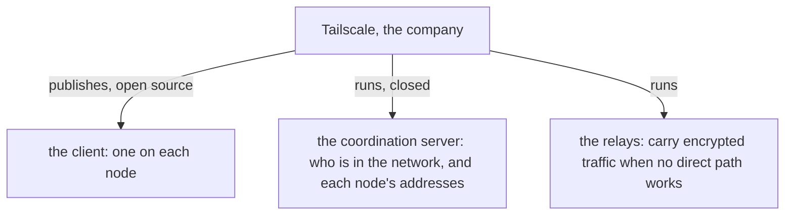
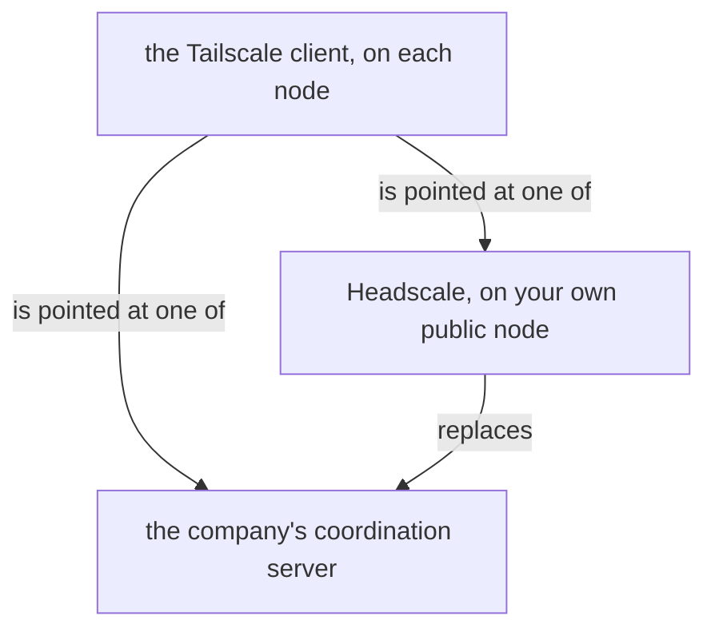
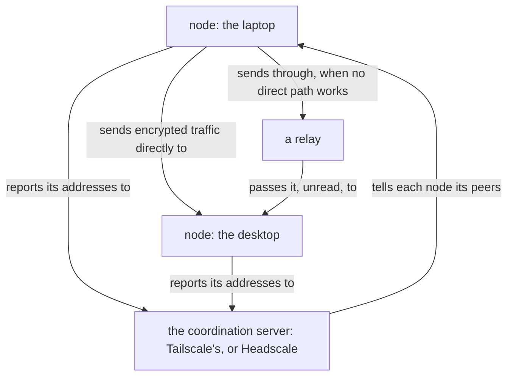

Presentation.{ «Tailscale and Headscale, the words» Account }

# Tailscale and Headscale, the words

Created by Fable 5.2, from what it knows; the research under way confirms the details.

## Tailscale is two things under one name

Tailscale is a company and its product. The product has two parts: the client, a program that runs on each of your nodes and is open source, and the coordination server, which the company runs for you and keeps closed. The company also runs the relays. «The Tailscale service» means the parts the company runs.

## Headscale is the coordination server, hosted by you

Headscale is a separate open-source project. It is a coordination server written to speak to the same Tailscale client, so that you run that one part yourself, on your own public node. The client on each node stays Tailscale's; it is pointed at your server in place of the company's. A relay can run on the same node.

## What flows where

The coordination server tells each node who its peers are and where they are. The traffic itself goes between the nodes, encrypted from one end to the other, directly when a path exists and through a relay when none does.

The whole is usually called Tailscale when the company's server is used, and «Tailscale with Headscale» or simply Headscale when yours is.
