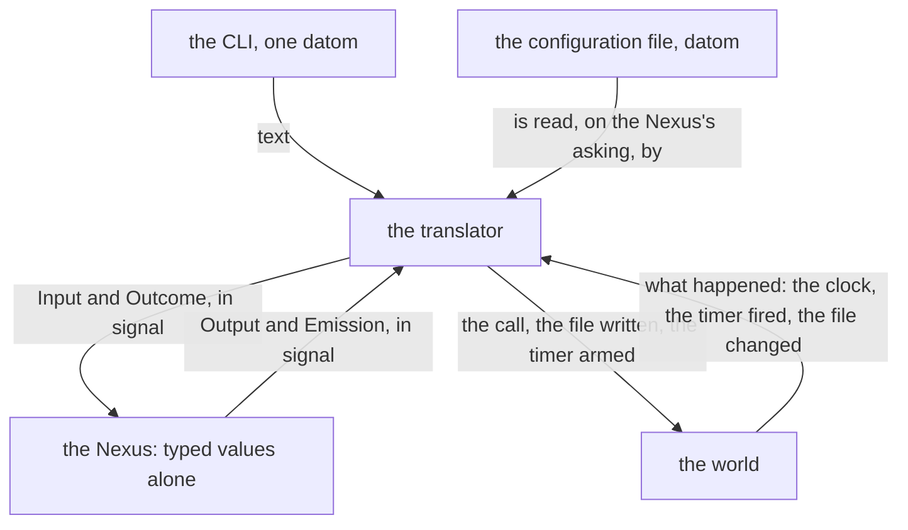

Presentation.{ «Chronos, version 1: the first proper Nexus» Proposal }

# Chronos, version 1: the first proper Nexus

Created by Fable. A reader of mine established what is built of the translator, of Ethos and of Chronos.

### Proposal 1: The translator · psyche-belief › vision/nexus/1.md

+ A Nexus reads the world as it writes to it, by an emission: the Nexus asks, the translator fetches the text, turns it into the typed value, and answers it as the Outcome. A file, a clock and a timer are read this way.

+ The world speaks to a Nexus through its translator as well: what the translator observes, a file changed among it, reaches the Nexus as an Input.

+ A Nexus's configuration is one datom file in its place. The Nexus is started knowing its place and nothing else; it asks its translator for the configuration, and asks again when the translator tells it the file has changed.



### Proposal 2: New module · psyche-belief › vision/chronos/1.md

::: description
+ The Nexus that tells astrological time, rewritten as the first Nexus built whole on the translator: its four parts, its configuration file and its displays.
:::

+ # Chronos, version 1

+ Chronos is rewritten whole as the smallest Nexus that uses every part: it is asked, it reads its configuration and the clock through its translator, it remembers its location, and it writes the time to the displays its configuration names. What is learned building it is how every later Nexus is built. Every type below is tentative in its name.

+ ## The types

+ ```ethos
+ Library
+ []                                    ; imports
+ [ SolarTime.Decimal                   ; types: the Sun's arc on the ecliptic, in degrees
+   Lunation.Decimal                    ;   the Moon's arc less the Sun's, in degrees
+   Latitude.Decimal
+   Longitude.Decimal
+   Location.{ Latitude Longitude }
+   Instant.String                      ;   a moment, in universal time
+   FilePath.String
+   Reason.String                       ;   why the world refused, in its own words
+   Format.[ Solar Lunar Both ]         ;   what a display shows
+   Display.{ FilePath Format }         ;   one place the time is written to, a status bar's file among them
+   Time.{ Instant SolarTime Lunation } ;   the astrological time of one moment
+   Configuration.{ Location            ;   the whole configuration file
+                   Vector<Display> } ]
+ []                                    ; traits
+ []                                    ; associations
+ ```

+ ```datom
+ ; the configuration file, in the Nexus's place; every value is an example
+ { { 45.5 -73.6 }
+   [ { «/run/user/1000/chronos/solar» Solar }
+     { «/run/user/1000/chronos/both» Both } ] }
+ ```

+ ## What it says

+ ```ethos
+ Signal
+ [ chronos:[ Time Instant Location ] ] ; imports
+ [ Now                                 ; inputs: the default: the time now, at the configured location
+   At.{ Instant Location }             ;   a variation: the time of a given moment and location
+   Subscribe                           ;   the time now, then each change as it happens
+   ConfigurationChanged ]              ;   from the translator: the file was written
+ [ Now.Time                            ; outputs
+   At.Time
+   Subscribed.Time                     ;   the time on open
+   Changed.Time                        ;   a reaction: pushed to every subscriber
+   Reconfigured                        ;   answers ConfigurationChanged
+   Refused.[ NoConfiguration           ;   the file is absent or unreadable
+             NoLocation ] ]
+ []                                    ; types
+ ```

+ ```datom
+ ; asked at the CLI, through the translator
+ Now
+ Now.{ «2026-11-15T22:00:00Z» 233.4 71.2 }
+ ```

+ ## What it attempts

+ ```ethos
+ Operation
+ [ chronos:[ Time Instant Location Reason ] ] ; imports
+ [ Configuring                         ; attempts: the configuration read through the translator
+   Telling                             ;   the time now, computed from the clock and the location
+   TellingAt.{ Instant Location }
+   Displaying.Time                     ;   the time written to every display
+   Awaiting.Instant ]                  ;   the wake armed for the next change
+ [ Configured                          ; outcomes
+   Told.Time
+   Displayed
+   Awaited
+   Failed.Reason ]
+ []                                    ; types
+ ```

+ ## What it remembers

+ ```ethos
+ Memory
+ ; Tentative: Memory referring to a Library record is an open question for Ethos.
+ [ chronos:[ Location Display ] ]       ; imports
+ [ Configuration.{ Location            ; records: the configuration last read
+                   Vector<Display> }
+   Answer.[ Succeeded Failed ] ]
+ ```

+ ## What it sends into the world

+ The Nexus holds no text: it sends a Time and a Display, and the translator writes the words.

+ ```ethos
+ Emission
+ [ chronos:[ Time Instant Display Configuration Reason ] ] ; imports
+ [ Read                                ; emissions: the configuration file, read and translated
+   Clock                               ;   what moment it is
+   Wake.Instant                        ;   wake me at that moment
+   Show.{ Display Time } ]             ;   the time written to one display
+ [ Reading.[ Read.Configuration        ; outcomes: what the translator observed of each,
+             Unreadable.Reason ]       ;   one for each emission, in the same order
+   Clocked.Instant
+   Woken.Instant
+   Showing.[ Shown
+             Unwritable.Reason ] ]
+ []                                    ; types
+ ```

+ ## Every action answers an event

+ Chronos computes when what it shows will next change, and asks to be woken then; between two changes it is quiet.

+ ```mermaid
+ flowchart TB
+     s["Chronos starts, knowing its place"] -- "Read" --> c["the Configuration, remembered"]
+     c -- "Clock" --> t["the Time, computed"]
+     t -- "Show, to each display" --> d["the status bar reads its file"]
+     t -- "Changed, to each subscriber" --> u["subscribers"]
+     t -- "Wake, at the moment a shown value next changes" --> q["quiet"]
+     q -- "Woken" --> t
+     f["the configuration file is written"] -- "ConfigurationChanged" --> c
+ ```
