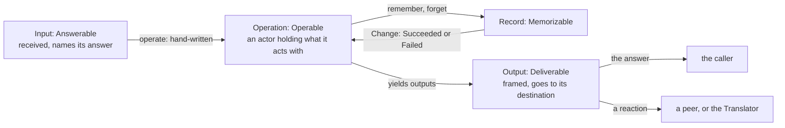

# The implied root traits

Created by Fable, on the draft by Fable (Psyche core Primary); evidence gathered by Sonnet.

A proposal into vision:ethos, vision:signal, vision:nexus and vision:memory. It takes the four traits the living ruled today, Answerable, Deliverable, Operable and Memorizable, and gives each its capabilities in Ethos, the Rust generated from it, what Ethos Zero emits beside the type and what one body stays hand-written. Bead ethos-zero-add in ethos-zero is held for it; the Mind ethos pair builds nothing until he rules.

## Why

A Nexus's ethos declares what it says, does and remembers; it never declares that an input is received and answered, that an output leaves toward somewhere, that an operation acts or that a record is kept. Those follow from the root a type is declared in. Today Ethos Zero emits the types and their derives and stops. The Flow Nexus v1 repositories hold generated types and nothing else: a grep for `impl … for` across flow-nexus, signal-flow-nexus and meta-signal-flow-nexus finds none, and `flow-nexus/STATUS.md` names the gap, "Implied Memory/Operation/Signal root traits: the current generator output supplies data types but no such interactions." Nothing is removed when this lands; the traits are added.

## The shape

Four traits, declared once in Ethos in the nexus library and implied by the roots: a Nexus's ethos writes none of them. Two supertraits they share carry identity and the wire. Every capability has one default body, written once under its trait in the nexus repository; Ethos Zero emits beside each type its derive and an empty impl. Two things are a Nexus's own and hand-written: how an operation operates, and from the second memory version on, how a record upgrades.



His words it rests on: "an operation is itself an object. The actor framework kind of impersonifies that with the concept of an actor, meaning we think of an object that can act" (2026-10-30); "a standard successful or unsuccessful change implemented on these particular data types … an upgrade from … the very edit" (2026-10-02); "every trait is written in ethos; a mechanical check finds none in hand-written code" (2026-10-07).

## The nexus library

Identity is trait-borne: an encoded form fingerprints itself, the hash of its rkyv archive. That is Archivable, borne by every type the three roots declare. An input is received: validated from its frame. An output is framed: archived and length-prefixed, and knows its destination. An operation is an actor that operates on the inputs it is given and yields outputs. A record is remembered or forgotten, answered by the standard Change, and has a version and the edit from the previous one.

The Ethos, in the nexus repository:

```
Library
[ :std:[ Byte Path ]                                   ; imports: the byte and the path, from std
  :rkyv:[ Serializable Deserializable ] ]              ;   the rkyv derives, named as legacy traits
[ Archive.Vector<Byte>                                 ; types: an rkyv archive, portable across endianness
  Fingerprint.Vector<Byte>                             ;   the hash of an archive: a value's identity
  Frame.{ Integer Archive }                            ;   the archive length-prefixed, as the socket carries it
  Refusal.[ Truncated Malformed ]                      ;   why a frame is refused on receive
  Destination.[ Caller                                 ;   where an output goes: back to the input's sender,
                Peer.Address                           ;     to a peer Nexus at an address,
                Translator ]                           ;     or to the Translator, which makes it real
  Memory.Path                                          ;   the memory engine: the one handle to a Nexus's store
  Failure.[ Absent Conflict Unwritable ]               ;   why a change failed
  Change.[ Succeeded                                   ;   what Memory answers a change
           Failed.Failure ] ]
[ Archivable.{ [ Sized Serializable Deserializable ]   ; traits: borne by every type a root declares
               []
               []
               [ archive.[ Archive ]                   ;   its rkyv archive
                 fingerprint.[ Fingerprint ] ] }       ;   the hash of that archive
  Answerable.{ [ Archivable ]                          ;   an input
               [ Answer<Deliverable> ]                 ;   the one output that answers it, sent at once
               []
               [ receive:{ [ Frame ]                   ;   validated on receive, or refused
                           [ Result<Self Refusal> ] } ] }
  Deliverable.{ [ Archivable ]                         ;   an output
                []
                []
                [ frame.[ Frame ]                      ;   archived and length-prefixed, ready to leave
                  destination.[ Destination ] ] }      ;   where it goes
  Operable.{ [ Archivable ]                            ;   an operation: an object that acts on what it receives
             [ Input<Answerable> Output<Deliverable> ] ;   what it is given, what it yields
             []
             [ operate!{ [ Input ] [ Vector<Output> ] } ] } ; acts: the answer among the outputs, and any reaction
  Memorizable.{ [ Archivable ]                         ;   a record
                [ Previous<Memorizable> ]              ;   the record type of the version before; the first version's is Self
                [ VERSION.Integer ]                    ;   the memory's version, from its manifest
                [ remember.{ [ Memory ] [ Change ] }   ;   the standard change: written under its fingerprint
                  forget.{ [ Memory ] [ Change ] }     ;   the standard change: erased
                  upgrade:{ [ Previous ] [ Self ] } ] } ] ; the very edit from the previous format
[]                                                     ; associations: none; the roots imply them
```

The Rust generated from it, the default bodies written once by hand beneath each trait:

```rust
#[derive(Datomizable, Compositional)] pub struct Archive(pub Vec<Byte>);
#[derive(Datomizable, Compositional)] pub struct Fingerprint(pub Vec<Byte>);
#[derive(Datomizable, Compositional)] pub struct Frame { pub integer: Integer, pub archive: Archive }
#[derive(Datomizable, Compositional)] pub enum Refusal { Truncated, Malformed }
#[derive(Datomizable, Compositional)] pub enum Destination { Caller, Peer(Address), Translator }
#[derive(Datomizable, Compositional)] pub struct Memory(pub Path);
#[derive(Datomizable, Compositional)] pub enum Failure { Absent, Conflict, Unwritable }
#[derive(Datomizable, Compositional)] pub enum Change { Succeeded, Failed(Failure) }

pub trait Archivable: Sized + rkyv::Archive + for<'a> rkyv::Serialize<Serializer<'a>> + rkyv::Deserialize<Self, Deserializer> {
    fn archive(&self) -> Archive { Archive(rkyv::to_bytes(self).expect("archiving an archivable value").to_vec()) }
    fn fingerprint(&self) -> Fingerprint { Fingerprint(hash(&self.archive().0)) }
}
pub trait Answerable: Archivable {
    type Answer: Deliverable;
    fn receive(frame: Frame) -> Result<Self, Refusal> {
        if frame.integer as usize != frame.archive.0.len() { return Err(Refusal::Truncated) }
        rkyv::from_bytes(&frame.archive.0).map_err(|_| Refusal::Malformed)
    }
}
pub trait Deliverable: Archivable {
    fn frame(&self) -> Frame { let archive = self.archive(); Frame { integer: archive.0.len() as Integer, archive } }
    fn destination(&self) -> Destination;
}
pub trait Operable: Archivable {
    type Input: Answerable;
    type Output: Deliverable;
    fn operate(&mut self, input: Self::Input) -> Vec<Self::Output>;
}
pub trait Memorizable: Archivable {
    type Previous: Memorizable;
    const VERSION: Integer;
    fn remember(&self, memory: Memory) -> Change { memory.write(self) }
    fn forget(&self, memory: Memory) -> Change { memory.erase(self.fingerprint()) }
    fn upgrade(previous: Self::Previous) -> Self;
}
```

## What the roots say, and what Ethos Zero emits

The traits need three facts the roots do not yet say: which outputs answer an input, where a reaction goes, and which inputs an operation acts on. Each is a pairing, and a pairing is written like an association: the type's name, a dot, what it pairs with. A head over a bracket pairs with a generated enum of the bracket's types; a head over one type pairs with that type.

### Signal: a fifth section, deliveries

Every output is delivered. An input's line names the outputs that answer it: they go to the caller, and the generated enum of them is the input's Answer. An output's line names its destination kind: that output is a reaction. Every output stands in exactly one line, as an answer or as a reaction; Ethos Zero refuses a Signal where one does not.

The Flow Nexus's ordinary Signal, with its two Translator outputs from the Translator proposal:

```
Signal
[ :flow_nexus_types:[ Address Remembering Brief FlowId Pane Message ] ] ; imports
[ Launch.{ Address Remembering Brief }                ; inputs
  End.FlowId ]
[ Launched.FlowId                                     ; outputs: the answers …
  Ended
  Refused.[ NoCapsule AddressBusy UnknownFlow ]
  Prompt.{ Pane Message }                             ;   … and the reactions
  Interrupt.Pane ]
[]                                                    ; types
[ Launch.[ Launched Refused ]                         ; deliveries: Launch is answered by one of these, to its caller
  End.[ Ended Refused ]
  Prompt.Translator                                   ;   a reaction, to the Translator
  Interrupt.Translator ]
```

The Rust generated from it. Each type gets the derive line Ethos Zero emits today, then the empty impls; the payload of an inline struct bears the variant's name with `_Data`, as the emitter does now.

```rust
pub struct Launch_Data { pub address: Address, pub remembering: Remembering, pub brief: Brief }
pub enum Input  { Launch(Launch_Data), End(FlowId) }
pub enum Output { Launched(FlowId), Ended, Refused(Refused_Data), Prompt(Prompt_Data), Interrupt(Pane) }
pub enum LaunchAnswer { Launched(FlowId), Refused(Refused_Data) }                 // from the deliveries section
pub enum EndAnswer    { Ended, Refused(Refused_Data) }

impl nexus::Archivable  for Launch_Data {}
impl nexus::Answerable  for Launch_Data { type Answer = LaunchAnswer; }            // generated whole
impl nexus::Deliverable for LaunchAnswer { fn destination(&self) -> Destination { Destination::Caller } }
impl nexus::Deliverable for Prompt_Data  { fn destination(&self) -> Destination { Destination::Translator } }
impl nexus::Answerable  for Input  { type Answer = Output; }                       // the enum: received, answered by some output
impl nexus::Deliverable for Output { fn destination(&self) -> Destination { match self { /* each variant's */ } } }
```

A reaction to a peer, `Notice.Peer`, takes its address from the output's one field of type Address; a Peer reaction with no such field, or two, is refused by Ethos Zero. So Deliverable too is generated whole.

### Operation: an operation holds what it acts with, and a fourth section, acts-on

An operation is the object: it is declared with the state it acts with, its Memory among it, and the acts-on section names the inputs it is given. The operation is a Kameo actor, its value the actor's state; the inputs are its messages. Ethos Zero emits the actor and message wiring; `operate` is the one hand-written body of a Nexus.

```
Operation
[ :flow_nexus_types:[ Capsule Launch End ]            ; imports
  :nexus:Memory ]
[ Starter.{ Capsule Memory }                          ; operations: the actor that starts and ends flows
  Reaper.Memory ]                                     ;   the actor that reaps what ended
[]                                                    ; types
[ Starter.[ Launch End ]                              ; acts on: the inputs each operation is given
  Reaper.End ]
```

```rust
pub struct Starter { pub capsule: Capsule, pub memory: Memory }
pub enum StarterInput { Launch(Launch_Data), End(FlowId) }                        // from the acts-on section
impl nexus::Archivable for Starter {}
impl kameo::Actor for Starter { type Args = Self; /* the value is the state */ }
impl kameo::message::Message<StarterInput> for Starter {                            // generated wiring: a message is operated on
    type Reply = Vec<Output>;
    async fn handle(&mut self, input: StarterInput, _: &mut Context<Self, Self::Reply>) -> Vec<Output> { self.operate(input) }
}
const _: () = { fn assert<T: nexus::Operable>() {} let _ = assert::<Starter>; };    // the Nexus writes the impl below
```

The hand-written body, in the Nexus, under the declared trait: the operation remembers through its Memory and yields the answer, with any reaction.

```rust
impl Operable for Starter {
    type Input = StarterInput; type Output = Output;
    fn operate(&mut self, input: StarterInput) -> Vec<Output> {
        match input {
            StarterInput::Launch(launch) => {
                let flow = Flow { /* … */ };
                match flow.remember(self.memory) {
                    Change::Succeeded => vec![Output::Launched(flow.flow_id), Output::Prompt(Prompt_Data { /* … */ })],
                    Change::Failed(_) => vec![Output::Refused(Refused_Data::NoCapsule)],
                }
            }
            StarterInput::End(id) => { /* … */ }
        }
    }
}
```

The Kameo shapes, `Actor`, `Message`, `handle`, follow the Kameo version the nexus repository pins; what is fixed here is that the operation value is the actor's state and an input is a message it operates on.

### Memory: the records, as today

```
Memory
[ :flow_nexus_types:[ FlowId Address State ] ]        ; imports
[ Flow.{ FlowId Address State } ]                     ; records
```

```rust
impl nexus::Archivable  for Flow {}
impl nexus::Memorizable for Flow { type Previous = Flow; const VERSION: Integer = 1; fn upgrade(previous: Flow) -> Flow { previous } }   // generated at version 1
```

Short term every memory is version 1 and the impl is generated whole. Medium term a memory has a manifest with versions; Ethos Zero takes Previous from the version before and emits `upgrade` from the edit between the two declarations where the edit is mechanical, a field added with a default or removed; where it is not, `upgrade` is the hand-written body.

## Generated and written

| trait | generated | hand-written |
|---|---|---|
| Answerable | receive; Answer and its enum, from deliveries | nothing |
| Deliverable | frame; destination, from deliveries | nothing |
| Operable | Input and its enum, from acts-on; the actor and message wiring | operate |
| Memorizable | remember, forget; Previous, VERSION, upgrade at version 1 | upgrade past version 1, where the edit is not mechanical |

## What this removes

The Flow Nexus v1 Operation declares outcomes, and Ethos Zero generates an `Outcome` enum beside `Operation`. An output is never part of an operation; outputs are the Signal's. The v1 section goes, with the enum and the per-operation names:

```
[ Start.{ Address Remembering Brief Declaration }   ; removed: an operation is the actor, Starter, declared with what it acts with
  Stop.FlowId … ]
[ Started.FlowId Stopped … Failed.[ … ] ]            ; removed: these are outputs, declared in the Signal and delivered by it
```

The Flow Nexus v1 Memory declares `Answer.[ Succeeded Failed ]` as a record; the nexus library's Change answers every change, and the line goes.

## The path, with the trait at each step

```datom
; 1 Input on the socket: Answerable receive
Launch.{ { Psyche core Primary } Predecessors.2 «Draft the Nexus book» }
; 2 the Starter, a Kameo actor, is given it: Operable operate, hand-written
Starter.{ { /home/li/primary [] } /var/flow/memory }
; 3 the record it leaves: Memorizable remember
Flow.{ 7 { Psyche core Primary } Running }
; 4 Memory's Change
Succeeded
; 5 the outputs it yields: Deliverable frame and destination
[ Launched.7 Prompt.{ 3 «Draft the Nexus book» } ]
; 6 Launched.7 goes to the caller, the answer; Prompt goes to the Translator, a reaction
```

## Alternatives, each a proposal of its own

Two sections instead of deliveries: answers for inputs and reactions for outputs, as the draft had. The same lines, split; I propose one section because both say where an output goes.

A reaction's destination hand-written, as the draft had: no Peer address rule, `destination` the one body of a reaction. I propose the rule because it leaves Deliverable generated whole.

## Lines to land

vision:ethos, Associations, after the four-trait line: The four traits are declared in Ethos once, in the nexus library, with Archivable, the identity trait every root type bears beneath them; every capability has one default body, written once under its trait, and Ethos Zero emits beside each type the empty impl of its root's trait. A Signal's fifth section is deliveries: an input's line names the outputs that answer it, an output's line names the destination kind of a reaction; every output stands in exactly one line. An Operation declares each operation with the state it acts with, and its fourth section, acts-on, names the inputs it is given. An operation type also gets its Kameo actor and message wiring, and `operate` is the one hand-written body of a Nexus.

vision:signal: Answerable receives, validated from its frame; Deliverable frames and knows its destination: Caller, Peer at an Address, or Translator.

vision:nexus, Actors: Each operation is a Kameo actor whose state is the operation's own value, its Memory among it; an input it acts on is a message to it.

vision:memory: Memorizable remembers and forgets through the Memory handle, answered by Change, Succeeded or Failed; a record has an Integer VERSION from its manifest, a Previous, and an upgrade; the first version has itself as Previous and identity as upgrade.
