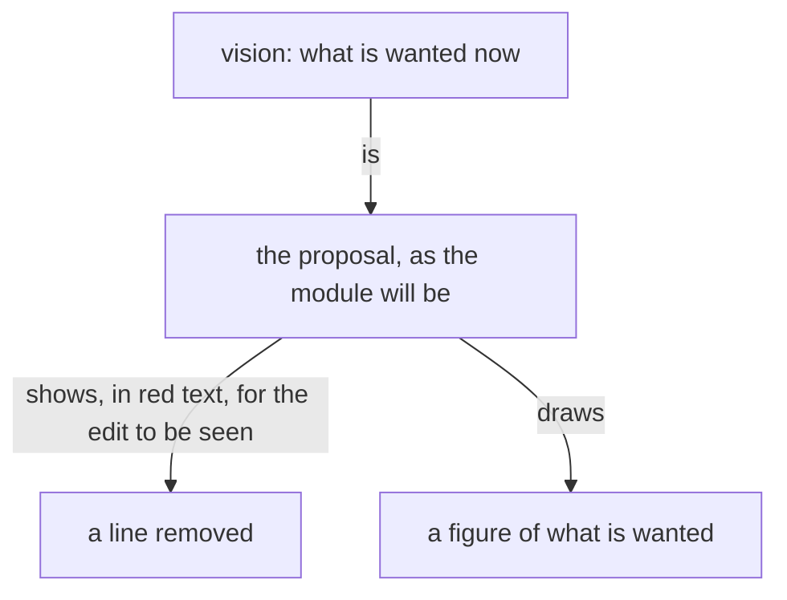

Presentation.{ «Vision is what is wanted now» }

# Vision is what is wanted now

*Created by Fable.*

Each proposal names the module, the sentence it replaces or follows, and the lines wanted.

## The idea, and why

Vision is what is wanted now. There is one vision, the one in the module at this moment; the minute a line is not wanted, it is not vision, and nothing refers to it as vision again. Vision has no past and documents nothing.

A proposal is the vision as it will be. It shows a removed line as the text it was, in red, for one reason: so the edit can be seen. Nothing else is made of a removed line: it is not drawn, not summarised, not shown as "how it is", because that would present as vision a thing that is not wanted.

A figure draws the vision. "As it stands" in a book means one thing: a module's text now, shown to situate the landing. A figure shown as it stands is a fence that is in the module.

Example. The module says "its work is what it writes to files"; the wanted line is "the transcript is the record of a flow's work". The proposal shows the old sentence in red, the new in green, and one green figure: the transcript, the flow's work, the file a reader asked for. It draws nothing of files being written, because nobody wants that.

Example. A module holds a mermaid fence that is no longer wanted. The proposal shows that fence's lines in red, as the lander will remove them, and the wanted fence in green. The removed fence is not redrawn beside the new one.

### Proposal 1: Vision has no past · psyche-belief › vision/psyche.md

After the sentence "Vision is what is wanted; it is neither real nor unreal, and it documents nothing.", in the same paragraph:

+ The minute a line is not wanted it is not vision: there is one vision, the one in the module now, and nothing refers to a past one.

### Proposal 2: What is made of a removed line · psyche-belief › vision/proposal.md

After the sentence "A proposal states what is wanted of the system; it documents nothing.", as its own paragraph:

+ A proposal is the vision as it will be. A removed line is shown as the text it was, in red, so the edit can be seen, and nothing else is made of it: it is not drawn, not summarised and not shown as a state of anything.

Replacing "A proposal is usually drawn as well as written, and always when it has a shape: what it adds, removes and keeps, in one frame.":

+ A proposal is usually drawn as well as written, and always when it has a shape; a figure draws what is wanted, and nothing of what goes.

Replacing "A proposal is written by Fable; Opus publishes it and lands it.":

+ Fable writes a proposal: the wanted lines and where they go, reading the belief modules itself. Opus publishes it and lands it.

### Proposal 3: Up to date means wanted now · psyche-belief › vision/crystallization.md

Replacing "Crystallized vision is up to date: it states the subject as it now stands.":

+ Crystallized vision is up to date: it states what is wanted of the subject now.

### Proposal 4: A figure draws the vision · psyche-belief › vision/book.md

Replacing "A figure proposed for a module shows under that module's path in green, as an added line does; a figure it replaces shows beside it in red.":

+ A figure proposed for a module shows under that module's path in green, as an added line does; a fence it replaces, in the module, shows as its red lines. A figure is drawn only of what is wanted; a removed sentence is its red text and is never drawn.

