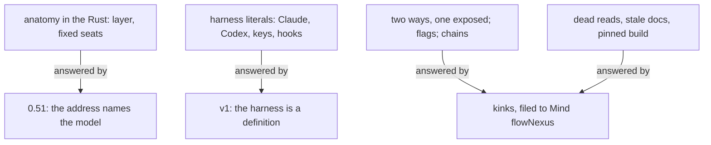

Presentation.{ «Flow Nexus vision audit» }

# Flow Nexus vision audit

Fable, Psyche flowAudit Primary fb129b; five Opus readers gathered the code and module findings, Psyche flowAudit Secondary checked the vision line by line against 0.50.

## What was audited

The Flow Nexus at 0.50, commit 3a202a4 on next/waiting-delivery-0.50-66ac59, and main at aefcbf5, which differs only in test injection; 84 000 lines of Rust, read whole by four Opus readers. The fifty vision modules of psyche-belief, read whole by a fifth, and judged here. The standard: no hard-coded behaviour, everything configurable, two ways of doing a thing exposed as a data-carrying variant, the design model-based; the three aspects may stay fixed.

## The code: what the audit found



**Anatomy.** 0.50 is addressed by layer. `Address.{ Aspect Topic Layer }` (flow-ethos library.ethos:12); the model is looked up from layer × aspect (store.rs:1010, 1345, 7760), the reverse of addressing by model. The layer decides power in three copies (waking.rs:124, binding.rs:142, store.rs:6085), effort (sending.rs:474: Quaternary Mind or Field is low, all else medium), the Secondary-first start and the NoSecondary refusal (launching.rs:152, lib.rs:173), and Up, in two tables that disagree: sending.rs:164 gives a Primary NoneAbove, waking.rs:2903 sends a Primary's refusal notice to Psyche core Secondary. Six seats are typed into the Rust: Psyche core Primary gets the presentation prompt (composition.rs:72) and is the core presentation (logical_delivery.rs:57), whose reply goes to Psyche book Tertiary as an Order with an English notice (logical_delivery.rs:904-954); the Message Nexus is Field message Primary (store/metaflow.rs:95); a reminder's last failure goes to the sender's Secondary (reminder.rs:123); topic core at a fixed list of aspect × layer is Maintained (metaflow_declaration.rs:113). A role table and a role-as-text in `flow_type` hold the same fact twice (store.rs:1549, 6185).

My opinion: this is the one structural finding, and it is already vision: `Address.{ Aspect Topic Model }` stands in vision:flow-nexus, and the running version goes on taking fixes. The fix is a subversion, 0.51: the address takes the model; power, effort, Up, Secondary-first and the six seats fold into what already exists for them, a Models row per model with its effort, a route in the declaration, a declaration field for the presentation prompt, a configuration value for the Message Nexus. I would do this in 0.50's line rather than wait for v1, because every flow runs on it today and the harness side of v1 is the larger work.

**Harness.** `HarnessKind.[ Codex Claude ]` carries no data (library.ethos:91), so every difference lives in Rust: six `== Claude` checks in Spawn (herdr/launch.rs:1974-2042), two transcript parsers in one match (2649-2822), the hook set and settings JSON (484-523, bypassPermissions, five hook events), the Claude flags and the Codex flags (1910-1935), the environment variables stripped from a pane (435-448), Claude Code 2.1.294's paste tables as constants (herdr/claude_paste.rs, flow-native/lib.rs:27), Codex's JSON-RPC methods and its `approvalPolicy: never, sandbox: danger-full-access` (codex.rs:1086), submit keys both configured in HarnessProfile and literal `"enter"` in pane.rs:398, a Codex app-server rule in the generic queue (queue_delivery.rs:79), and two event channels, the Claude hook and the Codex send tool, with no type naming the channel. Every timeout and limit is a constant: 10 s app-server, 30 s prompt reply, 15 s and 30 s rest waits, 12 submission reads, 3 interrupt presses, 64 KiB payload, 1 MiB frame, 64 ancestors, 4 reminders, 30 default minutes.

My opinion: these are not knobs to expose one by one; they are the harness's declaration, which vision:flow-nexus-v1 already has as `Harness.{ HarnessName Features }`. What 0.50 shows is what that declaration must carry beyond features: the program, its flags, its settings file, its hook events, its keys, its transcript root and format, and its version, since the paste tables are one Claude Code version's. I leave the v1 type to its designers and hand them the list; configuring these in 0.50 would be painting over.

**Two ways, one exposed.** A belief module from a repository or from a local path: absent from the types entirely; context.rs:4 says no path is accepted on the launch route and `Source.{ Repository Hash Path }` (library.ethos:20) is a product, not a choice. Proposal 7 below puts the variant where it belongs, the Belief Nexus. Codex endpoints are two fixed slots, stable and next (library.ethos:89, nexus_configuration.rs:47), and ConsumeReset always takes next's first model (lib.rs:405). Two configuration stores, the legacy records and ConfigureNexus, hold the same values with a fallback between them and no type saying which is in force (store.rs:1611, 4386, 5661, 5689). Two Start types (generated/startup.rs vs flow_ethos), two dead generated files, two Start dispatch paths of which one lacks the harness-arguments check (lib.rs:167 vs 978), two configure handlers, module identity in two grammars (composition.rs:310, 639), legacy queue entries found by a variant and by a `"legacy:"` prefix (queue_delivery.rs:991), Delivery derived from priority in two places though Send already carries it (store/metaflow.rs:296, logical_delivery.rs:1058).

**Flags.** `hard` makes `run` two procedures (delivery.rs:462-556); `rehearsal: bool` (sending.rs:507); `observe: bool` (pane.rs:82); `expected_session: Option` makes `adopt_seat` both BindSeat and Adopt (sending.rs:993); two booleans for three pane states (created_pane.rs); seven `Option` fields encoding the harness (harness_command.rs:92); `launch_request_id` empty meaning a wake (successor.rs:52); `--configure-only` as an argv string (main.rs:91); `admits_configuration_peer(bool, bool, bool)` (main.rs:194).

**Fallback chains.** Every store upgrade but one tries each older shape in turn on an Admission failure (store.rs:3720-3998, nexus_configuration.rs:284, metaflow_declaration.rs:328, events.rs:259); only `upgraded_launch_attempts` (store.rs:4029) matches on the stored version, which is the shape vision:versioning asks for. The running Nexus reads HOME, XDG_RUNTIME_DIR and CLAUDE_CONFIG_DIR through `HerdrCli::default()` (lib.rs:731, herdr.rs:144-198) while main.rs:90 reads the same environment into defaults that `open` ignores (`_defaults`, lib.rs:693); the V1 configuration upgrade fills the Curriculum socket from the opener's environment (nexus_configuration.rs:212). Submission is a chain of herdr submit, press again, take back, Stuck (delivery.rs:412); the startup receipt a chain of three (waking.rs:2449). peer.rs:118-128 passes a socket path where a binary path is expected when no meta snapshot exists, so the binary check compares against a socket.

**Dead and stale.** `landing_watch_option` is parsed and never read; `Query::Start` in production answers `reserve_start("legacy-test-start")`, reached only by tests (store.rs:5612); flake.nix:17 pins `packages.default` to d3ab87ee, not this source, and the capsule-witnesses check runs against that old artifact (flake.nix:238); README and DESIGN name FLOW_CORE_PRESENTATION_PROMPT, FLOW_NEXUS_STORE, FLOW_EFFORT, CODEX_HOME, which the code never reads, and "starts with no arguments", which it does not; reminding.rs:4 says Wake where line 63 passes Queue; delivery.rs:10 states a Soft check the code lacks; `Investigation::NotConfigured` is always used (compacting.rs:420).

**Seen live during this audit.** The Nexus refused my Opus's successor: `SuccessorUncomposable(ContextRefused(ModuleMissing("record missing: 34b1f0")))`. A fresh successor profile hardwires `Remembering::Predecessors(1)` (composition.rs:677) and the deployed Curriculum refuses a remembered flow whose vision/ and notion/ hold no record (curriculum src/startup.rs:151); so a flow that wrote no record can neither sleep at Stop (waking.rs:3194) nor refresh (3165), and is kept awake on every turn. The fix exists on Curriculum 0380322, unlanded. The Done answering my task came back `Failed ReceiptUncertain` and was delivered all the same.

What 0.50 does well: the harness is derived from the model (performing.rs:236); `NativeHistoryAnchor.[ ClaudeTranscript CodexTurns ]` exposes both ways in the type; the meta CLI takes one `Invocation { MetaSocketPath Query }` and allows whatever the wire allows.

## The vision: what the re-audit found

Most of what reads as contradiction between vision:flow-nexus and vision:flow-nexus-v1 is the horizon structure: v1 is the rewrite's module and the perennial module keeps the running version's fixes, as vision:versioning says. What follows is what is wrong inside one module or across two of the same horizon, landed below where I am sure, and left here where it is his to rule.

Left to him: FlowId is `Integer` in both Flow Nexus modules and a six-character hash in their own examples and in vision:remembering; Terra is a model in vision:flow-nexus and absent from vision:model-roles, the module that alone holds beliefs about models; vision:ethos refuses an enum of one variant while `[ Configure.Set ]`, `[ Adopt ]` and `[ Write ]` stand as one-input Signal sections in three v1 modules; vision:remembering has him pick topics and depth before a refresh while both Flow Nexus modules refresh at threshold unasked; vision:psyche says his words are written down nowhere but the transcript while the same module keeps open raw records; vision:crystallization lands his word the same hour while vision:review has him approve every crystallization; vision:datom's error example `Corporate.{ [ 1 ] Value.x }` names no layer the Error type has.

### Proposal 1: A working instruction leaves the perennial vision · psyche-belief › vision/flow-nexus.md

**Comment** "Opus starts first" is what 0.50 encodes as the Secondary-first start, launching.rs:152; it is an order, not vision, and the perennial module holds what is true at every horizon.

  A flow is specified whole, in Datom, by a domain-specific language in Ethos: its system prompt, its default belief modules and its variations. The flow ethos holds the specification.

- Short term, Opus starts first, then Fable.

  Long term, Fable is a simplified flow, used only to render judgment: guiding a design or posing questions.

### Proposal 2: One Launch shape · psyche-belief › vision/flow-nexus.md

**Comment** The module declares Launch twice, `Launch.LaunchRequest` beside Rehearse and `Launch.{ Address Brief.String }` in the Signal block, and its Rehearse example matches neither; vision:remembering has the shape. The prose that counts five request kinds names the type that holds seven.

- A request reaching a permaflow is one of a closed set of types, each with its waking effect: an order, a question, the living's words, a result, a notice.
+ A request reaching a permaflow is one of a closed set of types, SendableRequest below, each with its waking effect.

```datom
- Rehearse.{ { Psyche core Fable } Predecessors.1 «brief» }
+ Rehearse.{ { Psyche core Fable } { Predecessors.1 [] } «brief» }
```

```ethos
  Signal
- [ flow:[ FlowId Address Event ] ]
- [ Launch.{ Address Brief.String }
+ [ flow:[ FlowId Address Event Remembering ] ]
+ [ Launch.LaunchRequest
    Report.{ FlowId Event } ]
  [ Launched.FlowId
    Refused.[ NoCapsule
              AddressBusy.Address ]
    Reported ]
- []
+ [ LaunchRequest.{ Address Remembering Brief.String } ]
```

```datom
  ; 1 Input, typed at the CLI, sent as signal
- Launch.{ { Psyche core Fable }
+ Launch.{ { Psyche core Fable } { Predecessors.1 [] }
           «Draft the Nexus book» }
```

### Proposal 3: Four parts · psyche-belief › vision/nexus.md

**Comment** The heading counts three over a paragraph that counts four.

- ## Three parts and one path
+ ## Four parts and one path

### Proposal 4: Examples in the module's own types · psyche-belief › vision/flow-nexus-v1.md

**Comment** The Adopt example addresses by aspect, topic and layer where the module's Address is `{ MetaflowName FlowName }`; the Define example writes a module name as `spirit:core`, which is not datom, where the module's own ModuleName is `{ Kind Subject }`.

```datom
- Adopt.{ { Psyche core Primary } 15c0cea2-aa34-508b-8e20-ece1ab7823f4 }
+ Adopt.{ { designer fable } 15c0cea2-aa34-508b-8e20-ece1ab7823f4 }
  Adopted.15c0ce
```

```datom
             Path.«/home/li/primary»
-            { [ spirit:core vision:nexus-v1 ] Refuse }
+            { [ { Spirit core } { Vision nexus-v1 } ] Refuse }
             HarnessDefault []
```

### Proposal 5: The same, in aspects · psyche-belief › vision/aspects.md

```datom
        Permanent Path.«/home/li/primary»
-       { [ spirit:core ] Refuse }
+       { [ { Spirit core } ] Refuse }
        HarnessDefault []
```

### Proposal 6: Tools written as the variant they are · psyche-belief › vision/complex-v1.md

**Comment** `Tools.[ HarnessDefault Restricted.{ Allow Deny } ]` is the type; the example writes a bare struct, and `{ [] [] }` is Restricted to nothing, which is HarnessDefault.

```datom
        { [ { Spirit core } { Vision nexus-v1 } ] Refuse }
-       { [ Bash Edit ] [ Artifact ] }
+       Restricted.{ [ Bash Edit ] [ Artifact ] }
        [ ClaudeMd ]
```

```datom
        { [ { Spirit core } { Role worker } ] Notice }
-       { [] [] }
+       HarnessDefault
        []
```

### Proposal 7: A module source is a repository or a directory · psyche-belief › vision/belief-nexus-v1.md

**Comment** The first two ways asked for by the audit: a belief module from a repository, watched at main, or from a local directory, read as it stands and watched by nobody, so a module is tried from a working tree before it is committed. 0.50 has neither in its types; `Source.{ Repository Hash Path }` is a product of all three. The Belief Nexus is where the source lives, so the Flow Nexus keeps naming modules by name alone.

```ethos
  Signal
- [ belief:[ Repository ModuleName      ; imports
+ [ belief:[ ModuleSource ModuleName    ; imports
             Workspace Location ]
    flow:[ Harness ] ]
- [ Register.Repository                ; inputs: a module source
+ [ Register.ModuleSource              ; inputs: a module source
    Resolve.Vector<ModuleName>
    Furnish.{ Workspace Harness        ; the harness's
              Vector<ModuleName> }     ;   skills directory
    Subscribe ]
- [ Registered.Repository              ; outputs
+ [ Registered.ModuleSource            ; outputs
    Resolved.{ Vector<ModuleName>      ; found
               Vector<ModuleName> }    ; missing
    Furnished.{ Location
                Vector<ModuleName> }   ; missing, left out
    Subscribed
-   Changed.{ Repository                ; pushed: main moved
+   Changed.{ ModuleSource              ; pushed: main moved
              Vector<ModuleName>        ;   modules changed
              Vector<Workspace> }       ;   workspaces refurnished
-   Refused.[ UnknownRepository.Repository
+   Refused.[ UnknownSource.ModuleSource
              Unwritable.Workspace ] ]
```

```ethos
  Library
  []
- [ Repository.String                  ; a path holding
-                                      ;   <type>/<subject>.md
+ [ Path.String                        ; a directory holding
+                                      ;   <type>/<subject>.md
+   ModuleSource.[ Repository.Path     ; a git repository, watched:
+                                      ;   main moving refurnishes
+                  Directory.Path ]    ; a directory read as it
+                                      ;   stands, watched by nobody
    Kind.[ Spirit Intent Vision
           Knowledge Role ]
```

```datom
- Register.
-   /git/github.com/LiGoldragon/psyche-belief
- Registered.
-   /git/github.com/LiGoldragon/psyche-belief
+ Register.Repository.
+   /git/github.com/LiGoldragon/psyche-belief
+ Registered.Repository.
+   /git/github.com/LiGoldragon/psyche-belief
+ Register.Directory./home/li/psyche-belief-edits
```

### Proposal 8: Code documented in a vision module · psyche-belief › vision/belief-nexus-v1.md

**Comment** From "The ordinary single-reply boundary" to the end, three hundred lines document Rust that exists: "existing", "retained rather than redesigned", "author-written, not generated", "Ethos lowering is unverified". Vision documents nothing, and the section carries a second Signal contract that disagrees with the module's first (`Registered.Repository` against `Registered.RepositoryState`, `Placement.[ SystemPrompt Skill ]` against `Skills`). It is the one drastic cut of this audit, so it lands on his word alone; the lines go to flows/fb129b/archive/vision/belief-nexus-single-reply.md with their provenance.

**Archive** vision/belief-nexus-v1.md from the heading `## The ordinary single-reply boundary` to the end of the file, 307 lines, moved whole to flows/fb129b/archive/vision/belief-nexus-single-reply.md.

### Proposal 9: Two upgrades, two scopes · psyche-belief › vision/versioning.md

**Comment** The module says a subversion upgrades the store on open and that side by side is the only upgrade; both are his, and they are true of different scopes. The word that says which.

- Side by side is the only upgrade: a new place is told its complexes by replaying the owner's definition files, and nothing is migrated from the place before it.
+ Side by side is the only upgrade between places: a new place is told its complexes by replaying the owner's definition files, and nothing is migrated from the place before it. Within a place, a subversion upgrades the store on open.

## Kinks filed to Mind flowNexus

1. Up has two tables that disagree: sending.rs:164 NoneAbove for a Primary, waking.rs:2903 Psyche core Secondary; one table, the one knowledge:flow-messaging states.
2. Fixed seats in Rust: Psyche core Primary, Psyche core Secondary, Psyche book Tertiary, Field message Primary, the sender's Secondary, topic core Maintained; each a declaration or configuration value.
3. The model keyed by layer × aspect; power and effort by layer, in three copies; the address takes the model, 0.51.
4. peer.rs:118-128 compares the Message binary against a socket path when no meta snapshot exists.
5. main.rs:90 reads the environment into defaults `open` ignores; HerdrCli::default() reads HOME, XDG_RUNTIME_DIR, CLAUDE_CONFIG_DIR at lib.rs:731; herdr, flow-id and the Claude home are not configurable.
6. Store upgrades by trial on Admission failure; a match on the stored version, as upgraded_launch_attempts does.
7. Two configuration stores with a fallback and no type saying which is in force; the legacy records retire.
8. Submit keys twice: HarnessProfile and pane.rs:398 `"enter"`.
9. Flags: delivery.rs `hard`, `rehearsal`, `observe`, `expected_session`, created_pane's two booleans, harness_command's seven Options, `launch_request_id` empty for a wake, `--configure-only`.
10. Delivery derived from priority in two places though Send carries it.
11. Codex endpoints as two fixed slots; ConsumeReset always next's first model.
12. Dead: landing_watch_option, generated/library.rs and landing.rs, Query::Start's legacy-test path in production; flake packages.default pinned to d3ab87ee and the capsule check testing it.
13. Docs: README and DESIGN name environment variables never read and a no-argument start; reminding.rs:4 and delivery.rs:10 state what the code does not do.
14. A flow without a record can neither sleep nor refresh: fresh profile hardwires Predecessors(1), Curriculum refuses an empty record set; Curriculum 0380322, deployed by Mind flowNexus during this audit, lifts the refusal; Predecessors(1) stays hardwired.
15. A Done answered `Failed ReceiptUncertain` was delivered.
16. Two event channels, the Claude hook and the Codex send tool, with no type naming the channel; the send tool admits four request kinds of seven and waits for no receipt.
